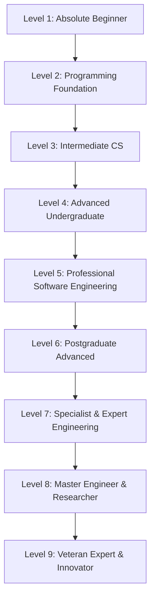

# MASTER ACADEMIC CURRICULUM

## Complete 9-Level Computer Science & Software Engineering Framework

This curriculum defines the full continuum of computing knowledge from absolute beginner (ground zero) through production software engineering, postgraduate foundations, specialist systems design, up to veteran researcher and innovator.

---

## 🧭 Overview of the 9 Progressive Levels

---

## LEVEL 1 — ABSOLUTE BEGINNER: Foundations of Computing
- **Target Audience:** Learners with zero prior programming or computing knowledge.
- **Goal:** Demystify how electronic computers, hardware, logic, and networks operate.
- **Core Modules & Subjects:**
  1. Introduction to Computers & Information Architecture
  2. Computer Hardware & Von Neumann Architecture
  3. Memory and Storage Hierarchy (Registers, Cache, RAM, NVMe)
  4. Number Systems & Data Representation (Binary, Octal, Hex, 2's Complement, Floating Point, Unicode)
  5. Logic Gates, Transistors & Boolean Algebra
  6. Algorithmic Thinking, Flowcharts & Pseudocode
  7. Operating System Concepts for Beginners
  8. Networking Foundations & The Internet Model (Packets, DNS, TCP/IP)
  9. Programming Languages & The Translation Pipeline (Compiler vs Interpreter)
  10. Digital Literacy, Cybersecurity Hygiene & Computing Ethics

---

## LEVEL 2 — PROGRAMMING FOUNDATION: Algorithmic Thinking & Procedural Mastery
- **Target Audience:** Beginners ready to write, trace, and debug independent programs.
- **Goal:** Develop robust problem-solving, structured programming, and foundational computational math.
- **Core Modules & Subjects:**
  1. Computational Logic & Problem Decomposition
  2. C Programming: Variables, Types, Control Flow, Functions, Pointers, Memory Allocation
  3. Python Programming: Scripting, Dynamic Typing, Data Structures, Standard Library
  4. Elementary Discrete Mathematics: Sets, Relations, Functions, Propositional Logic
  5. Foundations of Web Technology: HTML5, CSS3, DOM & JavaScript Basics
  6. Data Persistence Basics: Flat Files, CSV, JSON, and Intro to Relational Tables (SQLite)
  7. Debugging Techniques, Tracing, and Static Analysis
  8. AI Coding Assistants: Capabilities, Hallucination Management & Verification

---

## LEVEL 3 — INTERMEDIATE COMPUTER SCIENCE: Core Undergraduate CS
- **Target Audience:** 2nd-year undergraduate students (BCS, BCA, B.Tech, BESE).
- **Goal:** Core computer science discipline, object-oriented design, algorithmic complexity, and relational databases.
- **Core Modules & Subjects:**
  1. Object-Oriented Programming (Java & C++): Polymorphism, Inheritance, Encapsulation, Generics
  2. Data Structures & Algorithms I: Arrays, Linked Lists, Stacks, Queues, Binary Trees, Heaps
  3. Search & Sorting Algorithms: Analysis, Worst/Average/Best case bounds
  4. Database Management Systems (DBMS): Relational Model, ER Diagrams, Normalization (1NF–BCNF), SQL
  5. Computer Organization & Architecture: MIPS/RISC-V assembly, datapath, pipelining, cache coherence
  6. Operating Systems I: Processes, Threads, CPU Scheduling, Synchronization, Deadlocks
  7. Computer Networks I: Physical, Data Link, Network (IP routing), Transport (TCP/UDP), Application (HTTP/DNS)
  8. Discrete Mathematics & Probability for Computing

---

## LEVEL 4 — ADVANCED UNDERGRADUATE: Engineering Rigor & Systems
- **Target Audience:** 3rd/4th-year undergraduate engineering students.
- **Goal:** Mathematical theory of computation, compiler design, advanced algorithms, and systems engineering.
- **Core Modules & Subjects:**
  1. Data Structures & Algorithms II: Graphs (Dijkstra, Bellman-Ford, MST), Dynamic Programming, Greedy, Disjoint Sets
  2. Complexity Theory: P, NP, NP-Completeness, Reductions
  3. Theory of Computation: Regular Expressions, DFA/NFA, Context-Free Grammars, Pushdown Automata, Turing Machines
  4. Compiler Construction: Lexical Analysis (Flex), Parsing (Bison/LL/LR), Semantic Analysis, Intermediate Representation (LLVM), Code Gen
  5. Advanced Database Systems: Transactions (ACID), Isolation Levels, Concurrency Control (2PL, MVCC), Indexing (B+ Tree, LSM Tree)
  6. Operating Systems II (Internals): Memory Management, Paging, Virtual Memory, Linux VFS, Ext4/ZFS
  7. Software Engineering & SDLC: Agile, Scrum, Requirements Analysis, Testing Methodologies, Static Analysis

---

## LEVEL 5 — PROFESSIONAL SOFTWARE ENGINEERING: Production-Ready Engineering
- **Target Audience:** Graduating engineers, software developers entering industry.
- **Goal:** Build, test, secure, deploy, and maintain large-scale production applications.
- **Core Modules & Subjects:**
  1. Clean Code & Object-Oriented Design Principles (SOLID, GRASP, DRY, KISS)
  2. GoF Design Patterns & Enterprise Architectural Patterns (Repository, Unit of Work, CQRS, Hexagonal)
  3. Full-Stack Web Architecture: Modern Frontend (React/Vue/TS), Backend API Design (REST, gRPC, GraphQL)
  4. Secure Coding & Web Security: OWASP Top 10, Auth0/OAuth2/OIDC, JWT, Zero-Trust
  5. Cloud Engineering: AWS, GCP, Azure fundamentals, Serverless, Object Storage, IAM
  6. DevOps & Infrastructure as Code: Docker containerization, CI/CD pipelines (GitHub Actions), Terraform
  7. Testing at Scale: Unit, Integration, Contract, End-to-End, Performance/Load Testing

---

## LEVEL 6 — POSTGRADUATE ADVANCED: Distributed Systems & Intelligence
- **Target Audience:** Master's students (MCS, MCA, MESE, M.Tech) and senior software engineers.
- **Goal:** Master distributed computing, cloud-native microservices, modern machine learning, and advanced security.
- **Core Modules & Subjects:**
  1. Distributed Systems Fundamentals: CAP Theorem, PACELC, Vector Clocks, Failure Detectors, RPC
  2. Microservices Architecture: Service Meshes, Circuit Breakers, API Gateways, Distributed Tracing
  3. Modern Machine Learning & Deep Learning: Neural Networks, Backpropagation, CNNs, Transformers, LLMs, RAG
  4. Advanced Database Internals: Storage engines, Write-Ahead Logs (WAL), Sharding, Distributed Transactions (2PC, Saga)
  5. Cryptography & Cyber Defense: Public-Key Cryptography (RSA, ECC), Zero-Knowledge Proofs, Post-Quantum Crypto
  6. Cloud-Native Orchestration: Kubernetes internals, Operators, Autoscaling, Network Policies

---

## LEVEL 7 — SPECIALIST & EXPERT ENGINEERING: Scale, Reliability & SRE
- **Target Audience:** Staff / Principal Engineers, Systems Architects.
- **Goal:** Design and operate hyperscale, fault-tolerant, high-concurrency production platforms.
- **Core Modules & Subjects:**
  1. Consensus Algorithms: Raft, Multi-Paxos, Zab, Viewstamped Replication in depth
  2. High-Availability & Disaster Recovery: Multi-region active-active, split-brain mitigation, chaos engineering
  3. Event-Driven Systems & Stream Processing: Kafka internals, Event Sourcing, Apache Flink, Exactly-Once semantics
  4. Database Engine Engineering: Query optimizers, cost-based planning, columnar execution (ClickHouse/DuckDB)
  5. Site Reliability Engineering (SRE): SLI/SLO/SLA, Error Budgets, Observability (OpenTelemetry), Incident Response
  6. MLOps & Frontier Model Serving: vLLM, TensorRT-LLM, KV Cache optimization, distributed inference

---

## LEVEL 8 — MASTER ENGINEER & RESEARCHER: Advanced Systems & Formal Methods
- **Target Audience:** Research scientists, Chief Architects, Ph.D. scholars.
- **Goal:** Conduct original research, rigorous formal verification, and kernel/hardware-level optimization.
- **Core Modules & Subjects:**
  1. Formal Methods & Software Verification: TLA+, Alloy, Dafny, Model Checking, Formal Proof Assistants (Coq/Isabelle)
  2. Linux Kernel Internals & Systems Programming: eBPF, Kernel Modules, IO uring, zero-copy networking (DPDK)
  3. High-Performance Computing & GPU Architecture: CUDA, ROCm, Parallel Reduction, Matrix Multiplication at Silicon Scale
  4. Advanced Distributed Algorithms: Byzantine Fault Tolerance (PBFT, HotStuff), CRDTs (Conflict-free Replicated Data Types)
  5. Frontier AI Safety & Alignment: Mechanistic Interpretability, Red Teaming, Adversarial Robustness
  6. Academic Research Methodology: Writing papers, designing empirical computer experiments, reproducible benchmarks

---

## LEVEL 9 — VETERAN EXPERT & INNOVATOR: Scientific Contributions & Technical Leadership
- **Target Audience:** Distinguished Engineers, Fellows, Technology Leaders, Paradigm Innovators.
- **Goal:** Innovate new computing paradigms, design programming languages, lead global technical strategy.
- **Core Modules & Subjects:**
  1. Programming Language Design & Type Systems: Dependent types, Linear/Affine types, Rust borrow checker theory
  2. Novel Distributed Systems & Global-Scale State Machines
  3. Quantum Computing & Neuromorphic Computing Foundations
  4. Autonomous AI Software Engineering: Multi-agent coordination, self-healing architectures, formal agent boundaries
  5. Technology Strategy & Engineering Governance: Architecture Decision Records (ADRs), Tech Roadmaps, Org Design
  6. Open Research Problems in Computer Science & Long-Term Challenges
