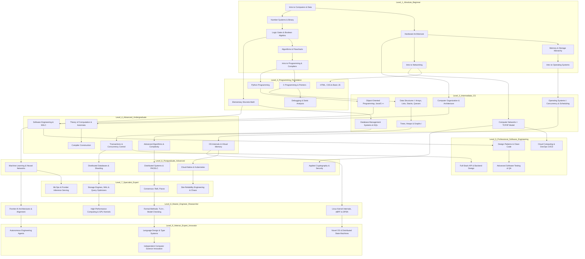

# PREREQUISITE DEPENDENCY GRAPH

This document formalizes the rigorous dependency chain across subjects and modules across the entire 9-level learning library. Under our core teaching principle **"Never assume that the learner already understands a concept unless its prerequisites have been covered"**, this graph guarantees that no advanced concept is introduced without its foundational antecedents.

---

## 🔗 High-Level Progression DAG (Directed Acyclic Graph)

---

## 📋 Prerequisite Verification Checklist by Module

| Module / Topic | Hard Prerequisites | Why this prerequisite is essential |
| :--- | :--- | :--- |
| **Logic Gates & Adders** | Binary Number System | Cannot comprehend how gates add bits without knowing positional base-2 math. |
| **Pointers in C** | Memory & Storage Hierarchy | Pointers are raw RAM addresses; without understanding bytes and physical memory, pointers seem arbitrary. |
| **Linked Lists & Stacks** | Pointers & Dynamic Allocation (`malloc`/`free`) | Implementing node-based dynamic structures requires heap allocation and pointer dereferencing. |
| **B+ Trees & Indexing** | Memory Hierarchy & Binary Trees | B+ trees exist specifically to optimize disk block I/O reads versus CPU RAM latency. |
| **Operating System Concurrency** | CPU Registers, Interrupts, Threads | Race conditions make sense only when understanding how the CPU switches register contexts across clock cycles. |
| **Compiler Parsing (LR/LL)** | Formal Grammars & Automata (DFA/NFA) | Parsers are state machines that consume language tokens generated by regular grammars. |
| **Database ACID & MVCC** | Disk storage, WAL, OS file locking | Multi-Version Concurrency Control relies on timestamping and append-only disk blocks to prevent read locks. |
| **Distributed Consensus (Raft)** | State Machines, Network RPCs, Network Partitions | Raft coordinates replicated state machines across asynchronous networks where messages can drop or reorder. |
| **Formal Methods (TLA+)** | First-Order Predicate Logic, Set Theory, Distributed State Machines | TLA+ mathematically specifies state transitions using temporal logic formulas over sets of variables. |
