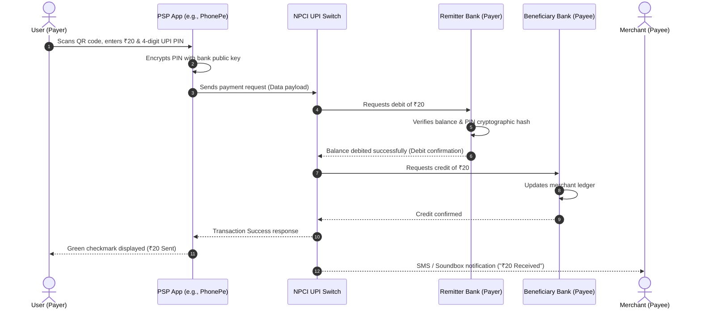

# CHAPTER 01: INTRODUCTION TO COMPUTERS AND DATA

---

## 1. Chapter Introduction
Welcome to your very first step into the world of computing! This chapter answers the most fundamental questions: **What actually is a computer?** How does a physical machine built from metal, silicon, and plastic take a tap on your smartphone screen and instantly transfer money, show a video, or send a message across the globe? We will explore the critical difference between raw **data** and meaningful **information**, understand the **Input-Process-Output (IPO)** cycle, examine the foundational **Von Neumann architecture**, and discover how computers perceive our world through numbers.

---

## 2. Why Should I Learn This?
Everything in modern civilization—from UPI payments at your local grocery store to Instagram reels, autonomous cars, satellite communications, and artificial intelligence—runs on the exact principles covered in this chapter. 
- If you don't understand the boundary between hardware, operating systems, and data, modern software will always feel like "magic" rather than an engineering discipline.
- Understanding the Input-Process-Output cycle and data representation allows you to debug problems effectively, write efficient software, and design reliable systems.
- Every major tech interview and university exam begins by evaluating whether you possess true mechanical sympathy for how computers process information.

---

## 3. Everyday-Life Example
### The Kitchen Recipe & Restaurant Analogy
Imagine you are running a busy restaurant kitchen:
1. **Raw Ingredients (Data):** You have raw tomatoes, uncooked pasta, salt, and water sitting on the shelf. In isolation, a raw tomato is not a meal; it is just an unprocessed item.
2. **The Chef & Cooking Instructions (Processing / CPU & Algorithm):** The chef reads a step-by-step recipe book (the program/code) and uses heat, knives, and pans (the processor) to chop, boil, and season the ingredients.
3. **The Plated Pasta Dish (Information):** The final hot plate of pasta served to the customer is structured, meaningful, and ready to be consumed.
4. **The Pantry Shelf (Storage / Secondary Memory):** Where unused tomatoes and pasta boxes are kept for tomorrow.
5. **The Prep Counter (Working Memory / RAM):** The small cutting board right in front of the chef where only the active ingredients being chopped right now are placed.

A computer behaves identically:
- **Data (Input):** Keystrokes, sensor readings, mouse clicks, camera pixels.
- **Processing (CPU):** Arithmetic calculations and logical comparisons.
- **Information (Output):** A message delivered on WhatsApp, a bank statement, or a rendered video.

---

## 4. Industry Example
### Real-Time Financial Transactions: The UPI (Unified Payments Interface) Flow
When you scan a QR code at a tea stall in India to pay ₹20 via Google Pay, PhonePe, or Paytm, a deterministic computer cycle executes in milliseconds:



1. **Input (Data):** Your finger taps the UPI PIN on the capacitive touchscreen. The screen controller detects a change in electrostatic charge at coordinate $(X=540, Y=1280)$, translates it into an electrical signal, and registers the keypress.
2. **Processing:** The payment app encrypts your PIN using a cryptographic algorithm, packages it with the timestamp, merchant Virtual Payment Address (VPA), and amount, and transmits it via radio waves to the cell tower.
3. **Distributed Processing:** Servers at NPCI (National Payments Corporation of India) route the packet to your bank's core banking server. The server verifies your account ledger in a relational database.
4. **Output (Information):** Your bank deducts ₹20, notifies the merchant's bank, and sends a success status back. Your smartphone screen lights up with a green checkmark, and a soundbox announces: *"Twenty rupees received on PhonePe."*

---

## 5. Prerequisites
**None!** This chapter assumes zero prior experience with programming or computer science. An open mind and curiosity about how technology works are all you need.

---

## 6. Basic Explanation
At its simplest level, a computer is a machine that does four things:
1. **Takes Input:** Accepts raw facts, keystrokes, mouse clicks, audio waves, or sensor values.
2. **Stores Data:** Holds instructions and numbers temporarily in fast memory or permanently on disks.
3. **Processes Data:** Performs mathematical arithmetic (addition, subtraction) and logical comparisons (is A greater than B?).
4. **Gives Output:** Displays text, renders graphics, plays audio, or activates a motor.

### Data vs. Information: What is the Difference?
Many people use the words "data" and "information" interchangeably, but in computer science, they are fundamentally different:

| Feature | Data | Information |
| :--- | :--- | :--- |
| **Definition** | Raw, unorganized, uninterpreted facts or symbols. | Processed, organized, structured data that has context and meaning. |
| **Form** | Unstructured (e.g., numbers, characters, raw pixel values). | Structured (e.g., reports, charts, receipts, status messages). |
| **Context** | Lacks context. Example: `39.5` | Has context. Example: *"Patient body temperature is 39.5°C (High Fever)."* |
| **Usability** | Cannot directly be used for decision making. | Empowers users to make informed decisions. |
| **Computer Stage** | Input to the computer. | Output produced by the computer. |

---

## 7. Detailed Technical Explanation

### 7.1 Digital vs. Analog Systems
The physical world is primarily **analog**—continuous, smooth, and infinite. When you speak, your vocal cords create continuous sound waves of pressure. When you look at sunlight, temperature shifts smoothly without jumps.

Early computing devices attempted to model these continuous values using physical voltages or mechanical gears (Analog Computers). However, analog systems suffer from **noise and signal degradation**: if an electrical wire carrying $2.50\text{ V}$ encounters minor interference and drops to $2.43\text{ V}$, the calculation is permanently corrupted.

**Digital computers** solve this problem by quantizing reality into discrete binary states:
- **High Voltage ($\approx 1.8\text{ V} - 5\text{ V}$):** Binary `1` (True / ON)
- **Low Voltage ($\approx 0\text{ V} - 0.4\text{ V}$):** Binary `0` (False / OFF)

Because a threshold separates `0` and `1`, minor noise (e.g., $1.8\text{ V}$ dropping to $1.6\text{ V}$) is still recognized cleanly as a `1`. This noise immunity is why digital systems dominate modern computing.

### 7.2 The Von Neumann Architecture
In 1945, mathematician and physicist **John von Neumann** published the foundational blueprint that almost all modern computers (laptops, phones, servers) still follow:

```
+-------------------------------------------------------------+
|                     CENTRAL PROCESSING UNIT                 |
|                                                             |
|  +--------------------+             +--------------------+  |
|  |    Control Unit    |             |   Arithmetic Logic |  |
|  |       (CU)         |<----------->|      Unit (ALU)    |  |
|  +--------------------+             +--------------------+  |
|            ^                                  ^             |
|            |         +-------------+          |             |
|            +-------->|  Registers  |<---------+             |
|                      +-------------+                        |
+-----------------------------^-------------------------------+
                              | (System Bus)
                              v
+-------------------------------------------------------------+
|                     MAIN MEMORY (RAM)                       |
|   - Stores both Program Instructions AND Program Data       |
+-------------------------------------------------------------+
            ^                                   ^
            | (Input Bus)                       | (Output Bus)
+-----------------------+           +-------------------------+
|     INPUT DEVICES     |           |     OUTPUT DEVICES      |
| Keyboard, Mouse, Mic  |           | Monitor, Speaker, Motor |
+-----------------------+           +-------------------------+
```

#### Key Von Neumann Principles:
1. **Stored-Program Concept:** Both program instructions (e.g., `ADD R1, R2`) and program data (e.g., the number `20`) share the **same physical memory space** (RAM).
2. **Sequential Instruction Processing:** Instructions are fetched, decoded, and executed one after another in order, controlled by a Program Counter (PC) register.
3. **Components:**
   - **ALU (Arithmetic Logic Unit):** Performs mathematical calculations ($+,-,\times,\div$) and Boolean logic (`AND`, `OR`, `NOT`, comparisons).
   - **Control Unit (CU):** The conductor of the CPU. It fetches instructions from memory, decodes what they mean, and sends electrical control signals to the ALU, registers, and memory.
   - **Registers:** Ultra-fast, tiny internal memory cells located directly inside the CPU core.
   - **Buses:** Bundles of physical micro-wires carrying control signals, memory addresses, and data bits.

#### The Von Neumann Bottleneck:
Because instructions and data must travel across the same shared memory bus between the CPU and RAM, the CPU frequently sits idle waiting for memory transfers. Modern computers mitigate this using multi-level CPU caches (L1, L2, L3).

---

## 8. Important Terminology
- **Computer:** An electronic, programmable machine that ingests raw data, processes it according to stored instructions, and produces meaningful output.
- **Bit (Binary Digit):** The smallest atomic unit of digital information, holding either a `0` or a `1`.
- **Byte:** A contiguous group of 8 bits. Capable of representing $2^8 = 256$ distinct values (e.g., single characters like `'A'`, `'7'`, or `'$'`).
- **Hardware:** The physical, tangible components of a computing system (silicon chips, circuit boards, display panels, cables).
- **Software:** The intangible set of electronic instructions, programs, and procedures that command the hardware what to do.
- **Firmware:** Permanent or semi-permanent low-level software programmed directly into non-volatile read-only memory (ROM/Flash) on hardware chips (e.g., UEFI/BIOS).
- **IPO Cycle:** Input $\rightarrow$ Process $\rightarrow$ Output; the foundational execution lifecycle of all computer operations.
- **Von Neumann Bottleneck:** The throughput limitation caused by the shared data and instruction bus between the CPU and memory.

---

## 9. Diagrams and Illustrations
### The Core Input-Process-Output-Storage (IPOS) Cycle

```
[ INPUT ]           [ PROCESSING ]          [ OUTPUT ]
Keyboard  -----\    +--------------+    /---> Monitor / Screen
Mouse     ------>   |  CPU Core    |   -----> Speaker / Soundbox
Microphone ----/    | ALU + CU     |    \---> Haptic Motor
Sensors   ----/     +--------------+     \--> Network Interface
                           ^
                           | Read / Write
                           v
                    [ STORAGE ]
                    RAM (Temporary)
                    SSD / Flash (Permanent)
```

---

## 10. Step-by-Step Examples

### Example 1.1: Tracing an ATM Cash Withdrawal through IPOS
Let us trace what happens when an ATM dispenses ₹5,000 cash:

- **Step 1 (Input):**
  - User inserts debit card. The card reader reads the EMV chip data (Account Token, Cardholder Name).
  - User enters 4-digit PIN on the encrypted keypad.
  - User selects "Withdrawal" and inputs amount: `5000`.
- **Step 2 (Data in Transit):**
  - The ATM terminal packages this raw data, encrypts it using 3DES/AES hardware encryption modules, and transmits the transaction packet over a secure leased line to the bank's core banking switch.
- **Step 3 (Processing):**
  - Bank server queries the customer account balance:
    $$\text{Account Balance} = ₹12,450$$
  - The ALU performs a logical comparison:
    $$\text{Is } ₹5,000 \le ₹12,450? \implies \textbf{TRUE}$$
  - The ALU checks withdrawal limits:
    $$\text{Daily limit: } ₹20,000; \text{ Already withdrawn today: } ₹0 \implies \textbf{VALID}$$
  - The ALU calculates the new balance:
    $$₹12,450 - ₹5,000 = ₹7,450$$
  - Database commits the debit transaction.
- **Step 4 (Output):**
  - Bank switch returns `STATUS_CODE: 00 (APPROVAL)`.
  - ATM controller activates mechanical stepper motors to count and dispense exactly ten ₹500 currency notes from the safe cassette.
  - Receipt printer prints transaction slip (or sends SMS).
  - Screen displays: *"Please take your cash and card."*

---

## 11. Practical Implementation
Let us write a clean, well-commented Python program to simulate the fundamental Input-Process-Output cycle of a sensor-based Smart Temperature Monitoring and Alert System.

```python
"""
Practical Lab 1.1: Simulation of the Input-Process-Output (IPO) Cycle
File: 11_PROGRAMMING_LAB/level_1/ch01_ipo_simulation.py
Author: Computer Science Master Library
Description: Demonstrates raw data acquisition, conversion, logical
             and arithmetic processing, and human-readable information output.
"""

from typing import Dict, Any


def ingest_raw_sensor_data(sensor_voltage: float) -> float:
    """
    INPUT STAGE:
    Simulates analog-to-digital sensor voltage conversion.
    A temperature sensor outputs 0.0V to 3.3V representing -20°C to +80°C.
    """
    # Linear interpolation formula: Temp = (Voltage / 3.3) * (80 - (-20)) + (-20)
    calculated_temp_celsius = (sensor_voltage / 3.3) * 100.0 - 20.0
    return round(calculated_temp_celsius, 2)


def process_temperature(temp_celsius: float) -> Dict[str, Any]:
    """
    PROCESSING STAGE:
    Applies business logic and arithmetic conversion to raw data.
    Transforms raw temperature into categorized information.
    """
    # Arithmetic: Convert Celsius to Fahrenheit
    # Formula: F = (C * 9/5) + 32
    temp_fahrenheit = round((temp_celsius * 9.0 / 5.0) + 32.0, 2)

    # Logical processing: State categorization
    if temp_celsius < 0.0:
        status = "FREEZING_WARNING"
        action_required = "Activate heating elements immediately."
    elif 0.0 <= temp_celsius <= 37.5:
        status = "NORMAL_OPTIMAL"
        action_required = "Maintain standard ventilation."
    elif 37.5 < temp_celsius <= 50.0:
        status = "ELEVATED_TEMPERATURE"
        action_required = "Activate secondary cooling fans."
    else:
        status = "CRITICAL_OVERHEAT"
        action_required = "Emergency shutdown triggered to protect equipment."

    # Return structured information dictionary
    return {
        "celsius": temp_celsius,
        "fahrenheit": temp_fahrenheit,
        "status": status,
        "action": action_required,
    }


def output_alert(info: Dict[str, Any]) -> None:
    """
    OUTPUT STAGE:
    Presents structured information to human operators or downstream systems.
    """
    print("=" * 60)
    print("        SERVER ROOM TELEMETRY MONITORING REPORT")
    print("=" * 60)
    print(f"Recorded Temperature : {info['celsius']} °C ({info['fahrenheit']} °F)")
    print(f"Operational Status   : {info['status']}")
    print(f"Required Protocol    : {info['action']}")
    print("=" * 60 + "\n")


if __name__ == "__main__":
    # Test 1: Normal operating conditions (voltage 1.65V -> ~30°C)
    raw_reading_1 = 1.65
    temp_1 = ingest_raw_sensor_data(raw_reading_1)
    report_1 = process_temperature(temp_1)
    output_alert(report_1)

    # Test 2: Overheat emergency (voltage 2.80V -> ~64.85°C)
    raw_reading_2 = 2.80
    temp_2 = ingest_raw_sensor_data(raw_reading_2)
    report_2 = process_temperature(temp_2)
    output_alert(report_2)
```

---

## 12. Industry Implementation
### How High-Performance Systems Handle Data Ingestion at Scale
In modern engineering enterprises (e.g., Uber, Amazon, Netflix), the IPO cycle is scaled horizontally across thousands of distributed server nodes:
- **Input at Scale (Ingestion Layer):** When millions of smartphones transmit GPS coordinates to Uber simultaneously, a single server would crash. Companies use distributed message queues like **Apache Kafka** or **AWS Kinesis** to ingest millions of incoming data events per second without dropping packets.
- **Processing at Scale (Compute Layer):** Stream processing engines (such as **Apache Flink** or **Spark Streaming**) compute distance, estimated time of arrival (ETA), and surge pricing dynamically across clusters of multicore CPUs.
- **Storage Layer:** High-speed in-memory caches like **Redis** keep the active driver locations readily accessible in RAM, while persistent databases like **ScyllaDB** or **PostgreSQL** record historical trip logs.
- **Output Layer:** Push notification gateways (Apple APNs, Google FCM) broadcast driver location updates back to riders' screens at 1-second intervals.

---

## 13. Advantages and Limitations
### Advantages of Digital Computing
1. **Speed:** Electronic pulses travel through silicon at near the speed of light. Modern CPUs execute billions of operations per second ($>3\text{ GHz}$).
2. **Deterministic Accuracy:** Given identical input and identical code, a digital computer produces the exact same output every single time without human fatigue.
3. **Versatility & Programmability:** The same physical laptop can calculate taxes, render a 3D video game, write poetry, or simulate rocket trajectories simply by loading different software.
4. **Massive Storage Capacity:** Billions of books can be preserved in a tiny fingernail-sized microSD card.

### Limitations of Computers
1. **Zero Intrinsic Common Sense (GIGO Principle):** *Garbage In, Garbage Out*. If a programmer writes a flawed equation or provides incorrect data, the computer will faithfully compute the wrong answer at lightning speed.
2. **Physical Latency & Thermal Dissipation:** Moving electrons generates heat. Overheating causes silicon gates to fail or throttle, capping clock frequencies.
3. **Power Dependency:** Digital electronics require continuous, regulated electrical voltage. Power cuts without battery/UPS backing halt operations immediately.
4. **Vulnerability to Malicious Modification:** Because computers follow software instructions unquestioningly, malicious software (malware) can hijack computer resources.

---

## 14. Common Mistakes
1. **Confusing Data with Information:** Stating that a spreadsheet of 10,000 unindexed transaction rows is "information". It is raw data until filtered, summarized, or visualized into insights.
2. **Assuming Computers Think Like Humans:** Believing a computer "understands" English or "knows" what an image is. A computer only manipulates binary electrical states (`0`s and `1`s). When an AI displays an English word, it is mathematically selecting numbers from a statistical probability distribution.
3. **Believing Digital Means "Exact in Every Way":** Believing digital numbers can represent infinite numbers precisely. Because computer memory is finite (e.g., 32-bit or 64-bit floating point numbers), numbers like $\frac{1}{3}$ or $0.1$ have slight rounding errors.
4. **Neglecting the Von Neumann Bottleneck:** Assuming that buying a faster CPU will automatically double application speed. If the program frequently fetches data from slow RAM or disks, the CPU core spends most of its cycles waiting (Memory Bound).

---

## 15. AI Connection
### Deterministic Computing vs. Probabilistic AI Models
In traditional computing, software is **deterministic**:
$$\text{Input } X + \text{Rule } Y \implies \text{Fixed Output } Z$$
If you write `print(2 + 2)`, Python will always output `4`.

In Artificial Intelligence and Machine Learning (e.g., ChatGPT, Claude, Computer Vision):
- The paradigm flips: You provide massive amounts of **Input Data** and **Desired Outputs**, and the computer uses statistical algorithms to discover the underlying mathematical weights (**The Model**).
- Modern AI is **probabilistic**: It computes the probability distribution of what the next word, pixel, or decision should be:
  $$P(w_{t} \mid w_{1}, w_{2}, \dots, w_{t-1})$$
- AI systems still run on Von Neumann hardware and GPUs, executing billions of standard matrix multiplications ($A \times B + C$) using standard binary logic gates!

---

## 16. AI Future Insights
- **Established Technology:** Large Language Models (LLMs) and neural networks execute automated document processing, speech recognition, and basic coding assistance on standard server clusters.
- **Emerging Technology:** Neuromorphic computing chips (e.g., Intel Loihi) attempt to depart from Von Neumann architecture by mimicking biological neurons, combining processing and memory in the same physical cell to bypass the Von Neumann bottleneck.
- **Reasonable Future Projection:** AI-optimized hardware accelerators (NPUs—Neural Processing Units) will become standard components on all commodity microprocessors, executing local AI inferences directly inside smartphones and IoT sensors without cloud connectivity.
- **Speculative Possibility:** Self-synthesizing computing architectures, where AI algorithms dynamically reconfigure field-programmable silicon gates (FPGAs) in real time to match the exact mathematical topology of running software.

---

## 17. Career Relevance
Understanding computer fundamentals is mandatory across every technology role:
- **Software Engineers:** Must know how memory and CPU cycles interact to write efficient, responsive code that does not waste battery or cloud compute budget.
- **Systems Architects & DevOps Engineers:** Must understand hardware constraints, networking bottlenecks, and the IPO lifecycle to deploy scalable cloud clusters.
- **Cybersecurity Analysts:** Exploit buffers, registers, and memory boundaries. You cannot protect or penetrate a system whose fundamental architecture you do not grasp.
- **Data Engineers:** Build pipelines that convert millions of raw data inputs into clean, queryable information for enterprise analytics.

---

## 18. Interview Preparation

### Category A: Beginner / Fresher Level

#### Q1: What is the difference between computer hardware and software?
- **Interviewer Evaluation:** Evaluates basic conceptual understanding and ability to articulate definitions clearly.
- **Simple Explanation:** Hardware is the physical body of the computer that you can touch (screen, chips, keyboard); software is the mind or thoughts (programs, apps) that tell the body what to do.
- **Technical Answer:** Hardware comprises the physical electronic, magnetic, and mechanical components of a system (CPU, RAM, Motherboard, PCIe buses). Software is the intangible collection of stored instructions, routines, and data written in machine-readable programming languages that direct the hardware to perform specific tasks. Hardware cannot operate without software; software cannot execute without hardware.
- **Common Wrong Answer:** Saying "Hardware is permanent, software is temporary." (False: Firmware is hardware-embedded software).

#### Q2: What is the Von Neumann architecture, and what is its primary bottleneck?
- **Interviewer Evaluation:** Checks understanding of core computer design and historical engineering trade-offs.
- **Simple Explanation:** It is the classic blueprint where instructions and data live in the same memory pool. The bottleneck is the narrow "highway" (bus) connecting the CPU to memory, forcing the fast CPU to wait for slow memory.
- **Technical Answer:** Introduced by John von Neumann in 1945, this architecture specifies a processing unit containing an ALU and registers, a Control Unit, external memory holding both program code and data, and secondary storage and I/O mechanisms. The **Von Neumann Bottleneck** occurs because a single shared system bus connects the CPU and memory. Since memory access is significantly slower than CPU clock cycles, the CPU spends idle cycles waiting for instructions and data to be fetched over the bus.

---

## 19. Practice Questions

### Multiple-Choice Questions (MCQs)
1. Which of the following represents unprocessed raw facts and symbols?
   - A) Information
   - B) Data
   - C) Firmware
   - D) Knowledge
   *(Answer: B)*

2. In the Von Neumann architecture, which component is directly responsible for decoding instructions and coordinating the other units?
   - A) Arithmetic Logic Unit (ALU)
   - B) Control Unit (CU)
   - C) Solid State Drive (SSD)
   - D) Direct Memory Access (DMA)
   *(Answer: B)*

3. Why are modern computers designed to be digital rather than analog?
   - A) Analog components are more expensive to manufacture.
   - B) Digital systems are far more resistant to electrical noise and signal degradation.
   - C) Analog computers cannot do multiplication.
   - D) Digital computers require no electricity.
   *(Answer: B)*

### Short Answer Questions
1. Define the Input-Process-Output (IPO) cycle with an example from an e-commerce checkout.
2. Differentiate between volatile and non-volatile computer memory.
3. State the primary difference between a bit and a byte.

### Long Answer Questions
1. Draw a neat, labeled schematic of the Von Neumann computer architecture. Describe the function of the ALU, Control Unit, Registers, Memory, and System Buses.
2. Explain the journey of a transaction from raw data input to processed information in a modern banking system, highlighting where validation, processing, and output occur.

---

## 20. Solved Examples
### Problem 20.1: Calculating Data Transfer Times
**Question:** An automated industrial weather station records 64 bytes of sensor data once every second.
1. How many bytes of data are recorded in a full 24-hour day?
2. If this daily data is transmitted across an internet connection with a bandwidth of 512 kilobits per second (kbps), how many seconds will the upload take?

**Step-by-Step Solution:**
1. **Calculate total bytes per day:**
   $$\text{Seconds in a day} = 24 \times 60 \times 60 = 86,400\text{ seconds}$$
   $$\text{Total Bytes} = 86,400\text{ s} \times 64\text{ bytes/s} = 5,529,600\text{ bytes}$$
   $$\text{Total in Megabytes (MB)} = \frac{5,529,600}{1024 \times 1024} \approx 5.273\text{ MB}$$

2. **Calculate upload time:**
   - Network bandwidth is given in **bits**, not bytes ($1\text{ byte} = 8\text{ bits}$).
   $$\text{Total Bits} = 5,529,600\text{ bytes} \times 8\text{ bits/byte} = 44,236,800\text{ bits}$$
   $$\text{Bandwidth} = 512\text{ kbps} = 512 \times 1,000 = 512,000\text{ bits per second}$$
   $$\text{Transmission Time} = \frac{\text{Total Bits}}{\text{Bandwidth}} = \frac{44,236,800}{512,000} \approx 86.4\text{ seconds}$$
   **Final Answer:** The daily data size is $5,529,600\text{ bytes}$ (~$5.27\text{ MB}$), and transmission takes approximately $86.4\text{ seconds}$ at $512\text{ kbps}$.

---

## 21. Unsolved Exercises
1. **Exercise 1.1:** Write a step-by-step IPOS breakdown for how a barcode scanner at a supermarket billing counter scans a packet of biscuits and updates inventory.
2. **Exercise 1.2:** A security camera captures 30 frames per second. Each uncompressed color image frame takes 2 Megabytes of data.
   - Calculate how many gigabytes of raw data 1 hour of recording produces.
   - Why do real-world cameras use compression software before storing video data?
3. **Exercise 1.3:** Modify the Python script in Section 11 to include a new input sensor reading (Humidity percentage) and add logic that sounds an alert if temperature exceeds 40°C AND humidity exceeds 85%.

---

## 22. Chapter Summary
- A computer is an electronic, programmable device that ingests data, stores it, processes it via algorithmic instructions, and outputs meaningful information.
- **Data** is raw, unorganized facts; **Information** is data that has been cleaned, structured, and presented in a meaningful context.
- The **Input-Process-Output-Storage (IPOS)** cycle is the foundational paradigm of all computing systems.
- Modern computers are digital because discrete binary voltage levels (`0` and `1`) provide superior noise immunity and reliability compared to continuous analog signals.
- The **Von Neumann Architecture** introduced the revolutionary concept of storing both program code and program data in the same unified memory space.
- The **Von Neumann Bottleneck** refers to the latency constraint imposed by the shared data bus between the CPU and main memory, a problem mitigated in modern processors by multi-level caches.

---

## 23. Revision Sheet
- **Formula 1 (Bytes to Bits):** $\text{Bits} = \text{Bytes} \times 8$
- **Formula 2 (Transmission Time):** $\text{Time (seconds)} = \frac{\text{Data Size in Bits}}{\text{Network Bandwidth in bps}}$
- **Binary Levels:** High Voltage $\rightarrow 1$; Low Voltage $\rightarrow 0$.
- **Von Neumann Components:**
  - $CU$ = Control Unit (coordinates execution, fetches & decodes instructions)
  - $ALU$ = Arithmetic Logic Unit (computes math and Boolean comparisons)
  - $Registers$ = High-speed temporary storage cells inside the CPU core
  - $RAM$ = Volatile primary memory holding active programs and data
  - $Buses$ = Address Bus, Data Bus, Control Bus

---

## 24. References
1. **Stallings, William.** *Computer Organization and Architecture: Designing for Performance.* 11th Edition, Pearson, 2018. Chapter 1: "Introduction" and Chapter 3: "A Top-Level View of Computer Function and Interconnection."
2. **Patterson, David A., and John L. Hennessy.** *Computer Organization and Design: The Hardware/Software Interface.* RISC-V Edition, Morgan Kaufmann, 2017. Chapter 1: "Computer Abstractions and Technology."
3. **Petzold, Charles.** *Code: The Hidden Language of Computer Hardware and Software.* 2nd Edition, Microsoft Press, 2022. Chapters 1–8.
4. **Von Neumann, John.** *"First Draft of a Report on the EDVAC."* Moore School of Electrical Engineering, University of Pennsylvania, 1945. (Historical Foundation).
