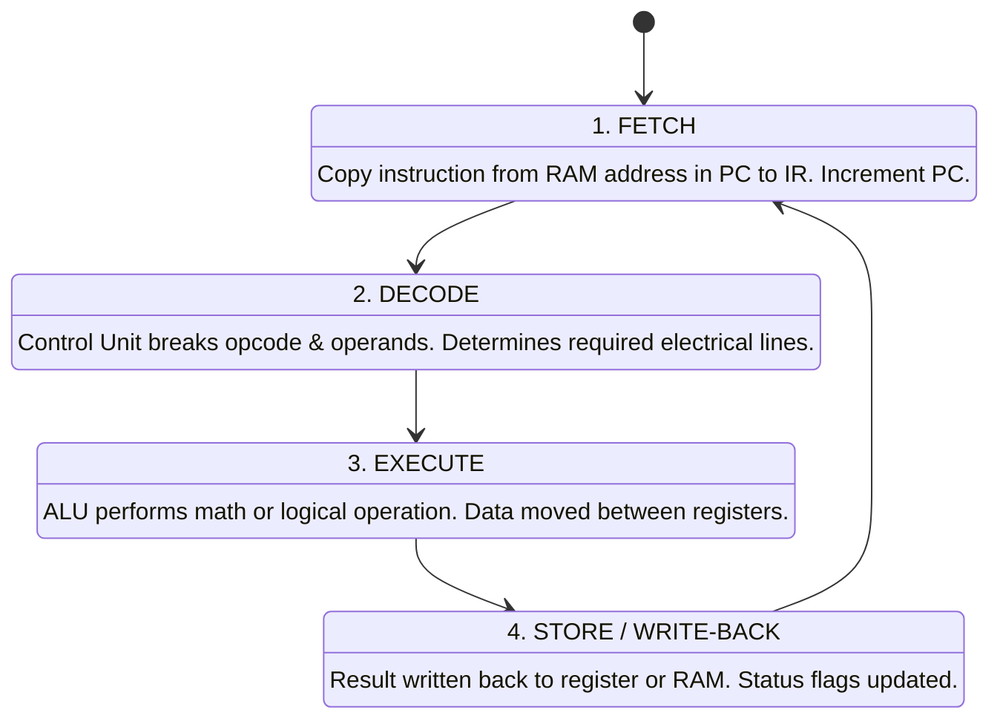

# CHAPTER 02: HOW COMPUTER HARDWARE WORKS

---

## 1. Chapter Introduction
In Chapter 1, we learned that a computer follows the Input-Process-Output cycle. Now, we dive beneath the plastic, glass, and aluminum casing into the physical machine itself. **How does silicon—essentially purified sand—execute billions of calculations every second?** 

This chapter breaks down the core physical components of modern computers: the **Central Processing Unit (CPU)**, the **Fetch-Decode-Execute machine cycle**, the **Motherboard**, system buses, clock speed, and the differences between 32-bit and 64-bit systems. We will also discover why modern AI relies so heavily on **Graphics Processing Units (GPUs)** rather than traditional CPUs.

---

## 2. Why Should I Learn This?
- **Mechanical Sympathy:** The best software engineers understand the physical machine their code executes on. Code that respects CPU cache lines and pipelining can run 10x to 100x faster than naive code.
- **Hardware Selection & Cloud Cost Optimization:** When deploying applications to AWS, GCP, or Azure, you must pick instances based on vCPUs, memory channels, and GPU accelerators. Misunderstanding hardware leads to massive wasted cloud expenditures.
- **Troubleshooting & Diagnostics:** Diagnosing thermal throttling, kernel panics, and out-of-memory errors requires solid hardware knowledge.

---

## 3. Everyday-Life Example
### The Orchestra Conductor & Workshop Analogy
Imagine a high-speed woodworking workshop:
1. **The Head Craftsman (ALU):** The person holding the saws, chisels, and measuring tape. They do the actual physical work—cutting wood ($+$) or measuring if board A equals board B (`==`).
2. **The Workshop Supervisor (Control Unit - CU):** The supervisor doesn't cut wood. Instead, they read the job sheet, coordinate workers, and shout: *"Fetch board #4! Pass it to the saw! Put the finished chair in the truck!"*
3. **The Tool Belt (Registers):** The craftsman's pockets. They only hold two nails and a pencil right now. Ultra-accessible, zero walking required, but holds almost nothing.
4. **The Metronome / Master Clock (CPU Clock):** A ticking metronome on the wall. Every time it clicks, every worker takes exactly one step. If the metronome ticks faster (overclocking), work gets done faster, but everyone sweats more and produces more heat (thermal dissipation).
5. **The Hallways (System Buses):** Conveyor belts connecting the tool shed (RAM) to the craftsman's table (CPU).

---

## 4. Industry Example
### Smartphone System-on-Chip (SoC): Apple Silicon (A-Series/M-Series) vs. Qualcomm Snapdragon
Inside your smartphone, there is no bulky motherboard with loose cables. Instead, engineers use a **System-on-Chip (SoC)**, where the CPU, GPU, Neural Engine, RAM, and 5G modem are manufactured onto a single microscopic piece of silicon:

```mermaid
graph TD
    subgraph Modern_Mobile_SoC [Modern Smartphone SoC e.g., Apple A17 / Snapdragon 8 Gen 3]
        CPU_P[High-Performance CPU Cores]
        CPU_E[High-Efficiency CPU Cores]
        GPU[Multi-Core Mobile GPU]
        NPU[Neural Processing Unit / AI Accelerator]
        ISP[Image Signal Processor - Camera]
        RAM_Unified[Unified High-Bandwidth LPDDR5X RAM]
    end

    Camera[Camera Sensor] --> ISP
    ISP --> RAM_Unified
    RAM_Unified <--> CPU_P
    RAM_Unified <--> GPU
    RAM_Unified <--> NPU
    Display[120Hz OLED Display] <-- GPU
```

When you shoot a 4K 60fps HDR video on your phone:
1. The **Image Signal Processor (ISP)** ingests millions of raw sensor pixels per millisecond, adjusting white balance and denoising.
2. The **NPU (Neural Engine)** runs a deep-learning algorithm to identify human faces and blur the background in real-time (Portrait Video).
3. The **GPU** renders the live preview onto the 120Hz OLED screen.
4. The **High-Efficiency CPU cores** compress the audio stream while consuming minimal battery power.
Because everything is integrated onto a single silicon die with **Unified Memory**, data never has to travel across slow external motherboard wires!

---

## 5. Prerequisites
- Completion of **Chapter 01: Introduction to Computers and Data** (understanding the Von Neumann concept and IPO cycle).

---

## 6. Basic Explanation
The computer's physical body consists of several primary components working in harmony:
- **CPU (Central Processing Unit):** The "brain" that executes instructions.
- **ALU (Arithmetic Logic Unit):** The calculation engine inside the CPU.
- **CU (Control Unit):** The coordinator inside the CPU that directs electrical traffic.
- **Registers:** The fastest memory on Earth, located directly inside the CPU core.
- **Motherboard:** The main circuit board with microscopic printed copper wires connecting all chips together.
- **System Bus:** The electronic highways (data bus, address bus, control bus) that carry bits between chips.
- **Clock Generator:** A tiny quartz crystal that vibrates millions or billions of times per second to synchronize all operations.

---

## 7. Detailed Technical Explanation

### 7.1 The Anatomy of the CPU Core
A modern CPU core contains three foundational functional blocks:

```
+-------------------------------------------------------------+
|                        CPU CORE                             |
|                                                             |
|  +-------------------------------------------------------+  |
|  |                 CONTROL UNIT (CU)                     |  |
|  |  - Instruction Register (IR): Holds current opcode    |  |
|  |  - Program Counter (PC): Holds address of next instr  |  |
|  |  - Instruction Decoder: Decodes binary into signals   |  |
|  +-------------------------------------------------------+  |
|                             | Signals                       |
|                             v                               |
|  +-------------------------------------------------------+  |
|  |              ARITHMETIC LOGIC UNIT (ALU)              |  |
|  |  - Hardware Adders / Multipliers                      |  |
|  |  - Logic Gates (AND, OR, XOR, Bitwise Shifters)       |  |
|  |  - Status Flags Register (Zero, Carry, Overflow, Sign)|  |
|  +-------------------------------------------------------+  |
|                             ^                               |
|                             | Read / Write                  |
|                             v                               |
|  +-------------------------------------------------------+  |
|  |                REGISTER FILE (REGISTERS)              |  |
|  |  - General Purpose Registers (e.g., RAX, RBX, RCX...) |  |
|  |  - Accumulator (ACC)                                  |  |
|  |  - Stack Pointer (SP) & Base Pointer (BP)             |  |
|  +-------------------------------------------------------+  |
+-------------------------------------------------------------+
```

### 7.2 The Machine Instruction Cycle (Fetch-Decode-Execute)
Every single program you have ever run—from a Python script to a 3D video game—is broken down by compilers into elementary machine instructions that execute across a continuous four-stage loop:



1. **FETCH:** The Control Unit checks the **Program Counter (PC)** register to see where the next instruction lives in RAM. It places that address onto the **Address Bus**, signals a `READ` on the **Control Bus**, and RAM returns the binary instruction over the **Data Bus**. The instruction is stored in the **Instruction Register (IR)**. The PC is then automatically incremented to point to the next instruction.
2. **DECODE:** The Instruction Decoder analyzes the bits in the IR. For example, the byte `0x01` might mean `ADD`, followed by register identifiers `R1` and `R2`. The CU activates the specific logic circuits inside the ALU required for addition.
3. **EXECUTE:** The ALU reads the values from registers `R1` and `R2`, executes the addition at the electrical gate level, and produces the sum.
4. **STORE (Write-back):** The result is saved into the destination register (or written back to RAM if specified), and the **Flags Register** is updated (e.g., Zero flag set to `1` if result is 0).

### 7.3 CPU Clock, Hertz, and Thermal Throttling
Inside the computer sits a tiny piezoelectric **quartz crystal oscillator**. When an electrical voltage is applied, it vibrates at an ultra-precise frequency:
- $1\text{ Hertz (Hz)} = 1\text{ cycle per second}$
- $1\text{ Megahertz (MHz)} = 1,000,000\text{ cycles per second}$
- $1\text{ Gigahertz (GHz)} = 1,000,000,000\text{ cycles per second}$

If a CPU runs at $3.5\text{ GHz}$, its internal clock ticks **3.5 billion times every single second**. Each tick allows electrons to advance through one stage of logic circuits.

#### Why can't we easily build a 100 GHz CPU?
- **Dynamic Power Dissipation Equation:**
  $$P = C \times V^2 \times f$$
  Where:
  - $P$ is Power dissipated as heat (Watts)
  - $C$ is Capacitance of the silicon transistors
  - $V$ is Operating Voltage
  - $f$ is Clock Frequency
- If you double frequency $f$, heat doubles. If you increase voltage $V$ to stabilize fast switching, heat quadruples!
- At around $4.0 - 5.5\text{ GHz}$, silicon chips become so hot that standard cooling cannot remove heat fast enough. This physical boundary is called the **Power Wall**.
- **Thermal Throttling:** When CPU internal sensors detect temperatures nearing dangerous thresholds ($\approx 95^\circ\text{C}-105^\circ\text{C}$), the CPU automatically drops its clock frequency (e.g., from $4.2\text{ GHz}$ down to $1.8\text{ GHz}$) to avoid melting the silicon. This is why your laptop slows down when gaming or rendering video on a hot day!

### 7.4 32-Bit vs. 64-Bit Architectures
What does it mean when an operating system or processor is labeled "64-bit"?
1. **Register Width:** A 64-bit CPU has registers that are 64 bits wide ($8\text{ bytes}$). It can manipulate numbers up to $2^{64} - 1 \approx 18.4\text{ quintillion}$ in a single clock cycle.
2. **Memory Address Bus Width:** The width of the address bus determines the maximum amount of physical RAM the CPU can directly address:
   - **32-Bit Limit:**
     $$\text{Max Addressable Bytes} = 2^{32} = 4,294,967,296\text{ bytes} = 4\text{ Gigabytes (GB)}$$
     A 32-bit computer cannot address more than 4 GB of RAM, regardless of how much physical memory you install!
   - **64-Bit Limit:**
     $$\text{Max Addressable Bytes} = 2^{64} \approx 18.4\text{ Exabytes (EB)} = 18.4\text{ billion GB}$$
     Practically unlimited for consumer and modern enterprise computing.

### 7.5 CPU vs. GPU: Latency vs. Throughput
Why did artificial intelligence and deep learning explode only after engineers started using Graphics Processing Units (GPUs)?

```
+-----------------------------------+     +-----------------------------------+
|               CPU                 |     |               GPU                 |
|  +--------+ +--------+ +--------+ |     | [][][][][][][][][][][][][][][][]  |
|  | Core 1 | | Core 2 | | Core 3 | |     | [][][][][][][][][][][][][][][][]  |
|  +--------+ +--------+ +--------+ |     | [][][][][][][][][][][][][][][][]  |
|  +------------------------------+ |     | [][][][][][][][][][][][][][][][]  |
|  |     Large L3 Cache & CU      | |     |   Thousands of Small Cores        |
|  +------------------------------+ |     |   Massive Parallel Throughput     |
+-----------------------------------+     +-----------------------------------+
  Optimized for LOW LATENCY                 Optimized for HIGH THROUGHPUT
  (1 complex task very quickly)             (10,000 simple tasks simultaneously)
```

- **CPU (Central Processing Unit):**
  - Contains **4 to 64 large, powerful cores**.
  - Optimized for **low latency**: Excels at sequential, complex logic, branching (`if-else`), and running operating systems.
- **GPU (Graphics Processing Unit):**
  - Contains **thousands of small, specialized ALU cores** (e.g., 16,384 cores on an NVIDIA RTX 4090).
  - Optimized for **high throughput**: Excels at parallel linear algebra—multiplying massive matrices of numbers simultaneously.
  - Since rendering 3D graphics (millions of screen pixels) and training neural networks (multiplying matrix weights) require the exact same math, GPUs are the undisputed engine of the AI revolution.

---

## 8. Important Terminology
- **CPU (Central Processing Unit):** The primary electronic circuitry that executes machine instructions.
- **ALU (Arithmetic Logic Unit):** CPU subsystem that executes arithmetic and bitwise logic operations.
- **Control Unit (CU):** CPU subsystem that orchestrates instruction fetching, decoding, and execution control signals.
- **Program Counter (PC):** Special register holding the memory address of the next instruction to be fetched.
- **Instruction Register (IR):** Special register holding the currently executing binary instruction.
- **Accumulator (ACC):** Register used for storing intermediate arithmetic and logic results.
- **System Bus:** Three-part physical communication channel:
  - **Data Bus:** Bidirectional wires carrying actual data bytes.
  - **Address Bus:** Unidirectional wires carrying memory addresses from CPU to RAM.
  - **Control Bus:** Wires carrying operational timing signals (`READ`, `WRITE`, `INTERRUPT`, `RESET`).
- **Clock Cycle:** The time elapsed between two consecutive pulses of the oscillator ($\text{Period } T = \frac{1}{f}$).
- **Thermal Throttling:** Automatic hardware frequency reduction triggered by excessive core temperatures.
- **GPU:** Graphics Processing Unit designed for massively parallel floating-point computations.
- **SoC (System-on-Chip):** An integrated circuit packaging CPU, GPU, memory controller, and wireless radios on a single chip.

---

## 9. Diagrams and Illustrations
### The System Bus Architecture Connecting CPU, Memory, and I/O

```
+---------------------------------------------------------------+
|                             CPU                               |
+---------------------------------------------------------------+
       | Control Signals        | Address Bits        | Data Bits
       v                        v                     v
================================================================= CONTROL BUS
================================================================= ADDRESS BUS
================================================================= DATA BUS
       ^                        ^                     ^
       | Control Signals        | Address Bits        | Data Bits
+--------------------+   +--------------------+   +-------------+
|    MAIN MEMORY     |   |  STORAGE (SSD/HDD) |   |  KEYBOARD/  |
|       (RAM)        |   |    CONTROLLER      |   |  DISPLAYS   |
+--------------------+   +--------------------+   +-------------+
```

---

## 10. Step-by-Step Examples
### Example 2.1: Hand-Tracing a Machine Instruction Cycle
Suppose our CPU has two registers (`R1`, `ACC`) and is about to execute this simple assembly instruction located at RAM address `0x1000`:
$$\texttt{ADD R1} \quad (\text{Binary opcode: } \texttt{0x2A})$$
Assume:
- $\text{Program Counter (PC)} = \texttt{0x1000}$
- $\text{Register } R1 = 15$
- $\text{Accumulator (ACC)} = 25$

Let us trace each step across the hardware:
1. **Clock Cycle 1 (Fetch Phase):**
   - CU copies contents of PC (`0x1000`) onto the Address Bus.
   - CU asserts the `MEMORY_READ` signal on the Control Bus.
   - RAM locates cell `0x1000` and places its content (`0x2A` — the opcode for `ADD R1`) onto the Data Bus.
   - CU latches the data into the Instruction Register (IR).
   - CU increments Program Counter: $\text{PC} \leftarrow \texttt{0x1001}$.
2. **Clock Cycle 2 (Decode Phase):**
   - The Instruction Decoder reads `0x2A`.
   - It decodes that this operation requires the ALU to add the contents of register `R1` to the `Accumulator (ACC)`.
   - Electrical control lines to the ALU's addition circuit are energized.
3. **Clock Cycle 3 (Execute Phase):**
   - ALU reads value $15$ from $R1$ and value $25$ from $ACC$.
   - The adder logic gates compute: $15 + 25 = 40$.
4. **Clock Cycle 4 (Store / Write-back Phase):**
   - The result ($40$) is stored into the Accumulator register: $\text{ACC} \leftarrow 40$.
   - Since $40 \ne 0$, the Zero flag remains `0`. Since no overflow occurred, Carry flag remains `0`.
   - The cycle finishes, and the CPU is ready to fetch the next instruction at `0x1001`.

---

## 11. Practical Implementation
Let us implement an educational **4-Bit Accumulator CPU Simulator in Python**. This interactive code models registers, the Program Counter, an Instruction Register, an ALU, and the Fetch-Decode-Execute cycle in software.

```python
"""
Practical Lab 1.2: 4-Bit Accumulator Machine CPU Simulator
File: 11_PROGRAMMING_LAB/level_1/cpu_simulator.py
Author: Computer Science Master Library
Description: Simulates the Von Neumann Fetch-Decode-Execute machine cycle,
             demonstrating registers (PC, IR, ACC) and ALU operations.
"""

from typing import List, Dict


class EducationalCPU:

    def __init__(self, memory_size: int = 16):
        # RAM: Array of 16 memory cells (holds instructions and data)
        self.memory: List[int] = [0] * memory_size

        # Internal Registers
        self.pc: int = 0  # Program Counter: points to next instruction
        self.ir: int = 0  # Instruction Register: holds current instruction
        self.acc: int = 0  # Accumulator: holds results of ALU operations
        self.halted: bool = False

        # Instruction Set Architecture (ISA) Opcode Mapping
        # High nibble (bits 7-4) = Opcode; Low nibble (bits 3-0) = Operand
        self.OPCODES = {
            1: "LOAD",  # Load value from memory address into ACC
            2: "STORE",  # Store value in ACC into memory address
            3: "ADD",  # Add value at memory address to ACC
            4: "SUB",  # Subtract value at memory address from ACC
            5: "PRINT",  # Print current ACC value
            0: "HALT",  # Stop execution
        }

    def load_program(self, program: List[int], start_address: int = 0) -> None:
        """Loads machine code instructions into simulated RAM."""
        for i, instruction in enumerate(program):
            self.memory[start_address + i] = instruction

    def step(self) -> None:
        """Executes one single Fetch-Decode-Execute machine cycle."""
        if self.halted:
            return

        # 1. FETCH STAGE
        self.ir = self.memory[self.pc]
        current_pc = self.pc
        self.pc += 1  # Increment PC

        # 2. DECODE STAGE
        opcode = (self.ir >> 4) & 0x0F  # Top 4 bits
        operand = self.ir & 0x0F  # Bottom 4 bits
        operation = self.OPCODES.get(opcode, "UNKNOWN")

        # 3. EXECUTE & STORE STAGE
        if operation == "LOAD":
            self.acc = self.memory[operand]
            print(
                f"[Cycle @ PC={current_pc}] LOAD: ACC <- Memory[{operand}] ({self.acc})"
            )
        elif operation == "STORE":
            self.memory[operand] = self.acc
            print(
                f"[Cycle @ PC={current_pc}] STORE: Memory[{operand}] <- ACC ({self.acc})"
            )
        elif operation == "ADD":
            operand_val = self.memory[operand]
            old_acc = self.acc
            self.acc += operand_val
            print(
                f"[Cycle @ PC={current_pc}] ALU ADD: {old_acc} + {operand_val} = {self.acc}"
            )
        elif operation == "SUB":
            operand_val = self.memory[operand]
            old_acc = self.acc
            self.acc -= operand_val
            print(
                f"[Cycle @ PC={current_pc}] ALU SUB: {old_acc} - {operand_val} = {self.acc}"
            )
        elif operation == "PRINT":
            print(f">>> OUTPUT DISPLAY: ACC = {self.acc}")
        elif operation == "HALT":
            self.halted = True
            print(f"[Cycle @ PC={current_pc}] HALT: Execution terminated.")
        else:
            raise ValueError(f"Illegal instruction opcode: {opcode}")

    def run(self) -> None:
        """Runs the machine cycle until HALT instruction is encountered."""
        print("=" * 60)
        print("          STARTING CPU MACHINE CYCLE EXECUTION")
        print("=" * 60)
        cycle_count = 0
        while not self.halted and self.pc < len(self.memory):
            cycle_count += 1
            self.step()
        print("=" * 60)
        print(f"Execution completed in {cycle_count} clock cycles.")
        print("=" * 60 + "\n")


if __name__ == "__main__":
    # Create simulated CPU
    cpu = EducationalCPU(memory_size=16)

    # Machine Code Program:
    # Task: Compute 25 + 17 and display the result.
    # Memory Layout:
    #   Address 14: Data value 25
    #   Address 15: Data value 17
    # Instructions:
    #   0: LOAD  address 14  -> Opcode 1, Operand 14 -> (1 << 4) | 14 = 0x1E (30)
    #   1: ADD   address 15  -> Opcode 3, Operand 15 -> (3 << 4) | 15 = 0x3F (63)
    #   2: PRINT             -> Opcode 5, Operand 0  -> (5 << 4) | 0  = 0x50 (80)
    #   3: HALT              -> Opcode 0, Operand 0  -> (0 << 4) | 0  = 0x00 (0)

    program = [
        (1 << 4) | 14,  # LOAD from cell 14
        (3 << 4) | 15,  # ADD value from cell 15
        (5 << 4) | 0,  # PRINT accumulator
        (0 << 4) | 0,  # HALT
    ]

    cpu.load_program(program, start_address=0)
    # Store data values into memory addresses 14 and 15
    cpu.memory[14] = 25
    cpu.memory[15] = 17

    cpu.run()
```

---

## 12. Industry Implementation
### Production Server Hardware Architecture in Cloud Data Centers
When companies like Google, Microsoft, or Netflix deploy cloud infrastructure:
- **Multi-Socket NUMA Architecture:** Production servers do not contain one CPU; they often have 2 to 4 physical CPU sockets (e.g., AMD EPYC 9654 with 96 cores each, giving 192 cores and 384 threads per server).
- **Non-Uniform Memory Access (NUMA):** Each CPU socket has its own dedicated memory channels. If CPU 1 needs to read data located in RAM connected to CPU 2, it must travel across an interconnect bus (AMD Infinity Fabric or Intel UPI), causing a slight latency penalty.
- **Hardware Telemetry & IPMI:** Data center engineers manage physical servers remotely through Baseboard Management Controllers (BMC) using protocols like IPMI or Redfish, monitoring chip temperatures, fan RPMs, and voltage fluctuations without needing a monitor or keyboard plugged into the machine.

---

## 13. Advantages and Limitations
### Advantages of Modern Microprocessor Architectures
1. **Instruction Pipelining:** Like an automobile assembly line, modern CPUs overlap fetch, decode, and execute stages so that multiple instructions are in flight simultaneously.
2. **Multi-Core Parallelism:** Multiple physical processor cores execute independent threads simultaneously without blocking each other.
3. **Energy Efficiency (big.LITTLE Architecture):** Combining high-performance cores for demanding tasks with low-power efficiency cores for background tasks saves massive battery power in mobile devices.

### Hardware Limitations & Physics Constraints
1. **The Power Wall:** Clock frequencies cannot exceed $\approx 5\text{ GHz}$ on air or standard water cooling without causing thermal runaway.
2. **Quantum Tunneling:** Transistors are now manufactured at microscopic sizes (3 nanometers—just a few dozen silicon atoms wide). At this scale, electrons can spontaneously "jump" through insulators via quantum tunneling, causing leakage current and errors.
3. **Speed of Light Latency:** Light travels roughly 30 centimeters in 1 nanosecond in a vacuum, and even slower through copper/silicon. Moving data across a 30 cm motherboard takes multiple clock cycles purely due to the cosmic speed limit of the universe!

---

## 14. Common Mistakes
1. **The "Megahertz Myth":** Assuming a $4.0\text{ GHz}$ CPU is always faster than a $3.0\text{ GHz}$ CPU. If the $3.0\text{ GHz}$ CPU executes 4 instructions per clock cycle (IPC = 4) while the older $4.0\text{ GHz}$ chip executes only 1 instruction per cycle (IPC = 1), the $3.0\text{ GHz}$ chip is three times faster!
   $$\text{Performance} = \text{Clock Rate} \times \text{Instructions Per Cycle (IPC)}$$
2. **Confusing 64-Bit OS with 64-Bit CPU:** Installing a 32-bit operating system on a 64-bit capable CPU cripples the machine, restricting it to 4 GB of addressable memory.
3. **Thinking GPUs Replace CPUs:** Believing that since GPUs have thousands of cores, computers should only have a GPU. GPUs cannot run operating systems efficiently because they handle complex branching (`if-else` cascades) very poorly.

---

## 15. AI Connection
### Why GPUs & TPUs Dominate Artificial Intelligence
Training a neural network like GPT-4 involves calculating billions of dot products of the form:
$$y = \sum_{i=1}^{n} w_i x_i + b$$
- A high-end CPU core executes these sequentially or with small vector extensions (AVX-512).
- A GPU or Google TPU (Tensor Processing Unit) contains **Tensor Cores** specifically engineered in silicon to multiply an entire $16 \times 16$ or $32 \times 32$ matrix in a single hardware clock cycle!
- This hardware specialization reduced neural network training times from months on CPUs to hours on GPU clusters.

---

## 16. AI Future Insights
- **Established Technology:** Dedicated NPUs (Neural Processing Units) embedded in Apple, Intel, AMD, and Qualcomm chips for real-time background blur, voice transcription, and local model inference.
- **Emerging Technology:** Optical Computing & Silicon Photonics, using photons of light instead of electrons over copper buses to transmit data between processors at zero thermal dissipation and near-zero latency.
- **Reasonable Future Projection:** 3D Chip Stacking (like AMD 3D V-Cache), stacking memory chips directly on top of CPU cores to virtually eliminate memory bus travel distance.
- **Speculative Possibility:** Room-temperature superconductor interconnects that eliminate electrical resistance entirely, enabling ultra-fast clock speeds with zero heat generation.

---

## 17. Career Relevance
- **Systems Developers (C/C++, Rust):** Write low-level code for drivers, operating systems, and game engines where hardware knowledge is mandatory.
- **Embedded Systems & IoT Engineers:** Design firmware for microcontrollers (ARM Cortex-M, ESP32) with severe memory and battery constraints.
- **Performance Engineering & SRE:** Profile code to detect CPU cache misses, pipeline stalls, and hardware throttling in cloud data centers.
- **Hardware & Silicon Engineers:** Design the next generation of RISC-V and ARM processors at firms like NVIDIA, Apple, Qualcomm, and Intel.

---

## 18. Interview Preparation

### Category A: Beginner / Fresher Level
#### Q1: What is the Fetch-Decode-Execute cycle?
- **Answer:** It is the continuous loop that the CPU executes to process instructions:
  1. **Fetch:** Retrieves the instruction from the RAM address specified by the Program Counter (PC) and loads it into the Instruction Register (IR), then increments the PC.
  2. **Decode:** The Control Unit's decoder interprets the binary opcode to determine what operation must be performed and which registers/circuits are needed.
  3. **Execute:** The ALU or execution units perform the operation (math, comparison, or data movement).
  4. **Store:** The result is saved back to a register or memory location.

#### Q2: Why can a 32-bit computer only support up to 4 GB of RAM?
- **Answer:** A 32-bit memory address bus has 32 physical binary address lines. The total number of unique binary combinations it can generate is $2^{32} = 4,294,967,296$. Since each unique address identifies exactly one byte of memory, the maximum directly addressable space is $4,294,967,296\text{ bytes} = 4\text{ Gigabytes (GB)}$. Any physical RAM beyond 4 GB cannot be addressed by the CPU without special memory paging tricks (such as PAE).

### Category B: Intermediate Level
#### Q3: What is the difference between CPU pipelining and multi-core processing?
- **Answer:** **Pipelining** is temporal parallelism within a *single* CPU core. It breaks the instruction cycle into sequential stages (Fetch, Decode, Execute, Writeback) so that while instruction 1 is executing, instruction 2 is being decoded, and instruction 3 is being fetched. **Multi-core processing** is physical spatial parallelism: multiple independent CPU cores sit on the same silicon die, each executing an entirely different stream of instructions simultaneously.

---

## 19. Practice Questions

### Multiple-Choice Questions (MCQs)
1. Which CPU register always holds the address of the *next* instruction to be fetched from memory?
   - A) Instruction Register (IR)
   - B) Program Counter (PC)
   - C) Accumulator (ACC)
   - D) Stack Pointer (SP)
   *(Answer: B)*

2. If a CPU has a clock speed of $2.5\text{ GHz}$, what is the duration of one single clock cycle?
   - A) $0.4\text{ microseconds}$
   - B) $0.4\text{ nanoseconds}$
   - C) $2.5\text{ nanoseconds}$
   - D) $4.0\text{ milliseconds}$
   *(Answer: B; $T = \frac{1}{2.5 \times 10^9} = 0.4 \times 10^{-9}\text{ s} = 0.4\text{ ns}$)*

3. Which bus is strictly unidirectional (carries signals in only one direction from the CPU)?
   - A) Data Bus
   - B) Address Bus
   - C) Control Bus
   - D) PCIe Bus
   *(Answer: B)*

### Short Answer Questions
1. Differentiate between the Control Unit (CU) and the Arithmetic Logic Unit (ALU).
2. What causes thermal throttling in modern processors, and how does the CPU protect itself?
3. State two reasons why GPUs are preferred over CPUs for deep learning training.

### Long Answer Questions
1. Explain the three system buses (Data Bus, Address Bus, Control Bus) in detail, including their directionality, width, and role in reading a byte from RAM.
2. Discuss the physical limitations that prevent CPU manufacturers from increasing clock speeds beyond 6 GHz, referencing the Power Wall, voltage scaling, and heat dissipation.

---

## 20. Solved Examples
### Problem 20.1: Calculating Clock Period and Execution Time
**Question:** A processor runs at a clock frequency of $4.0\text{ GHz}$.
1. Calculate the duration of one clock cycle in nanoseconds.
2. A program contains $2,000,000,000$ instructions. On average, each instruction takes 1.5 clock cycles to complete (Average CPI = 1.5). How many seconds will the program take to execute on a single core?

**Step-by-Step Solution:**
1. **Clock Period ($T$):**
   $$T = \frac{1}{f} = \frac{1}{4.0 \times 10^9\text{ Hz}} = 0.25 \times 10^{-9}\text{ seconds} = 0.25\text{ ns}$$
2. **Total Clock Cycles Required:**
   $$\text{Total Cycles} = \text{Instruction Count} \times \text{CPI} = 2 \times 10^9 \times 1.5 = 3 \times 10^9\text{ cycles}$$
3. **Total Execution Time ($CPU\text{ Time}$):**
   $$\text{Execution Time} = \frac{\text{Total Cycles}}{\text{Clock Frequency}} = \frac{3 \times 10^9\text{ cycles}}{4.0 \times 10^9\text{ cycles/sec}} = 0.75\text{ seconds}$$
   **Final Answer:** One clock cycle is $0.25\text{ ns}$, and the program completes in $0.75\text{ seconds}$.

---

## 21. Unsolved Exercises
1. **Exercise 2.1:** A 36-bit address bus is introduced on an enterprise server architecture. Calculate the maximum physical RAM this architecture can directly address in Gigabytes.
2. **Exercise 2.2:** Trace the execution of the Python CPU simulator in Section 11 when subtracting $12$ from $50$ and storing the result in memory address $13$.
3. **Exercise 2.3:** Research the difference between CISC (Complex Instruction Set Computer) and RISC (Reduced Instruction Set Computer) architectures. Why do smartphones predominantly use ARM (RISC) while desktop gaming PCs use x86 (CISC)?

---

## 22. Chapter Summary
- The **CPU** is composed of the Arithmetic Logic Unit (ALU), the Control Unit (CU), and high-speed internal registers.
- All software executes through the four-stage machine cycle: **Fetch, Decode, Execute, and Store**.
- The **Program Counter (PC)** holds the memory address of the next instruction; the **Instruction Register (IR)** holds the instruction currently being executed.
- The **System Bus** comprises the Address Bus (unidirectional, determines addressable memory), the Data Bus (bidirectional, carries data bytes), and the Control Bus (coordinates timing and state).
- **Clock frequency** (measured in GHz) defines the rhythm of processor switching. Frequencies are limited by the **Power Wall** ($P \propto V^2 f$), which causes thermal throttling if cooling is exceeded.
- **32-bit systems** are physically restricted to $2^{32} = 4\text{ GB}$ of addressable memory, whereas **64-bit systems** can address up to 18.4 Exabytes.
- **GPUs** utilize thousands of small ALU cores for massively parallel matrix math, making them the foundational hardware for computer graphics and AI model training.

---

## 23. Revision Sheet
- **Formula 1 (Clock Period):** $T = \frac{1}{f}$
- **Formula 2 (CPU Execution Time):** $\text{Time} = \frac{\text{Instructions} \times \text{CPI}}{f}$
- **Formula 3 (Addressable Space):** $\text{Max Memory} = 2^N\text{ bytes}$ (where $N$ = address bus width).
- **Core Registers:**
  - $PC$: Next instruction address.
  - $IR$: Current instruction opcode/operands.
  - $ACC$: Math accumulator.
  - $FLAGS$: Zero, Carry, Overflow, Sign status bits.
- **System Buses:**
  - Address Bus $\rightarrow$ Unidirectional (CPU $\rightarrow$ RAM).
  - Data Bus $\leftrightarrow$ Bidirectional (CPU $\leftrightarrow$ RAM/Devices).
  - Control Bus $\leftrightarrow$ Timing and read/write handshake lines.

---

## 24. References
1. **Stallings, William.** *Computer Organization and Architecture: Designing for Performance.* 11th Edition, Pearson, 2018. Chapter 3: "A Top-Level View of Computer Function and Interconnection" and Chapter 14: "Processor Structure and Function."
2. **Patterson, David A., and John L. Hennessy.** *Computer Organization and Design: The Hardware/Software Interface.* RISC-V Edition, Morgan Kaufmann, 2017. Chapter 4: "The Processor."
3. **Petzold, Charles.** *Code: The Hidden Language of Computer Hardware and Software.* 2nd Edition, Microsoft Press, 2022. Chapter 17: "The CPU" and Chapter 18: "From Registers to RAM."
4. **Hennessy, John L., and David A. Patterson.** *Computer Architecture: A Quantitative Approach.* 6th Edition, Morgan Kaufmann, 2017. (Advanced reference for instruction-level parallelism and GPU architectures).
