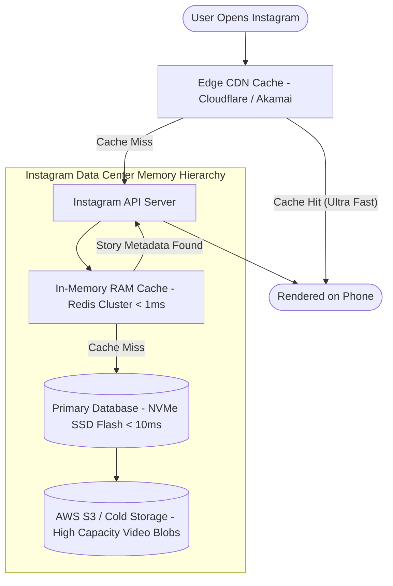

# CHAPTER 03: MEMORY AND STORAGE HIERARCHY

---

## 1. Chapter Introduction
In Chapter 2, we discovered the CPU and saw how it crunches billions of calculations every second. But a brilliant brain is useless if it has severe amnesia! The CPU needs places to hold numbers while calculating, places to keep the software running, and permanent places to store your photos, code, and operating system even when the power is turned off.

In this chapter, we explore the **Memory and Storage Hierarchy**—the engineering pyramid that balances **Speed, Cost, and Capacity**. We will understand why computers have multiple layers of memory (Registers, L1/L2/L3 Caches, RAM, and SSDs), why your computer freezes when you open 100 browser tabs (**Virtual Memory & Thrashing**), and the physical difference between spinning Hard Disk Drives (HDDs) and Solid State Drives (SSDs).

---

## 2. Why Should I Learn This?
- **Performance Optimization:** Accessing a variable in a CPU register takes less than 1 nanosecond; fetching it from an SSD can take 50,000 nanoseconds. Code designed with "data locality" runs hundreds of times faster without requiring any new hardware.
- **Understanding Real-World Crashes:** Out-of-memory errors (`OOMKilled`), system sluggishness, and disk bottlenecking account for a large percentage of production outages.
- **Architectural Decision-Making:** Knowing when to store data in an in-memory cache (like Redis) versus a relational disk database (like PostgreSQL) is the foundation of backend engineering.

---

## 3. Everyday-Life Example
### The Student Studying in a University Library
Imagine you are writing a research paper at a university library:
1. **Your Hand / Short-Term Memory (Registers):** The pen in your hand and the single sentence you are currently memorizing. Speed: Instant. Capacity: Extremely small.
2. **The Open Notebook on Your Desk (L1/L2 Cache):** Right in front of your eyes. You glance down and read notes in half a second. Capacity: 2 or 3 pages.
3. **The Stacks of Reference Books on Your Table (RAM / Main Memory):** Spread out across your study table. Reaching over to grab a textbook takes 10 to 15 seconds. Capacity: 10 books.
4. **The Library Bookshelves Downstairs (SSD / Secondary Storage):** If the book isn't on your table, you must stand up, walk downstairs, search the aisles, and bring it up. Time: 5 to 10 minutes. Capacity: 100,000 books.
5. **The National Archives in Another City (Cloud / Cold Storage):** You must order the book via courier. Time: 3 days. Capacity: Millions of books.

If you had to walk downstairs to the library bookshelves every time you wanted to read a single word, writing your paper would take 50 years! Computers use the exact same tiered strategy.

---

## 4. Industry Example
### Instagram Story Feed & Caching Layers (Redis vs. NVMe SSD vs. S3)
When you open Instagram and view a friend's Story:



1. **In-Memory RAM Layer (Redis / Memcached):** The user profile, active follower list, and unread story IDs are held directly in server RAM. Response latency is under **1 millisecond**.
2. **Fast Primary Storage Layer (NVMe SSDs):** If the user hasn't posted recently, metadata is fetched from high-speed NVMe flash drives running PostgreSQL/RocksDB. Latency: **5 to 10 milliseconds**.
3. **Object Storage (Cold Tier / AWS S3):** The actual 1080p video file is fetched from distributed object storage arrays, cached at edge Content Delivery Networks (CDNs) worldwide, and streamed to your phone.

---

## 5. Prerequisites
- Completion of **Chapter 01** (Input-Process-Output) and **Chapter 02** (CPU, Buses, Clock Cycles).

---

## 6. Basic Explanation
Why don't computer manufacturers simply build a computer with 1 Terabyte of ultra-fast CPU cache memory?

**The Iron Law of Memory Physics:**
- The **faster** a memory technology is, the **more expensive** and physically larger it is per bit, and the more power it consumes.
- The **cheaper** and denser a memory technology is, the **slower** it is to read and write.

Therefore, computer engineers build a **hierarchy (pyramid)**:
- At the top: Tiny amounts of ultra-fast, expensive memory directly inside the processor.
- In the middle: Gigabytes of reasonably fast, moderately priced working memory (RAM).
- At the bottom: Terabytes of cheap, non-volatile storage (SSDs and hard disks).

---

## 7. Detailed Technical Explanation

### 7.1 The Complete Memory Hierarchy Pyramid

```
                / \
               /   \             Speed: < 1 ns     | Capacity: ~1-2 KB
              / Reg \            Cost: Highest     | Volatile
             /-------\
            / L1 Cache\          Speed: ~1 ns      | Capacity: 64 KB / core
           /-----------\
          /  L2 Cache   \        Speed: ~4 ns      | Capacity: 512 KB - 1 MB / core
         /---------------\
        /    L3 Cache     \      Speed: ~10-20 ns  | Capacity: 16 - 96 MB shared
       /-------------------\
      /     Main RAM        \    Speed: ~60-80 ns  | Capacity: 8 - 128 GB
     /     (DDR4 / DDR5)     \   Cost: Moderate    | Volatile
    /-------------------------\
   /   Secondary Storage (SSD) \ Speed: ~25-100 µs | Capacity: 512 GB - 4 TB
  /     (NVMe PCIe Gen 4/5)     \Cost: Affordable  | Non-Volatile
 /-------------------------------\
/   Tertiary / Cold Storage (Cloud\ Speed: > 10 ms | Capacity: Petabytes+
/    Object Stores, Magnetic Tape) \ Cost: Lowest   | Non-Volatile
-------------------------------------
```

### 7.2 Human Latency Scale: The True Impact of the Gap
If we scale $1\text{ CPU Clock Cycle}$ ($0.3\text{ ns}$ on a $3.0\text{ GHz}$ CPU) to **1 second** in human time, the relative latencies become staggering:

| Hardware Component | Actual Hardware Latency | Scaled Human Equivalent Time | Human Real-World Analogy |
| :--- | :--- | :--- | :--- |
| **CPU Register** | $0.3\text{ ns}$ | **1 second** | Grabbing a pen already in your hand |
| **L1 CPU Cache** | $1.0\text{ ns}$ | **3.3 seconds** | Picking up a notepad on your desk |
| **L2 CPU Cache** | $4.0\text{ ns}$ | **13 seconds** | Reaching into a drawer under your desk |
| **L3 CPU Cache** | $15\text{ ns}$ | **50 seconds** | Walking to the bookshelf in the next room |
| **Main RAM (DDR5)** | $60\text{ ns}$ | **3.3 minutes** | Walking down the street to a coffee shop |
| **NVMe SSD Read** | $25,000\text{ ns}$ ($25\text{ µs}$) | **23 hours** | Taking an overnight international flight |
| **Mechanical HDD Seek** | $10,000,000\text{ ns}$ ($10\text{ ms}$) | **12 months** | Taking a 1-year expedition around the world |
| **Internet Packet (India to USA)** | $150,000,000\text{ ns}$ ($150\text{ ms}$) | **15 years** | Raising a child through high school |

This table proves why CPU caching and minimizing disk I/O is the single most critical performance consideration in software engineering!

### 7.3 Volatile vs. Non-Volatile Memory
- **Volatile Memory:** Requires continuous electrical power to maintain its stored state. The microsecond power is removed, all electrical charges dissipate, and the contents are wiped clean.
  - Examples: CPU Registers, L1/L2/L3 Cache (SRAM), Main Memory (DRAM).
- **Non-Volatile Memory:** Retains saved bits permanently, even when the computer is completely unplugged from electrical power.
  - Examples: Flash Memory, NVMe SSDs, USB Thumb Drives, ROM, Optical Discs, Magnetic Tape.

### 7.4 SRAM vs. DRAM: The Tale of Two RAMs
Why don't we use standard RAM as cache memory?

| Feature | SRAM (Static RAM) | DRAM (Dynamic RAM) |
| :--- | :--- | :--- |
| **Storage Cell Design** | 6 transistors per bit (Flip-Flop circuit). | 1 transistor + 1 tiny capacitor per bit. |
| **Refresh Required?** | **No.** Holds charge indefinitely while powered. | **Yes.** Capacitors leak charge; must be refreshed thousands of times per second ($~64\text{ ms}$). |
| **Speed** | Blazing fast ($0.5 - 2.5\text{ ns}$). | Slower ($50 - 80\text{ ns}$). |
| **Physical Density** | Low density (requires 6 large transistors per bit). | Extremely high density (billions of microscopic cells per chip). |
| **Cost** | Extremely expensive. | Affordable and cost-effective. |
| **Primary Use** | CPU L1, L2, and L3 Caches. | Main System RAM (DDR4, DDR5, LPDDR5). |

### 7.5 ROM, PROM, EPROM, and EEPROM
Before a computer boots, RAM is completely empty. How does the CPU know what to do when you press the power button? It reads from **ROM (Read-Only Memory)**:
1. **Mask ROM:** Hardwired at the silicon factory. Data cannot be altered under any circumstances.
2. **PROM (Programmable ROM):** Blank chip that can be written to exactly once using a high-voltage burner.
3. **EPROM (Erasable PROM):** Can be wiped by shining intense Ultraviolet (UV) light through a quartz window on top of the chip.
4. **EEPROM (Electrically Erasable PROM):** Can be erased and rewritten electrically byte-by-byte. Modern computer BIOS/UEFI firmware chips use **Flash EEPROM**, allowing you to update your motherboard BIOS safely via software.

### 7.6 HDD vs. SSD: Moving Mechanical Parts vs. Silicon Floating Gates

```
+------------------------------------+    +------------------------------------+
|    HARD DISK DRIVE (HDD)           |    |     SOLID STATE DRIVE (SSD)        |
|                                    |    |                                    |
|       ( ( ( ( (O) ) ) ) )          |    |     +------+ +------+ +------+     |
|      Spinning Magnetic Platters    |    |     | NAND | | NAND | | NAND |     |
|      5400 / 7200 RPM               |    |     |Flash | |Flash | |Flash |     |
|            \                       |    |     +------+ +------+ +------+     |
|             \--- Actuator Arm      |    |            Flash Controller        |
|                  & Read/Write Head |    |            Zero Moving Parts       |
+------------------------------------+    +------------------------------------+
  Vulnerable to shocks, high latency        Shock resistant, silent, ultra-fast
```

- **Hard Disk Drive (HDD):**
  - Stores data on spinning magnetic glass/aluminum platters.
  - A mechanical actuator arm physically swings a read/write head across the disk.
  - **Seek Time Latency:** Waiting for the arm to move to the correct cylinder and the disk to spin around takes $5 - 12\text{ milliseconds}$. If dropped, the head crashes into the platter, causing permanent data loss.
- **Solid State Drive (SSD):**
  - Contains **zero moving parts**.
  - Stores bits by trapping electrical charges inside non-volatile **Floating Gate Transistors** or **Charge Trap Flash cells** (NAND Flash).
  - Modern **NVMe (Non-Volatile Memory Express)** SSDs plug directly into high-speed PCIe lanes, reading data at up to $7,000 - 14,000\text{ Megabytes per second}$ with microsecond latencies.

### 7.7 Virtual Memory, Paging, and Thrashing
What happens when your computer has 8 GB of physical RAM, but you launch a 3D modeling tool, a web browser with 40 tabs, and Spotify, which collectively demand 14 GB?

1. **Virtual Address Space:** The Operating System presents an illusion to every running program that it has access to a contiguous, private memory space.
2. **Paging:** Memory is divided into fixed-size chunks called **Pages** (typically $4\text{ KB}$ each).
3. **Page Table & MMU:** The CPU's hardware **Memory Management Unit (MMU)** translates virtual addresses used by programs into physical RAM addresses.
4. **Swapping / Paging Out:** When physical RAM fills up, the OS kernel selects inactive pages (e.g., background browser tabs you haven't clicked in 30 minutes) and writes them out to a dedicated area on your SSD called the **Pagefile (Windows)** or **Swap Space (Linux)**.
5. **Page Fault:** When you click back onto that background tab, the CPU discovers that page is not in physical RAM! It raises a hardware interrupt called a **Page Fault**. The OS pauses the app, reads the page from the SSD back into RAM, and resumes execution.
6. **Thrashing (The Death Spiral):** If RAM is severely overloaded, the OS spends 99% of its CPU time constantly writing pages to disk and reading them back, while spending 1% of time running user code. The hard drive activity light stays solid, the mouse cursor stutters, and the computer becomes completely unresponsive.

---

## 8. Important Terminology
- **Memory Hierarchy:** The architectural arrangement of computer storage systems ordered by access speed, cost per bit, and capacity.
- **Volatile Memory:** Storage that loses all data when electrical power is removed (RAM, Caches).
- **Non-Volatile Memory (NVM):** Storage that retains saved data without power (NAND Flash, SSD, HDD, EEPROM).
- **SRAM (Static RAM):** Fast, 6-transistor memory cell used for CPU L1/L2/L3 caches.
- **DRAM (Dynamic RAM):** Dense, capacitor-based memory cell used for primary system memory, requiring periodic electrical refreshes.
- **Cache Hit:** When requested data is successfully found in the fast cache memory.
- **Cache Miss:** When requested data is missing from cache, forcing an expensive fetch from slower downstream memory (RAM or disk).
- **NAND Flash:** Non-volatile solid-state memory technology used in SSDs and smartphones.
- **NVMe (Non-Volatile Memory Express):** High-speed communications protocol designed specifically for SSDs connected via PCIe buses.
- **Virtual Memory:** An OS memory management technique that maps program virtual addresses to physical RAM or secondary storage swap files.
- **Page Fault:** An interrupt raised by hardware when a program accesses a memory page mapped to secondary storage rather than physical RAM.
- **Thrashing:** A pathological condition where the system is consumed with swapping memory pages back and forth between RAM and disk, stalling execution.

---

## 9. Diagrams and Illustrations
### The Paging and Virtual Memory Mapping Mechanism

```
Virtual Memory (Program View)              Physical Memory (Hardware Reality)
+---------------------------+              +---------------------------+
| Page 0 (Active Code)      |------------->| Frame 3 in Physical RAM   |
+---------------------------+              +---------------------------+
| Page 1 (Active Data)      |------------->| Frame 7 in Physical RAM   |
+---------------------------+              +---------------------------+
| Page 2 (Inactive Tab)     |----\         | Frame 12 in Physical RAM  |
+---------------------------+    |         +---------------------------+
| Page 3 (Background Task)  |--\ |         
+---------------------------+  | |         Secondary Storage (SSD / Swap)
                               | |         +---------------------------+
                               | \-------->| Block 401 on NVMe Disk    |
                               |           +---------------------------+
                               \---------->| Block 508 on NVMe Disk    |
                                           +---------------------------+
```

---

## 10. Step-by-Step Examples
### Example 3.1: Calculating Average Memory Access Time (AMAT)
**Scenario:** A computer system has an L1 cache and main RAM.
- L1 Cache Hit Time ($T_1$) = $1.2\text{ ns}$
- L1 Cache Hit Rate ($H_1$) = $95\%$ ($0.95$)
- Cache Miss Rate ($M_1$) = $1 - 0.95 = 0.05$ ($5\%$)
- Miss Penalty ($T_{RAM}$, time to fetch from RAM) = $60.0\text{ ns}$

**Formula for Average Memory Access Time (AMAT):**
$$\text{AMAT} = \text{Hit Time} + (\text{Miss Rate} \times \text{Miss Penalty})$$
$$\text{AMAT} = T_1 + (M_1 \times T_{RAM})$$

**Calculation:**
$$\text{AMAT} = 1.2\text{ ns} + (0.05 \times 60.0\text{ ns})$$
$$\text{AMAT} = 1.2\text{ ns} + 3.0\text{ ns} = 4.2\text{ ns}$$

**Insight:** Even though main RAM is 50 times slower than L1 cache ($60\text{ ns}$ vs $1.2\text{ ns}$), because $95\%$ of requests hit the cache, the effective average access time is only $4.2\text{ ns}$!

---

## 11. Practical Implementation
Let us write a Python experiment demonstrating **Cache Locality (Spatial Locality)**. In modern hardware, when you read one element from memory, the CPU hardware fetches an entire **64-byte Cache Line** into L1 cache.
- Iterating through a 2D matrix row-by-row touches contiguous memory, resulting in nearly 100% cache hits.
- Iterating column-by-column causes constant cache line jumps, triggering massive cache misses and slowing execution drastically!

```python
"""
Practical Lab 1.3: Cache Locality and Memory Access Latency Demonstration
File: 11_PROGRAMMING_LAB/level_1/cache_locality.py
Author: Computer Science Master Library
Description: Proves the physical reality of CPU cache lines by measuring
             execution times between row-major (cache friendly) and
             column-major (cache hostile) 2D array traversals.
"""

import time
import sys


def run_cache_locality_benchmark(rows: int = 4000, cols: int = 4000) -> None:
    print("=" * 65)
    print("      CPU CACHE LOCALITY & MEMORY ACCESS BENCHMARK")
    print("=" * 65)
    print(f"Allocating 2D Matrix of size {rows} x {cols} ({rows * cols:,} integers)...")

    # Allocate a contiguous flat 2D grid
    # In row-major memory, matrix[r][c] sits next to matrix[r][c+1]
    matrix = [[1 for _ in range(cols)] for _ in range(rows)]
    print(
        f"Memory allocated successfully (~{round(sys.getsizeof(matrix) / 1024, 2)} KB array headers).\n"
    )

    # -------------------------------------------------------------
    # TEST 1: Row-Major Traversal (Cache-Friendly: Spatial Locality)
    # -------------------------------------------------------------
    print("Test 1: Running Row-Major Traversal (Row by Row)...")
    start_time = time.perf_counter()
    sum_row = 0
    for r in range(rows):
        for c in range(cols):
            sum_row += matrix[r][c]
    end_time = time.perf_counter()
    row_time = end_time - start_time
    print(f"-> Row-Major Execution Time : {row_time:.4f} seconds (Sum = {sum_row:,})")

    # -------------------------------------------------------------
    # TEST 2: Column-Major Traversal (Cache-Hostile: Strided Access)
    # -------------------------------------------------------------
    print("\nTest 2: Running Column-Major Traversal (Column by Column)...")
    start_time = time.perf_counter()
    sum_col = 0
    for c in range(cols):
        for r in range(rows):
            sum_col += matrix[r][c]
    end_time = time.perf_counter()
    col_time = end_time - start_time
    print(f"-> Column-Major Execution Time: {col_time:.4f} seconds (Sum = {sum_col:,})")

    # Analysis
    slowdown_ratio = col_time / row_time if row_time > 0 else 1.0
    print("-" * 65)
    print(f"ANALYSIS: Column-major traversal was {slowdown_ratio:.2f}x SLOWER!")
    print("REASON  : Column-by-column traversal forces CPU cache misses on")
    print("          almost every access, proving the physical memory hierarchy!")
    print("=" * 65 + "\n")


if __name__ == "__main__":
    run_cache_locality_benchmark(rows=3000, cols=3000)
```

---

## 12. Industry Implementation
### In-Memory Databases & Multi-Tier Storage in High-Scale Banking
In global banking and stock trading systems (e.g., NASDAQ, Bombay Stock Exchange):
- **Core Order Book in RAM:** Stock exchange matching engines do not write orders to disk before matching. The entire order book sits in **DRAM** using specialized lock-free data structures. Matching latency is under **10 microseconds**.
- **Write-Ahead Logging (WAL) on NVMe SSDs:** As soon as an order is matched, an asynchronous transaction log is flushed sequentially to high-end enterprise NVMe SSDs (e.g., Intel Optane or Samsung PM1733) using battery-backed write caches to ensure ACID durability.
- **Cold Archival in Object Storage:** At the end of the trading day, completed trade logs are compressed, encrypted, and uploaded to cold cloud storage (e.g., AWS S3 Glacier or Google Cloud Storage Archive), where storage costs are pennies per Gigabyte per year.

---

## 13. Advantages and Limitations
### Advantages of Tiered Hierarchies
1. **Optimal Price-Performance Curve:** Delivers the illusion of a massive, cheap memory pool operating at near-CPU register speeds.
2. **Transparent Acceleration:** Programs do not have to manually move variables between L1, L2, and L3 caches; specialized hardware controllers manage cache prefetching automatically.
3. **Fault Isolation via Virtual Memory:** A buggy or malicious application cannot corrupt memory owned by another program or the operating system kernel.

### Limitations & Bottlenecks
1. **Cache Miss Penalties:** In irregular, pointer-heavy data structures (like fragmented binary trees or graphs), cache hit rates plummet, degrading CPU performance by up to 90%.
2. **SSD Write Wear-Out (Endurance):** NAND flash cells degrade every time they are electrically erased. Modern SSDs have a finite lifespan measured in **TBW (Terabytes Written)**, requiring internal wear-leveling algorithms.
3. **Thermal Throttling on PCIe Gen 5 SSDs:** Ultra-fast modern SSDs reading at $14\text{ GB/s}$ generate significant heat and require dedicated heatsinks or fans to prevent thermal throttling.

---

## 14. Common Mistakes
1. **Assuming "RAM" and "Storage/Hard Drive" are Synonyms:** Telling a technician *"My computer is out of memory"* when your SSD is full, or *"My storage is full"* when your RAM is maxed out. RAM is temporary working workspace; storage is your permanent filing cabinet.
2. **Thinking Virtual Memory Replaces Physical RAM:** Believing that adding a 100 GB swap file on an SSD makes an 8 GB laptop as fast as a 64 GB machine. SSDs are thousands of times slower than RAM; excessive paging causes crippling system thrashing.
3. **Ignoring Memory Alignment:** Storing data fields in memory without matching natural word boundaries (4-byte or 8-byte boundaries), forcing the CPU to issue two separate bus reads to fetch a single integer.

---

## 15. AI Connection
### The Memory Bandwidth Wall in Large Language Models (LLMs)
Why does running a model like LLaMA-3 or ChatGPT require such expensive GPUs?
- **Compute-Bound vs. Memory-Bound:** Calculating the next word in an LLM is **memory-bandwidth bound**, not compute bound!
- During model generation (token generation), every single parameter weight (e.g., 70 billion parameters = $140\text{ Gigabytes}$) must be loaded from GPU VRAM into the GPU computing cores **for every single word produced**!
- This is why AI chips use **HBM (High-Bandwidth Memory)**, stacking DRAM silicon dies directly on top of the GPU processor using thousands of through-silicon vias (TSVs) to achieve bandwidths exceeding $3\text{ Terabytes per second}$.

---

## 16. AI Future Insights
- **Established Technology:** High-Bandwidth Memory (HBM3e) and CXL (Compute Express Link), allowing CPUs and accelerators to share pooled memory pools over PCIe lanes.
- **Emerging Technology:** Processing-In-Memory (PIM). Integrating simple ALU circuits directly inside the DRAM memory chips themselves, eliminating the need to send data across external buses altogether.
- **Reasonable Future Projection:** Storage-Class Memory (SCM) bridging the gap between DRAM and NAND flash, offering near-DRAM speeds with complete non-volatility.
- **Speculative Possibility:** Molecular DNA Data Storage. Encoding digital bits into biological DNA molecules (A, C, G, T), allowing the entire internet's data to fit in a single test tube with a shelf-life of 1,000+ years.

---

## 17. Career Relevance
- **Backend & Database Engineers:** Design indexing strategies, buffer pools, and caching layers that maximize RAM throughput and minimize disk seeks.
- **Game Developers & Graphics Programmers:** Structure 3D game engines around "Data-Oriented Design" (DOD) to guarantee contiguous cache lines for physics and rendering loops.
- **Site Reliability Engineers (SRE):** Monitor virtual memory usage, swap thrashing, and page fault rates to maintain cloud platform uptime.
- **Systems & Kernel Engineers:** Maintain the Linux virtual memory manager, page replacement algorithms, and huge page allocations.

---

## 18. Interview Preparation

### Category A: Beginner / Fresher Level
#### Q1: What is the primary difference between RAM and ROM?
- **Answer:** **RAM (Random Access Memory)** is volatile memory that can be read from and written to by the CPU at high speeds; its contents are completely lost when power is turned off. It stores currently active programs and data. **ROM (Read-Only Memory)** is non-volatile memory that retains its contents permanently without electricity; it typically holds factory-written boot firmware (like UEFI/BIOS) required to start the computer.

#### Q2: What is Virtual Memory and what problem does it solve?
- **Answer:** Virtual Memory is an OS memory management technique that creates the abstraction of a very large contiguous memory space for programs by combining physical RAM with secondary storage (SSD/HDD swap space). It solves two critical problems: (1) it allows the computer to run programs that require more memory than physically installed RAM, and (2) it provides process isolation, ensuring one application cannot access or corrupt the memory of another.

### Category B: Intermediate Level
#### Q3: What is "Thrashing" in an operating system, and how can it be detected and fixed?
- **Answer:** Thrashing occurs when the system's available physical RAM is insufficient to hold the active working sets of all running processes. Consequently, the OS spends virtually all its time handling page faults—swapping memory pages in and out of secondary storage—rather than executing user code. It is detected by near 100% continuous disk I/O activity accompanied by near-zero CPU progress. It is resolved by closing non-essential applications, increasing physical RAM, or reducing the working set size of running software.

---

## 19. Practice Questions

### Multiple-Choice Questions (MCQs)
1. Which layer of the memory hierarchy has the fastest access time?
   - A) L1 CPU Cache
   - B) CPU Registers
   - C) Main RAM (DDR5)
   - D) NVMe PCIe SSD
   *(Answer: B)*

2. Why does Dynamic RAM (DRAM) require periodic electrical refreshing?
   - A) Its transistors wear out over time.
   - B) Its storage cells are tiny capacitors that naturally leak electrical charge.
   - C) To clear old data from deleted programs.
   - D) To prevent overheating.
   *(Answer: B)*

3. What is the typical physical page size used in most modern computer architectures?
   - A) 64 bytes
   - B) 4 Kilobytes (4 KB)
   - C) 512 Megabytes
   - D) 1 Gigabyte
   *(Answer: B)*

### Short Answer Questions
1. Differentiate between SRAM and DRAM in terms of speed, cost, and usage.
2. What is a "Cache Hit" versus a "Cache Miss"?
3. Explain why mechanical Hard Disk Drives (HDDs) suffer from seek-time latency while Solid State Drives (SSDs) do not.

### Long Answer Questions
1. Draw the complete Memory Hierarchy pyramid. Explain the trade-offs between speed, cost, and capacity from registers down to tertiary storage.
2. Explain the mechanism of Paging and Virtual Memory. What is a Page Fault, and what sequence of events does the OS execute when one occurs?

---

## 20. Solved Examples
### Problem 20.1: Calculating Effective Memory Access Time with Multi-Level Caches
**Question:** A system has a two-level cache hierarchy:
- L1 Cache: Hit rate = $90\%$ ($0.90$), Access time = $1\text{ ns}$
- L2 Cache: Hit rate = $80\%$ ($0.80$), Access time = $5\text{ ns}$
- Main Memory (RAM): Access time = $50\text{ ns}$
Calculate the Average Memory Access Time (AMAT).

**Step-by-Step Solution:**
1. **L2 Access occurs only when L1 misses:**
   $$\text{L1 Miss Rate} = 1 - 0.90 = 0.10$$
2. **Main RAM access occurs only when both L1 and L2 miss:**
   $$\text{L2 Miss Rate} = 1 - 0.80 = 0.20$$
   $$\text{Probability of reaching RAM} = \text{L1 Miss Rate} \times \text{L2 Miss Rate} = 0.10 \times 0.20 = 0.02\text{ (2\%)}$$
3. **Calculate AMAT:**
   $$\text{AMAT} = T_{L1} + (\text{L1 Miss Rate} \times T_{L2}) + (\text{Probability of reaching RAM} \times T_{RAM})$$
   $$\text{AMAT} = 1.0\text{ ns} + (0.10 \times 5.0\text{ ns}) + (0.02 \times 50.0\text{ ns})$$
   $$\text{AMAT} = 1.0\text{ ns} + 0.5\text{ ns} + 1.0\text{ ns} = 2.5\text{ ns}$$
   **Final Answer:** The system achieves an effective Average Memory Access Time of $2.5\text{ ns}$.

---

## 21. Unsolved Exercises
1. **Exercise 3.1:** Run the Python script in Section 11 on your local machine with matrix size $2000 \times 2000$. Record the time difference between row-major and column-major access.
2. **Exercise 3.2:** A video streaming server has 32 GB of RAM and streams 4K video files. If the server does not use caching and reads each video chunk directly from an HDD with a $10\text{ ms}$ seek time, calculate the maximum number of concurrent users it can support before requests stall.
3. **Exercise 3.3:** Research the difference between SLC, MLC, TLC, and QLC NAND flash memory used in SSDs. Which offers the longest lifespan and highest speed, and why?

---

## 22. Chapter Summary
- The **Memory Hierarchy** solves the physical trade-off between speed, capacity, and cost by cascading memory tiers from fastest/smallest (Registers) to slowest/largest (Storage).
- Scaled to human time (where 1 CPU cycle = 1 second), accessing L1 cache takes 3 seconds, RAM takes 3 minutes, and reading an SSD takes 23 hours!
- **Volatile memory** (SRAM, DRAM) loses data without power; **Non-volatile memory** (Flash, SSD, HDD, EEPROM) stores data permanently.
- **SRAM** uses 6-transistor flip-flops for ultra-fast CPU caches; **DRAM** uses single-transistor capacitors that require periodic refreshing for main system RAM.
- **SSDs** eliminate mechanical seek times by storing data in solid-state NAND flash floating-gate transistors.
- **Virtual Memory** divides program space into **Pages** and physical RAM into **Frames**. When RAM is exhausted, inactive pages are swapped to disk. Severe over-allocation triggers **Thrashing**.

---

## 23. Revision Sheet
- **Formula 1 (AMAT Single-Level):** $\text{AMAT} = \text{Hit Time} + (\text{Miss Rate} \times \text{Miss Penalty})$
- **Formula 2 (AMAT Two-Level):** $\text{AMAT} = T_{L1} + M_1 \times (T_{L2} + M_2 \times T_{RAM})$
- **Hierarchy Tiers (Fastest to Slowest):**
  $$\text{Registers} \rightarrow \text{L1} \rightarrow \text{L2} \rightarrow \text{L3} \rightarrow \text{RAM} \rightarrow \text{NVMe SSD} \rightarrow \text{HDD} \rightarrow \text{Cloud}$$
- **Key Hardware Facts:**
  - Standard Cache Line Size = $64\text{ bytes}$
  - Standard Virtual Memory Page Size = $4\text{ Kilobytes}$
  - DDR5 RAM Latency $\approx 50 - 80\text{ nanoseconds}$
  - NVMe SSD Read Latency $\approx 20 - 50\text{ microseconds}$

---

## 24. References
1. **Patterson, David A., and John L. Hennessy.** *Computer Organization and Design: The Hardware/Software Interface.* RISC-V Edition, Morgan Kaufmann, 2017. Chapter 5: "Large and Fast: Exploiting Memory Hierarchy."
2. **Stallings, William.** *Computer Organization and Architecture: Designing for Performance.* 11th Edition, Pearson, 2018. Chapter 4: "Cache Memory" and Chapter 5: "Internal Memory."
3. **Arpaci-Dusseau, Remzi H., and Andrea C. Arpaci-Dusseau.** *Operating Systems: Three Easy Pieces (OSTEP).* Chapter 18: "Paging: Introduction" and Chapter 21: "Beyond Physical Memory: Mechanisms."
4. **Drepper, Ulrich.** *"What Every Programmer Should Know About Memory."* Red Hat, 2007. (The definitive academic paper on CPU cache lines and memory latency).
