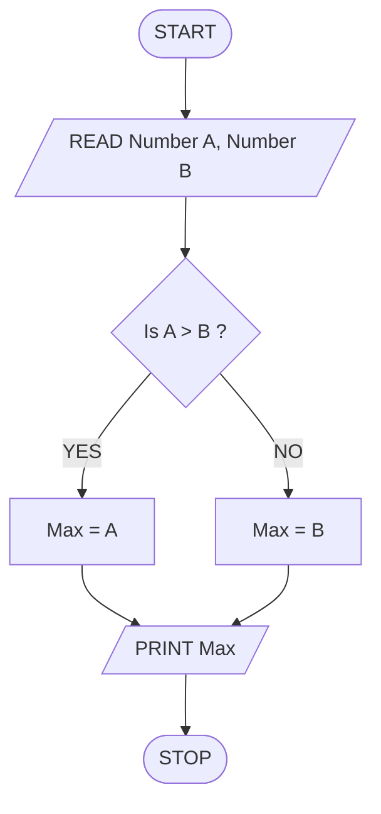

# CHAPTER 06: ALGORITHMS, FLOWCHARTS AND PSEUDOCODE

---

## 1. Chapter Introduction
In earlier chapters, we studied the physical machine: how transistors form logic gates, how CPUs execute clock cycles, and how memory stores binary numbers. But a computer with hardware alone is like an orchestra without sheet music—it has the instruments, but no idea what song to play.

Software begins with **Computational Thinking**. Before writing a single line of Python, C, or Java, an engineer must design an **Algorithm**: a clear, step-by-step procedure for solving a problem. In this chapter, we master the universal tools used to design and communicate problem solutions: **Algorithms**, standardized **Flowcharts**, and structured **Pseudocode**. We will analyze how real-world systems (like Google Maps navigation and Amazon delivery routing) break massive problems down into simple, deterministic steps.

---

## 2. Why Should I Learn This?
- **Language Independence:** Syntax changes across programming languages (Python uses `def`, C uses `int func()`, Java uses `public static void`), but the underlying algorithm remains identical. Learn the algorithm once, and you can implement it in any language.
- **Save Hundreds of Hours of Debugging:** Rushing to code before planning an algorithm leads to spaghetti code, endless bugs, and structural dead-ends. Flowcharts and pseudocode allow you to verify your logic on paper in 5 minutes.
- **The Core of Technical Interviews:** The famous "coding interview" at Google, Meta, Amazon, and top startups is fundamentally an **algorithm interview**. Interviewers don't evaluate how fast you type; they evaluate how clearly you decompose an ambiguous problem into an efficient algorithm.

---

## 3. Everyday-Life Example
### The Chai (Tea) Preparation Recipe
Imagine teaching someone who has never entered a kitchen how to make Indian Masala Chai:
1. **Input:** Water ($1\text{ cup}$), milk ($1/2\text{ cup}$), tea leaves ($1\text{ tsp}$), crushed ginger, sugar ($1\text{ tsp}$).
2. **Step 1:** Pour water into a pan and place it on the stove. Turn on the flame.
3. **Step 2:** Add crushed ginger and bring the water to a boil.
4. **Step 3:** Add tea leaves and simmer for 2 minutes.
5. **Step 4 (Decision):** *Does the guest want sugar?*
   - If **YES**: Add sugar and stir for 30 seconds.
   - If **NO**: Skip to Step 5.
6. **Step 5:** Pour milk into the pan and bring the mixture to a boil.
7. **Step 6 (Loop):** *Has the chai boiled up to the rim?*
   - If **NO**: Wait 10 seconds and check again.
   - If **YES**: Turn off the flame.
8. **Step 7:** Strain the chai through a sieve into a cup.
9. **Output:** A steaming cup of hot tea.

If you skip Step 1 (forgetting to light the flame) or change the order (straining before boiling), the process fails! An algorithm is simply this precise culinary recipe translated into logic.

---

## 4. Industry Example
### Navigation & Routing in Google Maps
When you request driving directions from Mumbai to Pune on Google Maps:
1. **The Problem:** Find the fastest route among thousands of interconnected road segments, considering live traffic congestion, tolls, and road closures.
2. **The Algorithm (Dijkstra's & $A^*$ Search):**
   - The road network is modeled as a mathematical graph (nodes = intersections, edges = roads with travel-time weights).
   - The algorithm maintains a priority list of tentative shortest distances from the origin.
   - It systematically explores adjacent road segments, continually expanding the path with the lowest estimated total travel time until it reaches the destination.
3. **Real-Time Constraint Handling:**
   - If sensor telemetry from Android phones ahead detects average vehicle speeds dropping from $80\text{ km/h}$ to $10\text{ km/h}$, the edge weight is updated in real time, and the rerouting algorithm recalculates the optimal path dynamically.

---

## 5. Prerequisites
- Completion of **Chapter 01: Introduction to Computers and Data** and **Chapter 05: Logic Gates and Boolean Algebra** (understanding conditional True/False states).

---

## 6. Basic Explanation
### What is an Algorithm?
An **Algorithm** is a finite, unambiguous, step-by-step sequence of instructions designed to perform a specific task or solve a particular problem.

Every valid algorithm must satisfy **Five Essential Properties (Donald Knuth's Criteria)**:
1. **Input:** Zero or more quantities provided externally.
2. **Output:** At least one quantity or result produced.
3. **Definiteness:** Every step must be clear, precise, and completely unambiguous.
4. **Finiteness:** The algorithm must terminate after a finite number of steps for all valid inputs (it must never run forever in an infinite loop).
5. **Effectiveness:** Every operation must be basic enough that it could theoretically be carried out by a human using a pencil and paper in a finite amount of time.

### Three Ways to Express Logic:
1. **Natural Language:** Plain English (simple, but prone to ambiguity and misunderstandings).
2. **Flowchart:** A visual, graphical diagram using standardized geometric shapes to represent data flow and logic.
3. **Pseudocode:** A text-based, semi-formal language that mimics programming constructs without strict language-specific syntax.

---

## 7. Detailed Technical Explanation

### 7.1 Standard Flowchart Symbols (ANSI / ISO Standard)
Flowcharts use universally recognized geometric shapes connected by directional arrows:

| Symbol Shape | Standard Name | Meaning & Function | Example |
| :---: | :---: | :--- | :--- |
| **Oval / Rounded Rectangle** | **Terminal (Start / End)** | Marks the entry or exit point of the algorithm. | `START`, `STOP` |
| **Parallelogram** | **Input / Output (I/O)** | Ingesting raw data or displaying a result. | `READ age`, `PRINT "Approved"` |
| **Rectangle** | **Process** | Arithmetic calculation or data manipulation. | `total = price * 1.18`, `count = count + 1` |
| **Diamond** | **Decision** | Evaluates a Boolean condition (`True` or `False`). Has 2+ exit arrows. | `is balance >= amount?` |
| **Small Circle** | **Connector** | Connects intersecting flow lines on the same page. | `(A)` |
| **Directional Arrow** | **Flow Line** | Indicates the exact sequence of execution. | $\downarrow$, $\rightarrow$ |

```
Standard Flowchart Shapes:
   +-------------+          /-------------/          +-------------+
  (     START     )        /   INPUT A   /           | X = A + 10  |
   +-------------+        /-------------/            +-------------+
      Terminal             Input / Output                Process

           /\
          /  \                  O                     |
         / X>0\            Connector                  v
         \    /                                   Flow Line
          \  /
           \/
        Decision
```

### 7.2 The Three Fundamental Control Structures
In 1966, mathematicians **Corrado Böhm and Giuseppe Jacopini** proved the foundational **Structured Program Theorem**: *Any computable algorithm can be constructed using only three control structures:*

1. **Sequence:** Executing statements one after another in order.
2. **Selection (Branching / Decision):** Choosing between alternative paths based on a condition (`IF-THEN-ELSE`).
3. **Iteration (Repetition / Looping):** Repeating a set of instructions until a termination condition is met (`WHILE`, `FOR`, `REPEAT-UNTIL`).

```
1. SEQUENCE             2. SELECTION (BRANCHING)        3. ITERATION (LOOP)
    [ Step 1 ]                     /\                         /-----> [ Check Condition ] ---\
        |                         /  \ Condition?            |               |                 |
        v                        /    \                      |              True             False
    [ Step 2 ]             False/      \True                 |               v                 |
        |                      v        v                    \------- [ Loop Body ]            v
        v                  [Action A] [Action B]                                          [ Exit Loop ]
    [ Step 3 ]                 \        /
                                v      v
                              [ Continue ]
```

### 7.3 Rules for Writing Clean Pseudocode
Unlike Python or C++, pseudocode has no compiler to reject your code for a missing semicolon. However, professional software engineers adhere to clear conventions:
1. Capitalize primary control keywords: `START`, `END`, `READ`, `WRITE`, `PRINT`, `IF`, `THEN`, `ELSE`, `WHILE`, `FOR`, `REPEAT`, `RETURN`.
2. Use indentation to indicate blocks of nested logic.
3. Use unambiguous mathematical assignment: `X \leftarrow 5` or `X = 5`.
4. Keep steps language-agnostic (write `READ user_name` instead of `scanf("%s", user_name)` or `input()`).

### 7.4 Algorithm Correctness: Loop Invariants
How do you mathematically prove that a loop produces the correct result without testing it on a billion inputs?
Computer scientists use a **Loop Invariant**:
- A logical assertion about the state of the program that is:
  1. **Initialization:** True *before* the first iteration of the loop.
  2. **Maintenance:** If it is true before an iteration, it remains true *before the next* iteration.
  3. **Termination:** When the loop terminates, the invariant provides a useful property that proves the algorithm is correct.
*(Analogous to mathematical induction!)*

---

## 8. Important Terminology
- **Algorithm:** A finite, ordered set of unambiguous instructions that solves a specific problem.
- **Flowchart:** A standardized graphical diagram depicting the operational steps and control flow of an algorithm.
- **Pseudocode:** An informal, high-level description of an algorithm combining human language with programming structures.
- **Control Flow:** The order in which individual statements or instructions are executed in a running program.
- **Sequence:** Linear execution of steps from top to bottom.
- **Selection:** Conditional branching where execution diverges based on a Boolean test.
- **Iteration (Loop):** Repetitive execution of a code block controlled by a condition.
- **Infinite Loop:** A logical defect where a loop's termination condition is never satisfied, causing the program to hang indefinitely.
- **Loop Invariant:** A formal mathematical condition that remains true across every iteration of a loop.
- **Time Complexity:** A theoretical measure of how the execution time of an algorithm scales as input size increases ($N$).

---

## 9. Diagrams and Illustrations
### Complete Flowchart: Finding the Maximum of Two Numbers ($A$ and $B$)



---

## 10. Step-by-Step Examples

### Example 6.1: Linear Search Algorithm
**Problem:** Given a list of $N$ student roll numbers and a target roll number $X$, find whether $X$ is present in the list and return its position.

#### 1. Plain English Strategy:
Start at the very first element. Compare it to $X$. If it matches, report success and stop. If not, move to the next element. Repeat until you find $X$ or reach the end of the list.

#### 2. Pseudocode:
```text
ALGORITHM LinearSearch(Array, N, Target):
    START
        index = 0
        found = FALSE
        
        WHILE (index < N) AND (found == FALSE) DO:
            IF Array[index] == Target THEN
                found = TRUE
                position = index
            ELSE
                index = index + 1
            ENDIF
        ENDWHILE
        
        IF found == TRUE THEN
            PRINT "Target found at index: ", position
            RETURN position
        ELSE
            PRINT "Target not present in list"
            RETURN -1
        ENDIF
    END
```

#### 3. Step-by-Step Trace Table:
Let $\text{Array} = [14, 28, 42, 56, 70]$, $N = 5$, $\text{Target} = 42$.

| Iteration | `index` | `Array[index]` | `Array[index] == Target`? | `found` | Action Taken |
| :---: | :---: | :---: | :---: | :---: | :--- |
| **Init** | 0 | - | - | FALSE | Enter loop |
| **1** | 0 | 14 | $14 == 42 \implies \text{False}$ | FALSE | `index` becomes 1 |
| **2** | 1 | 28 | $28 == 42 \implies \text{False}$ | FALSE | `index` becomes 2 |
| **3** | 2 | 42 | $42 == 42 \implies \text{True}$ | **TRUE** | `position = 2`; loop exits! |

**Output:** Target found at index `2`.

---

## 11. Practical Implementation
Let us write a comprehensive Python lab script demonstrating algorithmic problem decomposition:
1. Linear Search with step tracing.
2. The ancient **Euclidean Algorithm for Greatest Common Divisor (GCD)** (one of the oldest algorithms known to humanity, c. 300 BC).
3. Factorial calculation via iterative loop.

```python
"""
Practical Lab 1.6: Algorithms, Step-Tracing, and Verification
File: 11_PROGRAMMING_LAB/level_1/ch06_algorithms_lab.py
Author: Computer Science Master Library
Description: Demonstrates structured algorithm design, loop invariants,
             trace tables, and step-by-step state verification.
"""

import sys
from typing import List, Tuple, Optional

if hasattr(sys.stdout, "reconfigure"):
    try:
        sys.stdout.reconfigure(encoding="utf-8")
    except Exception:
        pass


def linear_search_with_trace(
    arr: List[int], target: int
) -> Tuple[Optional[int], int]:
    """
    Algorithm: Linear Search
    Traces every comparison step to demonstrate the IPO cycle of a loop.
    Returns: (Found Index or None, Total Comparison Count)
    """
    print(f"--- Running Linear Search for Target: {target} ---")
    print(f"Input Array: {arr}")
    print("Step | Index | Value Inspected | Match?")
    print("-" * 42)

    comparisons = 0
    for idx, val in enumerate(arr):
        comparisons += 1
        is_match = val == target
        print(f"{comparisons:4d} | {idx:5d} | {val:15d} | {is_match}")
        if is_match:
            print(f"-> MATCH FOUND at index {idx} in {comparisons} steps!\n")
            return idx, comparisons

    print(f"-> Target {target} NOT found after {comparisons} steps.\n")
    return None, comparisons


def euclidean_gcd(a: int, b: int) -> int:
    """
    Algorithm: Euclidean Algorithm for Greatest Common Divisor (GCD)
    Mathematical principle: gcd(a, b) = gcd(b, a mod b) until b == 0.
    """
    print(f"--- Computing GCD of ({a}, {b}) using Euclid's Algorithm ---")
    step = 0
    val_a, val_b = abs(a), abs(b)

    while val_b != 0:
        step += 1
        remainder = val_a % val_b
        print(
            f"Step {step}: {val_a} = ({val_a // val_b} * {val_b}) + Remainder {remainder}"
        )
        val_a = val_b
        val_b = remainder

    print(f"-> Final GCD result: {val_a}\n")
    return val_a


def calculate_factorial(n: int) -> int:
    """
    Algorithm: Iterative Factorial (n!)
    Loop Invariant: At start of iteration i, result = (i - 1)!
    """
    if n < 0:
        raise ValueError("Factorial is undefined for negative integers.")

    print(f"--- Calculating Factorial for n = {n} ---")
    result = 1
    for i in range(1, n + 1):
        prev_result = result
        result *= i
        print(f"Iteration {i}: {prev_result} * {i} = {result}")

    print(f"-> Final {n}! = {result}\n")
    return result


if __name__ == "__main__":
    # Test 1: Linear Search
    sample_list = [18, 42, 7, 99, 53, 24, 61]
    linear_search_with_trace(sample_list, target=99)
    linear_search_with_trace(sample_list, target=100)

    # Test 2: Euclidean GCD
    gcd_res = euclidean_gcd(252, 105)
    assert gcd_res == 21, f"Expected 21, got {gcd_res}"

    # Test 3: Factorial
    fact_res = calculate_factorial(5)
    assert fact_res == 120, f"Expected 120, got {fact_res}"

    print("All algorithm lab tests executed and verified successfully.")
```

---

## 12. Industry Implementation
### Order Matching & Delivery Routing in E-Commerce (Swiggy / Amazon)
How does Swiggy or Zomato assign a delivery partner when you order dinner?
1. **Candidate Gathering:** When an order is placed, the backend queries the geospatial database for delivery partners within a $3\text{ km}$ radius who are currently idle.
2. **The Assignment Algorithm (Bipartite Matching / Hungarian Algorithm):**
   - Cost matrix is constructed based on:
     $$\text{Cost} = w_1(\text{Distance to Restaurant}) + w_2(\text{Estimated Food Prep Delay}) + w_3(\text{Historical Partner Rating})$$
   - The algorithm computes the global minimum cost assignment across all active orders in that neighborhood.
3. **Execution & Fallback:**
   - The assigned driver's phone receives a push notification with a 30-second countdown timer.
   - If the driver accepts, state transitions to `ASSIGNED`.
   - If the driver rejects or the timer expires, the algorithm instantly falls back to the next optimal candidate in the priority queue.

---

## 13. Advantages and Limitations
### Advantages of Algorithmic Planning
1. **Flaw Detection Before Code:** Finding a logic error on a whiteboard costs 2 minutes; finding it in production can cost millions of dollars.
2. **Portability:** Pseudocode can be handed to a Python developer, a C++ developer, or a Swift developer; all three will produce functionally identical implementations.
3. **Efficiency Analysis:** Allows mathematical analysis of time and memory complexity before allocating computing resources.

### Limitations & Trade-Offs
1. **Oversimplification of Edge Cases:** High-level flowcharts frequently omit memory allocation limits, network timeouts, and thread safety concerns.
2. **Maintenance Overhead:** Flowchart diagrams can become excessively large and unreadable for systems containing thousands of conditional rules.

---

## 14. Common Mistakes
1. **Creating Infinite Loops:** Writing a loop whose counter never changes, e.g.:
   ```text
   i = 0
   WHILE i < 10 DO:
       PRINT i
       # Forgot i = i + 1! Runs forever until CPU/RAM crashes.
   ```
2. **Ambiguous Decision Diamonds:** Leaving decision branches unlabeled in flowcharts (not marking which branch is `YES`/`TRUE` and which is `NO`/`FALSE`).
3. **Off-by-One Errors (Fencepost Errors):** Looping $N+1$ times instead of $N$ times (e.g., checking indices $0$ to $N$ on an array of length $N$, triggering an `IndexOutOfBounds` error).

---

## 15. AI Connection
### Deterministic Algorithms vs. Machine Learning Heuristics
- **Traditional Algorithms (Deterministic):** Hand-crafted by human engineers. Every step is transparent, explainable, and 100% predictable. Given the same input, it will always follow the exact same path.
- **Machine Learning Algorithms (Probabilistic):** The steps are not explicitly programmed; instead, an optimization algorithm (like Gradient Descent) adjusts billions of numerical weights based on training data.
- **Modern Synergy (AI + Classical Algorithms):** Today's advanced software combines both! For example, in autonomous driving, deep neural networks detect pedestrians from camera pixels, but a classical deterministic control algorithm decides the exact brake pressure to ensure the car safely stops without skidding!

---

## 16. AI Future Insights
- **Established Technology:** AI coding assistants (Copilot, Gemini) that can automatically translate natural language algorithm prompts into working Python or C++ code.
- **Emerging Technology:** Neural Algorithmic Reasoning, where neural networks learn to simulate classical algorithms (like Dijkstra or Sorting) to generalize across incomplete or noisy real-world data.
- **Reasonable Future Projection:** Automated Algorithm Synthesis, where formal verification engines use AI to discover novel, provably optimal sorting or matrix multiplication algorithms faster than human mathematicians (e.g., AlphaDev).
- **Speculative Possibility:** Self-evolving software systems that autonomously rewrite their core algorithms in production to optimize for real-time hardware energy constraints.

---

## 17. Career Relevance
- **Software Engineers & Developers:** Daily job revolves around translating product requirements into clean algorithms and data structures.
- **Data Analysts & Scientists:** Structure multi-step data cleaning and transformation pipelines.
- **Technical Interview Candidates:** Ability to clearly whiteboard flowcharts and trace pseudocode is the single most tested skill in technical recruitment.
- **QA Automation Engineers:** Convert business requirements into step-by-step automated test scripts.

---

## 18. Interview Preparation

### Category A: Beginner / Fresher Level
#### Q1: What are the essential properties of an algorithm?
- **Answer:** As formulated by Donald Knuth, every valid algorithm must possess five core properties:
  1. **Input:** Zero or more externally supplied values.
  2. **Output:** At least one defined result or quantity.
  3. **Definiteness:** Every step must be clear, unambiguous, and precisely defined.
  4. **Finiteness:** Must terminate after a finite number of operations for all input cases.
  5. **Effectiveness:** Every operation must be sufficiently basic that it can be carried out exactly and in finite time.

#### Q2: What is the difference between a flowchart and pseudocode?
- **Answer:** A **flowchart** is a graphical, visual representation of an algorithm using standardized geometric shapes (rectangles, diamonds, ovals) connected by directional arrows. It excels at communicating high-level control flow to non-technical stakeholders. **Pseudocode** is a text-based, structured description using plain English combined with programming keywords (`IF`, `WHILE`, `FOR`). It is closer to actual code, easier to edit, and preferred by software engineers for complex logic.

### Category B: Intermediate Level
#### Q3: What is a "Loop Invariant", and how is it used to verify algorithm correctness?
- **Answer:** A loop invariant is a formal logical property or predicate that holds true before and after each iteration of a loop. Correctness is proven using three steps analogous to mathematical induction: (1) **Initialization:** The invariant holds true before the first loop iteration. (2) **Maintenance:** If the invariant holds true before iteration $k$, it remains true before iteration $k+1$. (3) **Termination:** When the loop terminates, the invariant combined with the reason for termination guarantees that the algorithm achieved its intended postcondition.

---

## 19. Practice Questions

### Multiple-Choice Questions (MCQs)
1. Which geometric shape is used in flowcharts to represent a conditional branching decision?
   - A) Rectangle
   - B) Diamond
   - C) Parallelogram
   - D) Oval
   *(Answer: B)*

2. Which flowchart symbol is used to represent reading user input or printing an output?
   - A) Parallelogram
   - B) Rectangle
   - C) Circle
   - D) Hexagon
   *(Answer: A)*

3. What happens if a loop's update statement (such as $i = i + 1$) is omitted?
   - A) The program runs faster.
   - B) The loop terminates immediately.
   - C) An infinite loop occurs.
   - D) The compiler automatically fixes it.
   *(Answer: C)*

### Short Answer Questions
1. Name the three fundamental control structures proven by Böhm and Jacopini.
2. Differentiate between `WHILE` loop (pre-test) and `DO-WHILE` loop (post-test).
3. Why is an algorithm required to have the property of "Finiteness"?

### Long Answer Questions
1. Draw a complete, standardized flowchart to check whether a given positive integer $N$ is a **Prime Number**.
2. Write structured pseudocode for the Euclidean Algorithm to compute the Greatest Common Divisor (GCD) of two numbers. Construct a manual trace table for $A = 84$ and $B = 30$.

---

## 20. Solved Examples
### Problem 20.1: Algorithm and Trace Table for Finding the Maximum in a List
**Task:** Design an algorithm to find the largest number in an array of $N$ integers.

**Pseudocode:**
```text
ALGORITHM FindMaximum(Arr, N):
    START
        IF N <= 0 THEN
            ERROR "Array cannot be empty"
        ENDIF
        
        max_val = Arr[0]
        i = 1
        
        WHILE i < N DO:
            IF Arr[i] > max_val THEN
                max_val = Arr[i]
            ENDIF
            i = i + 1
        ENDWHILE
        
        PRINT "Maximum value is: ", max_val
        RETURN max_val
    END
```

**Step-by-Step Trace:**
Let $\text{Arr} = [23, 89, 12, 94, 45]$, $N = 5$.
- **Initialization:** $\text{max\_val} = \text{Arr}[0] = 23$. $i = 1$.
- **Iteration 1 ($i=1$):** $\text{Arr}[1] = 89$. Is $89 > 23$? **YES** $\implies \text{max\_val} = 89$. $i$ becomes 2.
- **Iteration 2 ($i=2$):** $\text{Arr}[2] = 12$. Is $12 > 89$? **NO** $\implies \text{max\_val}$ remains 89. $i$ becomes 3.
- **Iteration 3 ($i=3$):** $\text{Arr}[3] = 94$. Is $94 > 89$? **YES** $\implies \text{max\_val} = 94$. $i$ becomes 4.
- **Iteration 4 ($i=4$):** $\text{Arr}[4] = 45$. Is $45 > 94$? **NO** $\implies \text{max\_val}$ remains 94. $i$ becomes 5.
- **Termination:** $i = 5$ is NOT $< 5$. Loop terminates!
- **Result:** Maximum value is $\mathbf{94}$.

---

## 21. Unsolved Exercises
1. **Exercise 6.1:** Draw a flowchart to calculate the roots of a quadratic equation $ax^2 + bx + c = 0$, properly handling real, equal, and complex roots using the discriminant $\Delta = b^2 - 4ac$.
2. **Exercise 6.2:** Write structured pseudocode to reverse the digits of an integer (e.g., $1234 \rightarrow 4321$) using arithmetic operations (`%` and `/`).
3. **Exercise 6.3:** Implement a Binary Search algorithm in Python in the lab directory, including a step-by-step trace showing the `low`, `mid`, and `high` pointers at each iteration.

---

## 22. Chapter Summary
- An **algorithm** is a finite, ordered sequence of unambiguous instructions that transforms inputs into outputs.
- Every algorithm must satisfy Knuth's five criteria: **Input, Output, Definiteness, Finiteness, and Effectiveness**.
- The Böhm-Jacopini theorem proves that all computable logic requires only three structures: **Sequence, Selection, and Iteration**.
- **Flowcharts** communicate algorithmic flow graphically using standardized symbols: Ovals (Terminals), Parallelograms (I/O), Rectangles (Process), and Diamonds (Decisions).
- **Pseudocode** provides an unambiguous, language-agnostic textual representation of an algorithm using structured keywords and indentation.
- **Trace tables** allow software engineers to verify variable state changes across loop iterations manually on paper before writing code.

---

## 23. Revision Sheet
- **ANSI Flowchart Symbols:**
  - Oval $\rightarrow$ Start / Stop
  - Parallelogram $\rightarrow$ Read / Print
  - Rectangle $\rightarrow$ Calculation / Assignment
  - Diamond $\rightarrow$ Condition / Decision (`True` / `False`)
  - Arrow $\rightarrow$ Control Flow Direction
- **Structured Theorem:** Any algorithm = Sequence + Selection + Iteration.
- **Knuth's 5 Properties:** Input, Output, Definiteness, Finiteness, Effectiveness.
- **Trace Table Columns:** Step | Variables | Condition Evaluated | Output.

---

## 24. References
1. **Cormen, Thomas H., Charles E. Leiserson, Ronald L. Rivest, and Clifford Stein.** *Introduction to Algorithms (CLRS).* 4th Edition, MIT Press, 2022. Chapter 1: "The Role of Algorithms in Computing" and Chapter 2: "Getting Started."
2. **Knuth, Donald E.** *The Art of Computer Programming, Volume 1: Fundamental Algorithms.* 3rd Edition, Addison-Wesley, 1997. Section 1.1: "Algorithms."
3. **Böhm, Corrado, and Giuseppe Jacopini.** *"Flow Diagrams, Turing Machines and Languages with Only Two Formation Rules."* Communications of the ACM, Vol. 9, No. 5, 1966. (Foundational paper on structured programming).
4. **ANSI/ISO Standard 5807.** *Information Processing — Documentation Symbols and Conventions for Data, Program and System Flowcharts.* (Official flowchart graphical standard).
