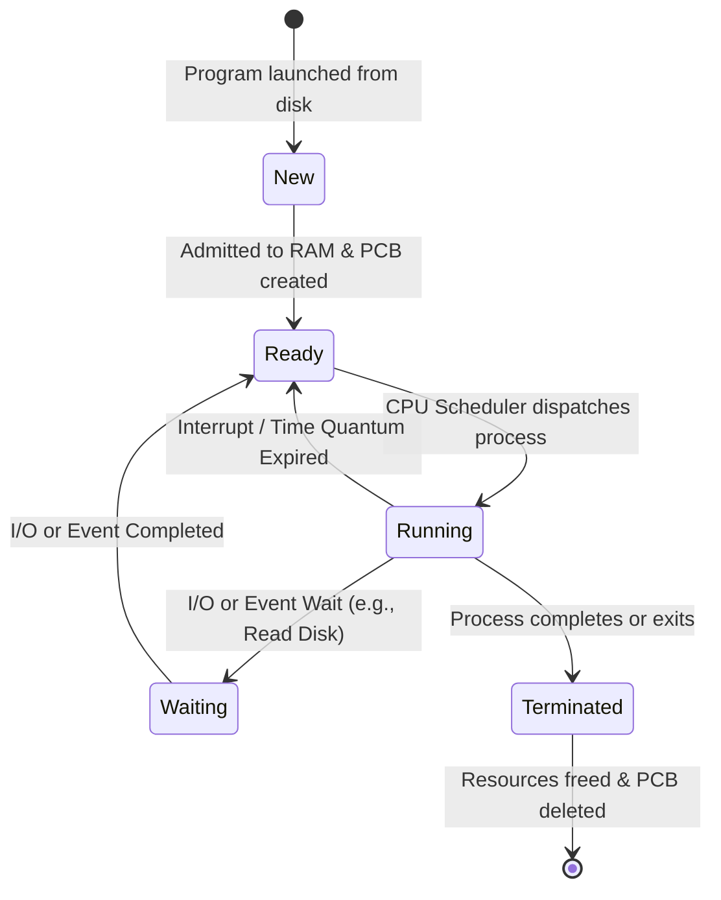

# CHAPTER 07: INTRODUCTION TO OPERATING SYSTEMS

---

## 1. Chapter Introduction
Imagine if every time a software developer wanted to print a line of text, save a game file, or display an image, they had to write custom electrical commands to spin a specific manufacturer's hard drive motor, manage raw voltages on RAM chips, and decode the microchip pins of three hundred different keyboard brands! Computing would be agonizingly slow, fragile, and chaotic.

The savior that prevents this chaos is the **Operating System (OS)**. The OS is the master software program that sits directly between physical hardware and application software. In this chapter, we demystify the operating system: what it does, how the **Kernel** operates, the difference between **User Mode** and **Kernel Mode**, how processes are scheduled across CPU cores, and how modern operating systems (Linux, Windows, macOS, Android) manage billions of events without crashing.

---

## 2. Why Should I Learn This?
- **Understand System Crashes & Sluggishness:** Why does an app show "Not Responding"? What is a "Kernel Panic" or "Blue Screen of Death (BSOD)"? Understanding the OS reveals what is happening under the hood.
- **Write High-Performance Software:** Every database query, network packet transmission, and file read issues a **System Call** to the OS kernel. Understanding context switching, processes, and threads allows you to build responsive, scalable applications.
- **Essential for Cloud, DevOps & Linux Administration:** Modern cloud infrastructure (AWS, Docker, Kubernetes) runs on the Linux operating system. You cannot deploy or debug enterprise microservices without solid OS fundamentals.

---

## 3. Everyday-Life Example
### The Restaurant General Manager Analogy
Imagine a busy 5-star restaurant:
1. **The Physical Resources (Hardware):** The kitchen stoves, frying pans, dining tables, plates, and refrigeration units.
2. **The Customers (Applications / Programs):** Table 1 wants butter chicken; Table 2 wants vegan pasta; Table 3 wants ice cream.
3. **The Chaos without a Manager (No OS):** Customers would run into the kitchen, fight over the stoves, steal each other's pans, drop food on the floor, and lock each other out of the pantry.
4. **The General Manager (The Operating System):**
   - **Table Allocation (Memory Management):** Assigns Table 4 to Customer A and Table 7 to Customer B, ensuring they don't sit in each other's laps.
   - **Order Dispatching (CPU Scheduling):** Decides which chef cooks which dish first so no customer starves.
   - **Pantry Security (File System & Security):** Keeps the expensive ingredients locked in the pantry; only authorized staff have the keys.
   - **Dishwasher & Janitor (Garbage Collection & Cleanup):** Cleans up plates when customers leave so the next guest can use the table.

The operating system manages hardware resources fairly, safely, and efficiently so applications can focus on their jobs.

---

## 4. Industry Example
### Container Isolation in Cloud Computing: Docker, Kubernetes & Linux Cgroups
When thousands of companies host applications on Amazon Web Services (AWS) or Google Cloud:
1. They don't buy physical computers for every single microservice. They run thousands of lightweight **Containers (Docker)** on large shared Linux servers.
2. **How does the OS prevent one container from crashing the others?**
   - **Linux Namespaces:** The OS kernel presents an illusion to each container that it is the only operating system running on the machine. It gives each container its own private process tree, network interfaces, and user list.
   - **Control Groups (cgroups):** The Linux kernel strictly enforces hardware quotas: *"Container A can never use more than 2 CPU cores and 4 GB of RAM."* If Container A suffers a memory leak and tries to consume 5 GB, the Linux Out-Of-Memory (`OOM`) killer terminates only Container A, leaving the rest of the server completely untouched!

---

## 5. Prerequisites
- Completion of **Chapter 02: How Computer Hardware Works** (CPU registers, machine cycles) and **Chapter 03: Memory and Storage Hierarchy** (RAM, paging, virtual memory).

---

## 6. Basic Explanation
### What is an Operating System?
An **Operating System (OS)** is system software that manages computer hardware and software resources, providing common services for application programs.

The OS performs two fundamental roles:
1. **Resource Manager:** Allocates CPU time, RAM space, disk storage, and I/O devices fairly and efficiently among competing programs.
2. **Extended Machine (Abstraction Provider):** Hides the hideous, messy details of physical hardware behind clean, elegant software interfaces (e.g., providing a simple function `save_file("photo.jpg")` instead of requiring you to write magnetic tracks on a spinning disk).

```
+-------------------------------------------------------------+
|                     APPLICATION PROGRAMS                    |
|             Web Browser, Media Player, Games, IDE           |
+-------------------------------------------------------------+
                              |
                              v  (Standard System Calls)
+-------------------------------------------------------------+
|                      OPERATING SYSTEM                       |
|   +-----------------------------------------------------+   |
|   |                       KERNEL                        |   |
|   |  - Process Scheduler        - Virtual Memory Mgr    |   |
|   |  - File System Controller   - Network Protocol Stack|   |
|   |  - Device Drivers           - Security & Protection |   |
|   +-----------------------------------------------------+   |
+-------------------------------------------------------------+
                              |
                              v  (Direct Hardware Control)
+-------------------------------------------------------------+
|                     PHYSICAL HARDWARE                       |
|          CPU, RAM, NVMe SSD, GPU, Network Interface         |
+-------------------------------------------------------------+
```

---

## 7. Detailed Technical Explanation

### 7.1 Dual-Mode Operation: User Mode vs. Kernel Mode
To protect the computer from buggy or malicious programs, modern CPUs provide hardware-enforced **Privilege Rings**:

```
+-------------------------------------------------------------+
| RING 3: USER MODE (Unprivileged)                            |
| Applications run here (Chrome, Spotify, Python scripts).     |
| Cannot execute privileged CPU instructions.                 |
| Cannot directly touch hardware or physical RAM addresses.   |
+-------------------------------------------------------------+
                              |
                              | System Call (TRAP / Interrupt)
                              v
+-------------------------------------------------------------+
| RING 0: KERNEL MODE (Supervisor / Privileged)               |
| The OS Kernel runs here.                                    |
| Has unrestricted, raw access to all CPU instructions,       |
| memory controllers, and physical hardware peripherals.      |
+-------------------------------------------------------------+
```

#### What is a System Call?
When a user program wants to perform an action involving hardware (e.g., reading a file from disk, opening a network socket, or creating a new process), it cannot do it directly. Instead:
1. The program prepares arguments and issues a software interrupt called a **Trap** or **System Call (`syscall`)**.
2. The CPU hardware switches its privilege mode from **User Mode (Ring 3)** to **Kernel Mode (Ring 0)**.
3. The kernel validates the request (e.g., *Does this user have permission to read this file?*), performs the hardware I/O, and places the result in a register.
4. The CPU flips back to **User Mode** and returns control to the application.

### 7.2 The Five Core Subsystems of the OS Kernel
1. **Process Management Subsystem:**
   - Creates, schedules, synchronizes, and terminates processes and threads.
2. **Memory Management Subsystem:**
   - Allocates and deallocates physical RAM frames; maintains page tables and virtual memory mappings.
3. **File System Subsystem:**
   - Organizes data into files, directories, access permissions, and storage drivers (ext4, NTFS, APFS).
4. **I/O & Device Driver Subsystem:**
   - Standardizes communication with external hardware (keyboards, mice, USB devices, displays) via uniform driver interfaces.
5. **Protection & Security Subsystem:**
   - Enforces user authentication, role-based access controls, and memory isolation boundaries between processes.

### 7.3 Processes vs. Programs & The Process State Lifecycle
- **Program:** A passive collection of instructions stored permanently on disk (e.g., `chrome.exe` sitting on an SSD).
- **Process:** An active program in execution. It owns allocated RAM, CPU register states, open file handles, and a unique **Process ID (PID)**.

#### The 5-State Process Model:



1. **New:** The process is being created and loaded into memory from disk.
2. **Ready:** The process is sitting in RAM, fully loaded, waiting for the CPU scheduler to grant it CPU time.
3. **Running:** Instructions of the process are actively executing on a physical CPU core.
4. **Waiting (Blocked):** The process cannot execute until an external event completes (e.g., waiting for the user to press a key, or waiting for a $10\text{ ms}$ disk read). It yields the CPU to other processes!
5. **Terminated:** The process has finished execution; the OS reclaims its memory and file handles.

#### What is a Process Control Block (PCB)?
For every process, the kernel maintains an internal data structure called the **Process Control Block (PCB)**:
- **Process ID (PID):** Unique integer identifier.
- **Process State:** Current state (`READY`, `RUNNING`, `WAITING`).
- **Program Counter (PC):** Address of the next instruction to execute.
- **CPU Registers:** Saved contents of all hardware registers ($RAX, RBX, SP, BP$).
- **Memory Allocation Limits:** Base and limit registers, page table pointers.
- **Open File Descriptors:** List of files and network sockets currently open.

#### Context Switching:
When the CPU pauses Process A to run Process B:
1. The kernel saves Process A's register state into its PCB in RAM.
2. The kernel loads Process B's saved register state from its PCB into the CPU hardware.
3. The Program Counter jumps to Process B's saved instruction.
This swap takes only **a few microseconds**, allowing modern operating systems to juggle hundreds of active processes on a single CPU core, creating the smooth illusion that all apps are running simultaneously (**Preemptive Multitasking**)!

### 7.4 CPU Scheduling Algorithms
How does the OS scheduler decide which process gets the CPU next?
- **First-Come, First-Served (FCFS):** Processes run in the exact order they arrive. Simple, but suffers from the **Convoy Effect** (a massive, long-running process blocks dozens of tiny, quick processes).
- **Shortest Job Next (SJN / SJF):** Runs the process with the shortest burst time first. Mathematically optimal for average wait time, but impossible to predict exact execution times in advance.
- **Round-Robin (RR):** Each process is granted a fixed slice of CPU time called a **Time Quantum** (e.g., $10\text{ to }50\text{ milliseconds}$). If it hasn't finished when the quantum expires, it is preempted, moved to the back of the Ready queue, and the next process runs. Standard in interactive desktop OSs!
- **Multi-Level Feedback Queue (MLFQ):** Modern production schedulers (in Linux and Windows) prioritize interactive tasks (like mouse movement and UI responsiveness) while relegating CPU-heavy batch processing to lower-priority background queues.

---

## 8. Important Terminology
- **Kernel:** The central, core module of the operating system that resides permanently in memory and exercises complete control over system resources.
- **User Mode:** Restricted CPU execution state where user applications run without direct hardware access.
- **Kernel Mode (Supervisor Mode):** Privileged hardware execution state allowing unrestricted access to physical instructions and memory.
- **System Call (`syscall`):** The programmatic interface through which a user application requests services from the kernel.
- **Process:** An instance of a computer program in active execution with its own dedicated memory space.
- **Thread:** The smallest unit of execution within a process; multiple threads in the same process share the same memory space.
- **Context Switch:** The hardware and software procedure of saving the execution state of one process and loading that of another.
- **PCB (Process Control Block):** Kernel data structure storing all accounting and execution state for a process.
- **Time Quantum:** The maximum contiguous time slice allocated to a process in Round-Robin scheduling.
- **Device Driver:** Specialized software component translating standardized OS commands into hardware-specific peripheral signals.
- **Monolithic Kernel vs Microkernel:**
  - *Monolithic (Linux, Windows):* All OS services (file system, drivers, scheduler, network stack) run inside the privileged kernel space for maximum speed.
  - *Microkernel (macOS Mach core, QNX):* Only essential services (IPC, basic scheduling, virtual memory) run in kernel space; drivers and file systems run as user-mode servers for fault isolation.

---

## 9. Diagrams and Illustrations
### Monolithic Kernel vs. Microkernel Architecture

```
   MONOLITHIC KERNEL (Linux)                  MICROKERNEL (Mach / QNX)
+------------------------------+          +------------------------------+
|     USER APPLICATIONS        |          |      USER APPLICATIONS       |
|    Browser, Shell, Editors   |          | File System Server, Drivers  |
+------------------------------+          +------------------------------+
------------- System Call Barrier ------------------ IPC Barrier ----------------
|        ALL IN KERNEL:        |          |     MINIMAL KERNEL ONLY:     |
| - Virtual Memory   - Files   |          | - Basic CPU Scheduling       |
| - IPC              - Drivers |          | - Inter-Process Comm (IPC)   |
| - CPU Scheduler    - Network |          | - Low-Level Memory Mapping   |
+------------------------------+          +------------------------------+
               |                                         |
               v                                         v
        HARDWARE PERIPHERALS                      HARDWARE PERIPHERALS
```

---

## 10. Step-by-Step Examples

### Example 7.1: Tracing Round-Robin CPU Scheduling
**Scenario:** Three processes arrive at time $t = 0$:
- Process $P_1$: Requires $12\text{ ms}$ CPU burst
- Process $P_2$: Requires $4\text{ ms}$ CPU burst
- Process $P_3$: Requires $6\text{ ms}$ CPU burst
- **Time Quantum ($Q$):** $4\text{ ms}$

Let us trace execution using a **Gantt Chart**:

```
Gantt Chart:
+----------+----------+----------+----------+----------+----------+
|    P1    |    P2    |    P3    |    P1    |    P3    |    P1    |
+----------+----------+----------+----------+----------+----------+
0          4          8         12         16         18         22
```

1. **Time 0 to 4 ms:** $P_1$ runs for 1 quantum ($4\text{ ms}$). Remaining burst for $P_1 = 12 - 4 = 8\text{ ms}$. $P_1$ is preempted and queued.
2. **Time 4 to 8 ms:** $P_2$ runs for $4\text{ ms}$. Remaining burst for $P_2 = 4 - 4 = 0\text{ ms}$. **$P_2$ finishes and terminates!**
3. **Time 8 to 12 ms:** $P_3$ runs for 1 quantum ($4\text{ ms}$). Remaining burst for $P_3 = 6 - 4 = 2\text{ ms}$. $P_3$ is preempted and queued.
4. **Time 12 to 16 ms:** $P_1$ runs for another quantum ($4\text{ ms}$). Remaining burst for $P_1 = 8 - 4 = 4\text{ ms}$.
5. **Time 16 to 18 ms:** $P_3$ needs only $2\text{ ms}$. It runs for $2\text{ ms}$ and **terminates at $t = 18\text{ ms}$**!
6. **Time 18 to 22 ms:** $P_1$ runs its final $4\text{ ms}$ and **terminates at $t = 22\text{ ms}$**!

#### Performance Metrics:
- **Completion Time:** $P_1 = 22\text{ ms}$, $P_2 = 8\text{ ms}$, $P_3 = 18\text{ ms}$.
- **Turnaround Time ($\text{Completion} - \text{Arrival}$):**
  - $P_1 = 22 - 0 = 22\text{ ms}$
  - $P_2 = 8 - 0 = 8\text{ ms}$
  - $P_3 = 18 - 0 = 18\text{ ms}$
  - **Average Turnaround Time:** $\frac{22 + 8 + 18}{3} = \frac{48}{3} = \mathbf{16.0\text{ ms}}$.

---

## 11. Practical Implementation
Let us write a comprehensive Python educational simulator modeling **Process States, Process Control Blocks (PCBs), and Round-Robin CPU Scheduling**.

```python
"""
Practical Lab 1.7: Operating System Process & Round-Robin Scheduler Simulator
File: 11_PROGRAMMING_LAB/level_1/ch07_os_simulator.py
Author: Computer Science Master Library
Description: Simulates process state transitions (NEW, READY, RUNNING, TERMINATED),
             PCB accounting, and preemptive Round-Robin CPU scheduling.
"""

import sys
from typing import List, Dict, Any
from collections import deque

if hasattr(sys.stdout, "reconfigure"):
    try:
        sys.stdout.reconfigure(encoding="utf-8")
    except Exception:
        pass


class ProcessControlBlock:

    def __init__(self, pid: int, name: str, burst_time: int):
        self.pid: int = pid
        self.name: str = name
        self.total_burst: int = burst_time
        self.remaining_burst: int = burst_time
        self.state: str = "NEW"
        self.arrival_time: int = 0
        self.completion_time: int = 0
        self.waiting_time: int = 0

    def __repr__(self) -> str:
        return f"[PID={self.pid} '{self.name}' State={self.state} Rem={self.remaining_burst}ms]"


class RoundRobinScheduler:

    def __init__(self, time_quantum: int = 4):
        self.time_quantum: int = time_quantum
        self.ready_queue: deque[ProcessControlBlock] = deque()
        self.terminated_list: List[ProcessControlBlock] = []
        self.current_time: int = 0

    def add_process(self, pcb: ProcessControlBlock) -> None:
        pcb.state = "READY"
        self.ready_queue.append(pcb)
        print(f"[Time {self.current_time:2d}ms] Admitted to Ready Queue: {pcb}")

    def run(self) -> None:
        print("=" * 65)
        print(f" STARTING CPU SCHEDULING SIMULATION (Quantum = {self.time_quantum}ms)")
        print("=" * 65)

        while self.ready_queue:
            # Dispatch next process from head of queue
            current_pcb = self.ready_queue.popleft()
            current_pcb.state = "RUNNING"

            # Determine execution time slice
            exec_time = min(self.time_quantum, current_pcb.remaining_burst)
            start_slice = self.current_time
            self.current_time += exec_time
            current_pcb.remaining_burst -= exec_time

            print(
                f"[Time {start_slice:2d}-{self.current_time:2d}ms] RUNNING: {current_pcb.name} (PID {current_pcb.pid}) for {exec_time}ms"
            )

            if current_pcb.remaining_burst == 0:
                # Process has finished execution
                current_pcb.state = "TERMINATED"
                current_pcb.completion_time = self.current_time
                current_pcb.waiting_time = (
                    current_pcb.completion_time
                    - current_pcb.arrival_time
                    - current_pcb.total_burst
                )
                self.terminated_list.append(current_pcb)
                print(
                    f"  --> Process {current_pcb.name} COMPLETED at time {self.current_time}ms!"
                )
            else:
                # Process preempted by timer interrupt; re-queue at tail
                current_pcb.state = "READY"
                self.ready_queue.append(current_pcb)
                print(
                    f"  --> Preempted: {current_pcb.name} re-queued (Remaining: {current_pcb.remaining_burst}ms)"
                )

        print("=" * 65)
        print("              CPU SCHEDULER EXECUTION REPORT")
        print("=" * 65)
        total_wait = 0
        print(
            "PID | Process Name  | Burst Time | Completion Time | Waiting Time"
        )
        print("-" * 65)
        for p in self.terminated_list:
            total_wait += p.waiting_time
            print(
                f"{p.pid:3d} | {p.name:<13} | {p.total_burst:7d} ms | {p.completion_time:12d} ms | {p.waiting_time:9d} ms"
            )
        avg_wait = total_wait / len(self.terminated_list)
        print("-" * 65)
        print(f"Average Waiting Time: {avg_wait:.2f} ms\n")


if __name__ == "__main__":
    scheduler = RoundRobinScheduler(time_quantum=4)
    p1 = ProcessControlBlock(pid=101, name="WebBrowser", burst_time=12)
    p2 = ProcessControlBlock(pid=102, name="MusicPlayer", burst_time=4)
    p3 = ProcessControlBlock(pid=103, name="CodeEditor", burst_time=6)

    scheduler.add_process(p1)
    scheduler.add_process(p2)
    scheduler.add_process(p3)

    scheduler.run()

    # Verification assertions
    assert p2.completion_time == 8, (
        f"Expected P2 to complete at 8ms, got {p2.completion_time}"
    )
    assert p3.completion_time == 18, (
        f"Expected P3 to complete at 18ms, got {p3.completion_time}"
    )
    assert p1.completion_time == 22, (
        f"Expected P1 to complete at 22ms, got {p1.completion_time}"
    )
    print("All operating system simulation tests verified successfully.")
```

---

## 12. Industry Implementation
### The Dominance of Linux in Enterprise Infrastructure
Why does virtually all cloud computing run on Linux instead of Windows or macOS?
1. **Zero License Cost & Open Source:** Linux is free and open-source under the GPLv2 license. Cloud companies can spin up 100,000 server instances without paying software license fees.
2. **Headless Execution & Minimal Footprint:** Linux runs without a graphical desktop (GUI). A minimal Alpine Linux or Ubuntu Server installation consumes less than $100\text{ MB}$ of RAM, dedicating 99.8% of hardware capacity directly to the application.
3. **Rock-Solid Stability:** Linux servers can run for years without requiring a reboot, updating security packages dynamically via `kpatch` live kernel patching.
4. **Everything is a File:** The UNIX design philosophy treats hardware devices, network sockets, and processes as virtual files under the root directory (`/dev/`, `/proc/`, `/sys/`), allowing engineers to inspect system state using simple text commands like `cat` and `grep`.

---

## 13. Advantages and Limitations
### Advantages of Modern Operating Systems
1. **Hardware Abstraction:** Developers write code against standardized POSIX or Win32 APIs, ensuring the program runs on Intel, AMD, or ARM processors without modification.
2. **Crash Resilience & Memory Isolation:** If an application encounters a division-by-zero or illegal memory access (`NullPointerException`), the OS terminates only that specific process, preventing the entire computer from crashing.
3. **Fair Resource Sharing:** Preemptive scheduling guarantees that background downloads do not freeze the mouse cursor or keyboard inputs.

### Limitations & Overhead
1. **Context Switch Overhead:** Continuously saving and restoring CPU register sets and invalidating Translation Lookaside Buffers (TLB) consumes 2% to 5% of all CPU cycles.
2. **Kernel Security Vulnerabilities:** Because the kernel executes with unrestricted hardware permissions, a vulnerability in a kernel module or driver (e.g., the CrowdStrike sensor incident of 2024) can crash millions of machines simultaneously worldwide.

---

## 14. Common Mistakes
1. **Confusing a Process with a Thread:** Stating that every tab in a browser is an entirely new OS. Threads share the same address space and memory variables, while processes are completely isolated in separate memory sandboxes.
2. **Thinking System Calls are Free:** Making millions of tiny disk reads or network writes in a tight loop without buffering. Switching from User Mode to Kernel Mode requires hundreds of clock cycles per call; always buffer I/O operations!
3. **Assuming Real-Time OS (RTOS) Means "Super Fast":** Believing an RTOS (like VxWorks used in Mars rovers) is faster than Linux. Real-time means **deterministic timing predictability**, not raw throughput. An RTOS guarantees an operation will complete within a strict deadline (e.g., $1.0\text{ ms}$), even if its average speed is slower.

---

## 15. AI Connection
### AI-Driven Kernel Scheduling & Anomaly Detection
Traditional operating system schedulers use static mathematical heuristics (like priority decays in Linux CFS).
- Modern systems research integrates lightweight neural networks into kernel telemetry.
- **Predictive Core Scheduling:** Machine learning models predict whether an incoming task is a short burst (interactive click) or a long compute job, pre-allocating it to high-performance cores or efficiency cores before latency occurs.
- **Kernel Security Anomaly Detection:** AI models analyze system call streams (`strace`) in real time, detecting zero-day ransomware or privilege escalation attacks when an application issues an abnormal pattern of system calls.

---

## 16. AI Future Insights
- **Established Technology:** AI copilot integrations embedded directly into desktop operating system shells (e.g., Windows Copilot, macOS Apple Intelligence).
- **Emerging Technology:** Microkernels written in memory-safe languages (like Rust in Redox OS and Google's Fuchsia/Zircon), eliminating the entire class of kernel memory safety bugs (buffer overflows, use-after-free).
- **Reasonable Future Projection:** Autonomous self-tuning kernels, where OS memory managers dynamically adjust page replacement algorithms based on continuous AI reinforcement learning over the running workload.
- **Speculative Possibility:** Zero-OS Computing, where specialized AI hardware accelerators run neural weights directly on bare silicon without traditional operating system kernels.

---

## 17. Career Relevance
- **DevOps & Cloud Engineers:** Manage Linux kernel parameters (`sysctl`), configure systemd services, and tune CPU cgroups.
- **Systems & Embedded Developers:** Write device drivers, embedded firmware, and board support packages (BSP).
- **Site Reliability Engineers (SRE):** Debug zombie processes, CPU load averages, memory leaks, and I/O wait bottlenecks on production cloud clusters.
- **Cybersecurity Analysts:** Investigate privilege escalation exploits, rootkits, and unauthorized kernel hook modifications.

---

## 18. Interview Preparation

### Category A: Beginner / Fresher Level
#### Q1: What is the primary difference between a Program and a Process?
- **Answer:** A **Program** is a passive, dormant entity—a collection of compiled machine code instructions stored permanently on secondary storage (e.g., `app.exe` on an SSD). A **Process** is an active, dynamic entity—a program currently in execution loaded into physical RAM. A process owns an assigned Process ID (PID), memory registers, a program counter, a stack, a heap, and open file descriptors managed by the OS kernel.

#### Q2: What is the difference between User Mode and Kernel Mode?
- **Answer:** They are hardware-enforced CPU execution privilege rings. In **User Mode** (Ring 3), user applications execute with restricted privileges; they cannot access hardware directly or execute privileged CPU instructions. In **Kernel Mode** (Ring 0), the operating system kernel executes with complete, unrestricted access to all CPU instructions, memory addresses, and physical devices. Applications transition from User Mode to Kernel Mode via **System Calls**.

### Category B: Intermediate Level
#### Q3: What is a "Context Switch", and what overhead does it introduce?
- **Answer:** A context switch is the process by which the CPU stops executing one process or thread and begins executing another. The OS kernel saves the current state (registers, program counter, stack pointer) of the active process into its Process Control Block (PCB) in memory, and restores the saved state of the incoming process into CPU hardware registers. The overhead includes: (1) Direct CPU cycles spent saving/restoring registers, and (2) Indirect performance costs from flushing CPU pipelines and invalidating cache lines (Translation Lookaside Buffer - TLB cache misses).

---

## 19. Practice Questions

### Multiple-Choice Questions (MCQs)
1. Which component of the operating system remains permanently resident in main memory from system boot to shutdown?
   - A) The Web Browser
   - B) The Compiler
   - C) The Kernel
   - D) The Disk Defragmenter
   *(Answer: C)*

2. When an application attempts to access memory outside its allocated virtual address space, what does the OS do?
   - A) Allocates more memory automatically.
   - B) Raises a Segmentation Fault and terminates the process.
   - C) Reboots the entire computer.
   - D) Ignores the error.
   *(Answer: B)*

3. Which CPU scheduling algorithm assigns a fixed time slice (quantum) to each process in cyclic order?
   - A) First-Come, First-Served (FCFS)
   - B) Shortest Job First (SJF)
   - C) Priority Scheduling
   - D) Round-Robin (RR)
   *(Answer: D)*

### Short Answer Questions
1. Differentiate between a monolithic kernel and a microkernel.
2. What is a "Zombie Process" in an operating system?
3. State the role of the Process Control Block (PCB).

### Long Answer Questions
1. Draw and explain the 5-State Process Lifecycle Model (New, Ready, Running, Waiting, Terminated). Describe the events that trigger transitions between each state.
2. Explain the mechanism of a System Call from an application's request in User Mode to execution in Kernel Mode and return. Why is this separation vital for system stability?

---

## 20. Solved Examples
### Problem 20.1: Calculating Process Waiting Times under FCFS vs Round-Robin
**Question:** Three processes arrive at $t = 0$: $P_1$ (burst = $24\text{ ms}$), $P_2$ (burst = $3\text{ ms}$), $P_3$ (burst = $3\text{ ms}$).
Calculate the average waiting time under:
1. First-Come, First-Served (FCFS) in order $P_1, P_2, P_3$.
2. Round-Robin with quantum $Q = 3\text{ ms}$.

**Step-by-Step Solution:**
1. **FCFS Calculation:**
   - Gantt Chart: $[P_1: 0 - 24] \rightarrow [P_2: 24 - 27] \rightarrow [P_3: 27 - 30]$
   - Waiting Time $P_1 = 0\text{ ms}$
   - Waiting Time $P_2 = 24\text{ ms}$
   - Waiting Time $P_3 = 27\text{ ms}$
   - **Average Waiting Time (FCFS):**
     $$\frac{0 + 24 + 27}{3} = \frac{51}{3} = \mathbf{17.0\text{ ms}}$$
     *(Notice the Convoy Effect: $P_2$ and $P_3$ waited 24ms for a 3ms job!)*

2. **Round-Robin Calculation ($Q = 3\text{ ms}$):**
   - Gantt Chart:
     $$[P_1: 0-3] \rightarrow [P_2: 3-6] \rightarrow [P_3: 6-9] \rightarrow [P_1: 9-30]$$
   - $P_2$ completes at $6\text{ ms}$. Waiting time = $6 - 3 = 3\text{ ms}$.
   - $P_3$ completes at $9\text{ ms}$. Waiting time = $9 - 3 = 6\text{ ms}$.
   - $P_1$ runs $0-3\text{ ms}$, waits $3-9\text{ ms}$ ($6\text{ ms}$ wait), then finishes at $30\text{ ms}$. Total wait = $6\text{ ms}$.
   - **Average Waiting Time (Round-Robin):**
     $$\frac{6 + 3 + 6}{3} = \frac{15}{3} = \mathbf{5.0\text{ ms}}$$
   **Conclusion:** Round-Robin reduced the average waiting time from $17.0\text{ ms}$ to $5.0\text{ ms}$—a 70% improvement for interactive response!

---

## 21. Unsolved Exercises
1. **Exercise 7.1:** Modify the Python OS simulator in Section 11 to implement a **Priority-Based Scheduler** where each PCB has a priority integer and the highest priority process always preempts lower priority tasks.
2. **Exercise 7.2:** Research the difference between a **Hard Real-Time System** (like an automotive ABS braking controller) and a **Soft Real-Time System** (like video streaming). What happens when a deadline is missed in each?
3. **Exercise 7.3:** Open your computer's task manager (Activity Monitor on macOS, Task Manager on Windows, or `htop` on Linux). Identify 5 processes, record their PIDs, CPU usage, and memory footprints, and categorize them as User apps or Background OS daemons.

---

## 22. Chapter Summary
- An **Operating System** is the master control software that acts as a hardware resource manager and provides an extended machine abstraction.
- The **Kernel** is the permanent core of the OS. Dual-mode CPU operation enforces a hardware boundary between **User Mode** (unprivileged apps) and **Kernel Mode** (privileged hardware access).
- Applications interact with hardware exclusively by issuing **System Calls** (`syscall`), which trigger a trap into kernel mode.
- A **Program** is static code on disk; a **Process** is an active program in execution possessing its own memory space and **Process Control Block (PCB)**.
- The 5-state process lifecycle comprises: **New, Ready, Running, Waiting, and Terminated**.
- **Context switching** rapidly saves and restores CPU registers, allowing the OS to interleave processes via preemptive scheduling.
- **Round-Robin scheduling** distributes equal time slices (quanta) across processes, minimizing waiting times and preventing process starvation.

---

## 23. Revision Sheet
- **Privilege Rings:** Ring 3 = User Mode; Ring 0 = Kernel Mode.
- **Process States:** $\text{New} \rightarrow \text{Ready} \leftrightarrow \text{Running} \rightarrow \text{Terminated}$ (or $\text{Running} \rightarrow \text{Waiting} \rightarrow \text{Ready}$).
- **Key Formulas:**
  - $\text{Turnaround Time} = \text{Completion Time} - \text{Arrival Time}$
  - $\text{Waiting Time} = \text{Turnaround Time} - \text{Total Burst Time}$
- **PCB Contents:** PID, State, Program Counter (PC), CPU Registers, Memory Limits, Open Files.
- **Common Kernels:** Linux (Monolithic), Windows NT (Hybrid Monolithic), macOS/iOS (XNU Hybrid), QNX (Microkernel).

---

## 24. References
1. **Silberschatz, Abraham, Peter B. Galvin, and Greg Gagne.** *Operating System Concepts.* 10th Edition, Wiley, 2018. Chapter 1: "Introduction", Chapter 2: "Operating-System Structures", and Chapter 3: "Processes."
2. **Arpaci-Dusseau, Remzi H., and Andrea C. Arpaci-Dusseau.** *Operating Systems: Three Easy Pieces (OSTEP).* Chapters 4–10: "CPU Virtualization, Processes, and Scheduling."
3. **Love, Robert.** *Linux Kernel Development.* 3rd Edition, Addison-Wesley, 2010. Chapter 3: "Process Management."
4. **Tanenbaum, Andrew S., and Herbert Bos.** *Modern Operating Systems.* 4th Edition, Pearson, 2014. Chapter 2: "Processes and Threads."
