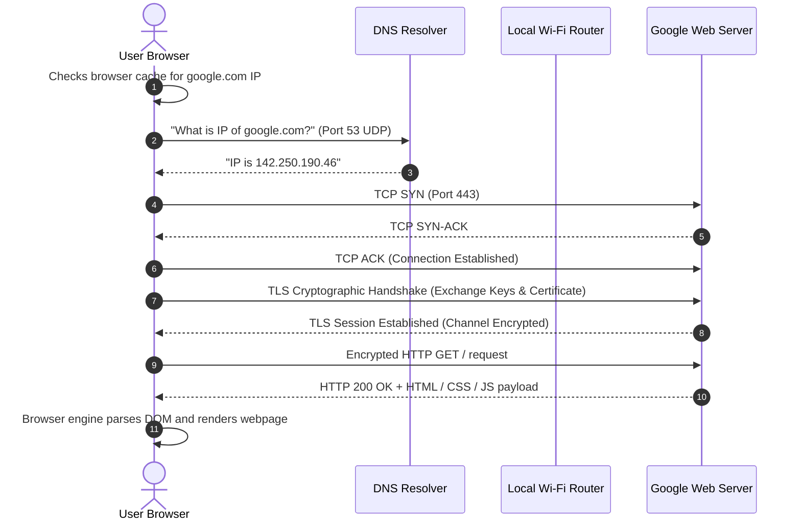

# CHAPTER 08: NETWORKING AND HOW THE INTERNET WORKS

---

## 1. Chapter Introduction
Have you ever wondered what actually happens in the split-second between tapping "Send" on a WhatsApp message in Delhi and having it chime on a phone in London? Or how your computer can stream a 4K movie from Netflix without a single hitch?

The internet is arguably humanity's greatest engineering creation: a global mesh connecting billions of computers across copper cables, undersea fiber-optic glass fibers, radio waves, and satellites. In this chapter, we master the fundamental mechanics of **Computer Networks and the Internet**. We will explore the global postal system analogy, **Packet Switching**, **IP Addresses** (IPv4 vs. IPv6), **MAC Addresses**, the **Domain Name System (DNS)**, the difference between reliable **TCP** and blazing-fast **UDP**, and trace the step-by-step microscopic journey of what happens when you type `google.com` into your browser.

---

## 2. Why Should I Learn This?
- **Every Application is a Network Application:** Today, virtually no software runs in total isolation. Whether building mobile apps, web backends, databases, or cloud microservices, software communicates over networks.
- **Diagnose Network Bottlenecks:** Is your app slow because of database processing, server CPU, DNS resolution delay, or packet loss over Wi-Fi? Network literacy lets you isolate issues instantly.
- **Foundational for Cybersecurity & Cloud:** Firewalls, VPCs, API gateways, and encryption protocols (TLS/HTTPS) all operate directly on the networking principles covered in this chapter.

---

## 3. Everyday-Life Example
### The Global Postal Delivery System Analogy
Imagine sending a 500-page book to a friend living on another continent:
1. **The Problem:** The postal service refuses to ship a 500-page book in a single massive box because it might get lost or block conveyor belts.
2. **The Solution (Packet Switching):**
   - You tear the book into 500 individual pages (the **Data Payload**).
   - You slip each page into a standardized envelope (a **Packet**).
   - On every envelope, you write the recipient's street address (the **Destination IP Address**) and your return address (the **Source IP Address**).
   - You write a sequence number on each envelope: *"Page 1 of 500"*, *"Page 2 of 500"* (the **TCP Header**).
3. **The Mail Sorting Centers (Routers):**
   - You drop the envelopes into the local mailbox.
   - Mail sorting facilities inspect the destination country and city on each envelope and route them along various cargo flights, delivery vans, and ships. Page 4 might travel on a flight through Dubai, while Page 5 flies through Singapore!
4. **Reassembly at Destination (The Receiver):**
   - Your friend receives the envelopes. Because different routes have different delays, Page 12 might arrive before Page 3!
   - Your friend inspects the sequence numbers, sorts them into numerical order, and notices if Page 47 is missing.
   - If Page 47 was dropped in transit, your friend sends a postcard saying: *"Please re-send Page 47!"* (TCP Retransmission).
   - Once all 500 pages are present, your friend rebinds the book.

This is exactly how video files, web pages, and photos travel across the global internet every millisecond.

---

## 4. Industry Example
### Undersea Cables & Content Delivery Networks (Cloudflare / Netflix Open Connect)
1. **The Undersea Fiber-Optic Backbone:**
   Over 99% of international internet traffic does not travel through satellites; it travels through deep-sea **Submarine Fiber-Optic Cables** laid on the ocean floor. These armored cables, no thicker than a garden hose, carry laser light pulses bouncing inside strands of purified glass, transmitting tens of Terabits per second across the Atlantic and Pacific oceans.
2. **Content Delivery Networks (CDNs):**
   If every Netflix user in Mumbai streamed movies directly from servers in California, international undersea cables would saturate, causing buffering and multi-second delays.
   - Netflix built **Netflix Open Connect**: custom storage appliances containing petabytes of popular movies installed directly inside local Indian Internet Service Providers (ISPs) like Airtel and Jio.
   - When you click "Play" on *Stranger Things*, the video chunks travel only $15\text{ km}$ across your city's local fiber network, starting in less than $20\text{ milliseconds}$!

---

## 5. Prerequisites
- Completion of **Chapter 01: Introduction to Computers and Data** (bits, bytes, transmission speeds) and **Chapter 04: Binary Number Systems** (hexadecimal and byte notation).

---

## 6. Basic Explanation
### What is a Computer Network?
A **Computer Network** is two or more computing devices connected together by physical communication links (wires or radio waves) for the purpose of sharing data and resources.

Networks are classified by geographic scale:
- **LAN (Local Area Network):** Connects computers within a small geographic area (your home Wi-Fi, a school computer lab, or an office floor).
- **MAN (Metropolitan Area Network):** Covers a city or university campus.
- **WAN (Wide Area Network):** Connects computers across cities, countries, or the entire planet. **The Internet is the world's largest WAN!**

---

## 7. Detailed Technical Explanation

### 7.1 Circuit Switching vs. Packet Switching
Why is the internet so resilient compared to old analog telephone networks?

```
CIRCUIT SWITCHING (Old Telephone Networks)
Sender =================[ DEDICATED PHYSICAL CIRCUIT ]================= Receiver
- If wire is cut, call dies permanently.
- If nobody speaks, expensive bandwidth is completely wasted.

PACKET SWITCHING (The Modern Internet)
             /---> [ Router B ] ---\
[ Sender ] ------> [ Router A ] -------> [ Router D ] ----> [ Receiver ]
             \---> [ Router C ] ---/
- Data broken into independent chunks (Packets).
- Packets take different routes dynamically based on traffic.
- If Router B crashes, packets automatically reroute through Router C!
```

- **Circuit Switching:** A dedicated, exclusive physical electrical path is established between two endpoints for the entire duration of communication.
- **Packet Switching:** Data is divided into discrete chunks called **Packets**. Each packet contains data payload and header metadata (source, destination, sequence number). Routers forward packets independently across available paths. This maximizes channel utilization and guarantees that if any single network cable is severed, traffic reroutes dynamically around the damage.

### 7.2 Addressing the Internet: MAC vs. IP Addresses

| Feature | MAC Address (Media Access Control) | IP Address (Internet Protocol) |
| :--- | :--- | :--- |
| **Layer** | Data Link Layer (Layer 2) | Network Layer (Layer 3) |
| **Nature** | **Physical & Permanent.** Burned into your network card (NIC) at the factory. | **Logical & Dynamic.** Assigned by your ISP or router based on where you are connected. |
| **Analogy** | A person's Government ID / Aadhaar / Passport Number (Identity). | A person's current postal delivery address (Location). |
| **Format** | 48-bit Hexadecimal (`6C:40:08:9B:F3:12`) | IPv4: 32-bit dotted-decimal (`192.168.1.1`)<br>IPv6: 128-bit hex (`2404:6800:4009:81b::200e`) |
| **Scope** | Local communication on the same Wi-Fi/switch. | Global routing across the internet. |

#### IPv4 vs. IPv6:
- **IPv4 (32-Bit):** $2^{32} = 4,294,967,296$ unique addresses (~4.3 billion). As billions of smartphones, laptops, servers, and smart bulbs connected to the internet, the world officially ran out of unallocated IPv4 addresses in 2011!
- **NAT (Network Address Translation):** Kept IPv4 alive by allowing an entire home or office with 50 devices to share a single public IP address, using local private IPs (`192.168.x.x`).
- **IPv6 (128-Bit):** Provides $2^{128} \approx 3.4 \times 10^{38}$ unique addresses (340 undecillion addresses)—enough to assign a unique IP address to every single atom on the surface of planet Earth!

### 7.3 Domain Name System (DNS): The Internet's Phonebook
Humans remember words (`google.com`, `wikipedia.org`); computers only route numbers (`142.250.190.46`). **DNS** translates human-readable domain names into machine-routable IP addresses through a hierarchical lookup tree:

```
                                [ ROOT DNS SERVERS (.) ]
                                           |
                    +----------------------+----------------------+
                    |                                             |
           [ .COM TLD Server ]                           [ .ORG TLD Server ]
                    |
      [ Authoritative DNS Server ]
          (for google.com)
                    |
      Resolves "google.com" -> 142.250.190.46
```

1. **Browser Cache & OS Cache:** The computer checks if it already resolved `google.com` recently.
2. **Recursive DNS Resolver (ISP / Google 8.8.8.8 / Cloudflare 1.1.1.1):** If not in cache, the request goes to your ISP's recursive resolver.
3. **Root Nameservers (`.`):** Directs the resolver to the **Top-Level Domain (TLD)** nameserver for `.com`.
4. **TLD Nameserver (`.com`):** Directs the resolver to the **Authoritative Nameserver** for `google.com`.
5. **Authoritative Nameserver:** Returns the final IP address (`142.250.190.46`). The resolver caches it and returns it to your browser.

### 7.4 Transport Layer Protocols: TCP vs. UDP

```
+------------------------------------+    +------------------------------------+
|    TCP (Transmission Control)      |    |      UDP (User Datagram)           |
|                                    |    |                                    |
|   - Connection-Oriented (Handshake)|    |   - Connectionless (No Handshake)  |
|   - Guaranteed Delivery (ACKs)     |    |   - No Guarantees (Fire-and-forget)|
|   - Ordered Packet Sequencing      |    |   - Packets may arrive out of order|
|   - Slower, heavier overhead       |    |   - Blazing fast, minimal overhead |
|   - Uses: Web (HTTP), Email, Files |    |   - Uses: Live Gaming, VoIP, Video |
+------------------------------------+    +------------------------------------+
```

#### The TCP 3-Way Handshake:
Before transmitting a single byte of web data, client and server synchronize:
1. **SYN (Synchronize):** Client sends: *"Hello, I want to talk! My starting sequence number is 1000."*
2. **SYN-ACK (Synchronize-Acknowledge):** Server responds: *"Hello! I acknowledge your 1000 (ACK 1001), and my starting sequence number is 5000."*
3. **ACK (Acknowledge):** Client replies: *"Got your 5000 (ACK 5001)! Connection established, here comes my data."*

### 7.5 Ports and Sockets
An IP address identifies a physical host on the network. But once the packet arrives at the server, which software application should receive it? The web server? The database? The email service?
The OS uses **Port Numbers** (16-bit integers, $0\text{ to }65,535$):
- **Port 80:** Unencrypted Web (HTTP)
- **Port 443:** Secure Encrypted Web (HTTPS / TLS)
- **Port 22:** Secure Shell remote administration (SSH)
- **Port 53:** Domain Name System (DNS)
A **Socket** is the combination of an $(\text{IP Address} : \text{Port Number})$, uniquely identifying a specific communication channel (e.g., `142.250.190.46:443`).

---

## 8. Important Terminology
- **Packet:** The basic unit of data transmitted over a packet-switched network, containing header metadata and payload data.
- **Router:** A Layer-3 networking device that inspects destination IP addresses and forwards packets between different networks.
- **Switch:** A Layer-2 networking device that forwards data frames between devices on the same local network using MAC addresses.
- **IP Address:** A numerical label assigned to every device connected to a computer network that uses the Internet Protocol.
- **MAC Address:** A unique hardware identifier permanently assigned to a Network Interface Card (NIC) by its manufacturer.
- **DNS (Domain Name System):** The hierarchical, decentralized naming system that translates domain names into numerical IP addresses.
- **TCP (Transmission Control Protocol):** Connection-oriented transport protocol providing reliable, ordered, error-checked packet delivery.
- **UDP (User Datagram Protocol):** Lightweight, connectionless transport protocol providing low-latency, unacknowledged transmission.
- **Latency (Ping):** The time taken for a data packet to travel from source to destination and back (measured in milliseconds).
- **Bandwidth:** The maximum rate of data transfer across a given network path (measured in Megabits per second, Mbps).
- **HTTP / HTTPS:** Hypertext Transfer Protocol (and its TLS-encrypted secure variant) used for fetching web pages and REST API payloads.

---

## 9. Diagrams and Illustrations
### The Microscopic Journey of a Web Request (`https://www.google.com`)



---

## 10. Step-by-Step Examples

### Example 8.1: Packet Checksum Calculation
How does a receiver detect if a network cable introduced electrical noise that flipped a bit in transit?
Internet protocols use the **Internet Checksum (RFC 1071)**:

**Problem:** Calculate the 16-bit checksum for two 16-bit binary words:
- Word 1: `0x4500` ($0100\ 0101\ 0000\ 0000_2$)
- Word 2: `0x003C` ($0000\ 0000\ 0011\ 1100_2$)

1. **Step 1: Add words using binary addition:**
   $$\begin{array}{r@{\quad}l}
     0100\ 0101\ 0000\ 0000 & (\text{0x4500}) \\
   + 0000\ 0000\ 0011\ 1100 & (\text{0x003C}) \\
   \hline
     0100\ 0101\ 0011\ 1100 & (\text{0x453C})
   \end{array}$$
2. **Step 2: Add any carry-out bits (End-Around Carry):**
   - Here, carry-out is 0. Sum remains `0x453C`.
3. **Step 3: Invert all bits (One's Complement):**
   - Invert: $1011\ 1010\ 1100\ 0011_2 \implies \mathbf{0xBAC3}$
4. **Verification at Receiver:**
   - The receiver sums Word 1 + Word 2 + Checksum:
     $$\text{0x4500} + \text{0x003C} + \text{0xBAC3} = \text{0xFFFF} \quad (1111\ 1111\ 1111\ 1111_2)$$
   - Inverting all-ones yields **0**. Since the final result is zero, the packet is guaranteed free of single-bit transmission errors!

---

## 11. Practical Implementation
Let us write a Python network simulator that demonstrates:
1. Simulating a **DNS Cache and Recursive Resolver**.
2. Simulating the **TCP 3-Way Handshake state machine**.
3. Verifying an **Internet Packet Checksum**.

```python
"""
Practical Lab 1.8: Network Protocols, DNS Resolver & TCP Handshake Simulator
File: 11_PROGRAMMING_LAB/level_1/ch08_network_sim.py
Author: Computer Science Master Library
Description: Simulates DNS hierarchical name resolution, packet checksum
             verification, and the TCP 3-way handshake state machine.
"""

import sys
from typing import Dict, Tuple, Optional

if hasattr(sys.stdout, "reconfigure"):
    try:
        sys.stdout.reconfigure(encoding="utf-8")
    except Exception:
        pass


class DNSResolverSimulator:

    def __init__(self):
        # Local cache
        self.cache: Dict[str, str] = {}
        # Authoritative DNS records
        self.authoritative_zone: Dict[str, str] = {
            "google.com": "142.250.190.46",
            "github.com": "140.82.121.4",
            "wikipedia.org": "208.80.154.224",
            "bharatconnect.in": "103.14.120.5",
        }

    def resolve(self, domain: str) -> str:
        domain = domain.lower()
        print(f"[DNS Lookup] Request for: '{domain}'")
        if domain in self.cache:
            print(f"  --> CACHE HIT: Found IP {self.cache[domain]} in local cache.")
            return self.cache[domain]

        print("  --> CACHE MISS: Querying Authoritative Root & TLD servers...")
        if domain in self.authoritative_zone:
            resolved_ip = self.authoritative_zone[domain]
            self.cache[domain] = resolved_ip
            print(f"  --> RESOLVED: {domain} -> {resolved_ip} (Saved to cache)\n")
            return resolved_ip
        else:
            raise ValueError(f"NXDOMAIN: Domain '{domain}' does not exist.")


class TCPHandshakeSimulator:

    def __init__(self):
        self.state: str = "CLOSED"

    def perform_handshake(
        self, client_ip: str, server_ip: str, port: int = 443
    ) -> bool:
        print("=" * 60)
        print(
            f"   INITIATING TCP 3-WAY HANDSHAKE: {client_ip} -> {server_ip}:{port}"
        )
        print("=" * 60)

        # Step 1: Client sends SYN
        client_seq = 1000
        print(
            f"Step 1 [Client -> Server]: Flag=SYN, Client_Seq={client_seq}, Port={port}"
        )
        self.state = "SYN_SENT"

        # Step 2: Server responds SYN-ACK
        server_seq = 5000
        server_ack = client_seq + 1
        print(
            f"Step 2 [Server -> Client]: Flag=SYN-ACK, Server_Seq={server_seq}, ACK_Num={server_ack}"
        )
        self.state = "SYN_RECEIVED"

        # Step 3: Client acknowledges with ACK
        client_ack = server_seq + 1
        print(
            f"Step 3 [Client -> Server]: Flag=ACK, Seq={server_ack}, ACK_Num={client_ack}"
        )
        self.state = "ESTABLISHED"

        print(
            f"--> TCP CONNECTION ESTABLISHED: Socket ({client_ip} <-> {server_ip}:{port})\n"
        )
        return True


def compute_internet_checksum(words: list[int]) -> int:
    """Computes RFC 1071 16-bit Internet Checksum over a list of 16-bit words."""
    checksum_sum = sum(words)
    # Fold 32-bit sum into 16 bits (carry handling)
    while (checksum_sum >> 16) > 0:
        checksum_sum = (checksum_sum & 0xFFFF) + (checksum_sum >> 16)
    # One's complement (invert)
    return (~checksum_sum) & 0xFFFF


if __name__ == "__main__":
    # Test 1: DNS Resolution & Caching
    dns = DNSResolverSimulator()
    ip1 = dns.resolve("google.com")
    ip2 = dns.resolve("google.com")  # Should be cache hit
    assert ip1 == "142.250.190.46" and ip2 == ip1

    # Test 2: TCP 3-Way Handshake
    tcp = TCPHandshakeSimulator()
    success = tcp.perform_handshake("192.168.1.15", ip1, port=443)
    assert success is True and tcp.state == "ESTABLISHED"

    # Test 3: Checksum verification
    test_words = [0x4500, 0x003C]
    calculated_cs = compute_internet_checksum(test_words)
    print(f"Calculated 16-bit Checksum: 0x{calculated_cs:04X}")
    assert calculated_cs == 0xBAC3, (
        f"Expected 0xBAC3, got 0x{calculated_cs:04X}"
    )

    # Verification: sum of words + checksum should fold to 0xFFFF
    total = sum(test_words) + calculated_cs
    while (total >> 16) > 0:
        total = (total & 0xFFFF) + (total >> 16)
    assert total == 0xFFFF, "Checksum verification failed!"
    print("Checksum mathematically verified (folded sum = 0xFFFF).")

    print("\nAll network simulation tests verified successfully.")
```

---

## 12. Industry Implementation
### Zero-Downtime Traffic Routing via Anycast BGP
When you connect to Google DNS (`8.8.8.8`) or Cloudflare DNS (`1.1.1.1`):
- `8.8.8.8` is NOT a single physical server sitting in California!
- **Anycast BGP Routing:** Google advertises the exact same IP address (`8.8.8.8`) from hundreds of data centers across India, Japan, Germany, and the US simultaneously.
- When an ISP router in Mumbai forwards a packet addressed to `8.8.8.8`, global BGP (Border Gateway Protocol) routing directs it to the geographically closest server rack (e.g., in Mumbai), answering the query in under $3\text{ milliseconds}$.
- If the Mumbai data center encounters an electrical power outage, BGP automatically withdraws the route, and traffic seamlessly routes to Pune or Chennai without users dropping connection!

---

## 13. Advantages and Limitations
### Advantages of the Packet-Switched Internet
1. **Dynamic Resilience:** No central point of failure; destroyed cables or crashed routers are automatically bypassed by dynamic routing algorithms.
2. **Stateless Scalability:** The core routers of the internet do not need to remember state for every active video call; they simply inspect individual packet destination headers and forward them.
3. **Universal Interoperability:** Any device—from an Apple watch to a Linux supercomputer—can communicate seamlessly as long as it speaks the standard TCP/IP protocol.

### Limitations & Security Challenges
1. **Unpredictable Latency & Jitter:** Because packets take dynamic paths, packets may arrive with varying delays (jitter), requiring software buffering for smooth voice and video.
2. **Built Without Native Security:** The foundational internet protocols (IP, DNS, BGP) were designed in the 1970s for trusted academic labs. They contain zero built-in encryption or authentication, requiring added security layers like **TLS/HTTPS, DNSSEC, and BGPsec**.

---

## 14. Common Mistakes
1. **Assuming "The Internet" and "The World Wide Web (WWW)" are Identical:** The **Internet** is the physical and logical networking infrastructure (wires, routers, IP packets). The **Web (WWW)** is just one application service running *on top* of the internet using HTTP and web browsers (alongside email, multiplayer gaming, BitTorrent, and SSH).
2. **Confusing Bandwidth with Latency:** Buying a "1 Gbps connection" and wondering why gaming latency (ping) didn't decrease from $80\text{ ms}$ to $1\text{ ms}$. Bandwidth is the *width of the pipe* (how much data can flow per second); latency is the *speed of light delay* (how long a single packet takes to travel physically from Delhi to London).
3. **Using TCP for Real-Time Multiplayer Games:** Using TCP for high-speed shooting or racing games. If packet 14 drops, TCP pauses everything and waits for a retransmission, causing severe screen freezes (rubber-banding). Games use **UDP**, discarding dropped packets and rendering the latest state immediately!

---

## 15. AI Connection
### AI for Network Traffic Engineering & Cybersecurity Defense
Modern telecommunications networks route petabytes of traffic per second.
- **AI-Powered Network Intrusion Detection (NIDS):** Deep learning models monitor network flow telemetry, detecting DDoS attacks, botnet command-and-control beacons, and data exfiltration patterns within seconds, automatically updating firewall drop rules.
- **Predictive Traffic Routing:** Telecommunications providers use reinforcement learning to predict congestion spikes (e.g., during a live World Cup cricket match) and dynamically shift bandwidth routes before buffers overflow.

---

## 16. AI Future Insights
- **Established Technology:** SD-WAN (Software-Defined Wide Area Networking) with AI traffic steering across satellite, fiber, and 5G cellular.
- **Emerging Technology:** Satellite Mega-Constellations (Starlink, Kuiper) utilizing inter-satellite laser links in the vacuum of space, routing packets between continents faster than terrestrial fiber optics (light travels 47% faster in vacuum than in glass fiber!).
- **Reasonable Future Projection:** Post-Quantum Cryptography in TLS. Migrating the internet's HTTPS encryption from RSA and ECC to lattice-based cryptography to prevent future quantum computers from decrypting recorded traffic.
- **Speculative Possibility:** The Quantum Internet. Transmitting entangled quantum photons across fiber networks, enabling theoretically unhackable communications through quantum key distribution (QKD).

---

## 17. Career Relevance
- **Network Engineers (CCNA/CCNP):** Configure enterprise switches, BGP routers, VLANs, and firewalls.
- **Backend & Cloud Developers:** Design REST, GraphQL, and gRPC APIs, configure reverse proxies (Nginx), and optimize payload sizes.
- **DevOps & Infrastructure Engineers:** Set up Kubernetes network overlays (Calico/Cilium), configure AWS VPCs, and manage DNS records.
- **Cybersecurity & Penetration Testers:** Inspect packet captures using Wireshark, analyze port scans (`nmap`), and detect vulnerabilities in network protocol implementations.

---

## 18. Interview Preparation

### Category A: Beginner / Fresher Level
#### Q1: What is the difference between TCP and UDP?
- **Answer:** **TCP (Transmission Control Protocol)** is connection-oriented and requires a 3-way handshake before transmitting data. It guarantees reliable, ordered packet delivery with error-checking and retransmissions, but introduces higher latency and overhead. It is used for web pages (HTTP), email (SMTP), and file transfers. **UDP (User Datagram Protocol)** is connectionless and sends packets ("fire-and-forget") without handshakes, acknowledgments, or delivery guarantees. It offers minimal latency and overhead, making it ideal for real-time video streaming, online gaming, VoIP calls, and DNS queries.

#### Q2: What is the function of the Domain Name System (DNS)?
- **Answer:** DNS is the decentralized, hierarchical naming system that translates human-memorable domain names (like `google.com`) into machine-routable numerical IP addresses (like `142.250.190.46`). It eliminates the need for humans to memorize numerical IP addresses. When a user requests a URL, DNS resolvers traverse root nameservers, TLD nameservers, and authoritative nameservers to return the matching IP address.

### Category B: Intermediate Level
#### Q3: What happens when you type a URL like `https://www.example.com` into your browser address bar and press Enter?
- **Answer:** 
  1. **URL Parsing:** The browser breaks down the protocol (`https`), domain (`www.example.com`), and path (`/`).
  2. **DNS Resolution:** The browser checks its cache, OS cache, and queries a recursive DNS resolver to resolve `www.example.com` to an IP address.
  3. **TCP Connection:** The browser initiates a TCP 3-way handshake (SYN, SYN-ACK, ACK) with the server on port 443.
  4. **TLS Handshake:** The client and server exchange certificates, verify the certificate authority, and negotiate symmetric encryption keys via a TLS handshake.
  5. **HTTP Request:** The browser sends an encrypted HTTP `GET /` request.
  6. **Server Processing:** The web server receives the request, queries databases if necessary, and returns an HTTP response (status code 200 OK + HTML/CSS/JS payload).
  7. **Browser Rendering:** The browser parses the HTML DOM, renders the CSS styling, executes JavaScript, and displays the webpage.

---

## 19. Practice Questions

### Multiple-Choice Questions (MCQs)
1. Which layer of the 5-layer Internet model is responsible for end-to-end process communication and port numbers?
   - A) Network Layer
   - B) Transport Layer
   - C) Data Link Layer
   - D) Physical Layer
   *(Answer: B)*

2. What is the standard port number used for secure, encrypted web traffic (HTTPS)?
   - A) 80
   - B) 22
   - C) 443
   - D) 8080
   *(Answer: C)*

3. Which protocol is primarily used for streaming real-time multiplayer video game telemetry where speed is prioritized over guaranteed delivery?
   - A) TCP
   - B) UDP
   - C) FTP
   - D) SMTP
   *(Answer: B)*

### Short Answer Questions
1. Differentiate between a MAC address and an IP address.
2. What is the purpose of the TCP 3-Way Handshake?
3. What is Network Address Translation (NAT) and why was it invented?

### Long Answer Questions
1. Compare and contrast Packet Switching with Circuit Switching. Explain why packet switching forms the foundational architecture of the modern internet.
2. Explain the DNS resolution hierarchy in detail from Root servers, TLD servers, Authoritative servers to Recursive resolvers. What is DNS caching and why is it essential?

---

## 20. Solved Examples
### Problem 20.1: Calculating Packet Transmission Delay
**Question:** A server transmits a 10 Megabyte ($10\text{ MB}$) video file over a network link with a bandwidth of $100\text{ Megabits per second (Mbps)}$. The distance between sender and receiver is $3,000\text{ km}$, and signals travel through fiber optic cable at the speed of light in glass ($200,000\text{ km/second}$).
Calculate:
1. Transmission Delay (time to push all bits onto the wire).
2. Propagation Delay (time for one bit to travel physically across the distance).
3. Total Latency to deliver the file (ignoring queuing and processing delays).

**Step-by-Step Solution:**
1. **Convert File Size to Bits:**
   $$10\text{ MB} = 10 \times 1,024 \times 1,024\text{ bytes} = 10,485,760\text{ bytes}$$
   $$\text{Total Bits} = 10,485,760 \times 8 = 83,886,080\text{ bits}$$
2. **Calculate Transmission Delay ($D_{trans}$):**
   $$\text{Bandwidth} = 100\text{ Mbps} = 100 \times 10^6\text{ bits/second}$$
   $$D_{trans} = \frac{\text{Total Bits}}{\text{Bandwidth}} = \frac{83,886,080}{100,000,000} \approx \mathbf{0.8389\text{ seconds}} \quad (838.9\text{ ms})$$
3. **Calculate Propagation Delay ($D_{prop}$):**
   $$D_{prop} = \frac{\text{Distance}}{\text{Propagation Speed}} = \frac{3,000\text{ km}}{200,000\text{ km/s}} = \mathbf{0.015\text{ seconds}} \quad (15\text{ ms})$$
4. **Total Delivery Latency:**
   $$\text{Total Latency} = D_{trans} + D_{prop} = 838.9\text{ ms} + 15.0\text{ ms} = \mathbf{853.9\text{ ms}}$$
   **Final Answer:** Transmission delay is $838.9\text{ ms}$, propagation delay is $15.0\text{ ms}$, and total delivery latency is $853.9\text{ ms}$ (~$0.854\text{ seconds}$).

---

## 21. Unsolved Exercises
1. **Exercise 8.1:** Open your terminal and run `traceroute google.com` (on macOS/Linux) or `tracert google.com` (on Windows). Count how many router hops your packet traversed to reach Google. Record the latency at each hop.
2. **Exercise 8.2:** In the Python network simulator from Section 11, add a simulation of a packet drop during the TCP handshake (e.g., Step 2 SYN-ACK gets dropped). Implement a timeout and retransmission loop.
3. **Exercise 8.3:** Calculate how many IPv4 addresses are reserved in a `/24` subnet and explain why the usable host count is $254$ instead of $256$.

---

## 22. Chapter Summary
- A **computer network** connects computing devices via physical links (copper, fiber, radio) to share resources.
- The internet is built on **packet switching**, breaking data into discrete packets that route dynamically across decentralized routers without requiring dedicated physical circuits.
- **MAC addresses** (48-bit hex) provide permanent local physical identity; **IP addresses** (IPv4 32-bit, IPv6 128-bit) provide routable global locations.
- **DNS** translates human domain names into numerical IP addresses across a distributed hierarchy of Root, TLD, and Authoritative nameservers.
- **TCP** provides reliable, ordered, error-checked data delivery via a 3-way handshake (SYN, SYN-ACK, ACK); **UDP** provides lightweight, connectionless, low-latency transmission.
- **Port numbers** route incoming packets to specific application processes (Port 80/443 for web, Port 22 for SSH).
- Requesting a web page initiates a cascade of DNS resolution, TCP handshake, TLS encryption, and HTTP request-response parsing.

---

## 23. Revision Sheet
- **Address Sizes:**
  - MAC Address = $48\text{ bits}$ ($6\text{ bytes}$)
  - IPv4 Address = $32\text{ bits}$ ($4\text{ bytes}$)
  - IPv6 Address = $128\text{ bits}$ ($16\text{ bytes}$)
  - Port Number = $16\text{ bits}$ ($0 - 65,535$)
- **Common Port Standards:** HTTP = 80, HTTPS = 443, SSH = 22, DNS = 53.
- **TCP 3-Way Handshake:** $\text{SYN} \rightarrow \text{SYN-ACK} \rightarrow \text{ACK}$.
- **Delays:**
  - $D_{trans} = \frac{L\text{ (bits)}}{R\text{ (bps)}}$
  - $D_{prop} = \frac{d\text{ (distance)}}{s\text{ (speed)}}$

---

## 24. References
1. **Kurose, James F., and Keith W. Ross.** *Computer Networking: A Top-Down Approach.* 8th Edition, Pearson, 2020. Chapter 1: "Computer Networks and the Internet" and Chapter 2: "Application Layer."
2. **Tanenbaum, Andrew S., David J. Wetherall, and Nick Feamster.** *Computer Networks.* 6th Edition, Pearson, 2021. Chapter 1: "Introduction" and Chapter 5: "The Network Layer."
3. **Postel, Jon.** *"Internet Protocol."* RFC 791, 1981; and *"Transmission Control Protocol."* RFC 793, 1981. (The foundational internet RFC standards).
4. **Mockapetris, Paul.** *"Domain Names - Concepts and Facilities."* RFC 1034, 1987. (The official DNS specification).
