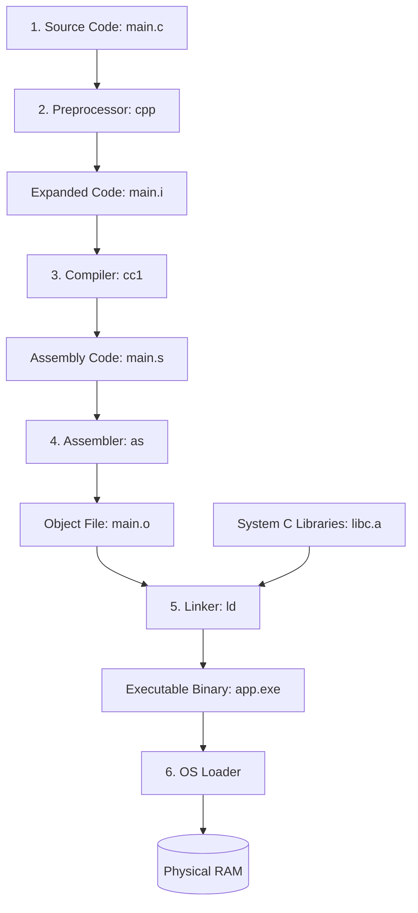

# CHAPTER 09: INTRODUCTION TO PROGRAMMING AND COMPILERS

---

## 1. Chapter Introduction
In Chapter 2, we saw that a CPU core only understands streams of binary numbers like `10110000 00101010` (Machine Code). But human beings do not think in binary hexadecimal opcodes; humans think in words, concepts, and mathematical equations. If programmers had to write modern software by hand-typing billions of binary digits, building an app like WhatsApp or a 3D video game would take hundreds of lifetimes!

In this chapter, we bridge human thought and silicon hardware: **Programming Languages, Compilers, and Interpreters**. We will explore the evolutionary hierarchy of programming languages (from raw Machine Code to Python and Rust), understand the step-by-step **Translation Pipeline** (Preprocessor, Compiler, Assembler, Linker, and Loader), demystify the difference between **Compiled, Interpreted, and Just-In-Time (JIT)** languages, and write our very own working mini-interpreter in Python!

---

## 2. Why Should I Learn This?
- **Demystify the Build Process:** When you press "Run" or "Build" in your code editor, what is actually happening? Why do you get "Syntax Errors", "Linker Errors", or "Unresolved External Symbol" bugs? Understanding the compilation pipeline turns mysterious build errors into straightforward fixes.
- **Choose the Right Tool for the Job:** Why is Python preferred for data science and AI, while C++ is used for game engines and operating systems, and JavaScript dominates web browsers? Knowing how language runtimes work allows you to pick the right technology stack.
- **Write Machine-Friendly Code:** Code that plays nicely with compilers and virtual machines runs orders of magnitude faster and consumes significantly less cloud infrastructure cost.

---

## 3. Everyday-Life Example
### Translating an English Book into Hindi: The Publisher vs. The Live Interpreter
Imagine you have a best-selling English novel and want a Hindi audience to read it:

1. **Approach 1: The Full Book Translator (The Compiler - e.g., C, C++, Rust):**
   - A professional translator takes the entire English book, works for 3 months, translates every sentence into Hindi, and prints 100,000 physical copies of the Hindi book.
   - **The Advantage:** When a Hindi reader buys the book, they read it instantly at full speed without needing the translator present.
   - **The Catch:** If the author changes a single paragraph, the entire book must be re-translated and re-printed. Furthermore, a Hindi book cannot be read by someone who only speaks Japanese (Platform Dependency).
2. **Approach 2: The Real-Time Whisper Translator (The Interpreter - e.g., Python, Ruby):**
   - The English author speaks aloud at a conference. An interpreter stands next to them, listening to one sentence at a time and whispering the Hindi translation to the audience.
   - **The Advantage:** Highly flexible. The author can change sentences on the fly, and the listener doesn't need to wait 3 months for a printed book.
   - **The Catch:** It is significantly slower. The author must pause after every sentence while the translator works.
3. **Approach 3: The Hybrid Courtroom Stenographer (JIT Compiler - e.g., Java JVM, JavaScript V8):**
   - The translator writes a quick shorthand summary first (Bytecode), and if the author repeats a popular phrase 50 times, the translator pre-records that phrase in Hindi and plays it instantly (Just-In-Time compilation)!

---

## 4. Industry Example
### Google V8 Engine: How Chrome Runs JavaScript at Blazing Speeds
When JavaScript was created in 1995, it was a slow, interpreted language meant for simple form validations (like checking if an email has an `@` symbol).
1. In 2008, Google engineers revolutionized web performance by releasing the **V8 Engine** in Google Chrome:
2. **Ignition (The Bytecode Interpreter):** When you load Google Docs or Figma in your browser, V8 quickly compiles the JavaScript text into compact bytecode and begins executing it immediately without noticeable startup lag.
3. **TurboFan (The JIT Optimizing Compiler):** While the code is running, an internal profiler watches which functions are executed repeatedly (**Hot Code**). TurboFan takes those hot functions, compiles them on-the-fly into ultra-fast, raw x86-64 machine instructions, and swaps them in while the webpage is running!
4. This JIT architecture allowed complex applications like Google Earth, video editors, and games to run directly inside web browsers at near-native C++ speeds.

---

## 5. Prerequisites
- Completion of **Chapter 02: How Computer Hardware Works** (Fetch-Decode-Execute machine cycle) and **Chapter 06: Algorithms, Flowcharts and Pseudocode**.

---

## 6. Basic Explanation
A **Programming Language** is a formal, constructed language designed to communicate instructions to a machine.

Languages are organized into generational levels based on their distance from physical hardware:
1. **Low-Level Languages:** Close to the silicon hardware.
   - **Machine Code:** Raw binary (`0`s and `1`s). Native to the CPU, unreadable to humans.
   - **Assembly Language:** Replaces binary numbers with short text abbreviations called **mnemonics** (e.g., `MOV`, `ADD`, `JMP`).
2. **High-Level Languages:** Close to human language and mathematics.
   - Written in English words (`if`, `while`, `print`).
   - Completely independent of the underlying CPU architecture. A Python or C program can run on an Intel x86 PC, an ARM smartphone, or a RISC-V microcontroller!

```
+-------------------------------------------------------------+
| HIGH-LEVEL CODE:                                            |
|   total = price * 1.18                                      |
+-------------------------------------------------------------+
                              |
                              v  (Compiled / Translated)
+-------------------------------------------------------------+
| ASSEMBLY MNEMONICS:                                         |
|   movss   xmm0, DWORD PTR [rbp-4]                           |
|   mulss   xmm0, DWORD PTR .LC0[rip]                         |
+-------------------------------------------------------------+
                              |
                              v  (Assembled into Machine Code)
+-------------------------------------------------------------+
| RAW BINARY MACHINE CODE (What the CPU executes):            |
|   F3 0F 10 45 FC F3 0F 59 05 ... (10110000 01100001 ...)    |
+-------------------------------------------------------------+
```

---

## 7. Detailed Technical Explanation

### 7.1 The Complete Compilation & Translation Pipeline
When you write a C or C++ program (`main.c`) and run `gcc main.c -o app`, five discrete software tools execute sequentially under the hood:



1. **The Preprocessor:**
   - Scans for directives starting with `#` (e.g., `#include <stdio.h>`, `#define PI 3.14159`).
   - Strips comments (`//`), expands macros, and physically pastes the contents of header files into the code.
2. **The Compiler:**
   - The heart of translation. It parses the expanded source code, checks syntax, performs semantic analysis, and translates the high-level statements into architecture-specific **Assembly Language** (`main.s`).
3. **The Assembler:**
   - Takes the human-readable assembly mnemonics (`MOV`, `ADD`) and translates them directly into machine-readable binary **Object Code** (`main.o`).
4. **The Linker:**
   - A real program is made of multiple source files and external libraries (like `printf` or math functions). The linker stitches all `.o` object files together, resolves cross-file function memory addresses, and bundles them into a standalone **Executable Binary** (`.exe` on Windows, ELF binary on Linux).
5. **The Loader:**
   - A subsystem of the OS kernel. When you double-click the executable, the loader allocates virtual memory, copies code and initialized data from your SSD into RAM, sets up the stack and heap, and points the CPU's Program Counter (PC) to the first instruction (`main`).

### 7.2 Compilers vs. Interpreters vs. JIT Compilers

| Feature | Ahead-Of-Time (AOT) Compiler | Pure Interpreter | Just-In-Time (JIT) Hybrid |
| :--- | :--- | :--- | :--- |
| **Examples** | C, C++, Rust, Go, Swift | Classic Python (CPython), Ruby, PHP | Java (JVM), C# (.NET CLR), JS (V8) |
| **Translation Time** | Ahead of time before execution. | Line-by-line during execution. | Bytecode generated ahead of time; compiled during runtime. |
| **Execution Speed** | **Fastest (Native)**. Direct CPU instructions. | **Slowest**. Software translation loop overhead. | **Very Fast**. Approaching native speeds for hot loops. |
| **Portability** | Platform-dependent. Must recompile for ARM vs x86. | Highly portable. Any machine with the interpreter runs it. | Highly portable. The compiled Bytecode (`.class`) runs everywhere. |
| **Memory Overhead** | Minimal. Runs bare binary. | Higher. Interpreter engine must reside in RAM. | Moderate to High (JVM memory footprint). |

### 7.3 Anatomy of a Compiler: From Text to Optimization
How does a compiler know your code has a syntax error?
A modern compiler (like GCC or Clang/LLVM) operates in phases:
1. **Lexical Analysis (Scanner):** Reads characters and groups them into meaningful language tokens (e.g., `total`, `=`, `price`, `*`, `1.18`).
2. **Syntax Analysis (Parser):** Verifies that the sequence of tokens follows the formal grammar of the language, constructing an **Abstract Syntax Tree (AST)**.
3. **Semantic Analysis:** Checks logical correctness (e.g., *Is `price` declared? Are you trying to add an integer to an incompatible text string?*).
4. **Intermediate Code Generation (IR):** Translates the AST into an architecture-neutral intermediate language (like LLVM IR).
5. **Optimization:** Re-arranges instructions, eliminates unused variables (Dead Code Elimination), and unrolls loops to maximize execution speed.
6. **Code Generation:** Outputs raw binary machine instructions tailored for the target CPU (x86-64, ARM64, RISC-V).

### 7.4 Types of Programming Errors
1. **Syntax Errors (Compile-Time):** Violations of the grammatical rules of the language (e.g., missing parenthesis `print("Hello"`, misspelled keyword `whille`). Detected before the program can run.
2. **Runtime Errors (Exceptions):** The syntax is legal, but an illegal operation is attempted during execution (e.g., dividing by zero `x = 10 / 0`, accessing an array index that doesn't exist, running out of RAM). Causes the program to crash.
3. **Logical Errors (Semantic Bugs):** The program compiles and runs without crashing, but produces the wrong answer because the programmer's underlying algorithm was flawed (e.g., writing `total = price - tax` instead of `total = price + tax`). **The most dangerous errors in software engineering!**

---

## 8. Important Terminology
- **Source Code:** High-level human-readable program text written in a programming language.
- **Machine Code:** The native binary (`0`s and `1`s) instructions executed directly by a CPU.
- **Assembly Language:** A low-level programming language using human-readable mnemonics (`MOV`, `ADD`) to represent machine code instructions.
- **Compiler:** A program that translates an entire source code file into machine code or bytecode before execution.
- **Interpreter:** A program that directly executes source code or intermediate bytecode line-by-line without prior complete translation.
- **Just-In-Time (JIT) Compiler:** A runtime compiler that dynamically compiles frequently executed bytecode loops into native machine instructions during program execution.
- **Bytecode:** A platform-independent intermediate binary format (e.g., Java `.class` files or Python `.pyc` files) executed by a virtual machine.
- **Linker:** A systems utility that combines individual object files and library code into a unified executable file.
- **Abstract Syntax Tree (AST):** A tree representation of the abstract syntactic structure of source code used by compilers.
- **Semantic Analysis:** The compiler phase that verifies type compatibility, variable scopes, and logical language rules.

---

## 9. Diagrams and Illustrations
### The Abstract Syntax Tree (AST) for the Expression: `total = price + (rate * 10)`

```
                  Assignment (=)
                   /          \
              Variable       Binary Operator (+)
              (total)         /               \
                         Variable      Binary Operator (*)
                         (price)        /               \
                                   Variable           Literal
                                    (rate)             (10)
```

---

## 10. Step-by-Step Examples

### Example 9.1: Tracing Lexical Analysis (Tokenization)
Suppose a compiler encounters this line of source code:
$$\texttt{int count = 5 + 10;}$$

The Lexical Analyzer (Scanner) scans characters left-to-right and produces a stream of typed **Tokens**:

| Lexeme | Token Type | Value / Metadata |
| :---: | :---: | :--- |
| `int` | `KEYWORD_TYPE` | Native 32-bit integer |
| `count` | `IDENTIFIER` | Variable name symbol |
| `=` | `ASSIGNMENT_OPERATOR` | Assignment |
| `5` | `INTEGER_LITERAL` | Constant 5 |
| `+` | `ARITHMETIC_OPERATOR` | Addition operator |
| `10` | `INTEGER_LITERAL` | Constant 10 |
| `;` | `SEMICOLON` | Statement terminator |

If the programmer accidentally typed `int 5count = ...`, the scanner flags an error: *An identifier cannot begin with a number!*

---

## 11. Practical Implementation
Let us write an educational **Mini-Language Tokenizer, Parser, and Interpreter in Python**. This script implements the exact core pipeline of a real programming language: it scans text into tokens, parses arithmetic expressions into an AST, evaluates logic, and tracks a symbol table of variables!

```python
"""
Practical Lab 1.9: Educational Mini-Interpreter & AST Evaluator
File: 11_PROGRAMMING_LAB/level_1/ch09_simple_interpreter.py
Author: Computer Science Master Library
Description: Demonstrates the foundational phases of a programming language runtime:
             Lexical Tokenization, Parsing, Symbol Table Management, and Execution.
"""

import sys
import re
from typing import List, Dict, Any, Union

if hasattr(sys.stdout, "reconfigure"):
    try:
        sys.stdout.reconfigure(encoding="utf-8")
    except Exception:
        pass


class Token:

    def __init__(self, type_: str, value: Any):
        self.type = type_
        self.value = value

    def __repr__(self):
        return f"Token({self.type}, {repr(self.value)})"


def tokenize(source_code: str) -> List[Token]:
    """LEXICAL ANALYSIS: Converts raw string characters into structured tokens."""
    token_specification = [
        ("NUMBER", r"\d+"),
        ("PRINT", r"\bPRINT\b"),
        ("IDENTIFIER", r"[A-Za-z_][A-Za-z0-9_]*"),
        ("ASSIGN", r"="),
        ("PLUS", r"\+"),
        ("MINUS", r"-"),
        ("MULTIPLY", r"\*"),
        ("SKIP", r"[ \t]+"),  # Skip spaces and tabs
        ("NEWLINE", r"\n"),
    ]
    tok_regex = "|".join(
        f"(?P<{pair[0]}>{pair[1]})" for pair in token_specification
    )
    tokens: List[Token] = []

    for mo in re.finditer(tok_regex, source_code):
        kind = mo.lastgroup
        value = mo.group()
        if kind == "NUMBER":
            tokens.append(Token("NUMBER", int(value)))
        elif kind == "SKIP" or kind == "NEWLINE":
            continue
        elif kind in (
            "PRINT",
            "IDENTIFIER",
            "ASSIGN",
            "PLUS",
            "MINUS",
            "MULTIPLY",
        ):
            tokens.append(Token(kind, value))
        else:
            raise SyntaxError(f"Unexpected character: {value}")

    return tokens


class SimpleInterpreter:
    """INTERPRETER & EXECUTION ENGINE: Evaluates tokens against a Symbol Table."""

    def __init__(self):
        self.symbol_table: Dict[str, int] = {}

    def execute(self, tokens: List[Token]) -> None:
        idx = 0
        n = len(tokens)

        while idx < n:
            tok = tokens[idx]

            # Case 1: Assignment Statement -> IDENTIFIER = EXPRESSION
            if (
                tok.type == "IDENTIFIER"
                and (idx + 1 < n)
                and tokens[idx + 1].type == "ASSIGN"
            ):
                var_name = tok.value
                idx += 2  # Skip identifier and '='

                # Evaluate Expression (supports: Value, or Value OP Value)
                val = self._evaluate_value(tokens[idx])
                idx += 1

                # Check if there is an operator following
                if idx < n and tokens[idx].type in (
                    "PLUS",
                    "MINUS",
                    "MULTIPLY",
                ):
                    op = tokens[idx].type
                    idx += 1
                    rhs = self._evaluate_value(tokens[idx])
                    idx += 1
                    if op == "PLUS":
                        val += rhs
                    elif op == "MINUS":
                        val -= rhs
                    elif op == "MULTIPLY":
                        val *= rhs

                self.symbol_table[var_name] = val
                print(
                    f"[Runtime] Assigned: {var_name} = {val} (Symbol Table Updated)"
                )

            # Case 2: PRINT statement -> PRINT IDENTIFIER
            elif tok.type == "PRINT":
                idx += 1
                target = tokens[idx]
                idx += 1
                result = self._evaluate_value(target)
                print(f">>> OUTPUT: {result}")

            else:
                idx += 1

    def _evaluate_value(self, token: Token) -> int:
        if token.type == "NUMBER":
            return token.value
        elif token.type == "IDENTIFIER":
            if token.value in self.symbol_table:
                return self.symbol_table[token.value]
            else:
                raise NameError(
                    f"Runtime Error: Variable '{token.value}' is referenced before assignment!"
                )
        raise SyntaxError(f"Expected number or identifier, got {token}")


if __name__ == "__main__":
    # Sample Source Code in our mini-language:
    program_code = """
    apples = 10
    bonus = 5
    total = apples + bonus
    PRINT total
    reward = total * 2
    PRINT reward
    """

    print("=" * 60)
    print("        RUNNING MINI-LANGUAGE COMPILER PIPELINE")
    print("=" * 60)
    print("Source Code:\n", program_code)

    # Phase 1: Lexical Analysis
    token_stream = tokenize(program_code)
    print("--- Phase 1: Generated Token Stream ---")
    for t in token_stream:
        print(f"  {t}")
    print()

    # Phase 2 & 3: Execution & Symbol Table Management
    print("--- Phase 2: Execution & Output ---")
    runtime = SimpleInterpreter()
    runtime.execute(token_stream)

    # Verify execution assertions
    assert runtime.symbol_table["apples"] == 10
    assert runtime.symbol_table["bonus"] == 5
    assert runtime.symbol_table["total"] == 15
    assert runtime.symbol_table["reward"] == 30
    print("\nAll interpreter simulation tests passed successfully.")
```

---

## 12. Industry Implementation
### LLVM (Low Level Virtual Machine) Compiler Infrastructure
In modern enterprise software engineering at Apple, Google, Adobe, and Sony:
- Compilers are no longer built as single monolithic blocks.
- **The Modern Compiler Split (LLVM Architecture):**
  - **Frontends:** Specialized parsers for specific languages (Clang for C/C++, Swift for Apple iOS, Rustc for Rust). The frontend only parses code and produces standard **LLVM Intermediate Representation (IR)**.
  - **Optimizer:** A universal optimizer performs hundreds of optimization passes over the LLVM IR (loop vectorization, constant folding).
  - **Backends:** Specialized code generators translate the optimized IR into binary machine instructions for specific hardware (Intel x86, ARM64, NVIDIA PTX, WebAssembly).
- **The Power of LLVM:** If you invent a new programming language, you only need to write a frontend that emits LLVM IR. You instantly get world-class optimizations and support for every CPU chip on Earth for free!

---

## 13. Advantages and Limitations
### Advantages of High-Level Programming
1. **Developer Productivity:** A single line of Python (`sorted(data)`) replaces 50 lines of complex Assembly pointer operations.
2. **Platform Independence:** Code runs without modification across different CPU architectures as long as a compiler or runtime exists.
3. **Compile-Time Safety:** Strong type systems catch errors (like treating text as an integer) before code ever deploys to production.

### Limitations & Trade-Offs
1. **Abstraction Overhead:** High-level abstractions (dynamic typing, garbage collection) consume extra CPU cycles and memory compared to hand-tuned Assembly.
2. **Loss of Hardware Control:** In languages like Python or Java, developers cannot directly control CPU cache placement, memory alignment, or specific hardware registers.

---

## 14. Common Mistakes
1. **Confusing Compilation with Execution:** Assuming that compiling a program runs it. Compiling merely translates the source text into an executable binary file. You must execute the binary file to see results.
2. **Ignoring Compiler Warnings:** Treating compiler warnings as unimportant because *"the program still compiled!"* In languages like C, a warning about uninitialized memory or pointer mismatch almost always turns into a catastrophic production crash or security vulnerability.
3. **Believing Interpreted Code Cannot Be Fast:** Assuming Python is always slow. Python libraries like NumPy and PyTorch execute their heavy mathematical loops using pre-compiled, highly optimized C and CUDA binaries beneath the surface!

---

## 15. AI Connection
### Large Language Models as Compilers & AI-Driven Optimization
- **Natural Language as Code:** LLMs (like Claude, Gemini, and GPT-4) can be viewed as probabilistic compilers that translate human natural language specifications into formal Python, SQL, or Rust source code.
- **Deep Learning in Compilers:** Traditional compilers use fixed heuristics to decide when to unroll a loop or inline a function. Modern research (e.g., Google's CompilerGym and AlphaDev) uses reinforcement learning to discover assembly instruction sequences that execute sorting algorithms up to 70% faster than human-engineered heuristics!

---

## 16. AI Future Insights
- **Established Technology:** Automated AI code completion and syntax error auto-fixers integrated directly into IDEs.
- **Emerging Technology:** Neural Decompilation, using deep learning to reconstruct clean, readable high-level source code from stripped, raw binary executables.
- **Reasonable Future Projection:** Intent-Driven Programming, where software engineers specify high-level invariants, security boundaries, and unit tests, and AI synthesis engines generate, verify, and compile the entire implementation automatically.
- **Speculative Possibility:** Self-Optimizing Autonomous Binaries that continuously recompile their own machine code in RAM based on real-time hardware telemetry and live user usage patterns.

---

## 17. Career Relevance
- **Software Developers (All Languages):** Understanding compilation turns obscure build errors into simple fixes and enables writing clean, idiomatic code.
- **Game Engine & Systems Programmers:** Fine-tune compiler flags (`-O3`, `-march=native`, Link-Time Optimization) to squeeze maximum frame rates out of hardware.
- **Compiler & Tools Engineers:** Build programming languages, linters, debuggers, and domain-specific compilers at tech giants (Apple, Google, Microsoft).
- **Security Researchers:** Analyze disassembly output (`objdump`, Ghidra, IDA Pro) to discover buffer overflows and vulnerabilities.

---

## 18. Interview Preparation

### Category A: Beginner / Fresher Level
#### Q1: What is the primary difference between a Compiler and an Interpreter?
- **Answer:** A **Compiler** translates the entire source code program into machine code or bytecode all at once before execution, generating a standalone executable file (like `.exe`). Once compiled, execution is very fast, but platform-dependent. An **Interpreter** translates and executes the source code or intermediate bytecode line-by-line during runtime. It does not produce a standalone executable; it requires the interpreter software to be present, resulting in slower execution but greater portability and interactive debugging.

#### Q2: What are the primary phases of the C translation pipeline?
- **Answer:** The pipeline consists of five stages:
  1. **Preprocessor:** Expands macros, processes `#include` directives, and strips comments.
  2. **Compiler:** Checks syntax and semantics, translating high-level code into assembly language mnemonics.
  3. **Assembler:** Converts assembly mnemonics into machine code binary object files (`.o`).
  4. **Linker:** Combines object files and external libraries, resolving cross-reference memory addresses into a final executable.
  5. **Loader:** OS service that loads the executable binary into physical RAM for CPU execution.

### Category B: Intermediate Level
#### Q3: What is a Just-In-Time (JIT) compiler and how does it balance compilation and interpretation?
- **Answer:** A JIT compiler combines the rapid startup of an interpreter with the execution performance of a compiler. When an application launches (such as in Java or JavaScript), the engine immediately begins executing portable bytecode using an interpreter. As the program runs, a profiler monitors which code blocks are executed frequently ("hot spots"). The JIT compiler dynamically compiles these hot bytecode routines into native CPU machine instructions in memory during runtime, achieving near-native execution speeds for compute-heavy loops.

---

## 19. Practice Questions

### Multiple-Choice Questions (MCQs)
1. Which phase of the compiler is responsible for grouping characters into tokens?
   - A) Code Generation
   - B) Lexical Analysis (Scanner)
   - C) Linker
   - D) Loader
   *(Answer: B)*

2. What type of error occurs when a syntactically correct program attempts to divide a number by zero?
   - A) Syntax Error
   - B) Preprocessor Error
   - C) Runtime Error (Exception)
   - D) Linker Error
   *(Answer: C)*

3. What intermediate format does Java code compile into before being executed by the JVM?
   - A) Assembly Code
   - B) Machine Code
   - C) Bytecode
   - D) Source Code
   *(Answer: C)*

### Short Answer Questions
1. Differentiate between syntax errors and logical errors.
2. What role does the Linker play in building an executable file?
3. What is an Abstract Syntax Tree (AST)?

### Long Answer Questions
1. Describe the phases of a modern optimizing compiler from Lexical Analysis to Machine Code Generation. Explain what happens during each phase.
2. Compare Compiled, Interpreted, and Just-In-Time (JIT) languages across execution speed, portability, memory consumption, and developer debugging workflows.

---

## 20. Solved Examples
### Problem 20.1: Distinguishing Error Types
**Question:** Categorize each of the following programming defects as a **Syntax Error**, **Runtime Error**, or **Logical Error**:
1. A programmer types `prnt("Hello")` instead of `print("Hello")` in Python.
2. A program calculates the area of a rectangle as `area = length + width`.
3. A program tries to open a file named `data.txt` from a flash drive that was just unplugged.
4. In C, a programmer writes `int x = 10` without the trailing semicolon.

**Step-by-Step Analysis:**
1. `prnt("Hello")`: **Runtime Error (NameError)** in Python (or Syntax Error in a statically typed language). Python parses the syntax, but fails at runtime because the name `prnt` is undefined.
2. `area = length + width`: **Logical Error**. The program compiles and runs cleanly, but computes the wrong mathematical answer (area should be $\text{length} \times \text{width}$).
3. Accessing an unplugged drive: **Runtime Error (FileNotFoundException / IOError)**. The code is grammatically valid, but the requested external resource is physically absent during execution.
4. Missing semicolon in C: **Syntax Error (Compile-Time)**. Violates the strict formal grammar of the C language; the compiler aborts translation.

---

## 21. Unsolved Exercises
1. **Exercise 9.1:** Extend the Python mini-interpreter in Section 11 to support a `WHILE` loop construct with a decrementing counter.
2. **Exercise 9.2:** Look up the command to compile a C program using `gcc` with all warnings enabled (`-Wall -Wextra`) and generate the intermediate assembly output file (`-S`). Inspect the generated `.s` assembly file on your machine.
3. **Exercise 9.3:** Draw the Abstract Syntax Tree (AST) for the mathematical expression:
   $$Z = (A + B) \times (C - D)$$

---

## 22. Chapter Summary
- Programming languages bridge human cognitive thinking with binary silicon execution.
- Languages span generations from **Machine Code** (binary), to **Assembly** (mnemonics), to **High-Level Languages** (structured, portable English-like statements).
- The **Translation Pipeline** transforms code through Preprocessor $\rightarrow$ Compiler $\rightarrow$ Assembler $\rightarrow$ Linker $\rightarrow$ Loader.
- **Compilers** translate code ahead-of-time (AOT) to native machine code; **Interpreters** execute code line-by-line; **JIT Compilers** dynamically compile frequently executed bytecode at runtime.
- A compiler operates through **Lexical Analysis (Tokens)**, **Syntax Analysis (AST)**, **Semantic Analysis**, **Intermediate Code Generation**, **Optimization**, and **Target Code Generation**.
- Errors are categorized into **Syntax Errors** (grammar violations), **Runtime Errors** (illegal operations during execution), and **Logical Errors** (semantic bugs producing incorrect output).

---

## 23. Revision Sheet
- **Language Generations:**
  - 1GL: Machine Language (Binary opcodes)
  - 2GL: Assembly Language (Mnemonics + registers)
  - 3GL: High-Level Languages (C, Python, Java)
  - 4GL: Declarative Languages (SQL)
- **Compilation Pipeline:** Source (`.c`) $\rightarrow$ Preprocessor $\rightarrow$ Compiler $\rightarrow$ Assembly (`.s`) $\rightarrow$ Assembler $\rightarrow$ Object (`.o`) $\rightarrow$ Linker $\rightarrow$ Executable (`.exe`).
- **Compiler Phases:** Lexer $\rightarrow$ Parser (AST) $\rightarrow$ Type Checker $\rightarrow$ Optimizer $\rightarrow$ Code Generator.
- **Error Categories:**
  - Syntax = Grammar rules broken (caught at compile-time).
  - Runtime = Illegal operations during run (div by 0, out of memory).
  - Logical = Wrong business logic (silent, most dangerous).

---

## 24. References
1. **Aho, Alfred V., Monica S. Lam, Ravi Sethi, and Jeffrey D. Ullman (Dragon Book).** *Compilers: Principles, Techniques, and Tools.* 2nd Edition, Pearson, 2006. Chapter 1: "Introduction."
2. **Kernighan, Brian W., and Dennis M. Ritchie.** *The C Programming Language.* 2nd Edition, Prentice Hall, 1988. Chapter 1: "A Tutorial Introduction."
3. **Lattner, Chris, and Vikram Adve.** *"LLVM: A Compilation Framework for Lifelong Program Analysis & Transformation."* CGO, 2004. (The foundational LLVM compiler infrastructure paper).
4. **Petzold, Charles.** *Code: The Hidden Language of Computer Hardware and Software.* 2nd Edition, Microsoft Press, 2022. Chapter 24: "Languages and Tools."
