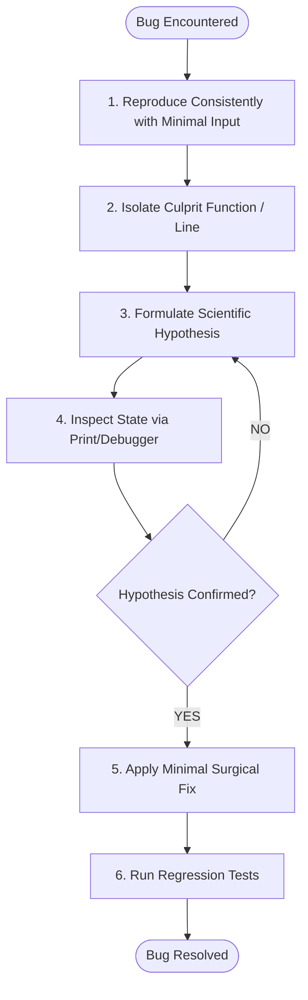

# CHAPTER 01: PROGRAMMING MENTAL MODELS AND PROBLEM SOLVING

---

## 1. Chapter Introduction
Welcome to **Level 2: Programming Foundation**! In Level 1, you learned how a computer works from the outside in: the hardware, the operating system, the internet, and the binary code that powers it all. Now, your role transforms from a curious observer into an active **creator**.

Many beginners struggle when learning their first programming language not because the syntax is difficult, but because they have not developed the correct **Mental Models** of computation. A computer does not "know" what you meant; it only executes what you told it to do. In this chapter, we construct the psychological and logical foundations of programming: how variables act as labeled memory buckets, how control flow moves like a deterministic conveyor belt, how to decompose massive problems into small solvable parts, how to dry-run code on paper, and how to use AI coding assistants responsibly without losing your ability to think independently.

---

## 2. Why Should I Learn This?
- **Overcome the "Blank Screen" Paralysis:** Every new programmer experiences the fear of staring at an empty text editor, unsure where to start. Problem decomposition turns an overwhelming challenge into small, manageable, bite-sized tasks.
- **Master Any Language in Days:** Once your mental models of state, iteration, and memory are solid, learning a new programming language (whether C, Python, Go, or Rust) is just learning new vocabulary for concepts you already deeply understand.
- **Avoid Fragile "Copy-Paste" Engineering:** Copying code from StackOverflow or an AI assistant without understanding the underlying state machine leads to catastrophic bugs when edge cases occur.

---

## 3. Everyday-Life Example
### The Lego Brick Architecture Analogy
Imagine someone asks you to build a scale model of the Taj Mahal or the Eiffel Tower out of Lego bricks:
1. **The Overwhelmed Beginner:** Tries to build the entire dome in one breath, gets frustrated when it collapses, and gives up.
2. **The Computational Thinker (Decomposition):**
   - **Step 1 (Break Down into Modules):** Decomposes the monument into: Base Platform, Four Minarets, Central Archway, and the Main Dome.
   - **Step 2 (Identify Reusable Units):** Notices that all four minarets are identical! Builds *one* reliable minaret design, and repeats it four times (Functions and Loops).
   - **Step 3 (Assemble and Integrate):** Connects the verified modular parts onto the foundation platform.

Writing software is identical: you never write 10,000 lines of code at once. You decompose the problem into tiny, independently testable 10-line functions.

---

## 4. Industry Example
### Autonomous Mars Rover (NASA Curiosity / Perseverance)
When NASA engineers send instructions to the Perseverance rover on Mars:
1. **The Constraint:** Mars is between 5 and 20 light-minutes away from Earth. If the rover encounters a boulder, an engineer in California cannot steer it with a joystick—by the time the video arrives on Earth, the rover has already crashed!
2. **The Mental Model Applied:**
   - The rover's onboard software operates as a **Deterministic Finite State Machine (FSM)**.
   - It breaks planetary navigation into an unbroken loop: `Sense (Sensors) -> Model (Build 3D Map) -> Plan (Evaluate Routes) -> Act (Spin Motors) -> Verify (Check Encoders)`.
   - Every movement is backed by formal state verification: if the tilt sensor exceeds $30^\circ$, it immediately enters the `SAFE_HALT` state and awaits Earth telemetry.

---

## 5. Prerequisites
- Completion of **Level 1** (specifically Chapter 01 on Data vs Information and Chapter 06 on Algorithms, Flowcharts, and Pseudocode).

---

## 6. Basic Explanation
### What is a "Mental Model"?
A **Mental Model** is an internal psychological representation of how something works in the real world.

To write code effectively, you must replace naive human assumptions with three foundational computer mental models:

```
1. THE LABELED MEMORY BUCKET (Variables & State)
   +-------------------+
   | age = 21          |  A variable is a named bucket in RAM holding a single value.
   +-------------------+  Reassigning age = 22 throws the old value in the trash!

2. THE CONVEYOR BELT (Sequential Execution)
   [ Line 1: Read input ] ---> [ Line 2: Compute tax ] ---> [ Line 3: Print receipt ]
   Statements execute strictly in order, one at a time, like boxes on a conveyor belt.

3. THE BLACK BOX CONTRACT (Functions)
   Input (Ingredients) ===> [ FUNCTION: cook_meal() ] ===> Output (Plated Dish)
   You don't care how the chef chops vegetables inside, as long as the output is correct.
```

---

## 7. Detailed Technical Explanation

### 7.1 The "Named Memory Bucket" Model (State & Mutation)
In elementary mathematics, writing $x = x + 1$ is an algebraic impossibility (it implies $0 = 1$).
In programming, the equals sign (`=`) is **NOT** a statement of mathematical equality; it is an **Assignment Operation (Action)**:

```
               x = x + 1;
               
1. EVALUATE RHS (Right-Hand Side):
   Look into the memory bucket labeled 'x'. Suppose it holds the number 5.
   Compute: 5 + 1 = 6.

2. OVERWRITE LHS (Left-Hand Side):
   Pour the result (6) into the bucket labeled 'x', destroying the previous value (5).
```

- **State:** The snapshot of all values currently sitting in all memory buckets at a specific millisecond of program execution.
- **Mutation:** The act of modifying the contents of an existing memory bucket.

### 7.2 Problem Decomposition Strategies
When confronted with a complex software task:
1. **Top-Down Decomposition (Stepwise Refinement):**
   Start with the high-level goal and break it into progressively smaller sub-tasks until each task can be implemented in 5–15 lines of code.
   $$\text{Build Banking App} \longrightarrow \begin{cases} \text{1. Authentication} \rightarrow \text{Validate PIN} \\ \text{2. Ledger} \rightarrow \text{Check Balance, Debit, Credit} \\ \text{3. Notification} \rightarrow \text{Send SMS receipt} \end{cases}$$
2. **Bottom-Up Construction:**
   Build small, highly reliable foundation blocks first (e.g., a function to calculate sales tax), test them thoroughly, and assemble them into larger business workflows.
3. **Single Responsibility Principle (SRP):**
   Every function or module must do **one thing well**. A function named `calculate_payroll()` should never send emails or draw graphics!

### 7.3 Dry-Running on Paper: The Trace Table
The most powerful tool for debugging is not an expensive software tool; it is a **pencil and paper Trace Table**.
- Before running code on the computer, an engineer traces line-by-line, updating columns for each variable at each step.
- If you cannot dry-run your logic on paper with simple test inputs, the code will not work on a computer.

### 7.4 Scientific Debugging Methodology
When your program produces a bug, never randomly change lines of code hoping it magically works! Follow the **Scientific Debugging Method**:
1. **Reproduce:** Find the exact minimal set of inputs that consistently triggers the bug.
2. **Isolate:** Narrow down the exact file, function, and line where variable values diverge from expectations.
3. **Hypothesize:** Formulate a scientific theory: *"I hypothesize that when user age is exactly 18, the condition `age > 18` evaluates to False instead of True."*
4. **Test:** Add a print statement or use a debugger to test your hypothesis.
5. **Fix & Verify:** Implement the minimal correct fix and verify that no other existing features were broken (**Regression Testing**).

---

## 8. Important Terminology
- **Mental Model:** A structured conceptual framework explaining how an underlying system operates.
- **State:** The collective values of all stored variables in memory at any given point in execution.
- **Mutation:** Changing the value of a variable in place.
- **Immutability:** Data that cannot be modified after it is created.
- **Stepwise Refinement:** The process of breaking a problem down through successive levels of increasing detail.
- **Trace Table:** A diagnostic grid tracking variable state changes across execution steps on paper.
- **Heuristic:** A practical problem-solving shortcut or rule of thumb that is sufficient for immediate goals.
- **Regression:** A software bug where an existing feature stops working after a new code change is introduced.
- **Edge Case:** An extreme or unusual boundary condition (e.g., input is 0, empty list, negative number, or maximum integer limit).

---

## 9. Diagrams and Illustrations
### The Scientific Debugging Lifecycle Loop



---

## 10. Step-by-Step Examples

### Example 1.1: Decomposing an ATM Cash Dispensing Problem
**Problem:** An ATM needs to dispense an amount $W$ (e.g., ₹3,800) using the minimum number of currency notes (denominations: ₹500, ₹200, ₹100).

#### Step 1: Decomposition & Validation
- *Check 1:* Is $W > 0$?
- *Check 2:* Is $W \le \text{User Account Balance}$?
- *Check 3:* Is $W$ a multiple of 100? (Cannot dispense ₹3,850 with ₹100 notes).

#### Step 2: Greedy Algorithmic Decomposition
Dispense the largest denomination first, then take the remainder for smaller notes:
1. Notes of ₹500: $\lfloor 3800 / 500 \rfloor = 7\text{ notes}$ ($₹3,500$). Remainder $= 3800 \pmod{500} = ₹300$.
2. Notes of ₹200: $\lfloor 300 / 200 \rfloor = 1\text{ note}$ ($₹200$). Remainder $= 300 \pmod{200} = ₹100$.
3. Notes of ₹100: $\lfloor 100 / 100 \rfloor = 1\text{ note}$ ($₹100$). Remainder $= 100 \pmod{100} = ₹0$.

#### Step 3: Trace Table

| Step | Current Remainder | Note Denomination | Count Calculated | New Remainder |
| :---: | :---: | :---: | :---: | :---: |
| **Start** | ₹3,800 | - | - | ₹3,800 |
| **1** | ₹3,800 | ₹500 | $3800 // 500 = \mathbf{7}$ | $3800 \% 500 = ₹300$ |
| **2** | ₹300 | ₹200 | $300 // 200 = \mathbf{1}$ | $300 \% 200 = ₹100$ |
| **3** | ₹100 | ₹100 | $100 // 100 = \mathbf{1}$ | $100 \% 100 = \mathbf{₹0}$ |

**Result:** Dispense $7 \times ₹500 + 1 \times ₹200 + 1 \times ₹100 = ₹3,800$.

---

## 11. Practical Implementation
Let us write a Python laboratory script that demonstrates **Mental Models of State Tracking**, **Trace Table Generation**, and **Problem Decomposition**:

```python
"""
Practical Lab 2.1: Programming Mental Models & State Space Simulator
File: 11_PROGRAMMING_LAB/level_2/ch01_mental_models_lab.py
Author: Computer Science Master Library
Description: Demonstrates stepwise refinement, automated trace table logging,
             and boundary-condition validation.
"""

import sys
from typing import Dict, List, Tuple

if hasattr(sys.stdout, "reconfigure"):
    try:
        sys.stdout.reconfigure(encoding="utf-8")
    except Exception:
        pass


def dispense_currency(
    amount: int, denominations: List[int]
) -> Dict[str, Any]:
    """
    Decomposed Currency Dispenser.
    Demonstrates state mutation tracking and edge-case validation.
    """
    print(f"--- Processing ATM Withdrawal Request: ₹{amount:,} ---")

    # Step 1: Input Validation (Boundary Checks)
    if amount <= 0:
        raise ValueError("Withdrawal amount must be strictly positive.")

    min_denom = min(denominations)
    if amount % min_denom != 0:
        raise ValueError(
            f"Amount must be a multiple of the lowest note (₹{min_denom})."
        )

    # Sort denominations descending (Greedy approach)
    sorted_denoms = sorted(denominations, reverse=True)

    remaining_balance = amount
    notes_dispensed: Dict[int, int] = {}
    trace_log: List[Tuple[int, int, int, int]] = []

    # Step 2: State Mutation Loop
    for denom in sorted_denoms:
        count = remaining_balance // denom
        prev_balance = remaining_balance
        remaining_balance = remaining_balance % denom

        if count > 0:
            notes_dispensed[denom] = count

        trace_log.append((prev_balance, denom, count, remaining_balance))

    # Step 3: Print Automated Trace Table
    print("Trace Table:")
    print("Starting Remainder | Denomination | Notes Count | Ending Remainder")
    print("-" * 65)
    for row in trace_log:
        print(f"₹{row[0]:17,d} | ₹{row[1]:11d} | {row[2]:11d} | ₹{row[3]:15,d}")
    print("-" * 65)

    print(f"Dispense Breakdown: {notes_dispensed}")
    print(f"Final Unresolved Remainder: ₹{remaining_balance}\n")

    return {
        "amount": amount,
        "notes": notes_dispensed,
        "remaining": remaining_balance,
        "success": remaining_balance == 0,
    }


if __name__ == "__main__":
    # Test 1: Standard withdrawal
    denoms = [500, 200, 100]
    res1 = dispense_currency(3800, denoms)
    assert res1["success"] is True
    assert res1["notes"] == {500: 7, 200: 1, 100: 1}

    # Test 2: Clean round number
    res2 = dispense_currency(2000, denoms)
    assert res2["success"] is True
    assert res2["notes"] == {500: 4}

    # Test 3: Edge Case validation
    try:
        dispense_currency(3855, denoms)
        assert False, "Should have rejected non-multiple amount!"
    except ValueError as e:
        print(f"Edge Case Successfully Caught: {e}")

    print("\nAll mental models and state tracking tests passed successfully.")
```

---

## 12. Industry Implementation
### Architecture Decision Records (ADRs) & Production Refactoring
In large software engineering organizations (Google, Netflix, Amazon):
1. **The Danger of "Clever" Code:** Junior developers often write dense, one-line tricks to look smart. In industry, clever code is considered a liability because it breaks mental models during emergency 3 AM outages!
2. **Clean Code Standard:** Production code must be written so simply and clearly that any junior engineer can deduce its mental model within 10 seconds of reading.
3. **Architecture Decision Records (ADRs):** Before writing code for a major feature, engineering teams write a 1-page document detailing:
   - What problem are we solving?
   - What mental model/architecture did we choose?
   - What alternative approaches did we reject and why?

---

## 13. Advantages and Limitations
### Advantages of Developing Strong Mental Models
1. **Rapid Language Acquisition:** Syntactical differences become trivial when control flow and memory models are intuitive.
2. **Defensive Programming:** Anticipating edge cases (null values, buffer limits, divide-by-zero) before they ever hit production.
3. **Clear Code Structure:** Naturally writes modular, testable, and maintainable software.

### Limitations of Human Mental Models
1. **Cognitive Load Limits:** The human working memory can only hold $7 \pm 2$ concepts simultaneously. Functions exceeding 50 lines overload human cognitive capacity, requiring strict modular decomposition.
2. **Concurrency Blindness:** Human brains are purely sequential thinkers; human mental models fail miserably when debugging asynchronous, multi-threaded race conditions (which we address in Level 4).

---

## 14. Common Mistakes
1. **Treating Assignment as Mathematical Equality:** Writing `x = x + 1` and assuming it means $0 = 1$, or writing `x + 1 = y` (illegal syntax; the left-hand side must always be a writeable variable bucket!).
2. **Coding Before Thinking:** Opening an IDE and typing code before knowing the inputs, outputs, and edge cases on paper.
3. **Over-Relying on AI Assistants Without Understanding:** Asking an AI to generate code, pasting it without dry-running it, and having no idea how to fix it when an unexpected edge case crashes the server.

---

## 15. AI Connection
### The Responsible Use of AI Coding Assistants (Copilot, Gemini, Claude)
- **The Correct Paradigm: AI as an Eager Junior Intern:**
  Treat an AI coding assistant like a brilliant, lightning-fast junior intern who has read every book on Earth, but has zero real-world common sense and occasionally invents plausible-sounding hallucinations!
- **The Golden Rule of AI Programming:**
  **Never paste a line of AI-generated code into your project unless you can explain line-by-line what every single variable, loop, and function does on paper.**
- AI is incredible at generating boilerplate, writing regex, and creating mock test data; but human engineers remain 100% accountable for architecture, security, and algorithmic correctness.

---

## 16. AI Future Insights
- **Established Technology:** Context-aware code completion predicting the next 3 to 10 lines of code in VS Code.
- **Emerging Technology:** Autonomous test-generation agents that automatically write 100 adversarial unit tests to find edge-case vulnerabilities in your code.
- **Reasonable Future Projection:** Natural language system synthesis, where engineers write formal specification contracts, and AI generates certified, provably correct microservice code.
- **Speculative Possibility:** Self-debugging autonomic software environments that monitor runtime exceptions in production and autonomously patch their own source code.

---

## 17. Career Relevance
- **All Software Engineers:** The foundational ability to decompose business problems into clean code is the primary skill evaluated in every job on Earth.
- **Technical Leads & Architects:** Spend 80% of their day establishing mental models and architecture boundaries for development teams.
- **Technical Interviewees:** Interviewers evaluate your thought process and problem decomposition steps out loud far more than the exact language syntax.

---

## 18. Interview Preparation

### Category A: Beginner / Fresher Level
#### Q1: What is the difference between a variable declaration and a variable assignment?
- **Answer:** **Variable Declaration** introduces a named variable to the compiler/runtime, specifying its identifier and its data type, which reserves the appropriate memory bucket in RAM (e.g., `int age;` in C). **Variable Assignment** stores an actual data value into that reserved memory bucket (e.g., `age = 21;`). In many languages, declaration and assignment can be performed simultaneously (**Initialization**: `int age = 21;`).

#### Q2: What is the Single Responsibility Principle (SRP) in basic programming?
- **Answer:** The Single Responsibility Principle states that a function, module, or class should have one, and only one, reason to change. In practical terms, it means every function should do exactly one well-defined task (e.g., calculate tax, validate an email, or sort a list). If a function is doing two unrelated tasks, it should be decomposed into two separate functions.

### Category B: Intermediate Level
#### Q3: How do you systematically debug an intermittent or hard-to-reproduce software bug?
- **Answer:** 
  1. **Capture Logs & Telemetry:** Inspect production logs, stack traces, and variable snapshots at the moment of failure.
  2. **Isolate Inputs:** Identify the exact boundary conditions (network latency, null fields, specific character encodings) that triggered the event.
  3. **Create a Minimal Reproducible Example (MRE):** Write an isolated unit test that triggers the bug with 100% consistency on a local machine.
  4. **Formulate & Test Hypotheses:** Use step-by-step trace debugging to observe state mutation until the deviation is isolated.
  5. **Apply Fix & Regression Suite:** Correct the logic and add the unit test to the automated CI/CD pipeline to guarantee the bug never returns.

---

## 19. Practice Questions

### Multiple-Choice Questions (MCQs)
1. In programming, what does the expression `counter = counter + 5` accomplish?
   - A) Proves that 0 = 5.
   - B) Reads the current value of `counter`, adds 5, and stores the new sum back into `counter`.
   - C) Creates a syntax error because variables cannot appear on both sides.
   - D) Compares whether `counter` equals `counter + 5`.
   *(Answer: B)*

2. What is a "Trace Table" primarily used for?
   - A) Measuring network speed.
   - B) Tracking the step-by-step values of variables across program execution on paper.
   - C) Generating automated documentation.
   - D) Compiling C code into assembly.
   *(Answer: B)*

3. What should a programmer do first when given a complex, difficult programming challenge?
   - A) Immediately start typing code in an IDE.
   - B) Decompose the problem into smaller sub-tasks on paper and define inputs and outputs.
   - C) Ask an AI to write the entire program.
   - D) Memorize the solution from a textbook.
   *(Answer: B)*

### Short Answer Questions
1. Differentiate between Top-Down and Bottom-Up problem solving.
2. Why is "clever" one-line code often discouraged in professional software teams?
3. What is a "Regression Bug"?

### Long Answer Questions
1. Explain the "Named Memory Bucket" mental model of variables. How does variable mutation differ from mathematical equality, and what happens in physical RAM during reassignment?
2. Detail the Scientific Debugging Method. How does formulating testable hypotheses prevent wasted time compared to trial-and-error guessing?

---

## 20. Solved Examples
### Problem 20.1: Constructing a Trace Table for a Swapping Algorithm
**Task:** Trace what happens in memory when swapping two variables without a temporary variable:
```text
Line 1: A = 15
Line 2: B = 7
Line 3: A = A + B
Line 4: B = A - B
Line 5: A = A - B
```

**Step-by-Step State Evolution Table:**

| Line Number | Action Executed | Value in Bucket `A` | Value in Bucket `B` | Mathematical Reasoning |
| :---: | :--- | :---: | :---: | :--- |
| **Init** | Variables declared | Unassigned | Unassigned | Memory allocated |
| **Line 1** | `A = 15` | **15** | Unassigned | Direct assignment |
| **Line 2** | `B = 7` | 15 | **7** | Direct assignment |
| **Line 3** | `A = A + B` | **22** | 7 | $15 + 7 = 22$. Bucket `A` overwritten! |
| **Line 4** | `B = A - B` | 22 | **15** | $22 - 7 = 15$. Bucket `B` now holds original `A`! |
| **Line 5** | `A = A - B` | **7** | 15 | $22 - 15 = 7$. Bucket `A` now holds original `B`! |

**Conclusion:** `A` and `B` have successfully swapped values ($A=7, B=15$) without requiring a third variable!

---

## 21. Unsolved Exercises
1. **Exercise 1.1:** Construct a trace table for an algorithm that takes an integer $N = 345$ and computes the sum of its individual digits ($3 + 4 + 5 = 12$) using a `WHILE` loop with modulo `% 10` and integer division `// 10`.
2. **Exercise 1.2:** Apply Top-Down decomposition to design an automated Smart Traffic Light controller for a 4-way intersection that detects pedestrian button presses and ambulance emergency sirens.
3. **Exercise 1.3:** Modify the Python currency dispenser in Section 11 to handle a stock limit on notes (e.g., the ATM has only three ₹500 notes remaining). Trace what happens when ₹3,800 is requested.

---

## 22. Chapter Summary
- Computational thinking requires building robust **Mental Models** of memory, execution flow, and modular contracts.
- A **Variable** is a labeled memory bucket in RAM; assignment (`=`) evaluates the right-hand side and overwrites the left-hand bucket.
- **Problem Decomposition** breaks massive problems into independent, testable sub-functions following the Single Responsibility Principle.
- **Trace Tables** allow engineers to manually verify state mutations on paper, preventing logic errors before running code.
- **Scientific Debugging** follows an empirical loop: Reproduce $\rightarrow$ Isolate $\rightarrow$ Hypothesize $\rightarrow$ Experiment $\rightarrow$ Fix $\rightarrow$ Regression Test.
- Use **AI coding assistants** as accelerators, but maintain 100% human accountability and line-by-line understanding of all code.

---

## 23. Revision Sheet
- **Core Mental Models:**
  - Variables = Named memory buckets in RAM.
  - Execution = Sequential conveyor belt (Line 1 $\rightarrow$ Line 2 $\rightarrow$ Line 3).
  - Functions = Black box contract (Input $\rightarrow$ Process $\rightarrow$ Output).
- **Debugging Protocol:** Reproduce $\rightarrow$ Isolate $\rightarrow$ Hypothesize $\rightarrow$ Test $\rightarrow$ Fix.
- **Golden Rule:** Never write code until you can trace the state transitions on paper!

---

## 24. References
1. **Hunt, Andrew, and David Thomas.** *The Pragmatic Programmer: Your Journey to Mastery.* 20th Anniversary Edition, Addison-Wesley, 2019. (The seminal guide to developer mental models and debugging).
2. **Martin, Robert C.** *Clean Code: A Handbook of Agile Software Craftsmanship.* Prentice Hall, 2008. Chapter 2: "Meaningful Names" and Chapter 3: "Functions."
3. **Wing, Jeannette M.** *"Computational Thinking."* Communications of the ACM, Vol. 49, No. 3, 2006. (The landmark paper establishing computational thinking foundations).
4. **Zeller, Andreas.** *Why Programs Fail: A Guide to Systematic Debugging.* 2nd Edition, Morgan Kaufmann, 2009. (The definitive academic text on scientific debugging).
