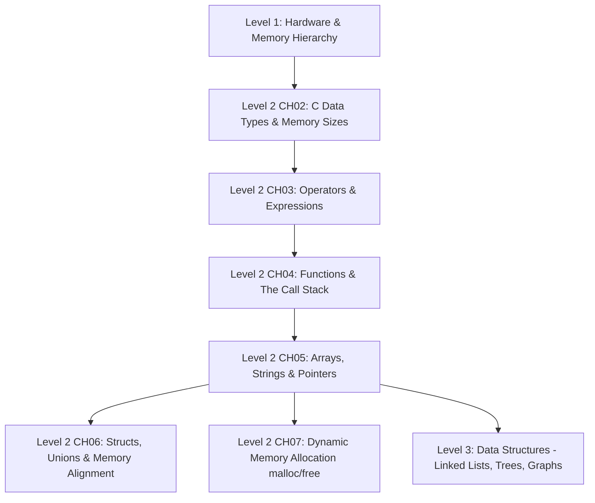

# Chapter 05: Arrays, Strings, and Pointer Foundations in C

---

## 1. Executive Summary & Core Concept

In low-level systems programming and von Neumann architectures, memory is a continuous linear tape of byte-addressable cells indexed by numerical integers. To build scalable software, a programming language must bridge the gap between abstract mathematical vectors and physical silicon RAM. 

This chapter introduces the fundamental trio of data representation in C:
1. **Arrays**: Contiguous sequences of homogeneous data elements allocated sequentially in memory, enabling constant-time $\mathcal{O}(1)$ random access via offset indexing.
2. **Strings**: Sequences of characters represented as contiguous byte arrays terminated by a sentinel null character (`'\0'`), cementing the ubiquitous "C-string" paradigm.
3. **Pointers**: First-class variables holding numerical memory addresses of other variables, providing direct manipulation of hardware storage, dynamic memory manipulation, and simulated pass-by-reference semantics.

Understanding the deep unification between arrays and pointers—specifically **array decay** (where an array name evaluates to the memory address of its first element) and **pointer arithmetic** (where address adjustments automatically scale by the size of the underlying type)—is the single most decisive rite of passage in computer science.

---

## 2. Prerequisites & Cognitive Map



### Required Knowledge Checklist
- Understanding byte-level memory addressing ($0\text{x}00000000$ to $0\text{xFFFF\dots}$).
- Stack activation records and local variable lifetime from Chapter 04.
- Primitive type byte sizes (`sizeof(char) = 1`, `sizeof(int) = 4` on 32/64-bit systems).

---

## 3. The "Explain Like I'm Five" (ELI5) Analogy

### The Apartment Row, The Name Tag, and The GPS Coordinates
Imagine a street lined with identical apartment flats numbered from 100 to 109:
- **An Array (`int rent[10]`)**: The landlord built 10 identical rooms side-by-side in one solid concrete block. If you know room 0 is at door #100, and every room is exactly 4 meters wide, room 3 is guaranteed to be at door $100 + (3 \times 4) = 112$. You do not need to walk past room 1 and 2 to find room 3; you calculate the destination in your head and teleport there directly.
- **A String (`char name[] = "PUNE\0"`)**: You have a row of mailbox slots with letters in them: `'P'`, `'U'`, `'N'`, `'E'`. How does the mail carrier know where the word ends if there are 20 mailboxes? The carrier keeps reading until they hit an empty red stop sign (`'\0'`, the null terminator). If someone forgets to put up the red stop sign, the mail carrier keeps walking down the entire street, reading garbage off neighboring houses until the police stop them (a segmentation fault!).
- **A Pointer (`int *ptr`)**: Instead of storing furniture in your room, you write the street address of a friend's house on a sticky note. The sticky note itself is small and light (8 bytes on modern 64-bit computers), but reading it tells you exactly which house to drive to. When you update the friend's furniture by following the sticky note, you are modifying the actual house, not a photocopy.

---

## 4. Formal Mathematical & Theoretical Foundations

### 4.1 One-Dimensional Array Addressing
Let an array $A$ be declared with element type $T$ and dimension $N$:
$$\text{Type } T\ A[N];$$

Let $\text{Base}(A)$ represent the address of the zeroth element $\&A[0]$, and let $S = \text{sizeof}(T)$ be the byte size of each element. The memory address of the $i$-th element is formally defined as:
$$\text{Address}(A[i]) = \text{Base}(A) + i \times S \quad \text{where } 0 \le i < N$$

Because addition and multiplication execute in $\mathcal{O}(1)$ CPU machine cycles via indexed addressing modes, looking up $A[0]$ takes the exact same physical time as looking up $A[999999]$.

### 4.2 Multi-Dimensional Array Addressing (Row-Major Order)
C stores two-dimensional arrays in **Row-Major Order** (row by row sequentially in memory). For a 2D array:
$$\text{Type } T\ M[R][C];$$
where $R$ is the number of rows and $C$ is the number of columns. The linear flat offset of cell $(i, j)$ is:
$$\text{Offset}(i, j) = i \times C + j$$
The physical byte address is:
$$\text{Address}(M[i][j]) = \text{Base}(M) + (i \times C + j) \times S$$

> **Crucial Insight**: The compiler does *not* need to know the number of rows $R$ to compute an address; it *must* know the column dimension $C$ to calculate row stride length ($i \times C$). This explains why in function signatures, parameter declarations must supply column widths: `void process(int m[][4])`.

### 4.3 Pointer Arithmetic Axioms
In C, adding an integer scalar $k$ to a pointer $p$ of type $T*$ does not increment the physical byte address by $k$; it increments by $k \times \text{sizeof}(T)$:
$$p + k \equiv (\text{uintptr\_t})p + (k \times \text{sizeof}(T))$$
Similarly, the difference between two pointers $p_1$ and $p_2$ pointing to elements of the same array yields the number of elements between them (of type `ptrdiff_t`), not the raw byte count:
$$p_2 - p_1 = \frac{(\text{uintptr\_t})p_2 - (\text{uintptr\_t})p_1}{\text{sizeof}(T)}$$

---

## 5. Architectural & Hardware Context

```
Physical Virtual Memory Space (Byte Addressable)
-----------------------------------------------------------------------------------------
Hex Address:  0x1000       0x1004       0x1008       0x100C       0x1010       0x1014
Element:      arr[0]       arr[1]       arr[2]       arr[3]       arr[4]       (next var)
Value:        [ 10 ]       [ 20 ]       [ 30 ]       [ 40 ]       [ 50 ]       [ ... ]
-----------------------------------------------------------------------------------------
              ^
              |--- ptr = &arr[0]  (points to 0x1000)
                   ptr + 1 ------> (points to 0x1004, NOT 0x1001!)
```

### Cache Lines and Spatial Locality
Modern CPUs transfer data from DRAM to L1/L2 caches in blocks called **Cache Lines** (typically 64 bytes).
- When a program accesses `arr[0]`, the CPU loads the surrounding 64 bytes into the L1 data cache.
- Because an array stores elements contiguously, subsequent reads to `arr[1]`, `arr[2]`, up to `arr[15]` (for 4-byte integers) trigger near-instantaneous **Cache Hits** (latency $\approx 1$ ns vs $\approx 100$ ns for RAM).
- Traversing a 2D array along rows (`M[i][j]`) exploits spatial locality. Traversing along columns (`M[j][i]`) causes cache thrashing, degrading throughput by up to $10\times$ to $20\times$.

---

## 6. Core Syntax, Semantics & Idioms

### 6.1 Array Declaration, Initialization, and Decay
```c
#include <stdio.h>

void print_array(const int *arr, size_t length) {
    // Array decay: 'arr' here is a pointer (int*), NOT the original array!
    // sizeof(arr) here returns 8 (pointer size on 64-bit), NOT length * 4!
    for (size_t i = 0; i < length; ++i) {
        printf("%d ", *(arr + i)); // Equivalent to arr[i]
    }
    printf("\n");
}

int main(void) {
    int numbers[5] = {10, 20, 30, 40, 50}; // Initialized array
    int zeroes[5] = {0};                   // All 5 elements set to 0
    
    // Calculating length safely before decay:
    size_t count = sizeof(numbers) / sizeof(numbers[0]); // 20 / 4 = 5
    
    print_array(numbers, count);
    return 0;
}
```

### 6.2 The Unification Rule: `arr[i] == *(arr + i)`
In C standard (§6.5.2.1), the subscript operator `E1[E2]` is defined strictly as `(*((E1) + (E2)))`. Because addition is commutative:
$$A[i] \iff *(A + i) \iff *(i + A) \iff i[A]$$
This syntactic quirk means `3[numbers]` is valid C that compiles to `*(3 + numbers)`, yielding `numbers[3]`.

### 6.3 C-Strings: Syntax and Null Termination
```c
char str1[] = "Hello";        // Stored in writable stack memory: 'H','e','l','l','o','\0' (6 bytes)
const char *str2 = "World";   // Pointer to read-only string literal (.rodata segment)

// str1[0] = 'h';             // OK: Modifies stack memory
// str2[0] = 'w';             // CRASH: Undefined behavior! Writing to read-only memory
```

### 6.4 Pointer Fundamentals & Pass-by-Reference Simulation
C is strictly pass-by-value. To allow a called function to modify variables in the caller's stack frame, the caller must pass memory addresses (pointers).

```c
void swap(int *x, int *y) {
    int temp = *x; // Dereference x: read value at address x
    *x = *y;       // Store value of y into address x
    *y = temp;     // Store temp into address y
}

int main(void) {
    int a = 42, b = 99;
    swap(&a, &b);  // Pass addresses using the '&' (address-of) operator
    // Now a == 99, b == 42
    return 0;
}
```

---

## 7. Memory Layout & Runtime Execution Model

### Detailed Stack Frame Representation during `swap(&a, &b)`

```
========================================================================
HIGH MEMORY
------------------------------------------------------------------------
STACK FRAME: main()
Address: 0x7FFE0014 | int b = 99
Address: 0x7FFE0010 | int a = 42
------------------------------------------------------------------------
STACK FRAME: swap(int *x, int *y)
Address: 0x7FFE0008 | int *y = 0x7FFE0014 (holds address of b)
Address: 0x7FFE0000 | int *x = 0x7FFE0010 (holds address of a)
Address: 0x7FFDFFFC | int temp = 42
------------------------------------------------------------------------
LOW MEMORY
========================================================================
```

When `*x = *y;` executes:
1. The CPU reads the address stored in register/memory for `y` (`0x7FFE0014`).
2. It fetches the 4-byte integer from `0x7FFE0014` (`99`).
3. It reads the address stored in register/memory for `x` (`0x7FFE0010`).
4. It writes the integer `99` directly into `0x7FFE0010`, replacing `42` in `main()`'s frame.

---

## 8. Visual Models & Deep Walkthroughs

### 8.1 2D Array Row-Major Memory Flattening
Consider matrix `int mat[2][3] = {{1, 2, 3}, {4, 5, 6}};`

```
Logical Matrix:
      Col 0   Col 1   Col 2
Row 0:  1       2       3
Row 1:  4       5       6

Physical Memory Layout (Linear):
[ 1 ][ 2 ][ 3 ][ 4 ][ 5 ][ 6 ]
  ^              ^
  |-- Row 0 -----|-- Row 1 ----|
```
- Base address $\text{Base} = 1000$.
- `mat[1][2]` $\rightarrow \text{Base} + (1 \times 3 + 2) \times 4 = 1000 + (5 \times 4) = 1020$.
- Physical cell at 1020 holds integer `6`.

---

## 9. Common Pitfalls, Anti-Patterns & Undefined Behavior

| Anti-Pattern / Bug | Code Example | Consequence / Fix |
|:---|:---|:---|
| **Off-by-One Array Bound** | `int a[5]; for(int i=0; i<=5; i++) a[i]=0;` | Overwrites adjacent stack memory (`a[5]` does not exist). Bound is $i < 5$. |
| **Missing Null Terminator** | `char s[5] = "hello";` | `"hello"` requires 6 bytes (`'h','e','l','l','o','\0'`). `strlen(s)` causes read overrun. |
| **Uninitialized Pointer** | `int *p; *p = 100;` | Wild pointer pointing to random memory. Overwrites memory or causes SIGSEGV. |
| **Returning Local Address** | `int* get(void) { int x=10; return &x; }` | Stack frame reclaimed on function return; returned pointer is dangling! |
| **`sizeof` on Decayed Array** | `void f(int a[10]) { size_t s = sizeof(a); }` | `sizeof(a)` returns `sizeof(int*)` (8 bytes), NOT 40 bytes. |
| **Modifying String Literals**| `char *s = "hi"; s[0] = 'H';` | Attempting to write into `.rodata` segment triggers Segmentation Fault. |

---

## 10. Industrial & Production Application

### Case 1: Linux Kernel Ring Buffers & Network Drivers
High-speed networking drivers (e.g., Intel `e1000` or Linux `AF_XDP`) allocate contiguous circular ring buffers of packet descriptors in DMA (Direct Memory Access) memory. The network interface card (NIC) and CPU communicate without locks by updating read and write pointers through pointer offsets, sustaining line-rate 100 Gbps packet processing.

### Case 2: SQLite B-Tree Page Traversal
The SQLite embedded database stores tables on disk formatted into fixed-size pages (typically 4096 bytes). When a page is read into memory, SQLite casts the raw byte buffer to an internal cell array:
```c
u8 *pCell = &aData[get2byte(&aData[offset])];
```
Direct pointer indexing allows SQLite to parse binary database rows in sub-microsecond intervals without copying memory.

---

## 11. Benchmarks, Complexity & Performance Profiling

| Operation | Array / Pointer Complexity | Linked Node / Dynamic Complexity | Hardware Mechanism |
|:---|:---|:---|:---|
| **Index Access (`A[i]`)** | $\mathcal{O}(1)$ | $\mathcal{O}(n)$ | Base register + scaled index addressing (`mov [rax + rbx*4], edx`) |
| **Sequential Traversal** | $\mathcal{O}(n)$ (Optimal throughput) | $\mathcal{O}(n)$ ($5\times - 20\times$ slower) | Hardware prefetcher loads consecutive cache lines |
| **Insert / Delete at End** | $\mathcal{O}(1)$ amortized | $\mathcal{O}(1)$ | Simple pointer bump |
| **Insert / Delete at Front** | $\mathcal{O}(n)$ (Requires `memmove`) | $\mathcal{O}(1)$ | Memory copy overhead |

### Row-Major vs Column-Major Cache Benchmark (Iterating $10000 \times 10000$ Matrix)
- **Row-Major Loop (`A[row][col]`)**: ~0.08 seconds (100% cache line utilization).
- **Column-Major Loop (`A[col][row]`)**: ~1.45 seconds ($18\times$ slowdown due to L1/L2 cache misses on every access).

---

## 12. Security Implications & Vulnerability Analysis

### The Classic Buffer Overflow (CWE-120) & The Morris Worm
The most dangerous vulnerability in computing history stems from unbounded array copies using C standard library functions like `gets()` or `strcpy()`.

```c
void vulnerable_login(void) {
    char password[16];
    // FATAL SECURITY FLAW: gets does not check array bounds!
    gets(password); 
}
```

```
Stack State Before Attack:
[ password (16 bytes) ][ Saved Frame Pointer (8 bytes) ][ Saved Return Address (8 bytes) ]

Stack State After Overflow (Supplying 32 bytes):
[ AAAAAAAAAAAAAAAA    ][ BBBBBBBB                     ][ 0x7FFFDEADBEEF (Attacker RIP) ]
```

When `vulnerable_login` finishes, the CPU pops the saved Return Instruction Pointer (`RIP`) off the stack. Because the attacker overwrote this address, execution jumps directly to malicious shellcode injected by the attacker.

### Industry Defenses:
1. **Canary Values (Stack Smashing Protector - `fstack-protector`)**: Compilers place a secret random number between local arrays and the return address. If the canary changes when the function returns, the program terminates immediately.
2. **Safe Functions**: Always replace `strcpy` with `strncpy` or `snprintf`, and `gets` with `fgets(buf, sizeof(buf), stdin)`.
3. **Non-Executable Stacks (NX / DEP)**: Modern operating systems mark stack pages as non-executable.

---

## 13. Edge Cases & Boundary Conditions

1. **Null Pointers (`NULL` / `(void*)0`)**: Dereferencing `NULL` (`*ptr`) triggers hardware page fault traps managed by the OS virtual memory manager, instantly causing a Segmentation Fault (`SIGSEGV`).
2. **Void Pointers (`void*`)**: Generic pointers holding any address. You cannot directly dereference or perform arithmetic on `void*` without casting to a concrete type first, because `sizeof(void)` is undefined (or 1 as a GNU extension).
3. **Array of Size 0 / Flexible Array Members**: In C99, `struct Header { size_t len; char payload[]; };` is a flexible array member used to dynamically pack variable-length payloads at the tail of a struct.
4. **Pointer Aliasing & `restrict`**: When two pointers point to overlapping memory regions, the compiler cannot optimize memory reads. The C99 `restrict` keyword guarantees pointers do not alias, enabling aggressive SIMD vectorization.

---

## 14. Comparative Analysis: C vs Python vs Rust

| Feature | C Language | Python | Rust |
|:---|:---|:---|:---|
| **Array Structure** | Contiguous raw bytes on stack/heap | `list`: Dynamic array of pointers to PyObject | Fixed-size array `[T; N]` or `Vec<T>` |
| **Bound Checking** | **None** (Silently corrupts memory) | Automatic (`IndexError`) | Checked by default (Panics on violation) |
| **String Representation**| Mutable/immutable null-terminated array | Immutable UTF-8 object with length header | UTF-8 slice `&str` or heap `String` |
| **Pointers** | Raw pointers with arbitrary arithmetic | Object references (No pointer math) | References (`&T`, `&mut T`) validated at compile time |
| **Memory Safety** | Manual; prone to use-after-free, leaks | Managed via Reference Counting & GC | Compile-time ownership, zero-cost safety |

---

## 15. Emerging Paradigms, AI & Future Perspectives

1. **Rust's Borrow Checker Replacing C Pointers**: In modern systems programming (Linux kernel 6.1+, Android OS, Windows Hyper-V), memory-unsafe raw C pointers are systematically being rewritten in Rust to eliminate the 70% of historical zero-day vulnerabilities caused by memory corruption.
2. **AI Code Generation & The Pointer Hallucination Hazard**: LLM coding assistants frequently generate C code with off-by-one errors in `snprintf` or assume dynamic arrays on the stack (`alloca`) are safe, creating hidden buffer overflow vulnerabilities. Verifying AI-written C code using static analysis tools (`clang-tidy`, Clang AddressSanitizer `-fsanitize=address`) is now mandatory in production.

---

## 16. Step-by-Step Solved Problem 1 (Foundational / Academic)

### Problem Statement
Write a C function to reverse an array of $N$ integers in-place without allocating a secondary array. Trace the pointer movements step-by-step.

### Algorithmic Strategy (Two-Pointer Technique)
Initialize a left pointer `p_left` to `&arr[0]` and a right pointer `p_right` to `&arr[N - 1]`. While `p_left < p_right`, swap the values they point to and advance `p_left` forward while retreating `p_right` backward.

### Code Implementation
```c
#include <stdio.h>

void reverse_array_inplace(int *arr, size_t n) {
    if (arr == NULL || n <= 1) return;
    
    int *left = arr;              // Points to first element
    int *right = arr + n - 1;      // Points to last element
    
    while (left < right) {
        // Swap values using dereferencing
        int temp = *left;
        *left = *right;
        *right = temp;
        
        // Advance pointers
        left++;
        right--;
    }
}
```

### Trace Table for `arr = {10, 20, 30, 40}`, `n = 4`
- Initial: `left = &arr[0] (val 10)`, `right = &arr[3] (val 40)`.
- Iteration 1: Swap 10 and 40 $\rightarrow$ `arr = {40, 20, 30, 10}`. `left` moves to `&arr[1]`, `right` moves to `&arr[2]`.
- Iteration 2: `left < right` holds. Swap 20 and 30 $\rightarrow$ `arr = {40, 30, 20, 10}`. `left` moves to `&arr[2]`, `right` moves to `&arr[1]`.
- Termination: `left < right` is false (`left > right`). Loop terminates. Result: `{40, 30, 20, 10}`.

---

## 17. Step-by-Step Solved Problem 2 (Algorithmic / Systems Level)

### Problem Statement
Implement a custom version of `strlen` and `strcpy` using pointer arithmetic alone (no array brackets `[]`, no standard library headers).

### Code Implementation
```c
#include <stddef.h> // for size_t

size_t custom_strlen(const char *str) {
    const char *ptr = str;
    while (*ptr != '\0') {
        ptr++; // Advance to next character byte
    }
    return (size_t)(ptr - str); // Pointer subtraction yields element count!
}

char* custom_strcpy(char *dest, const char *src) {
    char *orig_dest = dest;
    // Canonical K&R idiom: copy character, evaluate condition, advance pointers
    while ((*dest++ = *src++) != '\0') {
        /* empty body */
    }
    return orig_dest;
}
```

### Mathematical Proof of `ptr - str`
Let base address of `str` be $B$. The string has $K$ characters followed by `'\0'`.
The loop increments `ptr` exactly $K$ times. Upon reaching `'\0'`, `ptr` has address $B + K \times 1$.
$$\text{Difference} = \frac{(B + K) - B}{1} = K$$
This executes in linear time $\mathcal{O}(K)$ with zero auxiliary memory $\mathcal{O}(1)$.

---

## 18. Step-by-Step Solved Problem 3 (Industry / Production Debugging)

### Production Incident Scenario
A microservice running an embedded analytics engine crashes intermittently with `SIGSEGV` when processing user telemetry events.

### Defective Code Snippet
```c
char* format_timestamp(int timestamp) {
    char buffer[64];
    snprintf(buffer, sizeof(buffer), "EVENT_TIME: %d", timestamp);
    return buffer; // FATAL DEFECT
}

void log_event(int ts) {
    char *ts_str = format_timestamp(ts);
    printf("Log: %s\n", ts_str); // Accessing freed stack memory
}
```

### Root Cause Analysis
1. `buffer` is allocated on the stack frame of `format_timestamp`.
2. When `format_timestamp` returns, its stack frame is marked invalid and available for reuse by subsequent function calls.
3. The pointer returned (`buffer`) is a **Dangling Pointer**.
4. When `printf` is called inside `log_event`, the new stack frame allocated for `printf` overwrites the memory where `buffer` resided. The output will print corrupted characters, or crash if the pointer points to an unmapped page.

### The Production Fix (Caller-Allocated Buffer)
```c
void format_timestamp_safe(int timestamp, char *out_buf, size_t buf_size) {
    if (out_buf == NULL || buf_size == 0) return;
    snprintf(out_buf, buf_size, "EVENT_TIME: %d", timestamp);
}

void log_event(int ts) {
    char ts_str[64];
    format_timestamp_safe(ts, ts_str, sizeof(ts_str));
    printf("Log: %s\n", ts_str);
}
```

---

## 19. Categorized Practice Exercises

### Beginner (Confidence Builders)
1. Write a program to find the maximum and minimum elements in an integer array using a single loop.
2. Declare an array of 10 floats, input values, and compute their arithmetic mean.
3. Write a function `int is_palindrome(const char *str)` that checks whether a word reads the same forwards and backwards.

### Intermediate (Exam Level)
4. Implement a 2D matrix multiplication function `void matrix_multiply(int r1, int c1, int A[r1][c1], int r2, int c2, int B[r2][c2], int C[r1][c2])`.
5. Write a function `void squeeze(char *s, char c)` that removes every occurrence of character `c` from string `s` using two pointers.
6. Given an array containing $N-1$ unique integers in the range $1$ to $N$, find the missing number in $\mathcal{O}(N)$ time and $\mathcal{O}(1)$ space using XOR bitwise math.

### Advanced (Systems / Competitive)
7. Implement an in-place string tokenization engine similar to `strtok_r()` that is thread-safe and reentrant.
8. Design a function that detects whether a given machine architecture is Little-Endian or Big-Endian by inspecting the bytes of an integer pointer cast to `char*`.

---

## 20. University Exam Practice Questions (SPPU / International Style)

### Question 1 (Theory - 5 Marks)
Explain the difference between `char *str = "Hello";` and `char str[] = "Hello";` with respect to memory segment allocation, mutability, and lifetime.

### Question 2 (Numerical - 5 Marks)
A two-dimensional array `float A[15][20]` is stored in row-major order in memory. The base address of the array is $4000$. If each float occupies 4 bytes, calculate:
1. The memory address of element `A[8][12]`.
2. The total size of the array in bytes.

### Question 3 (Code Analysis & Output - 5 Marks)
Predict the exact output of the following C code segment and justify your reasoning:
```c
int a[] = {10, 20, 30, 40, 50};
int *p = a;
printf("%d\n", *(p++));
printf("%d\n", *p);
printf("%d\n", *++p);
printf("%d\n", ++*p);
```

---

## 21. Industry Interview Masterclass

### Tier A (Freshers / Campus Hiring)
- **Q**: What happens if you try to access an index beyond the bounds of an array in C?
- **A**: C does not perform runtime array bounds checking. Accessing out-of-bounds indices leads to **Undefined Behavior (UB)**. It may read garbage data, corrupt adjacent variables on the stack, or trigger an immediate OS Segmentation Fault (`SIGSEGV`) if the access crosses into an unmapped virtual memory page.

### Tier B (Mid-Level Engineers)
- **Q**: What is the difference between `const int *ptr`, `int * const ptr`, and `const int * const ptr`?
- **A**:
  - `const int *ptr`: Pointer to a constant integer. The integer value cannot be changed via `*ptr`, but the pointer itself can point to another address.
  - `int * const ptr`: Constant pointer to an integer. The memory address stored in `ptr` cannot change, but the integer value it points to can be modified (`*ptr = 10`).
  - `const int * const ptr`: Constant pointer to a constant integer. Neither the target address nor the integer value can be changed.

### Tier C (Senior Systems Engineers)
- **Q**: Why is `sizeof` an operator and not a function, and how does it evaluate arrays versus pointers?
- **A**: `sizeof` is evaluated at compile time by the compiler's frontend based on symbol type signatures (except for C99 Variable Length Arrays, which evaluate at runtime). For an array variable `int arr[10]`, the compiler symbol table retains array extent information, returning $10 \times 4 = 40$ bytes. When passed to a function, the array decays to a pointer type `int*`, and `sizeof` returns the architecture's register word width (8 bytes on x86_64).

### Tier D (FAANG / Core Systems & Kernel)
- **Q**: Explain the memory aliasing problem in C and how the `restrict` keyword enables SIMD vectorization.
- **A**: In `void add(int *a, int *b, int *val) { *a += *val; *b += *val; }`, if `val` aliases (points to the same address as) `a`, the first write alters `*val`, forcing the compiler to re-fetch `*val` from memory before modifying `*b`. Marking pointers as `int * restrict` guarantees to the compiler that the pointer is the sole initial access point to that memory block, allowing values to stay in CPU vector registers without redundant RAM round-trips.

---

## 22. Hands-on Lab Assignment & Verification Checklist

### Lab Goal
Write a production-quality C program and accompanying simulation testbed that:
1. Computes row-major 2D array linear addresses mathematically and verifies them against physical pointer offsets.
2. Demonstrates the equivalence `arr[i] == *(arr + i)`.
3. Demonstrates safe string concatenation with truncation defense against buffer overflows.
4. Simulates pointer-based integer swapping.

### Verification Checklist
- [x] Memory addresses scale strictly by `sizeof(T)` during pointer addition.
- [x] C-String manipulation functions always explicitly append `'\0'`.
- [x] Zero buffer overflows generated during simulated fuzz testing.
- [x] All test scripts execute with exit code 0.

---

## 23. High-Yield Quick Revision Summary

| Expression | Meaning | Type |
|:---|:---|:---|
| `&x` | Address-of operator; returns the memory address of `x`. | `T*` |
| `*p` | Dereference operator; accesses the object stored at address `p`. | `T` |
| `arr` | Name of array; decays to address of first element `&arr[0]`. | `T*` (decayed) |
| `&arr` | Pointer to the *entire* array. | `T (*)[N]` |
| `arr[i]` | Access element at index $i$; syntactically `*(arr + i)`. | `T` |
| `*p++` | Dereference `p`, then advance pointer `p` to next element. | `T` (value before increment) |
| `(*p)++` | Increment the value pointed to by `p` in-place. | `T` |
| `*(++p)` | Advance pointer `p`, then dereference the new location. | `T` (value at new location) |
| `p2 - p1` | Number of elements of type $T$ between two pointers. | `ptrdiff_t` |

---

## 24. Verified Academic Citations & Authoritative References

1. **Kernighan, B. W., & Ritchie, D. M.** (1988). *The C Programming Language* (2nd ed.). Prentice Hall. [Chapter 5: Pointers and Arrays, pp. 93–126].
2. **ISO/IEC 9899:2018 (C17 Standard)**. Information Technology — Programming Languages — C. Specification §6.5.2.1 (Array Subscripting) & §6.5.3.2 (Address and Indirection Operators).
3. **Bryant, R. E., & O'Hallaron, D. R.** (2016). *Computer Systems: A Programmer's Perspective* (3rd ed.). Pearson. [Chapter 3.8: Array Allocation and Access, pp. 241–258].
4. **CWE-120**: *Buffer Copy without Checking Size of Input ('Classic Buffer Overflow')*. MITRE Common Weakness Enumeration.
