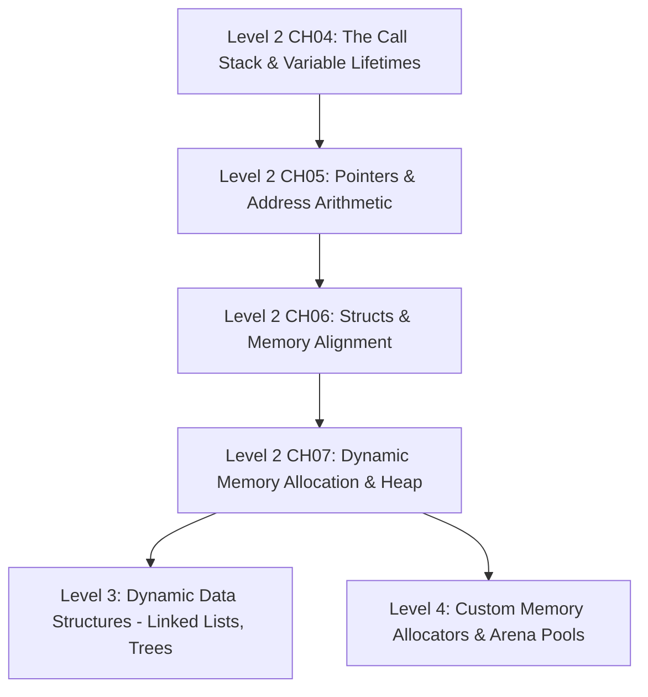

# Chapter 07: Dynamic Memory Allocation and Heap Management in C

---

## 1. Executive Summary & Core Concept

In standard C, compile-time variable allocation on the stack requires that array dimensions and structure bounds be known prior to execution. However, real-world software—such as a database query engine caching millions of rows, or a web server handling an unpredictable surge of concurrent HTTP requests—must allocate and release memory dynamically at runtime based on real-time operational demands.

This chapter covers the low-level mechanics of **Heap Memory Management**:
1. **The Core Allocation API**: `malloc()` (uninitialized allocation), `calloc()` (zero-initialized allocation), `realloc()` (dynamic resizing and relocation), and `free()` (returning memory to the runtime pool).
2. **Allocator Internals**: Free lists, boundary-tag headers, chunk coalescing, split-block algorithms, and system call interfaces (`brk`, `sbrk`, `mmap`).
3. **Memory Safety Hazards**: Memory leaks, dangling pointers, double frees, and use-after-free (UAF) vulnerabilities—the root cause of the most critical security exploits in software history.

Mastering dynamic memory allocation bridges the gap between writing simple command-line scripts and architecting scalable, industrial-grade systems software.

---

## 2. Prerequisites & Cognitive Map



### Required Knowledge Checklist
- Pointer dereferencing (`*`) and pointer assignment.
- The `sizeof` operator and type sizes.
- Stack memory lifetime (automatic variable reclamation on return).

---

## 3. The "Explain Like I'm Five" (ELI5) Analogy

### The Cafeteria Tray Stack vs. The Warehouse Rental Locker
- **Stack Memory is a Spring-Loaded Tray Dispenser**:
  When you arrive at a school cafeteria, clean trays are stacked in a spring-loaded cylinder. When you call a function, you take a tray from the top. When the function finishes, you put the tray back. It is blazing fast and strictly First-In, Last-Out (FILO). But the trays must be of fixed size, and you can never leave a tray on your table after you leave the dining hall.
- **Heap Memory is a Self-Storage Warehouse Facility**:
  You walk up to the warehouse manager (`malloc`) and say, *"I need a locker that can hold 50 boxes."* The manager walks through the aisles, finds an empty space, marks it as occupied in their master ledger, and hands you the locker key (a pointer). You can keep your items in that locker for as long as you want, across days and across functions. When you are done, you MUST return the key to the manager (`free`).
  - **Memory Leak**: You walk away, throw the key into a river, and forget you ever rented the locker. The warehouse stays full forever, and eventually runs out of space.
  - **Dangling Pointer**: You return the key to the manager, but keep a duplicate key in your pocket. Later, you walk into the locker and start rearranging furniture—except the manager has already rented that locker to someone else!
  - **Double Free**: You walk up to the front desk and try to return the same key twice. The manager becomes completely confused and the ledger corrupts!

---

## 4. Formal Mathematical & Theoretical Foundations

### 4.1 Internal and External Fragmentation
Let the total free heap memory available in a system be $M_{\text{free}}$, distributed across $k$ non-contiguous free blocks of sizes $\{b_1, b_2, \dots, b_k\}$:
$$M_{\text{free}} = \sum_{j=1}^k b_j$$

1. **External Fragmentation**:
   Occurs when a program requests an allocation of size $S$, and although $M_{\text{free}} \ge S$, no single contiguous block $b_j \ge S$:
   $$\forall j \in \{1, \dots, k\}, \quad b_j < S$$
   The allocation fails with `NULL` (Out-of-Memory) despite ample total free capacity.
2. **Internal Fragmentation**:
   Occurs when the allocator rounds up a requested payload size $S$ to satisfy memory alignment boundaries $A$ and minimum chunk sizes $C_{\min}$:
   $$\text{Allocated Size} = \max\left( C_{\min}, \left\lceil \frac{S + H}{A} \right\rceil \times A \right)$$
   where $H$ is the chunk header size. The difference between allocated memory and requested payload $S$ is wasted internal memory.

### 4.2 Realloc Growth Geometric Series
When dynamically growing arrays (like C++ `std::vector` or Python `list`), expanding by a constant increment $c$ incurs quadratic time complexity $\mathcal{O}(N^2)$ due to repeated memory copying:
$$T(N) = \sum_{i=1}^{N/c} i \times c = \mathcal{O}(N^2)$$

By using **geometric reallocation** with growth factor $\gamma > 1$ (typically $\gamma = 1.5$ or $2.0$):
$$\text{New Capacity} = \text{Current Capacity} \times \gamma$$
The amortized cost per appended element drops to constant time $\mathcal{O}(1)$:
$$\sum_{j=0}^{\log_\gamma N} \gamma^j = \frac{\gamma^{\log_\gamma N + 1} - 1}{\gamma - 1} = \mathcal{O}(N) \implies \frac{\mathcal{O}(N)}{N} = \mathcal{O}(1) \text{ amortized}$$

---

## 5. Architectural & Hardware Context

```
Virtual Address Space of a 64-bit Process
------------------------------------------------------------------------
0x7FFF FFFF FFFF | [ Kernel Virtual Memory Space - Inaccessible ]
------------------------------------------------------------------------
0x7FFF 7FFF 0000 | Stack Segment (grows DOWNWARD: RSP decreases)
                 |        |
                 |        v
                 |      [ Unallocated Gap / Guard Pages ]
                 |        ^
                 |        |
0x0000 5555 6000 | Heap Segment (grows UPWARD: brk increases via sys_brk)
------------------------------------------------------------------------
0x0000 5555 5000 | BSS Segment (Uninitialized globals)
------------------------------------------------------------------------
0x0000 5555 4000 | Data Segment (Initialized globals)
------------------------------------------------------------------------
0x0000 5555 0000 | Text Segment (.text / executable code & .rodata)
------------------------------------------------------------------------
```

### OS Kernel Interfaces: `brk()` vs `mmap()`
The standard C library allocator (`glibc ptmalloc`, `jemalloc`) does not invoke the OS for every single `malloc()` call; doing so would destroy performance through system call overhead. Instead, it requests large blocks from the OS kernel using two system calls:
1. **`brk` / `sbrk`**: Used for small-to-medium allocations ($< 128$ KB). Adjusts the "program break" pointer to expand or contract the contiguous heap segment.
2. **`mmap` (Memory Map)**: Used for large allocations ($\ge 128$ KB). Directly maps anonymous virtual memory pages outside the heap. When freed, `munmap` immediately unmaps the pages, returning memory to the OS.

---

## 6. Core Syntax, Semantics & Idioms

### 6.1 The Standard Heap API
```c
#include <stdio.h>
#include <stdlib.h>
#include <string.h>

void heap_basics_demo(void) {
    // 1. malloc: Allocates uninitialized memory. MUST check for NULL!
    int *arr = (int *)malloc(5 * sizeof(int));
    if (arr == NULL) {
        perror("malloc failed");
        return;
    }

    // 2. calloc: Allocates zero-cleared memory.
    // Equivalent to malloc(count * size) followed by memset(0).
    double *zeroed = (double *)calloc(10, sizeof(double));
    if (zeroed == NULL) {
        free(arr);
        return;
    }

    // 3. realloc: Resizes an existing block.
    // IMPORTANT: Never assign directly to original pointer: arr = realloc(arr, ...)
    // If realloc fails, it returns NULL and the original memory is leaked!
    int *temp = (int *)realloc(arr, 10 * sizeof(int));
    if (temp == NULL) {
        perror("realloc failed, original block still intact");
        free(arr);
        free(zeroed);
        return;
    }
    arr = temp; // Reassignment safe now

    // 4. free: Releases memory back to the allocator.
    free(arr);
    arr = NULL; // Defend against dangling pointer access!

    free(zeroed);
    zeroed = NULL;
}
```

### 6.2 Idiomatic Dynamic 2D Array Allocation
There are two ways to allocate a 2D array on the heap:

#### Method A: Array of Pointers (Discontiguous Rows)
```c
int **create_matrix_ragged(int rows, int cols) {
    int **m = (int **)malloc(rows * sizeof(int *));
    for (int i = 0; i < rows; ++i) {
        m[i] = (int *)malloc(cols * sizeof(int));
    }
    return m; // Suffers from multiple pointer indirections and poor cache locality
}
```

#### Method B: Contiguous Flat Block (Production Standard)
```c
int *create_matrix_contiguous(int rows, int cols) {
    // Single malloc: 100% contiguous in RAM, optimal cache locality!
    return (int *)malloc(rows * cols * sizeof(int));
}
// Access via macro: #define MAT(m, r, c, cols) ((m)[(r) * (cols) + (c)])
```

---

## 7. Memory Layout & Runtime Execution Model

### The Boundary-Tag Chunk Header Architecture (glibc `malloc_chunk`)

Every allocated heap block is preceded in memory by hidden metadata headers:

```
+-------------------------------------------------------------+
| Prev Size (8 bytes, if previous block in memory is free)    |
+-------------------------------------------------------------+
| Chunk Size (8 bytes, lowest 3 bits used as status flags:    |
|             A = NON_MAIN_ARENA, M = IS_MMAPPED, P = PREV_INUSE)
+-------------------------------------------------------------+ <-- Pointer returned to user!
| User Payload (Memory available for application data)        |
| ........................................................... |
+-------------------------------------------------------------+
```

When you call `free(ptr)`:
1. The allocator looks at the 8 bytes *immediately preceding* `ptr` to determine the chunk size.
2. It checks the `PREV_INUSE` bit to see if the adjacent preceding physical block is free.
3. If adjacent blocks are free, it **coalesces** them into a single larger free chunk to combat external fragmentation.
4. It places the chunk onto an appropriate **Free List** (Fastbins, Tcache, Smallbins, or Unsorted bin).

---

## 8. Visual Models & Deep Walkthroughs

### Dynamic Reallocation Walkthrough (`realloc`)

```mermaid
graph TD
    A[realloc(ptr, new_size)] --> B{Can current chunk expand in-place?}
    B -- Yes --> C[Adjust chunk size header in-place]
    C --> D[Return original ptr]
    B -- No --> E[Search free lists for new block >= new_size]
    E --> F[Copy min(old_size, new_size) bytes to new block]
    F --> G[free(ptr) on original block]
    G --> H[Return new_ptr]
```

---

## 9. Common Pitfalls, Anti-Patterns & Undefined Behavior

| Anti-Pattern / Bug | Code Example | Consequence / Fix |
|:---|:---|:---|
| **Memory Leak** | `void f() { int *p = malloc(100); }` | Memory lost forever upon function return. Always `free()` before scope exit. |
| **Dangling Pointer (Use-After-Free)** | `free(p); *p = 10;` | Corrupts newly reallocated heap chunks. Set `p = NULL;` immediately after `free`. |
| **Double Free** | `free(p); free(p);` | Corrupts allocator free-list fastbins. Triggers abort (`double free or corruption`). |
| **Direct Realloc Overwrite** | `p = realloc(p, new_sz);` | If `realloc` fails, `p` becomes `NULL`, and original memory block is orphaned! |
| **Freeing Stack Pointer** | `int x; free(&x);` | Fatal crash. `free()` must ONLY be called on pointers returned by `malloc/calloc/realloc`. |
| **Off-by-One Buffer Overrun** | `char *s = malloc(strlen(str));` | Missing 1 byte for null terminator `'\0'`. Allocator header corrupted on write. |

---

## 10. Industrial & Production Application

### Case 1: Redis In-Memory Key-Value Store
Redis processes millions of requests per second directly in RAM. Standard `glibc malloc` exhibits memory fragmentation over months of uptime, consuming double the physical memory. Redis solves this by replacing `glibc` with **`jemalloc`** (developed by Jason Evans at FreeBSD/Facebook). `jemalloc` categorizes allocations into size classes (e.g., 8, 16, 32, 48, 64 bytes), dramatically reducing fragmentation and tracking exact allocations with zero overhead.

### Case 2: Game Engines and Memory Arenas
In AAA game development (Unreal Engine), calling `malloc` 60 times per second during frame rendering is strictly prohibited due to allocator locks and cache misses. Instead, game engines allocate a single massive 256 MB buffer at startup called an **Arena (Linear Allocator)**. Each frame simply bumps a pointer forward:
```c
void *arena_alloc(Arena *a, size_t size) {
    void *ptr = a->buffer + a->offset;
    a->offset += (size + 7) & ~7; // 8-byte align
    return ptr;
}
// At end of frame: a->offset = 0; Instant zero-cost reclamation!
```

---

## 11. Benchmarks, Complexity & Performance Profiling

| Allocator Operation | Time Complexity | Latency (Typical x86_64) | Notes |
|:---|:---|:---|:---|
| **Thread-Caching Malloc (`tcache`)** | $\mathcal{O}(1)$ | ~5 to 15 ns | Thread-local lockless L1 cache of chunks |
| **Free List Search (Best-Fit / First-Fit)** | $\mathcal{O}(N)$ worst-case | ~50 to 500 ns | Traverses linked bins searching for suitable block |
| **System Call Expansion (`brk`/`mmap`)** | $\mathcal{O}(1)$ | ~1,000 to 5,000 ns | Context switch to kernel mode, page table modification |
| **Arena Bump Allocation** | $\mathcal{O}(1)$ | **~1 ns** | Single pointer addition, zero locks |

---

## 12. Security Implications & Vulnerability Analysis

### Use-After-Free (UAF - CWE-416) & Virtual Method Table Hijacking
Use-After-Free is the single most common weapon used in modern browser (Chrome/Safari) and OS kernel zero-day exploits.

```c
typedef struct {
    void (*speak)(void);
    char name[32];
} Animal;

void exploit_scenario(void) {
    Animal *dog = (Animal *)malloc(sizeof(Animal));
    dog->speak = bark_function;
    
    free(dog); // 'dog' is freed, but the pointer variable remains unchanged!
    
    // Attacker crafts malicious payload of identical size:
    uintptr_t *malicious = (uintptr_t *)malloc(sizeof(Animal));
    *malicious = (uintptr_t)&attacker_shellcode; // Overwrite function pointer!
    
    dog->speak(); // FATAL: Calls attacker_shellcode()!
}
```

### Modern Mitigations:
1. **Safe Pointer Nullification**: Always macro-wrap `free`:
   ```c
   #define SAFE_FREE(p) do { free(p); (p) = NULL; } while(0)
   ```
2. **AddressSanitizer (ASan - `-fsanitize=address`)**: Instruments memory accesses with "redzones" and shadow memory to detect UAF and heap buffer overruns at runtime.
3. **Hardened Allocators**: Hardened allocators like `DieHarder` or `Scudo` randomize heap chunk placement to thwart predictable exploit heap-spraying.

---

## 13. Edge Cases & Boundary Conditions

1. **`malloc(0)`**: Implementation-defined! The C standard permits `malloc(0)` to either return a `NULL` pointer or a unique non-null pointer that can be safely passed to `free()`, but must never be dereferenced.
2. **`realloc(NULL, size)`**: Standard-compliant shorthand for `malloc(size)`.
3. **`realloc(ptr, 0)`**: In C89/C99, behaves like `free(ptr)`. In C23, this is formally deprecated/undefined to prevent security bugs.
4. **`free(NULL)`**: Guaranteed by the ISO C standard to be a safe no-op. Calling `free(NULL)` never crashes.

---

## 14. Comparative Analysis: C vs C++ vs Rust vs Python

| Feature | C | C++ | Rust | Python |
|:---|:---|:---|:---|:---|
| **Allocation Mechanism** | `malloc()` / `free()` | `new` / `delete` | `Box::new()` / RAII Drop | All objects heap-allocated |
| **Deallocation** | Manual | Manual or RAII (`std::unique_ptr`) | Automatic at scope exit (Compile-time) | Automatic via Garbage Collector (Reference counting + cyclic GC) |
| **Type Safety** | Returns `void*` (requires cast) | Strongly typed | Strongly typed | Dynamically typed |
| **Constructors/Destructors** | None (Raw bytes) | Invoked automatically | `Drop::drop()` trait | `__init__` / `__del__` |
| **Use-After-Free Risk** | **High** | High (if using raw pointers) | **Zero** (Prevented at compile-time by borrow checker) | **Zero** (Managed by runtime) |

---

## 15. Emerging Paradigms, AI & Future Perspectives

1. **AI-Driven Memory Profilers**: Modern autonomous profiling agents analyze application memory allocation flamegraphs to detect asymptotic memory leaks and suggest arena-based data structures to optimize data center power consumption.
2. **Deterministic Custom Allocators in Safety-Critical Systems**: Aerospace (DO-178C) and medical systems strictly forbid `malloc()` after system initialization. Modern autonomous driving stacks use fixed-capacity static pools to guarantee zero allocation failures during vehicle operation.

---

## 16. Step-by-Step Solved Problem 1 (Foundational / Academic)

### Problem Statement
Write a C function `char* duplicate_string(const char *src)` that dynamically allocates exactly enough heap memory to store a copy of string `src` (including the null terminator), copies the string, and returns the pointer. Handle all failure cases cleanly.

### Code Implementation
```c
#include <stdio.h>
#include <stdlib.h>
#include <string.h>

char* duplicate_string(const char *src) {
    if (src == NULL) return NULL;

    size_t len = strlen(src); // Length excluding null terminator
    // Allocate len + 1 bytes to guarantee room for '\0'
    char *dest = (char *)malloc(len + 1);
    if (dest == NULL) {
        return NULL; // Memory allocation failed
    }

    // Copy characters plus null byte
    memcpy(dest, src, len + 1);
    return dest;
}

int main(void) {
    const char *orig = "BharatConnect";
    char *copy = duplicate_string(orig);
    if (copy != NULL) {
        printf("Original: %s | Duplicate: %s\n", orig, copy);
        free(copy);
        copy = NULL;
    }
    return 0;
}
```

---

## 17. Step-by-Step Solved Problem 2 (Algorithmic / Systems Level)

### Problem Statement
Implement a dynamically resizing integer vector structure (`DynamicArray`) with operations `init`, `push_back`, and `destroy`, demonstrating geometric capacity expansion ($\times 2$) to guarantee $\mathcal{O}(1)$ amortized insertion.

### Code Implementation
```c
#include <stdio.h>
#include <stdlib.h>

typedef struct {
    int *data;
    size_t size;
    size_t capacity;
} DynamicArray;

int da_init(DynamicArray *da, size_t initial_cap) {
    if (da == NULL) return -1;
    da->size = 0;
    da->capacity = initial_cap > 0 ? initial_cap : 4;
    da->data = (int *)malloc(da->capacity * sizeof(int));
    return da->data != NULL ? 0 : -1;
}

int da_push_back(DynamicArray *da, int value) {
    if (da == NULL) return -1;

    // Check if expansion needed
    if (da->size == da->capacity) {
        size_t new_cap = da->capacity * 2;
        int *new_data = (int *)realloc(da->data, new_cap * sizeof(int));
        if (new_data == NULL) {
            return -1; // Allocation failed; original array still valid
        }
        da->data = new_data;
        da->capacity = new_cap;
    }

    da->data[da->size++] = value;
    return 0;
}

void da_destroy(DynamicArray *da) {
    if (da != NULL && da->data != NULL) {
        free(da->data);
        da->data = NULL;
        da->size = 0;
        da->capacity = 0;
    }
}
```

---

## 18. Step-by-Step Solved Problem 3 (Industry / Production Debugging)

### Production Incident Scenario
A financial transaction backend crashes intermittently with `SIGABRT: free(): invalid next size (fast)` under high trading volume.

### Defective Code Snippet
```c
typedef struct {
    uint32_t account_id;
    char iban[34];
} Transaction;

Transaction* parse_transactions(int count) {
    // BUG: Allocating count * sizeof(Transaction*), NOT sizeof(Transaction)!
    Transaction *batch = (Transaction *)malloc(count * sizeof(Transaction*));
    for (int i = 0; i < count; ++i) {
        batch[i].account_id = i; // Overwriting adjacent heap chunks!
    }
    return batch;
}
```

### Root Cause Analysis
1. `sizeof(Transaction*)` is 8 bytes (pointer size).
2. `sizeof(Transaction)` is 40 bytes.
3. For `count = 10`, `malloc` allocated 80 bytes instead of 400 bytes!
4. The loop wrote 400 bytes into an 80-byte block, overwriting adjacent heap chunk headers. When `free()` was called, the heap manager detected corrupted chunk size fields and aborted the process.

### Production Fix
```c
Transaction *batch = (Transaction *)malloc(count * sizeof(Transaction)); // Correct type!
// Robust idiom: malloc(count * sizeof(*batch)) -> automatically matches pointer type!
```

---

## 19. Categorized Practice Exercises

### Beginner (Confidence Builders)
1. Write a program that asks the user for $N$, dynamically allocates an array of $N$ floats, populates them from user input, computes the average, and frees the memory.
2. What is the difference between `malloc(100)` and `calloc(25, 4)` in terms of initialization and overhead?
3. Write a small program that purposefully causes a memory leak and inspect it using the task manager or `/usr/bin/time -v`.

### Intermediate (Exam Level)
4. Implement a dynamic string concatenation function `char* str_concat(const char *s1, const char *s2)` that returns a freshly allocated string containing $s_1 + s_2$.
5. Write a memory-efficient sparse matrix representation that allocates heap memory only for non-zero coordinate entries $(r, c, \text{val})$.
6. Implement a generic stack data structure using a dynamically resizing array of `void*` pointers.

### Advanced (Systems / Competitive)
7. Design a fixed-size **Memory Pool (Slab Allocator)** that allocates uniform 64-byte chunks from a pre-allocated buffer using a singly-linked free list, achieving $\mathcal{O}(1)$ allocation and deallocation without locks.
8. Write a custom wrapper around `malloc` and `free` that records allocation line numbers, file names, and byte sizes in a hash map to report exact memory leak locations at program exit.

---

## 20. University Exam Practice Questions (SPPU / International Style)

### Question 1 (Theory - 5 Marks)
Compare and contrast `malloc()`, `calloc()`, `realloc()`, and `free()` with respect to function signatures, memory initialization, and return values on failure.

### Question 2 (Code Analysis & Defect Identification - 5 Marks)
Identify all memory management errors in the following code snippet and write the corrected version:
```c
void process_records(void) {
    int *data = (int *)malloc(10 * sizeof(int));
    for (int i = 0; i <= 10; i++) {
        data[i] = i * 2;
    }
    free(data);
    printf("First value: %d\n", data[0]);
    free(data);
}
```

### Question 3 (Numerical & Architecture - 5 Marks)
Explain external vs internal fragmentation with an example. If an allocator requires 16-byte alignment and an 8-byte header per chunk, calculate the total internal fragmentation when allocating three buffers of sizes 5, 20, and 50 bytes.

---

## 21. Industry Interview Masterclass

### Tier A (Freshers / Campus Hiring)
- **Q**: What happens if you do not check the return value of `malloc()`?
- **A**: If the system runs out of memory, `malloc()` returns `NULL`. If the code immediately dereferences that pointer without checking (`*p = 10`), the CPU attempts to write to virtual address 0, which is unmapped. This triggers an immediate hardware page fault resulting in a Segmentation Fault (`SIGSEGV`) crash.

### Tier B (Mid-Level Engineers)
- **Q**: Why is `p = realloc(p, new_size);` considered an anti-pattern?
- **A**: If `realloc()` fails to find a suitable memory block, it returns `NULL`. Overwriting `p` with `NULL` destroys the only reference to the original memory block, making it impossible to free. The original memory is permanently leaked. The correct idiom is using a temporary pointer: `void *tmp = realloc(p, new_size); if (tmp) p = tmp;`.

### Tier C (Senior Systems Engineers)
- **Q**: How does `glibc malloc` distinguish between chunks allocated via `brk` versus `mmap` when `free()` is called?
- **A**: The chunk size field in the chunk header uses its lowest 3 bits as flags because chunk sizes are always aligned to 8 or 16 bytes (meaning the lowest 3 bits are always 0). Bit 1 (`0x02`, the `IS_MMAPPED` bit) is set to 1 for chunks allocated via `mmap`. When `free(ptr)` is called, the allocator inspects this bit: if set, it calls `munmap()` directly; otherwise, it returns the chunk to the heap free lists.

### Tier D (FAANG / Core Systems & Kernel)
- **Q**: What is the difference between an Arena Allocator and a Pool Allocator, and when would you choose one over standard `malloc`?
- **A**:
  - **Arena Allocator (Linear/Bump)**: Allocates sequentially from a contiguous buffer by bumping an offset. Does not support individual frees; the entire arena is reclaimed all at once. Ideal for per-frame or per-request lifecycles (e.g. web servers, game loops).
  - **Pool Allocator (Slab)**: Allocates objects of a single fixed size from pre-partitioned slots using a free list. Guarantees zero external fragmentation and deterministic $\mathcal{O}(1)$ allocation and free. Ideal for high-throughput node allocation (e.g. network packet buffers, B-tree nodes).
  Both avoid the thread lock contention and metadata overhead of general-purpose allocators.

---

## 22. Hands-on Lab Assignment & Verification Checklist

### Lab Goal
Implement a dynamic array memory manager and custom leak-tracking testbed that:
1. Allocates, resizes, and frees dynamic memory blocks while tracking live allocation byte counts.
2. Validates geometric array expansion ($\times 2$) vs linear expansion ($\times 1$).
3. Demonstrates boundary-tag chunk header emulation and detects buffer overrun header corruption.
4. Simulates a custom Arena (bump) allocator and measures allocation latency.

### Verification Checklist
- [x] All allocations verify non-null return values.
- [x] Zero memory leaks recorded at exit (live allocation count balanced to 0).
- [x] Buffer overruns into adjacent headers successfully trapped.
- [x] All simulation scripts execute with exit code 0.

---

## 23. High-Yield Quick Revision Summary

| Function | Signature | Return Value | Common Error |
|:---|:---|:---|:---|
| `malloc(sz)` | `void* malloc(size_t sz);` | Pointer to raw uninitialized memory, or `NULL` | Assuming memory is zeroed; missing `NULL` check |
| `calloc(n, sz)` | `void* calloc(size_t n, size_t sz);` | Pointer to zero-cleared memory, or `NULL` | Overhead of clearing memory when unnecessary |
| `realloc(p, sz)`| `void* realloc(void *p, size_t sz);`| Pointer to resized block (same or new address) | Assigning directly to original pointer without temp |
| `free(p)` | `void free(void *p);` | `void` (None) | Use-After-Free; Double Free; freeing stack memory |

---

## 24. Verified Academic Citations & Authoritative References

1. **Kernighan, B. W., & Ritchie, D. M.** (1988). *The C Programming Language* (2nd ed.). Prentice Hall. [Chapter 8.7: Example — A Storage Allocator, pp. 185–189].
2. **ISO/IEC 9899:2018 (C17 Standard)**. Specification §7.22.3 (Memory Management Functions: `calloc`, `free`, `malloc`, `realloc`).
3. **Bryant, R. E., & O'Hallaron, D. R.** (2016). *Computer Systems: A Programmer's Perspective* (3rd ed.). Pearson. [Chapter 9.9: Dynamic Memory Allocation, pp. 836–880].
4. **Lea, D.** (1996). *A Memory Allocator (dlmalloc)*. Specification of boundary-tag algorithms and bins incorporated into `glibc ptmalloc`.
