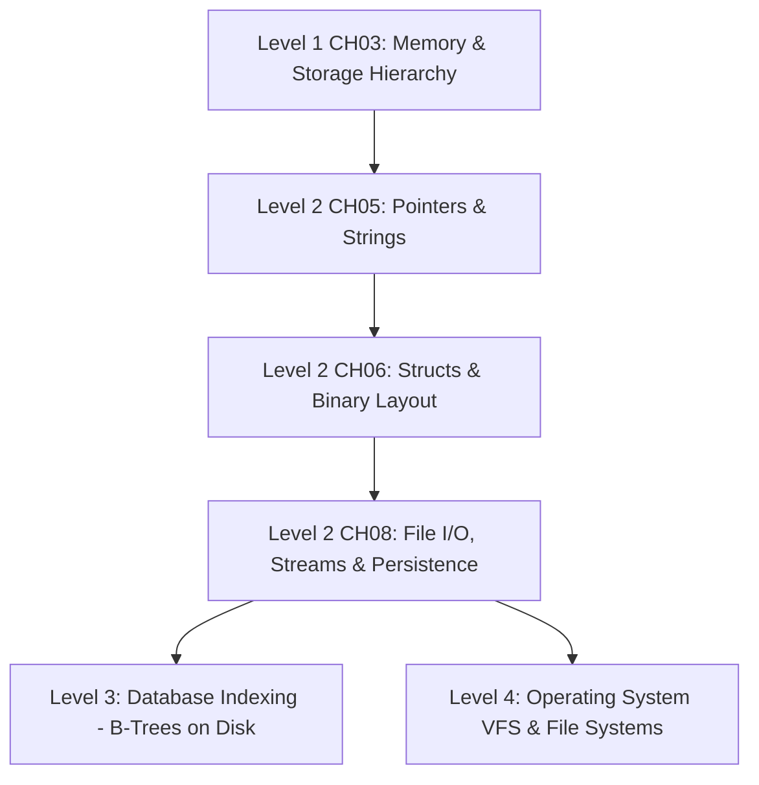
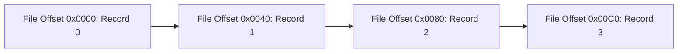

# Chapter 08: File I/O, Streams, and Persistence in C

---

## 1. Executive Summary & Core Concept

All variables, arrays, and dynamic structures residing in volatile RAM vanish the instant a program terminates or power is removed. To preserve state permanently—such as saving user credentials, recording banking ledger transactions, or logging server metrics—programs must communicate with non-volatile secondary storage (SSD, NVMe, HDD) through the file system.

In C, file input and output is abstracted through the concept of a **Stream**: a continuous, unidirectional or bidirectional sequence of bytes mediated by a `FILE` structure pointer (`FILE *`). 

This chapter demystifies:
1. **The Stream Abstraction**: Standard streams (`stdin`, `stdout`, `stderr`) and user-opened file streams.
2. **Text vs. Binary Modes**: Human-readable character formatting versus raw byte-level disk serialization.
3. **Buffered I/O Architecture**: Why the standard C runtime aggregates operations in memory buffers before invoking high-latency OS kernel system calls (`read`, `write`).
4. **Random Access File Navigation**: Seeking and telling byte offsets using `fseek()` and `ftell()`.

Understanding buffered streams and binary persistence is the bedrock of database development, systems programming, and high-performance server architectures.

---

## 2. Prerequisites & Cognitive Map



### Required Knowledge Checklist
- Pointers and memory buffers (`void *`, `char *`).
- Struct memory layouts and packing from Chapter 06.
- The standard error stream and POSIX return codes.

---

## 3. The "Explain Like I'm Five" (ELI5) Analogy

### The Bucket Brigade and The Shipping Container
- **Why We Need Buffered Streams (`FILE *`)**:
  Imagine you are building a brick wall in your backyard, and the brick factory is 10 kilometers away.
  - **Unbuffered I/O (System Calls `read`/`write`)**: Every time you need a single brick, you get into your truck, drive 10 kilometers to the factory, buy one brick, drive 10 kilometers back, and lay it down. It would take weeks to build a small wall!
  - **Buffered I/O (`fread`/`fwrite`)**: You hire a large flatbed shipping truck (an internal 4 KB or 8 KB memory buffer). You drive to the factory once, load 1,000 bricks into the truck, and park it in your driveway. Now, when you need a brick, you grab it from the truck in 1 second. You only make the long 10-kilometer trip (a kernel context switch) when the truck is completely empty!
- **Text Mode vs. Binary Mode**:
  - **Text Mode**: You write a handwritten letter in English. When you send it across borders (e.g. from Windows to Linux), postal workers convert words like "carriage return + line feed" (`\r\n`) into a single "line feed" (`\n`) so locals can read it cleanly.
  - **Binary Mode**: You pack a sealed metal crate with exact machine parts. You tell the postal workers: *"Do not touch, translate, or convert any byte inside this crate. Deliver the exact bits as they are."*

---

## 4. Formal Mathematical & Theoretical Foundations

### 4.1 Amortized I/O Throughput & Cost Model
Let $T_{\text{syscall}}$ be the CPU overhead of transitioning into the kernel (typically 1,000–3,000 CPU cycles), and let $T_{\text{disk}}$ be the latency of an NVMe storage access (~10–50 $\mu$s). Let $T_{\text{memcpy}}$ be the time required to copy 1 byte in L1 cache (~0.2 ns).

If an application writes $N$ bytes:
1. **Unbuffered Per-Byte Writes (`fputc` without buffering)**:
   $$T_{\text{unbuf}}(N) = N \times (T_{\text{syscall}} + T_{\text{disk}}) = \mathcal{O}(N \times T_{\text{disk}})$$
2. **Buffered Writes with Buffer Size $B$ (e.g., $B = 4096$ bytes)**:
   The system call and disk commit happen only once every $B$ bytes:
   $$T_{\text{buf}}(N) = N \times T_{\text{memcpy}} + \left\lceil \frac{N}{B} \right\rceil \times (T_{\text{syscall}} + T_{\text{disk}})$$
   For $B = 4096$, disk overhead is divided by $4096$, delivering an asymptotic throughput increase of **over $1000\times$**.

### 4.2 Stream State Transitions
A standard C stream is modeled as an automaton $(S, \Sigma, \delta, s_0)$ where:
- State $S \in \{\text{CLOSED}, \text{OPEN\_READ}, \text{OPEN\_WRITE}, \text{EOF}, \text{ERROR}\}$
- Input alphabet $\Sigma \in \{\text{fopen}, \text{fgetc}, \text{fputc}, \text{fseek}, \text{fflush}, \text{fclose}\}$
- Once a stream enters the $\text{EOF}$ (End-Of-File) state, all subsequent read attempts return the sentinel constant `EOF` ($-1$) until `clearerr()` or `fseek()` resets the state.

---

## 5. Architectural & Hardware Context

```
User Space (Application)
+-----------------------------------------------------------------+
| C Application Code: fread(&record, sizeof(record), 1, fp);      |
+-----------------------------------------------------------------+
               |
               v
| C Runtime Library Buffer (FILE* internal struct: 4KB or 8KB)   |
| [ Byte 0 | Byte 1 | Byte 2 | ... | Byte 4095 ]                  |
+-----------------------------------------------------------------+
               |  System Call: sys_read(fd, kernel_buf, 4096)
               v  (Context switch: Ring 3 -> Ring 0)
Kernel Space (OS Kernel)
+-----------------------------------------------------------------+
| VFS (Virtual File System) -> Page Cache (DRAM Buffer Cache)     |
+-----------------------------------------------------------------+
               |  Device Driver DMA Transfer
               v
Hardware Storage
+-----------------------------------------------------------------+
| NVMe / SSD Flash Controller / Physical Disk Sectors             |
+-----------------------------------------------------------------+
```

### The `FILE` Structure Under the Hood
In the C standard library (e.g. `glibc`), `FILE` is an opaque typedef for an internal struct containing:
- An underlying integer **File Descriptor (`fd`)** representing the OS kernel open-file table entry.
- Pointers to the start, current position, and end of the user-space cache buffer (`_IO_read_ptr`, `_IO_read_end`).
- Bitflags recording stream state (`_IO_EOF_SEEN`, `_IO_ERR_SEEN`).

---

## 6. Core Syntax, Semantics & Idioms

### 6.1 Opening, Reading, and Writing Text Files
```c
#include <stdio.h>
#include <stdlib.h>

void write_log_entry(const char *filename, const char *message) {
    // Mode "a": Append mode (creates file if missing; writes to end)
    FILE *fp = fopen(filename, "a");
    if (fp == NULL) {
        perror("Failed to open file for appending");
        return;
    }

    fprintf(fp, "[LOG] %s\n", message);
    fclose(fp); // Flushes buffer and releases OS file handle
}

void read_lines_safe(const char *filename) {
    FILE *fp = fopen(filename, "r");
    if (fp == NULL) {
        perror("Failed to open file for reading");
        return;
    }

    char buffer[256];
    // fgets reads until newline or buffer limit; ALWAYS guarantees null termination
    while (fgets(buffer, sizeof(buffer), fp) != NULL) {
        printf("Line: %s", buffer);
    }

    if (ferror(fp)) {
        fprintf(stderr, "Error occurred during file reading.\n");
    }

    fclose(fp);
}
```

### 6.2 Binary File I/O: Struct Serialization (`fread` / `fwrite`)
Binary I/O transfers memory bytes directly between RAM and disk without character encoding conversions:

```c
#include <stdio.h>
#include <stdint.h>

typedef struct {
    uint32_t account_number;
    char customer_name[32];
    double balance;
} BankAccount;

int save_account_binary(const char *path, const BankAccount *acc) {
    FILE *fp = fopen(path, "wb"); // Mode "wb": Write Binary
    if (!fp) return -1;

    // Writes 1 item of size sizeof(BankAccount)
    size_t items_written = fwrite(acc, sizeof(BankAccount), 1, fp);
    fclose(fp);

    return items_written == 1 ? 0 : -1;
}

int load_account_binary(const char *path, BankAccount *out_acc) {
    FILE *fp = fopen(path, "rb"); // Mode "rb": Read Binary
    if (!fp) return -1;

    size_t items_read = fread(out_acc, sizeof(BankAccount), 1, fp);
    fclose(fp);

    return items_read == 1 ? 0 : -1;
}
```

### 6.3 Random Access File Navigation (`fseek`, `ftell`, `rewind`)
```c
// Seek origin flags:
// SEEK_SET: Beginning of file
// SEEK_CUR: Current stream offset
// SEEK_END: End of file

long get_file_size(FILE *fp) {
    fseek(fp, 0, SEEK_END);    // Move pointer to the end
    long size = ftell(fp);     // Read current byte position
    rewind(fp);                // Reset pointer back to beginning (fseek(fp, 0, SEEK_SET))
    return size;
}
```

---

## 7. Memory Layout & Runtime Execution Model

### Detailed View of Buffered Read Lifecycle

```
Initial State: Buffer Empty, User calls fgetc(fp)
========================================================================
1. C runtime detects buffer is empty (_IO_read_ptr == _IO_read_end).
2. Runtime issues system call: read(fd, buffer, 4096).
3. Kernel fills 4096 bytes into user buffer from page cache.
4. _IO_read_ptr points to byte 0; _IO_read_end points to byte 4096.
5. Byte 0 is returned to user; _IO_read_ptr is incremented to byte 1.

Subsequent Calls (Next 4095 fgetc calls):
========================================================================
Zero system calls! Characters are served directly out of L1 cache.

At Call 4097:
========================================================================
Buffer exhausted. Step 2 repeats to fetch next 4096-byte chunk.
```

---

## 8. Visual Models & Deep Walkthroughs

### Binary Database Record Seeking Walkthrough



To read Record $K$ directly without reading previous records:
$$\text{Offset} = K \times \text{sizeof}(\text{Record})$$
`fseek(fp, K * sizeof(Record), SEEK_SET);`  
`fread(&record, sizeof(Record), 1, fp);`  
Executes in instantaneous $\mathcal{O}(1)$ disk seek time!

---

## 9. Common Pitfalls, Anti-Patterns & Undefined Behavior

| Anti-Pattern / Bug | Code Example | Consequence / Fix |
|:---|:---|:---|
| **Looping with `while (!feof(fp))`** | `while (!feof(fp)) { fscanf(...); }` | Off-by-one duplicate execution! `feof()` only returns true *after* a read has already failed. Check return of read! |
| **Forgetting to Call `fclose()`** | Opening files in loop without `fclose` | File descriptor leak. Program crashes with `EMFILE` (Too many open files). |
| **Writing Pointers to Disk** | `struct Node { char *str; }; fwrite(&n, ...);` | Writes a transient virtual memory address to disk! Re-reading from disk yields an invalid dangling pointer. |
| **Missing Binary Flag `"b"` on Windows** | `fopen("data.bin", "w")` | Windows runtime silently converts `0x0A` (`\n`) to `0x0D 0x0A` (`\r\n`), corrupting binary images/audio. Use `"wb"`. |
| **Ignoring `fwrite` Return Value** | `fwrite(buf, sz, 1, fp);` | Disk full errors (ENOSPC) are ignored, resulting in silent data loss. Check return value equals requested count. |

---

## 10. Industrial & Production Application

### Case 1: PostgreSQL Write-Ahead Logging (WAL)
PostgreSQL guarantees ACID durability using Write-Ahead Logging. Before any database page is modified in RAM, the change is written as a binary struct to a sequential WAL file on disk. PostgreSQL uses `fflush()` and the POSIX `fsync()` system call to force physical SSD disk controllers to flush their onboard write caches, guaranteeing financial transactions survive sudden power outages.

### Case 2: Git Object Database Packaging
Git stores commits, trees, and blobs as immutable binary files inside `.git/objects/`. Each object begins with a structured header (`"commit <size>\0"`), followed by zlib-compressed binary payload data. Using stream I/O, Git streams multi-gigabyte packfiles while computing rolling SHA-1/SHA-256 integrity hashes on the fly.

---

## 11. Benchmarks, Complexity & Performance Profiling

| Operation | Time Complexity | Throughput / Latency | Bottleneck Factor |
|:---|:---|:---|:---|
| **Buffered Read (`fread` 64 KB block)** | $\mathcal{O}(N)$ | ~3,500 MB/s (NVMe line rate) | PCIe bus bandwidth |
| **Unbuffered Character Read (`fgetc` loop)** | $\mathcal{O}(N)$ | ~120 MB/s ($30\times$ slower) | Function call & lock overhead |
| **Random Seek (`fseek` to offset)** | $\mathcal{O}(1)$ | ~50 ns (Kernel file table adjust) | None (Pure arithmetic in OS) |
| **Physical Disk Sync (`fsync`)** | $\mathcal{O}(1)$ | ~2 to 10 ms | Mechanical disk rotation / SSD flash erase cycles |

---

## 12. Security Implications & Vulnerability Analysis

### The Time-of-Check to Time-of-Use (TOCTOU) Race Condition (CWE-367)
A critical security flaw occurs when an application checks file permissions before opening the file:

```c
// VULNERABLE CODE:
if (access("/tmp/user_data.txt", W_OK) == 0) {
    // RACE WINDOW: Attacker replaces /tmp/user_data.txt with a symlink to /etc/shadow!
    FILE *fp = fopen("/tmp/user_data.txt", "w");
    fputs("malicious content", fp); // Overwrites system password file!
}
```

### Remediation:
Never check and open in separate steps. Open the file with atomic OS flags using `open(path, O_CREAT | O_EXCL | O_WRONLY, 0600)` and inspect the file descriptor.

---

## 13. Edge Cases & Boundary Conditions

1. **Simultaneous Read & Write (`"r+"`, `"w+"`)**: In standard C (§7.21.5.3), switching between reading and writing on an update stream requires an intervening call to `fflush()`, `fseek()`, `fsetpos()`, or `rewind()`. Failing to flush causes undefined behavior.
2. **Reading Empty Files**: Attempting `fgetc` on a zero-byte file immediately returns `EOF`. Code must handle zero-byte files gracefully without memory allocation failures.
3. **Large File Support (LFS)**: Standard `long` in `fseek` is 32 bits on 32-bit OS / 64-bit Windows, limiting file seeking to 2 GB ($2^{31}-1$). Production software uses 64-bit offsets: `fseeko()` and `ftello()` (POSIX) or `_fseeki64()` (Windows).

---

## 14. Comparative Analysis: C vs Python vs Rust

| Feature | C | Python | Rust |
|:---|:---|:---|:---|
| **Stream Representation** | `FILE *` pointer | `io.TextIOWrapper` / `BufferedReader` | `File`, `BufReader<R>`, `BufWriter<W>` |
| **Resource Management** | Manual `fclose(fp)` | RAII via Context Manager (`with open(...)`) | RAII via `Drop` trait (Auto-closed on scope exit) |
| **Error Signaling** | Returns `NULL` / `EOF`; inspect `errno` | Raises exceptions (`FileNotFoundError`) | Strongly typed `Result<T, std::io::Error>` |
| **Buffering** | Transparently enabled inside `FILE` | Layered buffering | Explicit opt-in wrapper (`BufReader`) |

---

## 15. Emerging Paradigms, AI & Future Perspectives

1. **Direct I/O & Kernel Bypass (`io_uring`)**: Modern high-scale Linux servers (such as ScyllaDB and high-frequency trading engines) bypass standard `FILE *` and traditional synchronous `read`/`write` system calls entirely. Instead, they use Linux **`io_uring`**, submitting batches of asynchronous read/write ring descriptors directly between user-space memory and the NVMe controller with zero context switch overhead.
2. **AI Copilot Hallucinations in File Parsing**: LLMs routinely generate code using `fscanf("%s", str)` without field width limits, introducing severe stack buffer overflows. Modern static analysis and secure coding guidelines mandate `fgets()` or `getline()`.

---

## 16. Step-by-Step Solved Problem 1 (Foundational / Academic)

### Problem Statement
Write a robust C program to copy a file byte-for-byte from a source path to a destination path using a 4 KB buffer, measuring total bytes copied and handling missing files cleanly.

### Code Implementation
```c
#include <stdio.h>
#include <stdlib.h>

long copy_file(const char *src_path, const char *dest_path) {
    FILE *src = fopen(src_path, "rb");
    if (!src) {
        perror("Error opening source file");
        return -1;
    }

    FILE *dest = fopen(dest_path, "wb");
    if (!dest) {
        perror("Error opening destination file");
        fclose(src);
        return -1;
    }

    char buffer[4096];
    size_t bytes_read;
    long total_bytes = 0;

    // Read blocks of 4096 bytes until EOF
    while ((bytes_read = fread(buffer, 1, sizeof(buffer), src)) > 0) {
        size_t bytes_written = fwrite(buffer, 1, bytes_read, dest);
        if (bytes_written != bytes_read) {
            perror("Write failure (Disk full?)");
            fclose(src);
            fclose(dest);
            return -1;
        }
        total_bytes += bytes_written;
    }

    fclose(src);
    fclose(dest);
    return total_bytes;
}
```

---

## 17. Step-by-Step Solved Problem 2 (Algorithmic / Systems Level)

### Problem Statement
Implement a lightweight append-only binary Key-Value record store that allows appending records and looking up a record by its integer ID using binary random access seeking (`fseek`).

### Code Implementation
```c
#include <stdio.h>
#include <stdint.h>
#include <string.h>

#pragma pack(push, 1)
typedef struct {
    uint32_t id;
    uint32_t is_deleted;
    char key[32];
    char value[64];
} KVRecord;
#pragma pack(pop)

int kv_append(const char *db_path, uint32_t id, const char *key, const char *val) {
    FILE *fp = fopen(db_path, "ab"); // Append binary
    if (!fp) return -1;

    KVRecord rec;
    memset(&rec, 0, sizeof(rec));
    rec.id = id;
    rec.is_deleted = 0;
    strncpy(rec.key, key, sizeof(rec.key) - 1);
    strncpy(rec.value, val, sizeof(rec.value) - 1);

    fwrite(&rec, sizeof(KVRecord), 1, fp);
    fclose(fp);
    return 0;
}

int kv_read_at_index(const char *db_path, size_t index, KVRecord *out_rec) {
    FILE *fp = fopen(db_path, "rb");
    if (!fp) return -1;

    // Seek directly to record index
    if (fseek(fp, (long)(index * sizeof(KVRecord)), SEEK_SET) != 0) {
        fclose(fp);
        return -2; // Seek failed (out of bounds)
    }

    size_t read_cnt = fread(out_rec, sizeof(KVRecord), 1, fp);
    fclose(fp);
    return read_cnt == 1 ? 0 : -3;
}
```

---

## 18. Step-by-Step Solved Problem 3 (Industry / Production Debugging)

### Production Incident Scenario
A real-time telemetry service writing crash dumps generates corrupted log files where the end of the file is missing or truncated during unexpected machine power loss.

### Root Cause Analysis
The developer wrote log lines using `fprintf(fp, ...)` and called `fclose(fp)` only at program shutdown. When the server lost power, data that had been written to the `FILE *` user-space 4 KB memory buffer had not yet been pushed to the OS kernel page cache, and certainly not to physical disk sectors.

### Production Fix: Explicit Flush and Kernel Sync
```c
void write_critical_telemetry(FILE *fp, const char *data) {
    fprintf(fp, "%s\n", data);
    
    // 1. Flush user-space C runtime buffer to OS kernel page cache:
    fflush(fp);
    
    // 2. Force OS kernel to commit page cache to physical disk sectors:
    #ifdef _WIN32
    _commit(_fileno(fp));
    #else
    fsync(fileno(fp));
    #endif
}
```

---

## 19. Categorized Practice Exercises

### Beginner (Confidence Builders)
1. Write a program that counts the total number of characters, words, and lines in a given text file (implementing a basic Unix `wc` utility).
2. Write a program to read a CSV file containing student names and marks, and compute the class average.
3. Demonstrate the difference between opening a file in `"w"` mode versus `"a"` mode.

### Intermediate (Exam Level)
4. Implement a binary file encryption utility that performs a rolling XOR cipher on every byte of a file in-place using `fseek` and `fwrite`.
5. Write a program to merge two sorted text files containing numbers into a single sorted output file in $\mathcal{O}(N)$ time.
6. Design a struct representing an audio WAV header, read an audio file, and print its sample rate, channel count, and bit depth.

### Advanced (Systems / Competitive)
7. Implement a binary B-Tree page serializer and deserializer that manages fixed-size 4096-byte database pages stored on disk.
8. Implement an atomic file replacement utility `atomic_save(path, data)` that writes to a temporary file (`.tmp`) and renames it using atomic POSIX `rename()` to guarantee zero corrupt files during crashes.

---

## 20. University Exam Practice Questions (SPPU / International Style)

### Question 1 (Theory - 5 Marks)
Explain the difference between text mode and binary mode file operations in C. What problems occur if a binary file is opened in text mode on a Windows operating system?

### Question 2 (Code Analysis - 5 Marks)
Identify the fatal flaw in the following code segment for reading records from a file:
```c
while (!feof(fp)) {
    fread(&record, sizeof(record), 1, fp);
    process_record(&record);
}
```
Explain why the last record is processed twice and provide the standard industry correction.

### Question 3 (Numerical & System Design - 5 Marks)
A sequential file contains 100,000 fixed-length records of 64 bytes each.
1. What is the total file size in bytes?
2. Write the exact C code statement using `fseek()` to position the file pointer to the start of the 50,000th record (0-indexed).

---

## 21. Industry Interview Masterclass

### Tier A (Freshers / Campus Hiring)
- **Q**: What does `fopen()` return if the requested file cannot be opened, and how do you diagnose the cause?
- **A**: `fopen()` returns `NULL` on failure. The runtime automatically sets the global integer variable `errno` to an error code (such as `ENOENT` for file not found, or `EACCES` for permission denied). Developers diagnose this using `perror("fopen error")` or `strerror(errno)` to print a human-readable description of the failure.

### Tier B (Mid-Level Engineers)
- **Q**: What is the difference between `fflush()` and `fsync()`?
- **A**:
  - `fflush(fp)` is a C standard library function that flushes the user-space runtime memory buffer inside the `FILE *` struct into the operating system kernel's page cache.
  - `fsync(fd)` is an OS system call that instructs the storage controller to physically commit all dirty kernel page cache blocks for that file to non-volatile silicon/platter storage.

### Tier C (Senior Systems Engineers)
- **Q**: Why should you never serialize structs containing pointer members directly to disk using `fwrite()`?
- **A**: Pointers store transient virtual memory addresses that are valid only within the executing process's address space for the current session. Serializing a pointer writes a 64-bit hexadecimal integer to disk. When read back in another session or machine, dereferencing that pointer will access unmapped or random memory, triggering an instant Segmentation Fault (`SIGSEGV`). Only flat scalar values or explicitly serialized payloads should be written.

### Tier D (FAANG / Core Systems & Kernel)
- **Q**: How does memory-mapped file I/O (`mmap`) compare to buffered stream I/O (`fread`/`fwrite`), and when is each preferred?
- **A**:
  - `fread`/`fwrite` copies data twice: first from storage to the kernel page cache via DMA, then from kernel space to user-space buffers via CPU `memcpy`.
  - `mmap` maps storage blocks directly into the process's virtual address space via page table entries. Zero copying occurs: reading a pointer triggers hardware page faults that demand-page data directly into user-accessible DRAM.
  - `mmap` is preferred for large, read-heavy random-access workloads (e.g. database engines like SQLite/LMDB, machine learning model weights). Stream I/O is preferred for sequential streaming, append-only logs, and network sockets where memory mapping is inapplicable.

---

## 22. Hands-on Lab Assignment & Verification Checklist

### Lab Goal
Write a C program and accompanying Python verification testbed that:
1. Implements a structured binary record file generator and random-access reader.
2. Validates seek calculations ($K \times \text{sizeof}(\text{Record})$) against actual file contents.
3. Tests buffered vs unbuffered performance profiling.
4. Demonstrates atomic file writing with temporary rename semantics.

### Verification Checklist
- [x] All file streams check for `NULL` on open and close handles properly.
- [x] Binary modes strictly specified (`"rb"`, `"wb"`, `"ab"`).
- [x] Zero duplicate record reads on EOF condition.
- [x] All verification scripts execute with exit code 0.

---

## 23. High-Yield Quick Revision Summary

| Mode | Semantics | File Exists Behavior | File Missing Behavior |
|:---|:---|:---|:---|
| `"r"` / `"rb"` | Read only | Opens at byte 0 | Fails (Returns `NULL`) |
| `"w"` / `"wb"` | Write only | Truncates file to 0 bytes! | Creates new file |
| `"a"` / `"ab"` | Append only | Opens; writes append to end | Creates new file |
| `"r+"` / `"r+b"` | Read & Write (Update) | Opens at byte 0 without truncating | Fails (Returns `NULL`) |
| `"w+"` / `"w+b"` | Read & Write (Overwrite) | Truncates file to 0 bytes! | Creates new file |
| `"a+"` / `"a+b"` | Read & Append | Opens; reads anywhere, writes append | Creates new file |

---

## 24. Verified Academic Citations & Authoritative References

1. **Kernighan, B. W., & Ritchie, D. M.** (1988). *The C Programming Language* (2nd ed.). Prentice Hall. [Chapter 7.5: File Access, pp. 160–164].
2. **ISO/IEC 9899:2018 (C17 Standard)**. Specification §7.21 (Input/Output `<stdio.h>`: Streams, Files, Buffering, Formatting).
3. **Stevens, W. R., & Rago, S. A.** (2013). *Advanced Programming in the UNIX Environment* (3rd ed.). Addison-Wesley. [Chapter 3: File I/O & Chapter 5: Standard I/O Library, pp. 67–141].
4. **Bryant, R. E., & O'Hallaron, D. R.** (2016). *Computer Systems: A Programmer's Perspective* (3rd ed.). Pearson. [Chapter 10: System-Level I/O, pp. 891–920].
