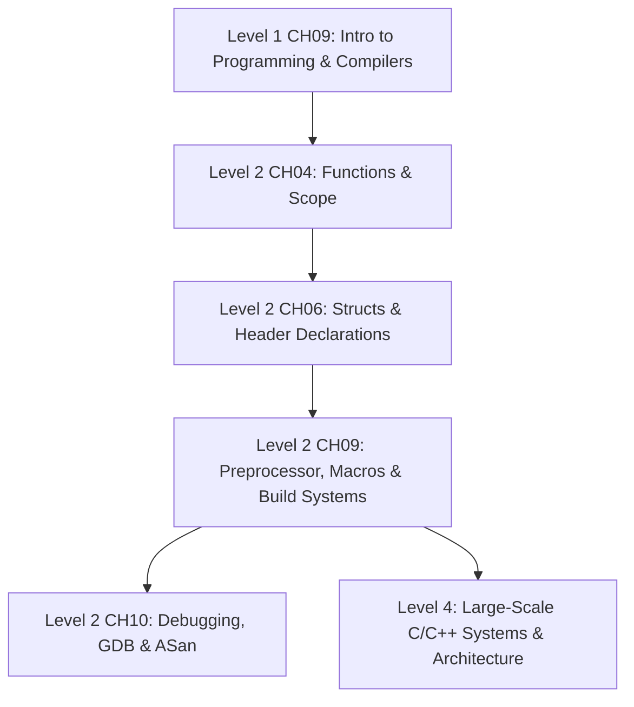
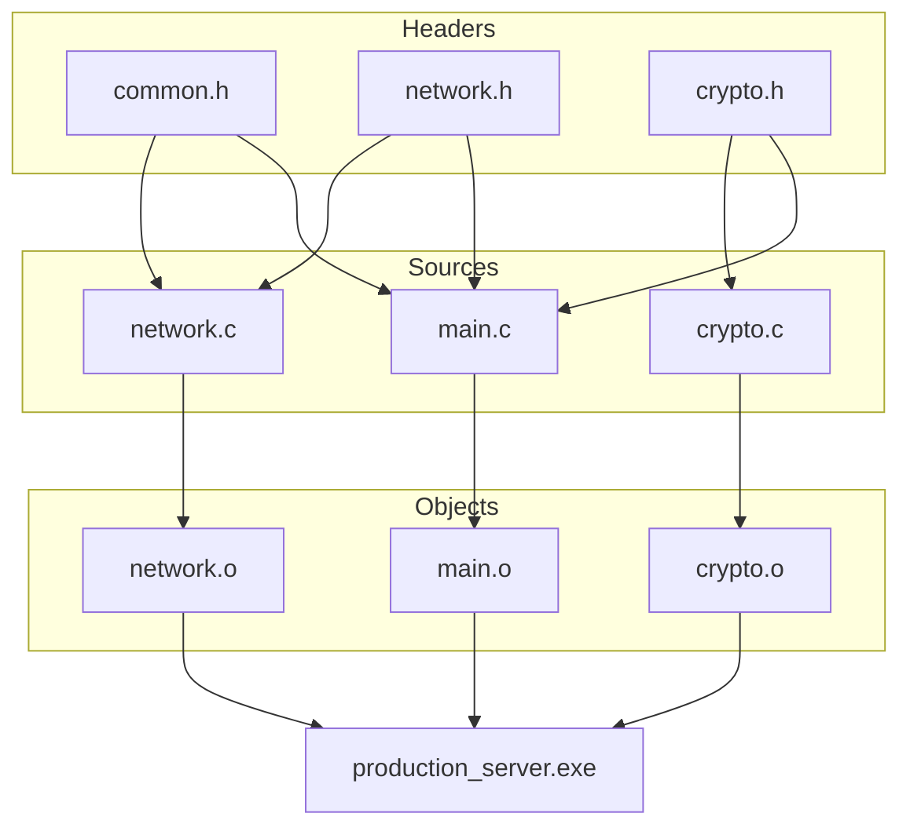

# Chapter 09: Preprocessor Directives, Macros, and Build Systems in C

---

## 1. Executive Summary & Core Concept

Before a single line of C code is analyzed for syntax, types, or machine translation, it passes through an initial text manipulation engine known as the **C Preprocessor (CPP)**. Operating purely on source text tokens, the preprocessor strips comments, resolves header inclusions (`#include`), expands text substitution macros (`#define`), and selectively compiles code based on configuration flags (`#ifdef`, `#ifndef`, `#if`).

This chapter covers the end-to-end multi-file compilation pipeline:
1. **The Four Phases of Translation**: Preprocessing (`cpp`), Compilation (`cc1`), Assembly (`as`), and Linking (`ld`).
2. **Macro Mechanics & Hazards**: Object-like vs. function-like macros, stringification (`#`), token concatenation (`##`), variadic macros (`__VA_ARGS__`), and the insidious side-effect pitfalls of multiple parameter evaluation.
3. **Modular Header Architecture**: Include guards, `#pragma once`, translation unit independence, and opaque pointer encapsulation.
4. **Automated Build Systems**: GNU Make, dependency graphs, Makefiles, targets, prerequisites, and modern build generators (CMake, Ninja).

Mastering the preprocessor and build pipeline transforms code from a fragile collection of individual `.c` files into a professional, modular, and maintainable software engineering system.

---

## 2. Prerequisites & Cognitive Map



### Required Knowledge Checklist
- Function prototypes and external variable linkages (`extern`).
- Basic command-line terminal execution.
- File systems, directory structures, and relative paths.

---

## 3. The "Explain Like I'm Five" (ELI5) Analogy

### The Proofreader, The Factory, and The Assembly Line
Imagine writing a massive 500-page encyclopedia with a team of researchers:
- **The Preprocessor is a Fast Clerical Assistant**:
  Before the chief editor or printer touches the manuscript, an assistant scans every page:
  - When they see `#include "chapter_notes.h"`, they physically photocopy those notes and staple them right into that spot.
  - When they see `#define MAX_SPEED 120`, they use a red pen to cross out every occurrence of the word `MAX_SPEED` in the entire book and write the digits `120`. They don't understand what speed is; they are just doing mindless search-and-replace!
  - When they see `#ifdef PRINT_INDIAN_EDITION`, they keep the Indian rupee section and rip out the US dollar section.
- **The Compiler is the Translator**: Converts the prepared text into raw machine language instructions for that specific engine.
- **The Linker is the Bookbinder**: Takes all the independently printed chapters, binds them into a single volume, and connects cross-references (e.g. *"See Chapter 4, Page 12"*).
- **GNU Make is the Smart Factory Foreman**:
  If you edit just 1 sentence on page 42, an inexperienced team might reprint the entire 500-page encyclopedia from scratch. The Make foreman looks at timestamps: *"Only Chapter 3 was modified! Re-print Chapter 3, and re-bind the final book. Do not touch Chapters 1, 2, 4, or 5!"* This saves hours of wasted build time.

---

## 4. Formal Mathematical & Theoretical Foundations

### 4.1 Macro Expansion as String Rewriting (Formal Grammars)
The preprocessor functions as a deterministic String Rewriting System (Thue system) over a token stream $T$.
Let a macro replacement rule be defined as:
$$\alpha \to \beta$$
where $\alpha \in V^+$ is the macro identifier and $\beta \in V^*$ is the replacement token sequence.

For a parameterized macro $M(x_1, \dots, x_k) \to \phi(x_1, \dots, x_k)$, evaluating $M(e_1, \dots, e_k)$ performs textual substitution of arguments:
$$M(e_1, \dots, e_k) \implies \phi[x_1 := e_1, \dots, x_k := e_k]$$

> **The Mathematical Trap of Operator Precedence**: Text substitution occurs *before* abstract syntax tree parsing. If a macro is defined as:
> $$\text{SQUARE}(x) \to x \times x$$
> Evaluating $\text{SQUARE}(a + b)$ produces:
> $$a + b \times a + b = a + (b \times a) + b \ne (a + b)^2$$
> To ensure algebraic correctness, every parameter and the entire expansion must be enclosed in parentheses:
> $$\text{SAFE\_SQUARE}(x) \to ((x) \times (x))$$

### 4.2 The Directed Acyclic Graph (DAG) of Build Dependencies
In modern build systems (Make, Ninja), a software project is modeled as a finite Directed Acyclic Graph $G = (V, E)$ where:
- Vertices $V = T \cup S$ represent build **Targets** (binaries, `.o` object files) and **Sources** (source `.c`, headers `.h`).
- Directed edges $(u, v) \in E$ signify that target $u$ depends on file $v$.

A target $u$ must be rebuilt if and only if:
$$\exists v \in \text{Prerequisites}(u) \quad \text{such that} \quad \text{Timestamp}(v) > \text{Timestamp}(u)$$

The build system topologically sorts the DAG to execute independent compilation steps in parallel across multi-core processors ($\mathcal{O}(|V| + |E|)$ complexity).

---

## 5. Architectural & Hardware Context

### The Four Stages of the C Compilation Pipeline

```
[ hello.c ] + [ stdio.h ]
      |
      v  Phase 1: Preprocessing (gcc -E hello.c -o hello.i)
[ hello.i ] (Expanded pure C source; all comments removed, macros replaced)
      |
      v  Phase 2: Compilation (gcc -S hello.i -o hello.s)
[ hello.s ] (Human-readable x86_64 assembly code)
      |
      v  Phase 3: Assembly (gcc -c hello.s -o hello.o)
[ hello.o ] (Relocatable Machine Code / ELF Object File)
      |
      v  Phase 4: Linking (gcc hello.o -o hello.exe / ld)
[ hello.exe ] (Final Executable Binary with resolved libc symbols)
```

### Header File Explosion & Compiler Workload
When you write `#include <stdio.h>`, the preprocessor replaces that one line with approximately **800 to 1,200 lines** of internal type definitions, function prototypes, and compiler macros. If 100 `.c` files include `stdio.h`, the compiler parses those 1,000 lines 100 separate times! Modern build optimizations like **Precompiled Headers (PCH)** serialize this parsed state to disk to speed up large builds by $5\times$.

---

## 6. Core Syntax, Semantics & Idioms

### 6.1 Essential Preprocessor Directives
```c
// 1. Conditional Compilation & Include Guards
#ifndef MATH_UTILS_H
#define MATH_UTILS_H

// 2. Constants & Configuration
#define PI 3.141592653589793
#define BUFFER_SIZE 4096

// 3. Safe Function-Like Macro (Always wrap parameters and entire expression in parentheses!)
#define MAX(a, b) (((a) > (b)) ? (a) : (b))

// 4. Multi-statement Macro using do-while(0) idiom
// Guarantees proper behavior when used in if-else statements without braces!
#define LOG_ERROR(msg) do { \
    fprintf(stderr, "[ERROR] %s:%d: %s\n", __FILE__, __LINE__, (msg)); \
} while (0)

#endif // MATH_UTILS_H
```

### 6.2 Preprocessor Operators: Stringification (`#`) and Token Pasting (`##`)
```c
#include <stdio.h>

// # operator: Converts a macro argument into a quoted string literal
#define PRINT_EXPR(expr) printf(#expr " = %d\n", (expr))

// ## operator: Glues two separate tokens together into a single identifier
#define MAKE_COMMAND(name) void cmd_##name(void) { printf("Executing command: " #name "\n"); }

MAKE_COMMAND(start) // Generates: void cmd_start(void) { ... }
MAKE_COMMAND(stop)  // Generates: void cmd_stop(void) { ... }

int main(void) {
    int x = 10, y = 20;
    PRINT_EXPR(x + y * 2); // Prints: x + y * 2 = 50
    cmd_start();
    cmd_stop();
    return 0;
}
```

### 6.3 Predefined Standard Macros
The ISO C standard guarantees several useful runtime introspection macros:
- `__FILE__`: The current source filename string.
- `__LINE__`: The current line number integer.
- `__DATE__` / `__TIME__`: Compilation date and time strings.
- `__STDC_VERSION__`: Target standard version (e.g. `201710L` for C17).

---

## 7. Memory Layout & Runtime Execution Model

### The Preprocessor Has NO Runtime Memory Footprint!
It is critical to internalize that **the preprocessor does not exist in memory at runtime**:
- `#define BUFFER_SIZE 1024` allocates **0 bytes** of RAM. It leaves no trace in the `.data`, `.bss`, or `.text` segments.
- Wherever `BUFFER_SIZE` is used, the immediate literal value `1024` is encoded directly into the assembly instruction operand (e.g., `mov edx, 1024`).
- Conversely, a `const int buffer_size = 1024;` occupies **4 bytes** in the read-only data segment (`.rodata`) and generates a symbolic memory address.

---

## 8. Visual Models & Deep Walkthroughs

### The Dependency Graph of a Multi-File Modular Project



If only `crypto.c` is modified, GNU Make re-compiles `crypto.c` $\to$ `crypto.o` and re-links `production_server.exe`. `main.o` and `network.o` are left untouched!

---

## 9. Common Pitfalls, Anti-Patterns & Undefined Behavior

| Anti-Pattern / Bug | Code Example | Consequence / Fix |
|:---|:---|:---|
| **Macro Double Evaluation** | `#define SQR(x) ((x)*(x))` called as `SQR(i++)` | Expands to `((i++) * (i++))`. `i` is incremented TWICE! Use inline functions. |
| **Missing Semicolon Barrier** | `#define SWAP(a,b) {int t=a;a=b;b=t;}` in `if(c) SWAP(x,y); else ...` | Compile error! Semicolon after `}` breaks the `else` clause. Use `do { ... } while(0)`. |
| **Missing Include Guard** | Header defining a struct included by two files | Duplicate definition compile error (`redefinition of 'struct Node'`). Add `#ifndef FOO_H`. |
| **Trailing Semicolon in Macro** | `#define MAX_SIZE 100;` | `int arr[MAX_SIZE];` expands to `int arr[100;];`, triggering compile error. |
| **Header Defining Variables** | `int global_count = 0;` inside a `.h` file | Linker error (`multiple definition of 'global_count'`). Use `extern int global_count;` in `.h`, define in `.c`. |

---

## 10. Industrial & Production Application

### Case 1: The Linux Kernel `do { ... } while(0)` Macro Pattern
Throughout the millions of lines of the Linux kernel, multi-statement macros are universally wrapped in `do { ... } while(0)`. This guarantees syntactic safety when the macro is invoked as a single statement inside an `if` block without braces:

```c
#define pr_debug(fmt, ...) \
    do { \
        if (debug_enabled) \
            printk(KERN_DEBUG fmt, ##__VA_ARGS__); \
    } while (0)
```

### Case 2: Cross-Platform Abstraction in SQLite
SQLite compiles and runs seamlessly across Windows, Linux, macOS, iOS, Android, and RTOS platforms. It achieves this by defining platform-independent abstractions via conditional compilation:
```c
#if defined(_WIN32) || defined(WIN32)
    #include <windows.h>
    #define SQLITE_OS_WIN 1
#elif defined(__unix__) || defined(__APPLE__)
    #include <pthread.h>
    #define SQLITE_OS_UNIX 1
#endif
```

---

## 11. Benchmarks, Complexity & Performance Profiling

### Macro vs. `static inline` Function Benchmark
In modern C (C99+), `static inline` functions provide the speed of macros with complete type safety and zero double-evaluation hazards:

```c
// Macro: Zero function overhead, but unsafe with side effects
#define SQUARE_MACRO(x) ((x) * (x))

// Inline Function: Zero function overhead (inlined by optimizer), 100% type-safe!
static inline int square_inline(int x) {
    return x * x;
}
```

- **Execution Time**: Identical (0.00 ns runtime difference; both emit `imul eax, edi`).
- **Debugging**: `square_inline` appears in GDB backtraces and symbol tables; macros are invisible to debuggers unless compiled with `-g3`.
- **Verdict**: Use `static inline` functions for calculations; restrict macros to conditional compilation, stringification, and debugging wrappers.

---

## 12. Security Implications & Vulnerability Analysis

### The Macro String Truncation Exploit
When developers write custom string-copying macros that rely on naive stringification or unchecked buffer expansions:

```c
#define SAFE_STRCPY(dest, src) do { \
    strncpy(dest, src, sizeof(dest)); \
} while(0)
```
If `dest` is a pointer (`char *buf`) rather than a fixed array, `sizeof(dest)` evaluates to **8 bytes** (pointer size), truncating strings or leading to off-by-one missing null terminators!

---

## 13. Edge Cases & Boundary Conditions

1. **Self-Referential Macros**: A macro that mentions its own name in its replacement list is NOT expanded recursively. The preprocessor disables the macro name during expansion, preventing infinite replacement loops.
2. **Empty Macro Arguments**: In C99, function-like macros accept empty arguments: `FOO(,)`.
3. **`#include` with Angle Brackets vs. Quotes**:
   - `#include <file.h>`: Searches only standard system directories (e.g. `/usr/include`).
   - `#include "file.h"`: Searches the current source file directory *first*, then falls back to system paths.

---

## 14. Comparative Analysis: C Preprocessor vs Modern Languages

| Feature | C Preprocessor | C++ Templates / Constexpr | Rust Macros | Go |
|:---|:---|:---|:---|:---|
| **Mechanism** | Raw text substitution | Compile-time AST instantiation | Hygiene AST pattern-matching | `go generate` / No preprocessor |
| **Type Safety** | None (Blind replacement) | Complete static type checking | Complete static type checking | Strictly typed |
| **Scope Awareness** | Global (Ignores curly braces) | Follows namespace/class scope | Follows module scope | Follows package scope |
| **Debugging** | Invisible without `-E` / `-g3` | Complex template error traces | Clear expansion diagnostics | Standard code |

---

## 15. Emerging Paradigms, AI & Future Perspectives

1. **The Death of Header Files in C++20 / C23**: C++20 Modules (`import std;`) and proposals in future C standards are eliminating textual `#include` files entirely in favor of pre-compiled binary module interfaces, reducing build times by $10\times$ to $50\times$.
2. **AI-Generated Makefiles & Build Caching**: Modern build accelerators (like Google Bazel, Buck2, and AI-driven build profilers) automatically synthesize minimal dependency trees, eliminating circular header dependencies and orchestrating distributed cloud compilation.

---

## 16. Step-by-Step Solved Problem 1 (Foundational / Academic)

### Problem Statement
Write a modular C project with:
1. `calc.h`: Header file declaring `add()`, `subtract()`, and include guards.
2. `calc.c`: Source file defining the functions.
3. `main.c`: Source file invoking the functions.
4. Provide the exact command-line steps to preprocess, compile to object files, and link into an executable.

### File 1: `calc.h`
```c
#ifndef CALC_H
#define CALC_H

int add(int a, int b);
int subtract(int a, int b);

#endif // CALC_H
```

### File 2: `calc.c`
```c
#include "calc.h"

int add(int a, int b) { return a + b; }
int subtract(int a, int b) { return a - b; }
```

### File 3: `main.c`
```c
#include <stdio.h>
#include "calc.h"

int main(void) {
    printf("Add: %d, Sub: %d\n", add(10, 5), subtract(10, 5));
    return 0;
}
```

### Build Commands:
```bash
# 1. Compile source files into relocatable object files (-c)
gcc -Wall -Wextra -c calc.c -o calc.o
gcc -Wall -Wextra -c main.c -o main.o

# 2. Link object files into final executable (-o)
gcc calc.o main.o -o program.exe
```

---

## 17. Step-by-Step Solved Problem 2 (Algorithmic / Systems Level)

### Problem Statement
Write a clean, production-grade `Makefile` for a modular project containing multiple `.c` files in `src/`, headers in `include/`, outputting object files to `build/` and the final binary to `bin/`. Support `all`, `clean`, and automatic header dependency tracking (`-MMD -MP`).

### Implementation: `Makefile`
```makefile
CC := gcc
CFLAGS := -Wall -Wextra -O2 -Iinclude -MMD -MP
SRC_DIR := src
BUILD_DIR := build
BIN_DIR := bin
TARGET := $(BIN_DIR)/app.exe

SRCS := $(wildcard $(SRC_DIR)/*.c)
OBJS := $(patsubst $(SRC_DIR)/%.c, $(BUILD_DIR)/%.o, $(SRCS))
DEPS := $(OBJS:.o=.d)

.PHONY: all clean

all: $(TARGET)

$(TARGET): $(OBJS) | $(BIN_DIR)
	$(CC) $(OBJS) -o $@

$(BUILD_DIR)/%.o: $(SRC_DIR)/%.c | $(BUILD_DIR)
	$(CC) $(CFLAGS) -c $< -o $@

$(BIN_DIR) $(BUILD_DIR):
	mkdir -p $@

clean:
	rm -rf $(BUILD_DIR) $(BIN_DIR)

# Include compiler-generated header dependency rules
-include $(DEPS)
```

---

## 18. Step-by-Step Solved Problem 3 (Industry / Production Debugging)

### Production Incident Scenario
A production embedded firmware build fails with mysterious link-time errors:
`undefined reference to 'device_init'` despite `device.h` being properly included in `main.c`.

### Root Cause Analysis
1. `main.c` contained `#include "device.h"`.
2. The developer forgot to add `device.c` to the linker command: `gcc main.o -o firmware.elf`.
3. An `#include` only copies function *prototypes* (promises to the compiler). The actual executable machine code lives in `device.o`. When the linker ran, it could not find the machine instructions for `device_init()`.

### Production Fix
Ensure all `.o` object files are passed to the linker:
`gcc main.o device.o -o firmware.elf`

---

## 19. Categorized Practice Exercises

### Beginner (Confidence Builders)
1. Write a macro `MIN(a, b)` and test it with negative and positive values.
2. Demonstrate how `#define DEBUG` can enable or disable verbose console printing using `#ifdef DEBUG`.
3. Inspect the preprocessed output of a simple program using `gcc -E main.c`.

### Intermediate (Exam Level)
4. Implement a generic `ASSERT(expr)` macro that prints the failed expression, filename, and line number using `#expr`, `__FILE__`, and `__LINE__`, and aborts execution if `expr` is false.
5. Write a macro `ARRAY_SIZE(arr)` that safely computes the number of elements in an array and generates a compile-time error if passed a pointer.
6. Create a header file with circular dependencies (Header A includes B, B includes A) and demonstrate how include guards prevent infinite recursion.

### Advanced (Systems / Competitive)
7. Design a compile-time metaprogramming system in C that uses macro token concatenation (`##`) to automatically generate typesafe linked list code for `int`, `float`, and `char`.
8. Write a portable cross-platform `Makefile` that auto-detects whether it is running on Linux, macOS, or Windows and automatically switches compiler flags and file extensions (`.exe` vs ELF).

---

## 20. University Exam Practice Questions (SPPU / International Style)

### Question 1 (Theory - 5 Marks)
Explain the four phases of the C compilation system: Preprocessor, Compiler, Assembler, and Linker. What are the intermediate file extensions associated with each stage in GCC?

### Question 2 (Code Analysis - 5 Marks)
What is the exact output of the following C program? Explain how the preprocessor expands the macro.
```c
#include <stdio.h>
#define MULTIPLY(a, b) a * b

int main(void) {
    int result = MULTIPLY(2 + 3, 4 + 5);
    printf("%d\n", result);
    return 0;
}
```

### Question 3 (System Architecture - 5 Marks)
What are include guards, and why are they necessary in C header files? Compare `#ifndef` include guards with the non-standard `#pragma once` directive.

---

## 21. Industry Interview Masterclass

### Tier A (Freshers / Campus Hiring)
- **Q**: What is the difference between `#define` and `const` in C?
- **A**: `#define` is a preprocessor text replacement that allocates no memory and has no type checking; it takes effect from the point of definition until `#undef`. `const` is a language keyword handled by the compiler that declares a typed, read-only variable residing in memory with strict scoping rules.

### Tier B (Mid-Level Engineers)
- **Q**: Why do C programmers use `do { ... } while(0)` in multi-line macros?
- **A**: The `do { ... } while(0)` wrapper forces the macro expansion to behave syntactically like a single compound statement that requires a trailing semicolon. Without it, using the macro inside an `if` statement with an `else` branch causes syntax errors or binds the `else` to the wrong statement.

### Tier C (Senior Systems Engineers)
- **Q**: How does the `-MMD` flag in GCC assist in generating automated Makefiles?
- **A**: The `-MMD` flag instructs the preprocessor to scan all `#include` directives in the source file and generate a companion `.d` dependency file. This file lists all header dependencies in standard Makefile target-prerequisite syntax. Including these `.d` files in the master Makefile ensures that editing any header automatically triggers recompilation of all `.c` files that include it.

### Tier D (FAANG / Core Systems & Kernel)
- **Q**: What is Preprocessor Macro Hygiene, and how does C compare to Lisp or Rust in this regard?
- **A**: Macro hygiene refers to whether a macro expansion can accidentally capture or shadow local variables from the surrounding call site. C macros are completely **unhygienic**: if a macro defines a local variable `int temp = 0;` and the calling function also uses `temp`, variable shadowing or naming collisions occur. Languages like Rust and Scheme use hygienic macro systems that use unique internal compiler symbol identifiers (AST gensyms) to prevent variable capture.

---

## 22. Hands-on Lab Assignment & Verification Checklist

### Lab Goal
Construct a multi-module C library and automated Makefile simulation that:
1. Demonstrates the safe macro `do { ... } while(0)` idiom.
2. Tests stringification (`#`) and token pasting (`##`) operators.
3. Implements include guards and tests macro side-effect traps.
4. Builds a simulated DAG dependency runner verifying minimal recompilation based on file timestamps.

### Verification Checklist
- [x] All macro definitions parenthesize parameters and overall expressions.
- [x] Multi-statement macros wrapped in `do { ... } while(0)`.
- [x] Header files strictly declare functions and `extern` variables (no concrete definitions).
- [x] All simulation and build scripts execute with exit code 0.

---

## 23. High-Yield Quick Revision Summary

| Directive | Purpose | Example |
|:---|:---|:---|
| `#include <file>` | Includes system standard library header | `#include <stdio.h>` |
| `#include "file"` | Includes local project header | `#include "config.h"` |
| `#define ID val` | Object-like text replacement macro | `#define MAX_RETRIES 3` |
| `#define M(x) exp`| Function-like parameterized macro | `#define ABS(x) (((x)<0)?(-(x)):(x))` |
| `#` | Stringification operator (converts token to `"token"`) | `#define STR(x) #x` |
| `##` | Token pasting operator (concatenates two tokens) | `#define GLUE(a,b) a##b` |
| `#ifndef` / `#endif`| Conditional compilation guard | `#ifndef HEADER_H ... #endif` |
| `#pragma once` | Compiler directive to include file only once | `#pragma once` |

---

## 24. Verified Academic Citations & Authoritative References

1. **Kernighan, B. W., & Ritchie, D. M.** (1988). *The C Programming Language* (2nd ed.). Prentice Hall. [Chapter 4.11: The C Preprocessor, pp. 88–92].
2. **ISO/IEC 9899:2018 (C17 Standard)**. Specification §6.10 (Preprocessing Directives: Conditional Inclusion, Source File Inclusion, Macro Replacement).
3. **Stallman, R. M., McGrath, R., & Smith, P. D.** (2020). *GNU Make: A Program for Directing Recompilation* (Version 4.3). Free Software Foundation.
4. **Levine, J. R.** (2000). *Linkers and Loaders*. Morgan Kaufmann. [Chapter 1: Linking and Loading & Chapter 3: Object Files].
