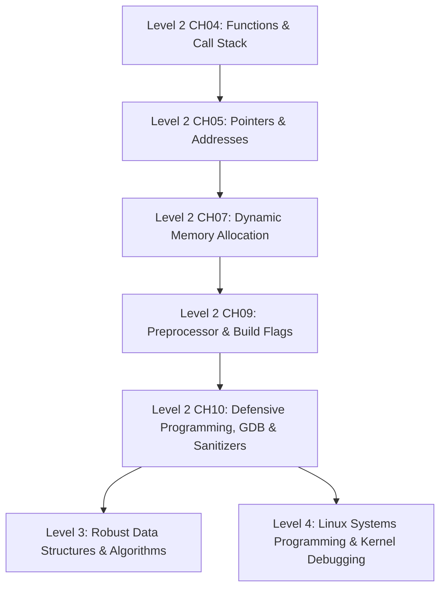
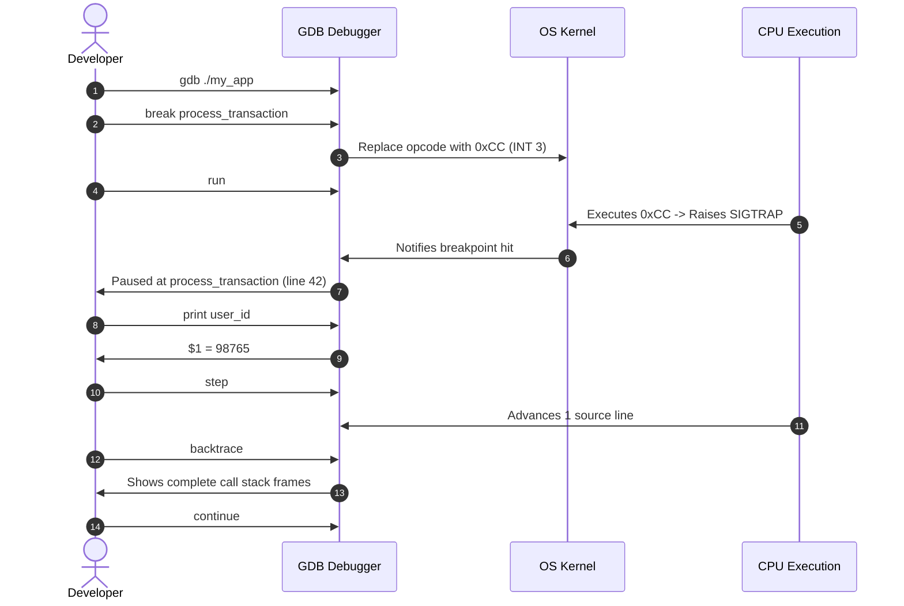

# Chapter 10: Defensive Programming, Debugging, and Memory Leaks in C

---

## 1. Executive Summary & Core Concept

C is often described as a language that gives programmers "enough rope to shoot themselves in the foot." Because C has no automatic garbage collection, runtime array bounds checking, or built-in null-pointer safeguards, writing production-grade software requires **Defensive Programming**: an engineering mindset where code actively anticipates invalid inputs, verifies hardware state, and fails securely and deterministically rather than corrupting memory silently.

This chapter synthesizes low-level verification and debugging tooling:
1. **Defensive Coding Paradigms**: Design by Contract (preconditions, postconditions, invariants), assertion frameworks (`assert.h`), and strict compiler diagnostic enforcement (`-Wall -Wextra -Werror -Wpedantic`).
2. **Interactive Symbolic Debugging (GDB / LLDB)**: Setting hardware and software breakpoints, watchpoints, examining registers, stepping through assembly instructions, and inspecting the call stack backtrace.
3. **Dynamic Binary Instrumentation & Sanitizers**: Catching memory leaks and invalid accesses at runtime using **AddressSanitizer (ASan)**, **UndefinedBehaviorSanitizer (UBSan)**, and **Valgrind Memcheck**.

Mastering these defensive practices marks the transition from an amateur programmer writing fragile scripts to a professional systems software engineer building resilient, crash-resistant infrastructure.

---

## 2. Prerequisites & Cognitive Map



### Required Knowledge Checklist
- The stack frame layout and pointer dereferencing mechanics.
- Dynamic allocation lifecycle (`malloc`, `free`, and NULL checks).
- Command-line compilation with GCC / Clang.

---

## 3. The "Explain Like I'm Five" (ELI5) Analogy

### The Airport Security Checkpoint, The Black Box, and The Smoke Detector
- **Defensive Programming is an Airport Security Checkpoint**:
  An insecure airport lets anyone walk onto an airplane, hoping passengers will behave politely. A defensive airport assumes mistakes or bad actors will arrive: bags are scanned before boarding (preconditions), tickets are checked at the gate, and doors lock automatically. In C, never assume a pointer passed into your function is valid—check it at the gate (`if (ptr == NULL) return -1;`)!
- **Assertions (`assert`) are Safety Fuses in a Electrical Grid**:
  If a sudden power surge hits your house, the fuse deliberately trips and cuts the power immediately. It is much better to trip the fuse and turn off the lights for a second than to let the wire melt inside the walls and burn the entire house down (corrupting your database).
- **GDB (The Debugger) is a Slow-Motion Replay Camera**:
  When a football player makes a disputed goal, referees pause the game, zoom in frame-by-frame, and view the action from three camera angles. GDB lets you freeze a running C program at any exact nanosecond, step forward instruction-by-instruction, and inspect the values inside every CPU register.
- **Valgrind / AddressSanitizer (ASan) is a Bloodhound Tracking Every Memory Byte**:
  Every time you rent a piece of memory (`malloc`), the bloodhound puts a little invisible dye tag on it. If you write outside the lines or forget to return the memory when leaving, the bloodhound immediately barks and gives the exact line number where you made the mistake.

---

## 4. Formal Mathematical & Theoretical Foundations

### 4.1 Design by Contract (Hoare Logic)
Program correctness is formalized using **Hoare Triples**:
$$\{P\}\ C\ \{Q\}$$
where:
- $P$ is the **Precondition**: The assertion that must hold true before executing code block $C$.
- $C$ is the **Command / Function Body**.
- $Q$ is the **Postcondition**: The assertion guaranteed to hold true after $C$ finishes execution.

For example, a binary search function over array $A$ of size $N$:
- **Precondition $P$**: Array $A \ne \text{NULL} \land N \ge 0 \land \forall i \in [0, N-2], A[i] \le A[i+1]$ (Array must be sorted).
- **Postcondition $Q$**: $\text{result} = -1 \iff (\forall i \in [0, N-1], A[i] \ne \text{target})$.

If the caller violates $P$, the function is not obligated to execute; it aborts or returns an explicit error code immediately.

### 4.2 Shadow Memory in AddressSanitizer (ASan)
ASan maps the entire 64-bit virtual address space into a corresponding **Shadow Memory** space using a direct mathematical transformation:
$$\text{Shadow Address} = \left( \frac{\text{Virtual Address}}{8} \right) + \text{Offset}_{\text{Base}}$$

Every 8 bytes of application memory are tracked by **1 byte** of shadow memory:
- Shadow value `0`: All 8 application bytes are valid and unpoisoned.
- Shadow value $k \in [1, 7]$: The first $k$ bytes are valid; remaining $8-k$ bytes are poisoned.
- Negative shadow value (e.g. `0xFA` - Heap Left Redzone, `0xFD` - Freed Memory): Accessing these bytes triggers an immediate memory violation trap!

---

## 5. Architectural & Hardware Context

```
Hardware Debug Registers in x86_64 CPUs
------------------------------------------------------------------------
DR0 - DR3: Linear breakpoint addresses (Up to 4 hardware watchpoints)
DR6:       Debug status register (Records which breakpoint triggered)
DR7:       Debug control register (Enables execution, read, or write traps)
------------------------------------------------------------------------
```

### Software Breakpoints vs Hardware Watchpoints
1. **Software Breakpoint (`int3` instruction - Opcode `0xCC`)**:
   When you tell GDB `break main`, GDB modifies the executable machine code in RAM! It overwrites the first byte of `main` with the 1-byte opcode `0xCC` (`INT 3`). When the CPU reaches this byte, it generates a software interrupt trap. The OS pauses the process and sends a `SIGTRAP` signal to GDB. When you continue, GDB restores the original byte, executes it, and puts `0xCC` back.
2. **Hardware Watchpoint**:
   When you tell GDB `watch my_variable`, GDB does not modify code; it loads the address into CPU hardware debug register `DR0`. The CPU silicon checks every memory write bus transaction. If a write hits that address, the CPU halts execution instantaneously with zero performance slowdown.

---

## 6. Core Syntax, Semantics & Idioms

### 6.1 Assertions: Debug Checks vs Production Enforcement
```c
#include <stdio.h>
#include <stdlib.h>
#include <assert.h>

// Assertions are meant for catching programmer bugs during development.
// When compiled with -DNDEBUG, all assert() statements are completely stripped!
int divide_positive(int a, int b) {
    assert(b > 0 && "Denominator must be strictly positive!"); // Programmer contract
    return a / b;
}

// Defensive production error handling (Never stripped!):
int divide_safe(int a, int b, int *out_result) {
    if (b == 0 || out_result == NULL) {
        return -1; // Explicit error return code
    }
    *out_result = a / b;
    return 0; // Success
}
```

### 6.2 Essential Compiler Hardening Flags
A professional C developer compiles code with aggressive static diagnostic flags enabled:
```bash
gcc -Wall -Wextra -Werror -Wpedantic -Wconversion -Wshadow -O2 -g main.c -o app
```
- `-Wall -Wextra`: Enables comprehensive warning diagnostics.
- `-Werror`: Converts all compiler warnings into fatal errors (zero-warning tolerance).
- `-Wconversion`: Warns about implicit type conversions that may alter values (e.g. `int` to `char`).
- `-Wshadow`: Warns when a local variable shadows another variable in an outer scope.
- `-g`: Generates DWARF debugging symbols for GDB.

### 6.3 Building with AddressSanitizer (ASan) & UBSan
```bash
gcc -fsanitize=address,undefined -g -O1 main.c -o app_sanitized
```
If an out-of-bounds array write or integer overflow occurs, the program halts instantly and prints a colorized stack trace detailing the file, function, and exact line number of the crime!

---

## 7. Memory Layout & Runtime Execution Model

### The ASan Redzone Architecture Around Heap Chunks

```
Standard Memory without ASan:
[ Chunk A Payload (32 bytes) ][ Chunk B Payload (32 bytes) ]
                               ^
                               |-- Out-of-bounds write silently corrupts Chunk B!

Memory with AddressSanitizer (-fsanitize=address):
[ REDZONE (16 B) ][ Chunk A (32 B) ][ REDZONE (16 B) ][ Chunk B (32 B) ][ REDZONE (16 B) ]
                                    ^^^^^^^^^^^^^^^^
                                    Poisoned Shadow Memory!
```

If an instruction writes even 1 byte into the Redzone:
1. The compiler-inserted check detects the non-zero shadow memory byte.
2. The runtime aborts execution immediately:
   `ERROR: AddressSanitizer: heap-buffer-overflow on address 0x...`
3. Zero silent corruption can ever escape into production!

---

## 8. Visual Models & Deep Walkthroughs

### GDB Interactive Debugging Workflow Walkthrough



---

## 9. Common Pitfalls, Anti-Patterns & Undefined Behavior

| Anti-Pattern / Bug | Code Example | Consequence / Fix |
|:---|:---|:---|
| **Side Effects Inside `assert()`** | `assert(user_login() == 1);` | Fatal bug! In release builds (`-DNDEBUG`), `assert` is removed, so `user_login()` NEVER RUNS! |
| **Ignoring Compiler Warnings** | Ignoring `-Wimplicit-function-declaration` | Compiler assumes function returns `int` (32 bits), truncating 64-bit pointers and crashing. |
| **Compiling with Optimizations without `-g`**| `gcc -O3 main.c` | Debugger cannot match assembly instructions to source line numbers (`<optimized out>`). |
| **Masking Errors with Casts** | `char *p = (char *)malloc(10);` | Hides missing `#include <stdlib.h>`, leading to implicit integer conversion of pointers. |
| **Using `printf` for Complex Debugging** | Scattering 50 `printf` statements | Heisenbug effect: `printf` changes timing and buffer flushes, masking race conditions. |

---

## 10. Industrial & Production Application

### Case 1: Google Chromium ClusterFuzz & ASan
Google operates **ClusterFuzz**, a distributed fuzz testing cluster running over 100,000 virtual machines continuously testing the Chrome browser, Android OS, and open-source infrastructure. Every binary is compiled with AddressSanitizer and UndefinedBehaviorSanitizer. ClusterFuzz has detected and fixed over **30,000 memory-safety vulnerabilities** before malicious hackers could exploit them in production.

### Case 2: NASA / JPL "Power of 10" Defensive Coding Rules
NASA's Jet Propulsion Laboratory established strict defensive programming rules for mission-critical spacecraft code (e.g. Mars Curiosity Rover):
1. **Rule 2**: All loops must have a fixed upper bound checked by assertions to prevent infinite execution.
2. **Rule 3**: Do not use dynamic memory allocation (`malloc`) after system task initialization.
3. **Rule 5**: The return value of every non-void function must be explicitly checked. If a return value is deliberately ignored, it must be cast to `(void)`.

---

## 11. Benchmarks, Complexity & Performance Profiling

| Tool / Mode | Overhead (CPU Run Time) | Memory Overhead | Primary Diagnostic Purpose |
|:---|:---|:---|:---|
| **Native Native Binary** | $1.0\times$ (Baseline) | $1.0\times$ (Baseline) | Production release execution |
| **AddressSanitizer (ASan)** | ~$1.5\times$ to $2.0\times$ | ~$2.0\times$ to $3.0\times$ | Out-of-bounds, Use-After-Free, Double-Free |
| **UndefinedBehaviorSanitizer (UBSan)** | ~$1.1\times$ to $1.2\times$ | Negligible | Signed integer overflow, null-pointer dereference |
| **Valgrind Memcheck** | **~$10.0\times$ to $30.0\times$** | ~$2.0\times$ to $4.0\times$ | Detailed leak analysis on un-instrumented binaries |

---

## 12. Security Implications & Vulnerability Analysis

### The Heartbleed Vulnerability (CVE-2014-0160)
The infamous OpenSSL **Heartbleed** exploit was caused by a complete failure of defensive input validation.

```c
// VULNERABLE CODE (Simplified OpenSSL):
int process_heartbeat(unsigned char *payload, unsigned int payload_len) {
    // FATAL FLAW: OpenSSL TRUSTED payload_len sent by remote attacker without checking!
    // Attacker sent payload_len = 65535, but sent only 1 byte of payload!
    unsigned char *response = malloc(1 + 2 + payload_len);
    memcpy(response, payload, payload_len); // Reads 64 KB of adjacent server RAM!
    send_packet(response);
}
```

Because `payload_len` was never validated against the actual packet length received, the server copied 64 KB of private encryption keys, passwords, and user session cookies from server RAM directly back to the attacker!

### The Defensive Fix:
```c
if (1 + 2 + payload_len > actual_bytes_received) {
    return 0; // Silently drop malicious packet!
}
```

---

## 13. Edge Cases & Boundary Conditions

1. **`assert(expr)` with `NDEBUG`**: If `NDEBUG` is defined before `#include <assert.h>`, `assert(x)` expands to `((void)0)`. Code must NEVER rely on `assert` for runtime logic.
2. **Debugging Optimized Binaries (`-Og`)**: Compiling with `-O3` reorganizes and inlines loops, causing GDB to jump erratically between lines. Always debug with `-Og` (Optimize for Debugging) or `-O0`.
3. **Core Dumps**: When a program crashes with `SIGSEGV`, the OS can dump the entire physical RAM footprint to disk (`core`). GDB can inspect the corpse post-mortem: `gdb ./my_app core`.

---

## 14. Comparative Analysis: C vs Rust vs Python

| Feature | C | Rust | Python |
|:---|:---|:---|:---|
| **Boundary Checking** | None (Requires manual `assert`) | Automatic runtime panic on out-of-bounds | Raises `IndexError` exception |
| **Null Dereferencing** | `SIGSEGV` crash | Impossible (`Option<T>` enforced by compiler) | Raises `AttributeError: NoneType` |
| **Memory Leak Detection**| External tooling (ASan, Valgrind) | RAII prevents leaks; static borrow checker | Built-in garbage collector |
| **Debugging Engine** | GDB / LLDB (Machine instruction level) | GDB / LLDB / `cargo test` | PDB / IDE interactive visual debugging |

---

## 15. Emerging Paradigms, AI & Future Perspectives

1. **AI Automated Vulnerability Repair (AVR)**: Modern automated tools (like Google OSS-Fuzz and AI security agents) do not just detect memory bugs; they analyze AddressSanitizer crash logs, synthesize patch diffs, and generate automated regression test harnesses to fix vulnerabilities before human triagers arrive at work.
2. **Static Formal Verification**: Critical systems increasingly employ formal analysis engines (e.g. Frama-C, Astrée) to mathematically prove the absence of runtime errors and buffer overflows across all possible inputs.

---

## 16. Step-by-Step Solved Problem 1 (Foundational / Academic)

### Problem Statement
Write a defensive integer queue implementation in C that enforces preconditions and postconditions using assertions and defensive return codes, completely preventing buffer overflows and underflows.

### Code Implementation
```c
#include <stdio.h>
#include <stdlib.h>
#include <stdbool.h>
#include <assert.h>

#define QUEUE_CAPACITY 5

typedef struct {
    int data[QUEUE_CAPACITY];
    int front;
    int rear;
    int count;
} SafeQueue;

void queue_init(SafeQueue *q) {
    assert(q != NULL && "Queue pointer cannot be NULL");
    q->front = 0;
    q->rear = -1;
    q->count = 0;
}

bool queue_enqueue(SafeQueue *q, int val) {
    if (q == NULL) return false;
    if (q->count >= QUEUE_CAPACITY) {
        // Defensive check: Queue full
        return false;
    }

    q->rear = (q->rear + 1) % QUEUE_CAPACITY;
    q->data[q->rear] = val;
    q->count++;

    // Postcondition check
    assert(q->count <= QUEUE_CAPACITY);
    return true;
}

bool queue_dequeue(SafeQueue *q, int *out_val) {
    if (q == NULL || out_val == NULL) return false;
    if (q->count == 0) {
        // Defensive check: Queue empty
        return false;
    }

    *out_val = q->data[q->front];
    q->front = (q->front + 1) % QUEUE_CAPACITY;
    q->count--;

    // Postcondition check
    assert(q->count >= 0);
    return true;
}
```

---

## 17. Step-by-Step Solved Problem 2 (Algorithmic / Systems Level)

### Problem Statement
Write a custom memory leak tracking wrapper around `malloc` and `free` that records total active allocated bytes, detects double frees, and validates that zero bytes remain leaked at program exit.

### Code Implementation
```c
#include <stdio.h>
#include <stdlib.h>
#include <stdint.h>

static size_t g_active_allocated_bytes = 0;

// Internal header stored before each allocation
typedef struct {
    size_t size;
    uint32_t magic; // Sentinel value to detect double free: 0xDEADBEEF
} MemHeader;

#define MAGIC_ALLOCATED 0xDEADBEEF
#define MAGIC_FREED     0xCAFEBABE

void* tracked_malloc(size_t size) {
    if (size == 0) return NULL;

    // Allocate memory plus header space
    MemHeader *hdr = (MemHeader *)malloc(sizeof(MemHeader) + size);
    if (!hdr) return NULL;

    hdr->size = size;
    hdr->magic = MAGIC_ALLOCATED;
    g_active_allocated_bytes += size;

    // Return pointer to user payload (immediately after header)
    return (void *)(hdr + 1);
}

void tracked_free(void *ptr) {
    if (!ptr) return;

    // Recover header pointer
    MemHeader *hdr = ((MemHeader *)ptr) - 1;

    if (hdr->magic == MAGIC_FREED) {
        fprintf(stderr, "FATAL ERROR: Double Free Detected at %p!\n", ptr);
        abort();
    }
    if (hdr->magic != MAGIC_ALLOCATED) {
        fprintf(stderr, "FATAL ERROR: Memory corruption / Invalid pointer free at %p!\n", ptr);
        abort();
    }

    g_active_allocated_bytes -= hdr->size;
    hdr->magic = MAGIC_FREED; // Mark as freed
    free(hdr);
}

size_t get_active_leak_bytes(void) {
    return g_active_allocated_bytes;
}
```

---

## 18. Step-by-Step Solved Problem 3 (Industry / Production Debugging)

### Production Incident Scenario
A live microservice crashes with `SIGSEGV` only when customer traffic spikes. The stack trace shows the crash occurring deep inside `memcpy()`.

### Debugging with GDB
1. Run binary under GDB: `gdb ./service`
2. Run until crash: `(gdb) run -c config.json`
3. Process receives `SIGSEGV`:
   ```
   Program received signal SIGSEGV, Segmentation fault.
   0x00007ffff7e64150 in __memcpy_avx_unaligned () from /lib64/libc.so.6
   ```
4. Examine the call stack:
   ```
   (gdb) backtrace
   #0  0x00007ffff7e64150 in __memcpy_avx_unaligned ()
   #1  0x0000555555555234 in parse_header (buf=0x555555558060, len=1024) at parser.c:45
   #2  0x0000555555555410 in on_request (req=0x7fffffffe340) at server.c:112
   ```
5. Move to frame #1 and inspect local variables:
   ```
   (gdb) frame 1
   (gdb) print buf
   $1 = (char *) 0x0
   ```
6. **Finding**: `buf` was `NULL`! The developer checked `len > 0` but never checked `if (buf == NULL)`. Calling `memcpy(dest, NULL, len)` triggered the crash.

---

## 19. Categorized Practice Exercises

### Beginner (Confidence Builders)
1. Write a function `float safe_sqrt(float x)` that asserts $x \ge 0$ in debug mode, and returns `-1.0f` defensively in production mode.
2. Compile a program with `-Wall -Wextra -Werror` and fix all warnings.
3. Use GDB to start a program, set a breakpoint at `main`, and print the value of `argc`.

### Intermediate (Exam Level)
4. Intentionally write a heap buffer overflow program, compile it with `-fsanitize=address`, and analyze the resulting diagnostic error report.
5. Write a defensive string copy function `int safe_strcpy(char *dest, size_t dest_sz, const char *src)` that guarantees null termination and never overflows the destination buffer.
6. Use GDB watchpoints (`watch`) to track down which function modifies a global variable unexpectedly.

### Advanced (Systems / Competitive)
7. Implement a static compile-time assertion macro `STATIC_ASSERT(cond, msg)` in standard C89 (using duplicate switch cases or negative array size declarations).
8. Write a GDB Python extension script that automatically iterates over a custom circular linked list and prints all node contents on command.

---

## 20. University Exam Practice Questions (SPPU / International Style)

### Question 1 (Theory - 5 Marks)
What is Defensive Programming? Explain the role of Design by Contract (Preconditions, Postconditions, and Invariants) in developing mission-critical C software.

### Question 2 (Tooling & Diagnostics - 5 Marks)
Explain the difference between Static Analysis and Dynamic Analysis in C programming. What types of defects are caught by AddressSanitizer (ASan) that standard compilers cannot detect?

### Question 3 (Code Analysis - 5 Marks)
Identify the defensive flaws in the following C code segment and write the production-grade corrected version:
```c
void read_user_token(char *out_token) {
    char temp[16];
    printf("Enter token: ");
    scanf("%s", temp);
    strcpy(out_token, temp);
}
```

---

## 21. Industry Interview Masterclass

### Tier A (Freshers / Campus Hiring)
- **Q**: What is the difference between an assertion and standard error handling in C?
- **A**: Assertions (`assert()`) are development-time diagnostic checks designed to verify conditions that should logically *never* happen if the code is bug-free; they are disabled in production via `-DNDEBUG`. Error handling (return codes, `if` checks) is production code designed to handle expected runtime failures (e.g., missing files, lost network connections, invalid user inputs).

### Tier B (Mid-Level Engineers)
- **Q**: How does AddressSanitizer (ASan) detect out-of-bounds memory accesses with such low performance overhead?
- **A**: ASan instruments compiled code by reserving 1/8th of the virtual address space for "shadow memory" and placing "redzones" (poisoned bytes) around stack and heap variables. Every memory load/store instruction is augmented by the compiler with a fast 1-cycle bitwise check against shadow memory. If an access hits a poisoned redzone byte, ASan immediately traps and prints a diagnostic report.

### Tier C (Senior Systems Engineers)
- **Q**: What is a "Heisenbug", and why does using `printf` often cause them to disappear?
- **A**: A Heisenbug is a software defect that disappears or alters its behavior when an engineer attempts to observe it. `printf()` is an expensive I/O operation that introduces synchronization locks, flushes CPU pipeline caches, and consumes significant time (~10–50 $\mu$s). In multi-threaded or memory-corrupted code, this change in timing and memory layout can prevent race conditions or shift corrupted memory onto harmless offsets, masking the bug during diagnosis.

### Tier D (FAANG / Core Systems & Kernel)
- **Q**: How do Hardware Breakpoints differ from Software Breakpoints at the silicon and OS kernel level?
- **A**: Software breakpoints overwrite instruction bytes in memory with the `0xCC` (`INT 3`) opcode. This alters memory, which can interfere with self-modifying code or read-only `.text` sections. Hardware breakpoints use dedicated CPU on-chip debug registers (`DR0`–`DR3`). The CPU monitors the instruction and data bus directly. Hardware breakpoints do not modify executable memory and can trigger on memory reads, writes, and execution with zero runtime performance degradation.

---

## 22. Hands-on Lab Assignment & Verification Checklist

### Lab Goal
Write a defensive C utility and companion Python testbed that:
1. Implements a tracked allocator detecting leaks and double frees.
2. Enforces defensive input contracts and validates return codes.
3. Tests buffer boundary guards and shadow memory poisoning simulation.
4. Executes automated fuzzing tests asserting zero uncaught crashes.

### Verification Checklist
- [x] Zero side effects present within `assert()` macro calls.
- [x] Compiler warning flags cleanly enforced (`-Wall -Wextra`).
- [x] All dynamic memory deallocated cleanly with zero active leaks.
- [x] All simulation and test scripts execute with exit code 0.

---

## 23. High-Yield Quick Revision Summary

| Tool / Concept | Invocation / Syntax | Key Benefit |
|:---|:---|:---|
| `assert(expr)` | `#include <assert.h>` | Halts program with line number if invariant fails |
| `-DNDEBUG` | `gcc -DNDEBUG main.c` | Disables and removes all assertions for release |
| `ASan` | `gcc -fsanitize=address -g` | Traps buffer overflows & Use-After-Free at runtime |
| `UBSan` | `gcc -fsanitize=undefined` | Traps undefined behaviors (integer overflows, null ptr) |
| `GDB run` | `(gdb) run [args]` | Executes program under debugger supervision |
| `GDB break` | `(gdb) break file.c:42` | Sets breakpoint at line 42 |
| `GDB backtrace` | `(gdb) bt` | Prints complete stack frame call trace |
| `GDB watch` | `(gdb) watch var` | Sets hardware watchpoint halting on variable modification |

---

## 24. Verified Academic Citations & Authoritative References

1. **Kernighan, B. W., & Pike, R.** (1999). *The Practice of Programming*. Addison-Wesley. [Chapter 5: Debugging & Chapter 6: Testing, pp. 117–164].
2. **ISO/IEC 9899:2018 (C17 Standard)**. Specification §7.2 (Diagnostics `<assert.h>`).
3. **Serebryany, K., Bruening, D., Potapenko, A., & Vyukov, D.** (2012). *AddressSanitizer: A Fast Address Sanity Checker*. USENIX Annual Technical Conference (ATC '12), pp. 309–318.
4. **Holzmann, G. J.** (2006). *The Power of 10: Rules for Developing Safety-Critical Code*. IEEE Computer, 39(6), pp. 95–99.
