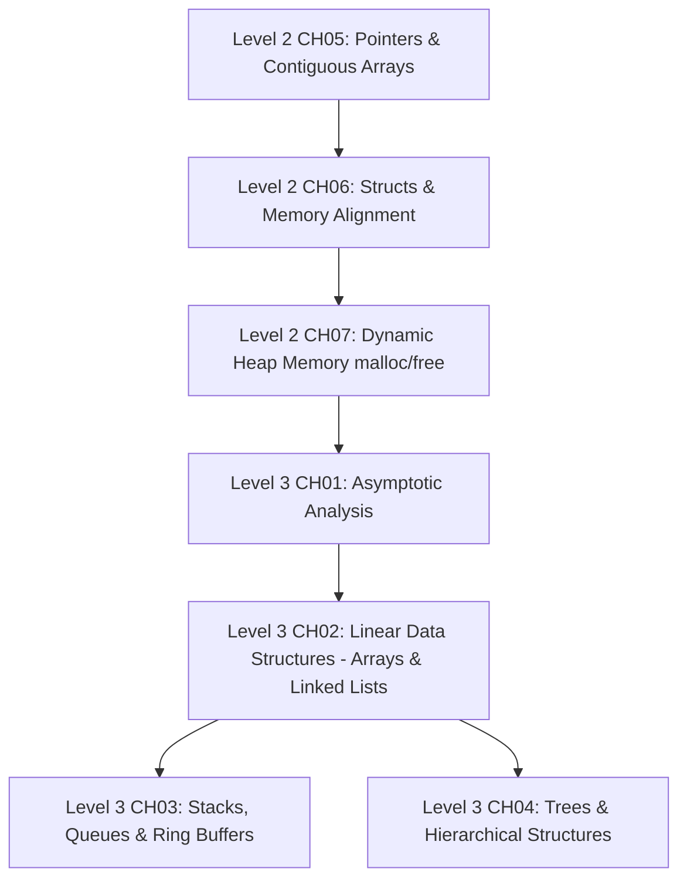
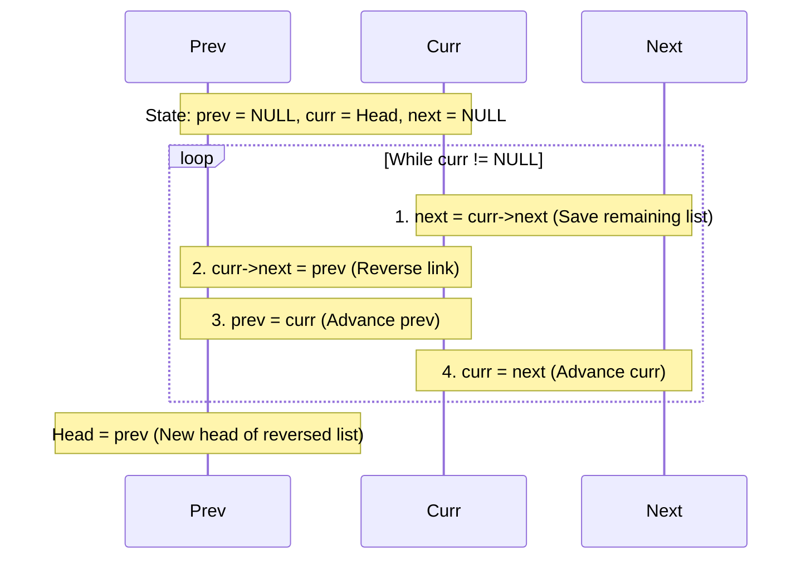

# Chapter 02: Linear Data Structures: Arrays and Linked Lists

---

## 1. Executive Summary & Core Concept

In computational data representation, a **Linear Data Structure** organizes elements sequentially, such that each element (except the first and last) has a unique predecessor and successor. The two foundational physical mechanisms for implementing linear sequences are:
1. **Arrays (Contiguous Allocation)**: Elements are packed side-by-side in a single contiguous block of physical memory, providing instantaneous $\mathcal{O}(1)$ random access via numerical index offsets, but incurring $\mathcal{O}(n)$ relocation penalties for mid-sequence insertions or deletions.
2. **Linked Lists (Node-Based Allocation)**: Elements are encapsulated within independent heap nodes linked together by explicit memory pointer references, providing constant-time $\mathcal{O}(1)$ insertion and deletion at any known iterator position, but requiring linear $\mathcal{O}(n)$ sequential pointer traversal for random access.

This chapter examines the mechanical and hardware realities of linear structures:
- The trade-offs between cache-friendly contiguous arrays and fragmentation-inducing pointer-based lists.
- Singly, Doubly, and Circular Linked Lists, alongside multi-level **Skip Lists** that achieve logarithmic $\mathcal{O}(\log n)$ search times.
- The Linux kernel's renowned **intrusive linked list** pattern (`struct list_head`).

Choosing the correct linear data structure is the fundamental engineering decision that dictates whether a high-throughput system sustains millions of transactions per second or suffers severe CPU cache thrashing.

---

## 2. Prerequisites & Cognitive Map



### Required Knowledge Checklist
- Dynamic heap memory allocation (`malloc`, `free`) and pointer dereferencing (`->`).
- Asymptotic notation ($\mathcal{O}(1)$, $\mathcal{O}(n)$, amortized complexity) from Chapter 01.
- CPU cache lines and spatial locality from Level 1 & Level 2.

---

## 3. The "Explain Like I'm Five" (ELI5) Analogy

### The Train Passenger Car vs. The Treasure Hunt Clues
- **An Array is a Passenger Train with Numbered Wagons**:
  All wagons are welded together in one straight, unbroken line: Wagon 0, Wagon 1, Wagon 2, Wagon 3. If you want to check Wagon 50, you walk straight to door #50 instantaneously ($\mathcal{O}(1)$ time). But imagine someone wants to insert a brand-new wagon right between Wagon 1 and Wagon 2! You have to physically decouple wagons 2 through 100, push every single one of them backward by one space, and then insert the new wagon. Inserting in the middle is exhausting and slow ($\mathcal{O}(n)$ work).
- **A Linked List is a Treasure Hunt with Clue Scrolls**:
  You are standing in room 0, and you hold a slip of paper with GPS coordinates pointing to room 1. Room 1 contains an item and another slip of paper pointing to room 2. The rooms are scattered all across town.
  - If you want to visit room 50, you CANNOT jump there directly! You MUST visit room 1, read the note, visit room 2, read the note, and visit all 49 rooms first ($\mathcal{O}(n)$ search).
  - But if you are standing at room 2 and want to insert a new room $X$, you simply scribble room $X$'s address on room 2's note, and put room 3's address inside room $X$. Zero heavy lifting! It takes only 2 seconds ($\mathcal{O}(1)$ insertion).

---

## 4. Formal Mathematical & Theoretical Foundations

### 4.1 Address Calculation Axiom: Dynamic Arrays
Let array $A$ be allocated at base physical memory address $\text{Base}(A)$, where each element occupies $S = \text{sizeof}(T)$ bytes. The address of index $i$ is:
$$\text{Address}(A[i]) = \text{Base}(A) + i \times S$$

Because the CPU executes this address computation via a single instruction using base-plus-index addressing modes (e.g. `mov edx, [rax + rbx*4]`), the latency is strictly invariant with respect to array length $n$:
$$\text{Time}(\text{Access}(A, i)) = \Theta(1)$$

### 4.2 Traversal Recurrence: Linked Lists
Let a linked list $L$ consist of a chain of nodes:
$$N_0 \xrightarrow{\text{next}} N_1 \xrightarrow{\text{next}} N_2 \xrightarrow{\text{next}} \dots \xrightarrow{\text{next}} N_{n-1} \xrightarrow{\text{next}} \text{NULL}$$

To reach node $N_k$ starting from the head pointer $N_0$, the system must perform $k$ sequential pointer dereferences:
$$\text{Address}(N_k) = \text{Dereference}^k(\text{Head})$$
The total operations $T(k)$ required to access index $k$ follows:
$$T(k) = k \implies T(n) \in \mathcal{O}(n)$$

### 4.3 Geometric Amortized Array Resizing Proof (Potential Method)
Let a dynamic array start with capacity $C_0 = 1$ and size $S_0 = 0$. When an insertion occurs with $S_{i-1} = C_{i-1}$, the array doubles its capacity: $C_i = 2 C_{i-1}$, requiring an allocation and copying of all $S_{i-1}$ elements.

Define the potential function $\Phi(D_i)$ as the excess unspent elements stored beyond half capacity:
$$\Phi(D_i) = 2 S_i - C_i$$

Notice:
1. Immediately after doubling ($C_i = 2 S_i$): $\Phi(D_i) = 2 S_i - 2 S_i = 0$.
2. Immediately before doubling ($S_i = C_i$): $\Phi(D_i) = 2 C_i - C_i = C_i \ge 0$.
3. Thus, $\Phi(D_i) \ge 0$ for all $i \ge 0$, and $\Phi(D_0) = 0$.

#### Case A: Normal Append (No Resizing Needed)
Actual cost $c_i = 1$ (writing the element).
$$\hat{c}_i = c_i + \Phi(D_i) - \Phi(D_{i-1}) = 1 + (2(S_i) - C_i) - (2(S_i - 1) - C_i) = 1 + 2 = 3$$

#### Case B: Expansion Append (Capacity Doubles)
Actual cost $c_i = S_{i-1} + 1$ (copying $S_{i-1}$ elements plus inserting 1 new element).
$$\hat{c}_i = (S_{i-1} + 1) + (2 S_i - C_i) - (2 S_{i-1} - C_{i-1})$$
Substitute $S_i = S_{i-1} + 1$, $C_{i-1} = S_{i-1}$, and $C_i = 2 S_{i-1}$:
$$\hat{c}_i = (S_{i-1} + 1) + (2(S_{i-1} + 1) - 2 S_{i-1}) - (2 S_{i-1} - S_{i-1})$$
$$\hat{c}_i = S_{i-1} + 1 + 2 - S_{i-1} = 3$$

In both cases, the amortized cost per append operation is strictly $\hat{c}_i \le 3 = \mathcal{O}(1)$. $\blacksquare$

---

## 5. Architectural & Hardware Context

```
Hardware Cache Line Comparison (64 Bytes)
========================================================================
Flat Contiguous Array (int arr[16]):
[ 10 ][ 20 ][ 30 ][ 40 ][ 50 ][ 60 ][ 70 ][ 80 ][ 90 ][100][110][120][130][140][150][160]
|--------------------------- Entire 64-Byte Cache Line --------------------------------|
Result: 1 Cache Fetch -> 16 integers loaded -> 15 subsequent CACHE HITS (100% locality)

Standard Linked List (struct Node { int data; Node *next; }):
[ Node 0 (16B) ] --> Heap Address 0x10A4 (Random)
[ Node 1 (16B) ] --> Heap Address 0x58F0 (Random)
[ Node 2 (16B) ] --> Heap Address 0x221C (Random)
Result: Every pointer traversal jumps across page boundaries -> CACHE MISS on every node!
```

### Pointer Overhead & Memory Waste
On a 64-bit architecture:
- An array of $1,000,000$ 4-byte integers consumes:
  $$\text{Memory}_{\text{Array}} = 1,000,000 \times 4\text{ bytes} = \mathbf{4\text{ MB}}$$
- A doubly linked list of $1,000,000$ 4-byte integers consumes:
  $$\text{Node Size} = 4\text{ bytes (data)} + 4\text{ bytes (padding)} + 8\text{ bytes (prev)} + 8\text{ bytes (next)} = 24\text{ bytes}$$
  $$\text{Memory}_{\text{List}} = 1,000,000 \times 24\text{ bytes} + 1,000,000 \times 16\text{ bytes (malloc chunk headers)} = \mathbf{40\text{ MB}}$$
- **Result**: The linked list consumes **$10\times$ more physical RAM** to store the exact same payload data!

---

## 6. Core Syntax, Semantics & Idioms

### 6.1 Singly Linked List Implementation in C
```c
#include <stdio.h>
#include <stdlib.h>
#include <stdbool.h>

typedef struct Node {
    int data;
    struct Node *next;
} Node;

// O(1) Push to Front (Head insertion)
void list_push_front(Node **head_ref, int new_data) {
    Node *new_node = (Node *)malloc(sizeof(Node));
    if (!new_node) return;
    new_node->data = new_data;
    new_node->next = *head_ref;
    *head_ref = new_node;
}

// O(1) Pop Front
bool list_pop_front(Node **head_ref, int *out_data) {
    if (*head_ref == NULL) return false;
    Node *temp = *head_ref;
    if (out_data) *out_data = temp->data;
    *head_ref = temp->next;
    free(temp);
    return true;
}

// O(n) Free entire list safely
void list_destroy(Node **head_ref) {
    Node *curr = *head_ref;
    while (curr != NULL) {
        Node *next = curr->next;
        free(curr);
        curr = next;
    }
    *head_ref = NULL;
}
```

### 6.2 Doubly Linked List Node Structure
```c
typedef struct DNode {
    int data;
    struct DNode *prev;
    struct DNode *next;
} DNode;

// O(1) Removal given direct pointer to node
void dlist_remove_node(DNode **head_ref, DNode *target) {
    if (!target) return;
    if (target->prev) target->prev->next = target->next;
    else *head_ref = target->next; // Target was head

    if (target->next) target->next->prev = target->prev;
    free(target);
}
```

### 6.3 The Linux Kernel Intrusive Linked List Pattern
Instead of wrapping user data inside a node, the Linux kernel embeds a `struct list_head` directly inside user structures:

```c
struct list_head {
    struct list_head *next, *prev;
};

// User structure embedding the list anchor
typedef struct {
    int pid;
    char command[16];
    struct list_head list; // Intrusive anchor (16 bytes)
} ProcessDescriptor;

// Recover parent struct address using offsetof
#define list_entry(ptr, type, member) \
    ((type *)((char *)(ptr) - offsetof(type, member)))
```

---

## 7. Memory Layout & Runtime Execution Model

### The Four Linked List Topologies

```
1. Singly Linked List:
Head -> [ Data | Next ] -> [ Data | Next ] -> [ Data | NULL ]

2. Doubly Linked List:
Head -> [ Prev | Data | Next ] <-> [ Prev | Data | Next ] <-> [ Prev | Data | Next ] -> NULL
NULL <-

3. Circular Singly Linked List:
Head -> [ Data | Next ] -> [ Data | Next ] -> [ Data | Next ]
           ^                                         |
           |-----------------------------------------|

4. Skip List (Probabilistic Multi-Level Express Lanes):
Level 2: [ 10 ] -----------------------------------------> [ 50 ] -> NULL
Level 1: [ 10 ] -------------> [ 30 ] -------------------> [ 50 ] -> NULL
Level 0: [ 10 ] -> [ 20 ] ---> [ 30 ] ---> [ 40 ] -------> [ 50 ] -> NULL
```

---

## 8. Visual Models & Deep Walkthroughs

### Reversing a Singly Linked List In-Place Walkthrough



### Complete In-Place Reversal Code
```c
Node* list_reverse_inplace(Node *head) {
    Node *prev = NULL;
    Node *curr = head;
    while (curr != NULL) {
        Node *next = curr->next; // 1. Save next
        curr->next = prev;       // 2. Reverse link
        prev = curr;             // 3. Step prev
        curr = next;             // 4. Step curr
    }
    return prev; // New head
}
```

---

## 9. Common Pitfalls, Anti-Patterns & Undefined Behavior

| Anti-Pattern / Bug | Code Example | Consequence / Fix |
|:---|:---|:---|
| **Dangling Link After Free** | `free(curr); curr = curr->next;` | Use-After-Free! Must save `next = curr->next;` *before* freeing `curr`. |
| **Losing the Head Pointer** | `while(head) { head = head->next; }` | Head pointer destroyed; original list can never be freed (Memory leak!). Use a traversal pointer `curr = head`. |
| **Circular List Infinite Loop** | Standard `while (curr != NULL)` | Traversal never terminates! Must terminate when `curr->next == head`. |
| **Dynamic Array Memory Doubling Trap** | `arr = realloc(arr, new_sz);` | If reallocation fails, `arr` is overwritten with `NULL`, leaking the original block. |
| **Off-by-One Array Splice** | `memmove(&a[i], &a[i+1], n-i)` | Fails to adjust for `sizeof(T)`. Number of bytes is `(n - i) * sizeof(T)`. |

---

## 10. Industrial & Production Application

### Case 1: Redis In-Memory Sorted Sets via Skip Lists
Redis implements its fundamental `ZSET` (Sorted Set) data structure using a hybrid of a hash table and a **Skip List**. While balanced trees (Red-Black Trees) require complex recursive balancing rotations during insertions, Skip Lists use probabilistic coin-flip heights. This allows Redis to execute range queries (`ZRANGEBYSCORE`) with pure forward pointer walking at line-rate memory speed while avoiding lock contention.

### Case 2: Linux Process Scheduler Runqueues
The Linux CFS (Completely Fair Scheduler) and task managers link every active process thread (`task_struct`) through intrusive doubly-linked circular lists (`struct list_head`). Because the node pointer is embedded directly inside the `task_struct`, moving a task between the ready queue and a sleep waitqueue requires only **four pointer assignments** ($\mathcal{O}(1)$), with zero memory allocation or free calls.

---

## 11. Benchmarks, Complexity & Performance Profiling

### Operation Complexity Matrix: Array vs. Singly Linked List vs. Doubly Linked List

| Operation | Array (Contiguous) | Singly Linked List | Doubly Linked List | Skip List |
|:---|:---|:---|:---|:---|
| **Access Index $k$** | $\mathbf{\Theta(1)}$ | $\Theta(k) \in \mathcal{O}(n)$ | $\Theta(k) \in \mathcal{O}(n)$ | $\mathcal{O}(\log n)$ |
| **Insert at Front** | $\mathcal{O}(n)$ (Shift all) | $\mathbf{\Theta(1)}$ | $\mathbf{\Theta(1)}$ | $\mathcal{O}(\log n)$ |
| **Insert at End** | $\mathcal{O}(1)$ amortized | $\Theta(1)$ (with tail ptr) | $\Theta(1)$ (with tail ptr) | $\mathcal{O}(\log n)$ |
| **Insert at Position $k$** | $\mathcal{O}(n)$ (Shift elements) | $\mathcal{O}(k)$ | $\mathcal{O}(k)$ | $\mathcal{O}(\log n)$ |
| **Delete Known Node** | $\mathcal{O}(n)$ (Shift elements) | $\mathcal{O}(n)$ (Requires predecessor)| $\mathbf{\Theta(1)}$ | $\mathcal{O}(\log n)$ |
| **Cache Locality** | **Excellent (Sequential)** | Poor (Pointer Chasing) | Poor (Pointer Chasing) | Moderate |

---

## 12. Security Implications & Vulnerability Analysis

### The Unlinking Exploit in Free-List Heap Managers
Old memory allocators (`dlmalloc`) used doubly-linked circular free-lists to track unallocated heap blocks. When a block was allocated, it was "unlinked" from the list:

```c
// VULNERABLE UNLINK MACRO (Historic dlmalloc):
#define unlink(P, BK, FD) { \
    FD = P->fd;             \
    BK = P->bk;             \
    FD->bk = BK;            \
    BK->fd = FD;            \
}
```

If an attacker overflowed an adjacent heap buffer, they could overwrite `P->fd` and `P->bk` with arbitrary memory addresses:
- Setting `P->fd = &function_pointer - offset`
- Setting `P->bk = &shellcode`
When `unlink()` executed, the line `BK->fd = FD;` wrote the shellcode address directly into the target function pointer, seizing complete control of the machine!

#### Modern Defense: "Safe Unlinking"
Modern allocators verify pointer reciprocity before unlinking:
```c
if (P->fd->bk != P || P->bk->fd != P) {
    abort(); // Heap corruption detected!
}
```

---

## 13. Edge Cases & Boundary Conditions

1. **Empty List Operations**: All insertion and deletion routines must check `if (*head_ref == NULL)` to prevent null-pointer dereferences.
2. **Single-Element List Deletion**: When deleting the only node in a list, `*head_ref` must be set to `NULL`, and any tail pointer updated accordingly.
3. **Circular List Termination**: Looping through a circular list requires an initial reference save:
   ```c
   Node *curr = head;
   if (head) {
       do {
           process(curr);
           curr = curr->next;
       } while (curr != head);
   }
   ```

---

## 14. Comparative Analysis: Array vs Linked List

| Feature | Dynamic Array | Linked List |
|:---|:---|:---|
| **Memory Layout** | Single contiguous block | Dispersed nodes across heap |
| **Random Access** | $\mathcal{O}(1)$ via mathematical offset | $\mathcal{O}(n)$ via sequential traversal |
| **Insertion at Known Pos**| $\mathcal{O}(n)$ due to shifting elements | $\mathcal{O}(1)$ pointer updates |
| **Memory Overhead** | Unused capacity buffer | 8–16 bytes of pointer metadata per node |
| **Hardware Prefetching** | **100% efficient** (Hardware L1 prefetcher)| Ineffective (Random addresses defeat prefetch) |
| **Resizing Mechanism** | Reallocation & copying ($\times 2$) | Node-by-node allocation |

---

## 15. Emerging Paradigms, AI & Future Perspectives

1. **Unrolled Linked Lists & B-Trees in Modern Systems**: Pure node-based linked lists have fallen out of favor in high-performance computing due to poor cache performance. Modern systems use **Unrolled Linked Lists** (where each node holds an array of 16–64 elements) or In-Memory B-Trees, blending $\mathcal{O}(1)$ node insertion with 100% hardware cache line utilization.
2. **AI Memory Pattern Optimizers**: Compilers like LLVM are developing automated layout passes that detect pointer-chasing data structures and automatically rewrite them into contiguous structure-of-arrays formats when targets permit.

---

## 16. Step-by-Step Solved Problem 1 (Foundational / Academic)

### Problem Statement
Implement Floyd's Cycle-Finding Algorithm ("Tortoise and Hare") to detect whether a singly linked list contains a cycle in $\mathcal{O}(n)$ time and strict $\mathcal{O}(1)$ auxiliary space.

### Mathematical Proof of Convergence
Let the list have $m$ non-cyclic nodes before entering a loop of length $C$.
- The slow pointer advances 1 node per step: $d_{\text{slow}}(t) = t$.
- The fast pointer advances 2 nodes per step: $d_{\text{fast}}(t) = 2t$.

Once both pointers have entered the cycle (which takes $t \ge m$ steps), the distance between them within the cycle increases by 1 node per step:
$$\Delta(t) = (2t - t) \pmod C = t \pmod C$$
Since the relative speed is 1 node/step, the fast pointer will catch up to the slow pointer from behind in at most $C$ steps after entering the cycle. Total steps $T \le m + C \in \mathcal{O}(n)$.

### Code Implementation
```c
#include <stdbool.h>
#include <stddef.h>

typedef struct Node {
    int data;
    struct Node *next;
} Node;

bool list_has_cycle(Node *head) {
    if (head == NULL || head->next == NULL) return false;

    Node *slow = head;
    Node *fast = head;

    while (fast != NULL && fast->next != NULL) {
        slow = slow->next;          // Move 1 step
        fast = fast->next->next;    // Move 2 steps

        if (slow == fast) {
            return true; // Cycle detected!
        }
    }

    return false; // Reached NULL -> No cycle
}
```

---

## 17. Step-by-Step Solved Problem 2 (Algorithmic / Systems Level)

### Problem Statement
Merge two sorted singly linked lists into a single sorted list in-place without allocating new heap nodes, maintaining $\mathcal{O}(n + m)$ time and $\mathcal{O}(1)$ space.

### Code Implementation
```c
Node* merge_sorted_lists(Node *l1, Node *l2) {
    // Dummy head technique eliminates special cases for empty lists
    Node dummy;
    dummy.next = NULL;
    Node *tail = &dummy;

    while (l1 != NULL && l2 != NULL) {
        if (l1->data <= l2->data) {
            tail->next = l1;
            l1 = l1->next;
        } else {
            tail->next = l2;
            l2 = l2->next;
        }
        tail = tail->next;
    }

    // Attach remaining elements
    tail->next = (l1 != NULL) ? l1 : l2;

    return dummy.next;
}
```

---

## 18. Step-by-Step Solved Problem 3 (Industry / Production Debugging)

### Production Incident Scenario
A high-throughput LRU (Least Recently Used) cache service crashes intermittently under heavy load with `SIGSEGV` during cache eviction.

### Defective Code Snippet
```c
void lru_evict_least_recent(LRUCache *cache) {
    DNode *victim = cache->tail;
    if (!victim) return;

    // FATAL FLAW: Removing tail without updating cache->tail pointer!
    victim->prev->next = NULL;
    free(victim);
    // cache->tail is now a DANGLING POINTER!
}
```

### Root Cause Analysis
1. `victim` was freed, but `cache->tail` was never reassigned to `victim->prev`.
2. The next eviction dereferenced `cache->tail`, accessing unmapped freed memory.

### Production Fix: Complete Invariant Update
```c
void lru_evict_safe(LRUCache *cache) {
    DNode *victim = cache->tail;
    if (!victim) return;

    cache->tail = victim->prev;
    if (cache->tail) {
        cache->tail->next = NULL;
    } else {
        cache->head = NULL; // Cache is now empty
    }

    free(victim);
    cache->count--;
}
```

---

## 19. Categorized Practice Exercises

### Beginner (Confidence Builders)
1. Write a function to count the total number of nodes in a singly linked list iteratively and recursively.
2. Write a function to find the middle element of a linked list in a single pass using slow and fast pointers.
3. Implement a function to delete a node given only its value.

### Intermediate (Exam Level)
4. Implement a function to find the $k$-th node from the end of a singly linked list in a single pass.
5. Write a function to check if a singly linked list is a palindrome using $\mathcal{O}(1)$ auxiliary space.
6. Implement an unrolled linked list node holding an array of 8 integers and write an insert operation.

### Advanced (Systems / Competitive)
7. Implement an in-memory **Skip List** with random level generation (coin flip probability $p = 0.5$) supporting `insert`, `search`, and `delete` in $\mathcal{O}(\log n)$ expected time.
8. Implement the Linux kernel `container_of` macro and demonstrate an intrusive doubly linked list holding heterogeneous struct types.

---

## 20. University Exam Practice Questions (SPPU / International Style)

### Question 1 (Theory - 5 Marks)
Compare and contrast arrays and linked lists on the basis of memory allocation, random access time, insertion/deletion complexity, and hardware cache performance.

### Question 2 (Algorithm & Trace - 5 Marks)
Write an algorithm to reverse a singly linked list in-place. Trace the execution step-by-step on the list:
$$[10] \to [20] \to [30] \to [40] \to \text{NULL}$$
showing all pointer modifications.

### Question 3 (Code Analysis & Defect Identification - 5 Marks)
Identify the errors in the following circular singly linked list traversal code and rewrite the corrected version:
```c
void print_circular_list(Node *head) {
    Node *temp = head;
    while (temp != NULL) {
        printf("%d -> ", temp->data);
        temp = temp->next;
    }
}
```

---

## 21. Industry Interview Masterclass

### Tier A (Freshers / Campus Hiring)
- **Q**: Why is random access $\mathcal{O}(1)$ in an array but $\mathcal{O}(n)$ in a linked list?
- **A**: Arrays store elements contiguously in physical RAM, allowing the CPU to compute any element's exact address via simple arithmetic ($\text{Base} + i \times \text{Size}$) in a single instruction. Linked list nodes are scattered across the heap; reaching node $i$ requires following $i$ sequential pointers from node to node.

### Tier B (Mid-Level Engineers)
- **Q**: How does Floyd's Tortoise and Hare algorithm detect the exact starting node of a cycle?
- **A**: When the slow and fast pointers meet inside the cycle, reset the slow pointer back to the `head` of the list while leaving the fast pointer at the meeting point. Then advance both pointers at the same speed (1 step at a time). The node where they meet again is mathematically guaranteed to be the exact entrance node of the cycle.

### Tier C (Senior Systems Engineers)
- **Q**: What is an Intrusive Linked List, and why is it universally preferred in operating system kernels over traditional generic linked lists?
- **A**: In traditional linked lists, the list manages the node, requiring a separate heap allocation (`malloc(sizeof(Node))`) for every element, which causes heap fragmentation and cache misses. In an intrusive list (like Linux `struct list_head`), the pointer hooks are embedded directly inside the user's data structure. Inserting or removing elements requires zero memory allocation, enables atomic container transitions, and guarantees no allocation failures during low-memory conditions.

### Tier D (FAANG / Core Systems & Kernel)
- **Q**: How do Skip Lists achieve $\mathcal{O}(\log n)$ search times without requiring the complex tree rebalancing rotations of AVL or Red-Black trees?
- **A**: Skip Lists maintain multiple probabilistic layers of linked lists. The bottom layer contains all elements; each higher layer acts as an "express lane" containing a subset of elements chosen with probability $p$ (typically $0.5$). Search begins at the highest layer, skipping large swaths of elements, and drops down a level when the target is overshot. Because heights are determined by random coin flips rather than structural invariants, insertions and deletions alter only local node pointers, avoiding cascading rebalancing across the structure.

---

## 22. Hands-on Lab Assignment & Verification Checklist

### Lab Goal
Write a comprehensive linear data structures benchmarking suite in C and Python that:
1. Implements Singly Linked List in-place reversal and verifies pointer integrity.
2. Implements Floyd's Cycle Detection algorithm and verifies detection of circular references.
3. Benchmarks sequential array scan vs. linked list traversal over $1,000,000$ elements to measure the cache locality penalty.
4. Implements an intrusive doubly linked list pattern.

### Verification Checklist
- [x] List reversal executes in-place without memory allocation.
- [x] Floyd's cycle detector correctly distinguishes cyclic from acyclic lists.
- [x] Cache benchmark demonstrates measurable latency advantage for contiguous arrays.
- [x] All simulation and test scripts execute with exit code 0.

---

## 23. High-Yield Quick Revision Summary

| Data Structure | Access Time | Insert (Head) | Insert (Middle) | Space Overhead | Cache Performance |
|:---|:---|:---|:---|:---|:---|
| **Contiguous Array** | $\mathcal{O}(1)$ | $\mathcal{O}(n)$ | $\mathcal{O}(n)$ | None (100% payload) | **Optimal (Sequential L1 hits)** |
| **Singly Linked List** | $\mathcal{O}(n)$ | $\mathcal{O}(1)$ | $\mathcal{O}(1)^*$ | 1 pointer / node (8B) | Poor (Pointer chasing) |
| **Doubly Linked List** | $\mathcal{O}(n)$ | $\mathcal{O}(1)$ | $\mathcal{O}(1)^*$ | 2 pointers / node (16B)| Poor (Pointer chasing) |
| **Circular List** | $\mathcal{O}(n)$ | $\mathcal{O}(1)$ | $\mathcal{O}(1)^*$ | 1–2 pointers / node | Poor (Pointer chasing) |
| **Skip List** | $\mathcal{O}(\log n)$ | $\mathcal{O}(\log n)$ | $\mathcal{O}(\log n)$ | $\approx 2$ pointers / node | Moderate |

*\*Note: Insertion in middle requires $\mathcal{O}(1)$ time once the iterator pointer to that position is already known; finding the position takes $\mathcal{O}(n)$.*

---

## 24. Verified Academic Citations & Authoritative References

1. **Cormen, T. H., Leiserson, C. E., Rivest, R. L., & Stein, C.** (2022). *Introduction to Algorithms* (4th ed.). MIT Press. [Chapter 10: Elementary Data Structures - Stacks, Queues, Linked Lists, pp. 251–264].
2. **Knuth, D. E.** (1997). *The Art of Computer Programming, Volume 1: Fundamental Algorithms* (3rd ed.). Addison-Wesley. [Section 2.2: Linear Lists and Linked Allocation].
3. **Pugh, W.** (1990). *Skip Lists: A Probabilistic Alternative to Balanced Trees*. Communications of the ACM, 33(6), pp. 668–676.
4. **Love, R.** (2010). *Linux Kernel Development* (3rd ed.). Addison-Wesley. [Chapter 6: Kernel Data Structures — The Linked List, pp. 85–98].
