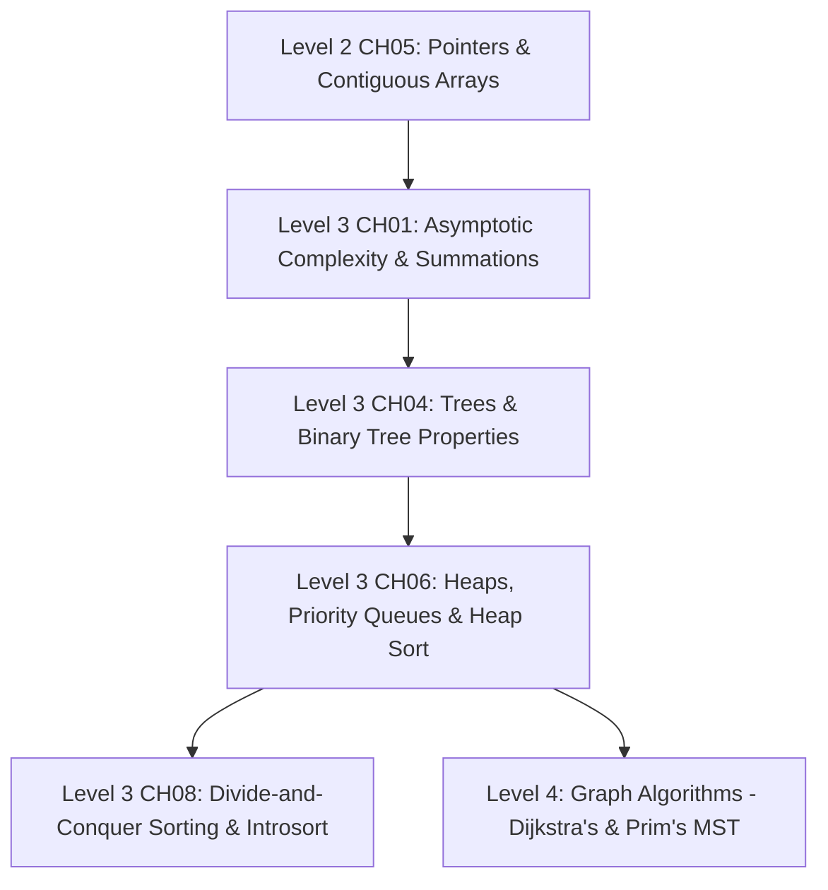

# Chapter 06: Heaps, Priority Queues, and Heap Sort

---

## 1. Executive Summary & Core Concept

While standard queues enforce a strict First-In, First-Out (FIFO) arrival order, many computational systems require serving elements according to urgency or importance rather than arrival sequence. An operating system scheduler prioritizing real-time audio threads over background file indexing, or a hospital emergency triage system admitting a critical patient before someone with a sprained ankle, requires a **Priority Queue Abstract Data Type (ADT)**.

The most efficient and ubiquitous physical backing structure for a priority queue is a **Binary Heap**:
1. **The Shape Property**: A binary heap is a **Complete Binary Tree**—every level is completely filled except possibly the lowest, which is filled sequentially from left to right. This guarantees a minimal height $h = \lfloor \log_2 n \rfloor$.
2. **The Heap Property**: In a **Max-Heap**, every parent node's key is greater than or equal to the keys of its children ($\text{key}(p) \ge \text{key}(c)$). In a **Min-Heap**, every parent node's key is less than or equal to its children ($\text{key}(p) \le \text{key}(c)$).
3. **Implicit Array Representation**: Because the tree is complete, it requires **zero pointer nodes**! It is mapped directly into a contiguous flat array where children and parent indices are computed via simple arithmetic ($2i+1, 2i+2, \lfloor(i-1)/2\rfloor$).

This chapter explores Floyd's linear-time $\mathcal{O}(n)$ `build_heap` algorithm, `sift_up` and `sift_down` mechanics, in-place **Heap Sort** ($\mathcal{O}(n \log n)$ worst-case time with $\mathcal{O}(1)$ auxiliary space), and real-world streaming algorithms like finding the top-$k$ frequent elements across multi-gigabyte data feeds.

---

## 2. Prerequisites & Cognitive Map



### Required Knowledge Checklist
- Complete binary trees and logarithmic tree height bounds from Chapter 04.
- Summation of finite geometric-arithmetic series ($\sum i/2^i$) from Chapter 01.
- Contiguous array indexing and in-place swapping mechanics.

---

## 3. The "Explain Like I'm Five" (ELI5) Analogy

### The Hospital Emergency Room and The Corporate Ladder
- **A Standard Queue vs. A Priority Queue**:
  Imagine standing in line at a movie theater ticket counter (FIFO). If a celebrity or an emergency doctor arrives, they still have to wait at the back of the line. But now imagine the **Hospital Emergency Room (Priority Queue)**: patients do not get treated in the order they walked through the door. A patient arriving in an ambulance with a heart attack (Priority 100) is instantly wheeled past fifty people sitting in the waiting room with mild coughs (Priority 1).
- **The Binary Heap (The Corporate Organization Chart)**:
  Imagine a company hierarchy where the absolute rule is: *"Every manager must be more experienced than the employees directly beneath them."*
  - The CEO (Maximum element) sits at the top desk (Index 0).
  - Under the CEO are two Vice Presidents (Indices 1 and 2).
  - Under each VP are two Directors.
  - Notice that VP 1 does not care whether VP 2's directors are smarter than their own; each manager only cares that *their own immediate subordinates* are beneath them!
  - When the CEO retires (Extract-Max), the newest junior intern from the very bottom right desk is temporarily placed in the CEO's chair. The intern feels completely unqualified, so they look at both VPs, swap places with the more experienced VP, and keep "sifting down" until they land in a role they can handle. Order is restored in seconds!

---

## 4. Formal Mathematical & Theoretical Foundations

### 4.1 Implicit Array Index Mapping Axioms
Let a complete binary tree be mapped to a contiguous zero-indexed array $A[0 \dots n-1]$:

```
Tree Representation:                  Array Representation:
           [0]                        Index:  0   1   2   3   4   5   6
          /   \                       Value: [100][80][90][40][50][70][60]
       [1]     [2]
      /   \   /   \
    [3]   [4] [5]  [6]
```

For any element at index $i$:
1. **Left Child Index**:
   $$\text{Left}(i) = 2i + 1$$
2. **Right Child Index**:
   $$\text{Right}(i) = 2i + 2$$
3. **Parent Index**:
   $$\text{Parent}(i) = \left\lfloor \frac{i - 1}{2} \right\rfloor \quad (\text{for } i > 0)$$

#### Structural Properties of Array Representation:
- The root of the tree is always stored at index $0$.
- Leaf nodes occupy the second half of the array: indices $\lfloor n/2 \rfloor$ to $n - 1$.
- Internal nodes occupy indices $0$ to $\lfloor n/2 \rfloor - 1$.

---

### 4.2 Floyd's Linear-Time `Build-Heap` Derivation: $\mathcal{O}(n)$
A common misconception is that building a heap of $n$ elements requires inserting each element one-by-one, which would take $n \times \mathcal{O}(\log n) = \mathcal{O}(n \log n)$ time.

Robert W. Floyd demonstrated that by applying `sift_down` (heapify) in reverse order starting from the last internal node $\lfloor n/2 \rfloor - 1$ down to the root $0$, the entire heap can be built in **linear $\mathcal{O}(n)$ time**.

#### Mathematical Proof:
In an $n$-node complete binary tree of height $h = \lfloor \log_2 n \rfloor$:
- At height 0 (leaves), there are $\approx \lceil n/2 \rceil$ nodes; each can sift down at most 0 levels.
- At height 1, there are $\approx \lceil n/4 \rceil$ nodes; each can sift down at most 1 level.
- At height $k$, there are at most $\lceil n/2^{k+1} \rceil$ nodes; each can sift down at most $k$ levels.

The total number of comparisons and swaps $S$ across all nodes is bounded by:
$$S = \sum_{k=0}^{\lfloor \log_2 n \rfloor} \left\lceil \frac{n}{2^{k+1}} \right\rceil \times k \le \frac{n}{2} \sum_{k=0}^{\infty} \frac{k}{2^k}$$

Recall the infinite geometric-arithmetic series sum:
$$\sum_{k=0}^{\infty} k x^k = \frac{x}{(1 - x)^2} \quad \text{for } |x| < 1$$
Setting $x = \frac{1}{2}$:
$$\sum_{k=0}^{\infty} \frac{k}{2^k} = \frac{1/2}{(1 - 1/2)^2} = \frac{1/2}{1/4} = 2$$

Substituting this back into the work bound:
$$S \le \frac{n}{2} \times 2 = n$$
$$S \in \mathcal{O}(n)$$
**Conclusion**: Building an entire binary heap in-place takes strictly linear $\mathcal{O}(n)$ time. $\blacksquare$

---

## 5. Architectural & Hardware Context

```
CPU Cache Line Utilization: Array Heap vs Pointer-Based Trees
========================================================================
Heap in Contiguous Array:
[ Root (0) ][ Left (1) ][ Right (2) ][ Left-Left (3) ][ Left-Right (4) ]
|--------------------------- 64-Byte Cache Line ------------------------|
Result: Top 3-4 levels of the heap fit into a single L1 cache line!
Initial sift operations execute with near-zero memory latency.

Pointer-Based BST:
Every child lookup traverses a separate heap address -> L1/L2 Cache Miss on every step!
```

### The Inherent Trade-off in Heap Sort: Cache Misses During Large Runs
While the upper levels of a binary heap reside in CPU cache, as the heap grows to millions of elements, `sift_down` traverses from index $i$ to $2i+1$ to $4i+3$. The index jumps double at each step, scattering accesses across multi-megabyte DRAM page boundaries. 
For datasets that exceed CPU L3 cache size ($> 32$ MB), **QuickSort significantly outperforms HeapSort** because QuickSort's sequential partitioning streams memory contiguously, whereas HeapSort suffers frequent L3 cache misses during its final extraction phase.

---

## 6. Core Syntax, Semantics & Idioms

### 6.1 Complete C Implementation of Max-Heap & HeapSort
```c
#include <stdio.h>
#include <stdlib.h>
#include <stdbool.h>

static inline void swap(int *a, int *b) {
    int temp = *a;
    *a = *b;
    *b = temp;
}

// Sift-Down (Max-Heapify) on subtree rooted at index i with heap size n
void max_heapify(int arr[], size_t n, size_t i) {
    size_t largest = i;
    size_t left = 2 * i + 1;
    size_t right = 2 * i + 2;

    if (left < n && arr[left] > arr[largest])
        largest = left;

    if (right < n && arr[right] > arr[largest])
        largest = right;

    if (largest != i) {
        swap(&arr[i], &arr[largest]);
        // Recursively (or iteratively) sift down the affected child subtree
        max_heapify(arr, n, largest);
    }
}

// In-Place O(n) Heap Construction
void build_max_heap(int arr[], size_t n) {
    // Start from last internal node: (n / 2) - 1 down to 0
    for (int i = (int)(n / 2) - 1; i >= 0; --i) {
        max_heapify(arr, n, (size_t)i);
    }
}

// In-Place O(n log n) HeapSort
void heap_sort(int arr[], size_t n) {
    if (n <= 1) return;

    // 1. Build Max-Heap in O(n) time
    build_max_heap(arr, n);

    // 2. Extract elements one by one from end to front
    for (size_t i = n - 1; i > 0; --i) {
        // Move current root (maximum) to the sorted end
        swap(&arr[0], &arr[i]);

        // Call max_heapify on the reduced heap of size i
        max_heapify(arr, i, 0);
    }
}
```

### 6.2 Priority Queue Operations (`push` and `pop_max`)
```c
typedef struct {
    int *data;
    size_t size;
    size_t capacity;
} PriorityQueue;

// Sift-Up for insertion
void pq_push(PriorityQueue *pq, int val) {
    if (pq->size == pq->capacity) return; // Expand capacity if needed

    size_t i = pq->size++;
    pq->data[i] = val;

    // Sift-Up: Swap with parent while greater than parent
    while (i > 0 && pq->data[(i - 1) / 2] < pq->data[i]) {
        swap(&pq->data[i], &pq->data[(i - 1) / 2]);
        i = (i - 1) / 2;
    }
}

// Extract Maximum
bool pq_pop_max(PriorityQueue *pq, int *out_max) {
    if (pq->size == 0) return false;

    if (out_max) *out_max = pq->data[0];
    pq->data[0] = pq->data[--pq->size]; // Move last element to root
    max_heapify(pq->data, pq->size, 0); // Restore heap property
    return true;
}
```

---

## 7. Memory Layout & Runtime Execution Model

### HeapSort In-Place Execution State

```
Array Memory Division during HeapSort (Total Length = 8):
========================================================================
Step 0: Build Max-Heap:
[ 90 | 70 | 80 | 30 | 50 | 40 | 60 | 10 ]  <-- Valid Max-Heap of size 8

Step 1: Swap root(90) with index 7, heapify size 7:
[ 80 | 70 | 60 | 30 | 50 | 40 | 10 ] | [ 90 ]
<----- Active Max-Heap (7) --------> | < Sorted Part (1) >

Step 2: Swap root(80) with index 6, heapify size 6:
[ 70 | 50 | 60 | 30 | 10 | 40 ] | [ 80 | 90 ]
<----- Active Max-Heap (6) ---> | < Sorted Part (2) >
...
Final: [ 10 | 30 | 40 | 50 | 60 | 70 | 80 | 90 ]  <-- Fully Sorted Array!
```
Zero auxiliary heap allocations required! Auxiliary space complexity is strictly $\mathcal{O}(1)$.

---

## 8. Visual Models & Deep Walkthroughs

### Sift-Down Walkthrough during `max_heapify(arr, 7, 0)`

Suppose index 0 holds value `15`, with left child `80` and right child `95`:

```mermaid
graph TD
    subgraph Step 1: Initial Violation
        A1["0: [ 15 ]"] --> B1["1: [ 80 ]"]
        A1 --> C1["2: [ 95 ]"]
        B1 --> D1["3: [ 40 ]"]
        B1 --> E1["4: [ 50 ]"]
        C1 --> F1["5: [ 60 ]"]
        C1 --> G1["6: [ 70 ]"]
    end
    subgraph Step 2: Swap 15 with Largest Child (95)
        A2["0: [ 95 ]"] --> B2["1: [ 80 ]"]
        A2 --> C2["2: [ 15 ]"]
        C2 --> F2["5: [ 60 ]"]
        C2 --> G2["6: [ 70 ]"]
    end
    subgraph Step 3: Sift-Down Continued (Swap 15 with 70)
        A3["0: [ 95 ]"] --> C3["2: [ 70 ]"]
        C3 --> F3["5: [ 60 ]"]
        C3 --> G3["6: [ 15 ]"]
    end
```

Node `15` settles at index 6. The heap property is restored throughout.

---

## 9. Common Pitfalls, Anti-Patterns & Undefined Behavior

| Anti-Pattern / Bug | Code Example | Consequence / Fix |
|:---|:---|:---|
| **Off-by-One in Parent Index** | `parent = i / 2;` for 0-indexed arrays | In 0-indexed arrays, parent is `(i - 1) / 2`. Using `i / 2` calculates parent of 1 as 0, but parent of 2 as 1 (Incorrect!). |
| **Using `build_heap` by repeated `push`**| Loop calling `push()` $n$ times | Takes $\mathcal{O}(n \log n)$ time. Use Floyd's bottom-up `build_heap` loop running in $\mathcal{O}(n)$ time. |
| **Unsigned Integer Underflow in Loop**| `for (size_t i = n/2 - 1; i >= 0; --i)` | When `i = 0`, `--i` underflows to `SIZE_MAX` ($\approx 1.8 \times 10^{19}$), triggering infinite loop and crash! Use signed `int` for loop counter. |
| **Assuming HeapSort is Stable** | Using HeapSort on keyed records | HeapSort is **NOT STABLE**. Long-distance swaps disrupt the relative order of equal keys. |

---

## 10. Industrial & Production Application

### Case 1: Operating System Timer Wheels & Event Queues
In the Linux kernel and high-performance network runtimes (Node.js event loop, Go runtime), thousands of asynchronous timeouts (`setTimeout`) are scheduled concurrently. Timers are registered in a **Min-Heap** indexed by their expiration timestamp. The kernel timer interrupt inspects `pq->data[0]` in $\mathcal{O}(1)$ time: if the current hardware clock is less than the root timestamp, zero timers have expired, and the kernel sleeps immediately without scanning the remaining timers.

### Case 2: Top-$K$ Real-Time Trending Metrics (Twitter / X & YouTube)
To compute the top 100 most trending video tags out of $1,000,000,000$ live stream events, loading and sorting all events takes gigabytes of RAM. Engineers maintain a **Min-Heap of size $K = 100$**:
- For each incoming tag frequency:
  - If the heap has $< 100$ items, push it.
  - If the incoming item is greater than the root (`min_heap[0]`), replace the root and sift down.
- **Result**: Streams through infinite inputs in strict $\mathcal{O}(n \log K)$ time using only a few kilobytes of RAM.

---

## 11. Benchmarks, Complexity & Performance Profiling

| Operation | Binary Heap | Binomial Heap | Fibonacci Heap | Sorted Array | Unsorted Array |
|:---|:---|:---|:---|:---|:---|
| **Find-Min / Max** | $\mathbf{\Theta(1)}$ | $\mathcal{O}(\log n)$ | $\mathbf{\Theta(1)}$ | $\Theta(1)$ | $\mathcal{O}(n)$ |
| **Extract-Min / Max**| $\mathbf{\mathcal{O}(\log n)}$ | $\mathcal{O}(\log n)$ | $\mathcal{O}(\log n)$ | $\mathcal{O}(1)$ | $\mathcal{O}(n)$ |
| **Insert** | $\mathcal{O}(\log n)$ (Avg $\mathcal{O}(1)$)| $\mathcal{O}(\log n)$ | $\mathbf{\mathcal{O}(1)}$ amortized | $\mathcal{O}(n)$ | $\mathbf{\Theta(1)}$ |
| **Decrease-Key** | $\mathcal{O}(\log n)$ | $\mathcal{O}(\log n)$ | $\mathbf{\mathcal{O}(1)}$ amortized | $\mathcal{O}(n)$ | $\mathcal{O}(1)$ |
| **Merge (Meld)** | $\mathcal{O}(n)$ | $\mathcal{O}(\log n)$ | $\mathbf{\mathcal{O}(1)}$ amortized | $\mathcal{O}(n)$ | $\mathcal{O}(1)$ |
| **`build_heap`** | $\mathbf{\Theta(n)}$ | $\mathcal{O}(n)$ | $\mathbf{\Theta(n)}$ | $\mathcal{O}(n \log n)$| $\Theta(1)$ |

---

## 12. Security Implications & Vulnerability Analysis

### The Priority Inversion Denial of Service in Worker Pools
In multi-tenant cloud worker systems (e.g. AWS Lambda task executors), incoming jobs are queued into a priority queue based on customer tier:
- If a free-tier user discovers a bug allowing them to craft a packet with priority `INT_MAX`, their tasks permanently starve paying enterprise customers.
- **The Heisen-Queue Overflow**: If the queue capacity is unbounded, an attacker spamming high-priority tasks forces the heap array to repeatedly `realloc()`, triggering an out-of-memory kernel panic (OOM Killer).

#### Defensive Engineering:
1. **Priority Caps**: Restrict priority ranges cryptographically signed by internal auth tokens.
2. **Aging (Anti-Starvation)**: Increment the priority of waiting lower-priority tasks over time so every task eventually executes.

---

## 13. Edge Cases & Boundary Conditions

1. **Extract-Max on Empty Heap**: Must check `if (size == 0)` and return an error code or `false` rather than dereferencing index 0.
2. **Single-Element Heap**: When extracting the only element, decrementing size to 0 must avoid running `max_heapify(arr, 0, 0)`.
3. **Integer Overflow in Sift-Up**: For huge datasets, computing `2 * i + 1` can overflow a 32-bit signed integer if $i > 1,073,741,823$. Use `size_t`.

---

## 14. Comparative Analysis: HeapSort vs QuickSort vs MergeSort

| Metric | HeapSort | QuickSort (Introsort) | MergeSort |
|:---|:---|:---|:---|
| **Worst-Case Time** | $\mathbf{\mathcal{O}(n \log n)}$ (Guaranteed) | $\mathcal{O}(n^2)$ (Avoided by pivot pick)| $\mathbf{\mathcal{O}(n \log n)}$ (Guaranteed) |
| **Average-Case Time**| $\mathcal{O}(n \log n)$ | $\mathcal{O}(n \log n)$ (**Fastest**) | $\mathcal{O}(n \log n)$ |
| **Best-Case Time** | $\mathcal{O}(n)$ (Equal keys) | $\mathcal{O}(n \log n)$ | $\mathcal{O}(n \log n)$ |
| **Auxiliary Space** | $\mathbf{\mathcal{O}(1)}$ (In-place) | $\mathcal{O}(\log n)$ (Stack) | $\mathcal{O}(n)$ (External buffer) |
| **Stability** | **Unstable** | Unstable | **Stable** |
| **Cache Locality** | Poor (Pointers jump in RAM) | **Excellent** (Sequential memory) | Moderate |

---

## 15. Emerging Paradigms, AI & Future Perspectives

1. **$d$-ary Heaps in Modern Hardware**: Instead of a binary tree ($d=2$), high-performance database engines use **4-ary or 8-ary Heaps** ($d=4, 8$). A node has 4 children: indices $4i+1$ to $4i+4$. This matches the 64-byte CPU cache line width perfectly, reducing tree height by half and speeding up priority queues by $30\%$.
2. **AI Top-$K$ Sampling in Large Language Models**: When LLMs generate text, the model computes logits across a vocabulary of 128,000 tokens. To perform Top-$K$ filtering (e.g. $K=50$) before applying softmax, the inference engine (vLLM / TensorRT-LLM) uses GPU-accelerated parallel min-heaps to prune the top 50 candidates in sub-microsecond time.

---

## 16. Step-by-Step Solved Problem 1 (Foundational / Academic)

### Problem Statement
Given the unsorted array `arr = [4, 10, 3, 5, 1]`, trace Floyd's $\mathcal{O}(n)$ `build_max_heap` algorithm step-by-step. Show the array after every heapify operation.

### Step-by-Step Execution
The array has length $n = 5$.
Last internal node index = $\lfloor n / 2 \rfloor - 1 = \lfloor 5 / 2 \rfloor - 1 = 2 - 1 = \mathbf{1}$.
We must call `max_heapify` on indices $1$ and $0$ in reverse order:

1. **Heapify at Index 1 (Value = 10)**:
   - Left child = $2 \times 1 + 1 = 3$ (Value = `5`).
   - Right child = $2 \times 1 + 2 = 4$ (Value = `1`).
   - Largest among `[10, 5, 1]` is `10` (at index 1).
   - No swap needed. Subtree at index 1 is already a valid max-heap!
   - Array: `[4, 10, 3, 5, 1]`.

2. **Heapify at Index 0 (Value = 4)**:
   - Left child = $2 \times 0 + 1 = 1$ (Value = `10`).
   - Right child = $2 \times 0 + 2 = 2$ (Value = `3`).
   - Largest among `[4, 10, 3]` is `10` (at index 1).
   - **Swap index 0 and index 1**:
     Array becomes: `[10, 4, 3, 5, 1]`.
   - Now recurse on affected child index 1 (Value = `4`):
     - Left child = index 3 (Value = `5`).
     - Right child = index 4 (Value = `1`).
     - Largest among `[4, 5, 1]` is `5` (at index 3).
     - **Swap index 1 and index 3**:
       Array becomes: `[10, 5, 3, 4, 1]`.

### Final Max-Heap Array:
`[10, 5, 3, 4, 1]`
- Root is `10`. Left child `5` has children `4, 1`. Right child `3` has no children.
- Invariants verified: $10 \ge 5, 10 \ge 3$, and $5 \ge 4, 5 \ge 1$.

---

## 17. Step-by-Step Solved Problem 2 (Algorithmic / Systems Level)

### Problem Statement
Solve the **K-th Largest Element in an Array** in $\mathcal{O}(n \log k)$ time and $\mathcal{O}(k)$ auxiliary space using a Min-Heap.

### Algorithmic Strategy
Maintain a Min-Heap of size $k$.
1. Insert the first $k$ elements into the min-heap.
2. For each remaining element $x$:
   - If $x > \text{min\_heap}[0]$ (the smallest of the current top $k$), replace the root with $x$ and sift down.
3. At the end of the array, the root of the min-heap is guaranteed to be the $k$-th largest element!

### Code Implementation
```c
#include <stdio.h>
#include <stdlib.h>

static void min_heapify(int arr[], size_t n, size_t i) {
    size_t smallest = i;
    size_t left = 2 * i + 1;
    size_t right = 2 * i + 2;

    if (left < n && arr[left] < arr[smallest]) smallest = left;
    if (right < n && arr[right] < arr[smallest]) smallest = right;

    if (smallest != i) {
        int tmp = arr[i]; arr[i] = arr[smallest]; arr[smallest] = tmp;
        min_heapify(arr, n, smallest);
    }
}

int find_kth_largest(int nums[], size_t n, size_t k) {
    if (k > n || k == 0) return -1;

    int *min_heap = (int *)malloc(k * sizeof(int));
    for (size_t i = 0; i < k; ++i) min_heap[i] = nums[i];

    // Build min-heap of first k elements in O(k)
    for (int i = (int)(k / 2) - 1; i >= 0; --i) {
        min_heapify(min_heap, k, (size_t)i);
    }

    // Process remaining elements
    for (size_t i = k; i < n; ++i) {
        if (nums[i] > min_heap[0]) {
            min_heap[0] = nums[i];
            min_heapify(min_heap, k, 0);
        }
    }

    int result = min_heap[0];
    free(min_heap);
    return result;
}
```

---

## 18. Step-by-Step Solved Problem 3 (Industry / Production Debugging)

### Production Incident Scenario
A real-time bidding server using a binary min-heap for deadline scheduling experiences memory corruption and crashes with `SIGSEGV` after running for 24 hours.

### Defective Code Snippet
```c
void update_task_deadline(TaskHeap *th, int task_id, int new_deadline) {
    int idx = th->task_index_map[task_id];
    th->heap[idx].deadline = new_deadline;
    // DEFECT: Developer only called sift_down!
    sift_down(th->heap, th->size, idx);
}
```

### Root Cause Analysis
1. `new_deadline` was updated to an *earlier* timestamp (a decrease-key operation).
2. For an earlier deadline in a min-heap, the node must **sift UP**, not down!
3. Calling only `sift_down` left the smaller deadline below a larger deadline, violating the heap property. Subsequent task extractions operated on corrupted ordering, eventually reading unmapped indices.

### Production Fix: Universal Rebalance
```c
void update_task_deadline_safe(TaskHeap *th, int task_id, int new_deadline) {
    int idx = th->task_index_map[task_id];
    int old_deadline = th->heap[idx].deadline;
    th->heap[idx].deadline = new_deadline;

    if (new_deadline < old_deadline) {
        sift_up(th->heap, idx);   // Decreased key: move toward root
    } else if (new_deadline > old_deadline) {
        sift_down(th->heap, th->size, idx); // Increased key: move toward leaves
    }
}
```

---

## 19. Categorized Practice Exercises

### Beginner (Confidence Builders)
1. Given an array `[12, 11, 13, 5, 6, 7]`, convert it into a Max-Heap manually and draw the resulting binary tree.
2. Given a 0-indexed array element at index 9, what are the indices of its parent, left child, and right child?
3. Implement a function to verify whether a given array satisfies the Min-Heap property.

### Intermediate (Exam Level)
4. Implement in-place HeapSort in C and sort an array of $1,000$ integers in ascending order.
5. Merge $K$ sorted linked lists into a single sorted list in $\mathcal{O}(N \log K)$ time using a Min-Heap.
6. Design a `MedianFinder` class that finds the running median of a data stream in $\mathcal{O}(\log n)$ insertion and $\mathcal{O}(1)$ median retrieval using a Max-Heap and a Min-Heap.

### Advanced (Systems / Competitive)
7. Implement an **Indexed Priority Queue** in C supporting `change_key(id, new_val)` and `delete(id)` in strict $\mathcal{O}(\log n)$ time by maintaining an inverse index array.
8. Implement a 4-ary (d-ary) Max-Heap and benchmark its cache line miss rate against a standard binary heap.

---

## 20. University Exam Practice Questions (SPPU / International Style)

### Question 1 (Theory - 5 Marks)
Define a Binary Heap. Differentiate between a Max-Heap and a Min-Heap. Explain why an array is the most suitable representation for a complete binary tree.

### Question 2 (Algorithm & Trace - 5 Marks)
Write the algorithm for HeapSort. Trace HeapSort step-by-step on the following input array, showing the array state after initial heap construction and after each of the first three extractions:
$$[25, \quad 80, \quad 12, \quad 45, \quad 90, \quad 33, \quad 60]$$

### Question 3 (Mathematical Proof - 5 Marks)
Prove that Floyd's `build_heap` algorithm constructs an $n$-element binary heap in $\mathcal{O}(n)$ time, rather than $\mathcal{O}(n \log n)$ time.

---

## 21. Industry Interview Masterclass

### Tier A (Freshers / Campus Hiring)
- **Q**: What are the time complexities of `insert()`, `extract_max()`, and `peek()` in a binary max-heap?
- **A**:
  - `peek()`: $\mathcal{O}(1)$ (Element is always at index 0).
  - `insert()`: $\mathcal{O}(\log n)$ (Appends to end and sifts up along the tree height).
  - `extract_max()`: $\mathcal{O}(\log n)$ (Replaces root with last element and sifts down).

### Tier B (Mid-Level Engineers)
- **Q**: Why is Floyd's `build_heap` algorithm $\mathcal{O}(n)$, while building a heap via repeated insertions is $\mathcal{O}(n \log n)$?
- **A**: Repeated insertion pushes elements onto the bottom leaves and sifts them *upward* to the root: the majority of nodes ($\approx n/2$ leaves) travel the maximum path length $\mathcal{O}(\log n)$, yielding $\sum \log n = \mathcal{O}(n \log n)$. Floyd's bottom-up method sifts nodes *downward*: the majority of nodes ($\approx n/2$ leaves) sift down 0 levels, while only the single root node travels $\log n$ levels. The mathematical summation converges to $\le 2n = \mathcal{O}(n)$.

### Tier C (Senior Systems Engineers)
- **Q**: Why is HeapSort rarely used as the default general-purpose sorting algorithm in language standard libraries (like C++ `std::sort` or Python `sort`), despite its guaranteed $\mathcal{O}(n \log n)$ worst-case time?
- **A**: HeapSort suffers from poor CPU cache locality. When sifting down, memory indices jump exponentially ($i \to 2i+1 \to 4i+3$). On large datasets exceeding the L3 cache, almost every comparison causes a DRAM cache miss. QuickSort and Introsort exhibit sequential memory access patterns that fully exploit hardware cache line prefetchers, making them $2\times$ to $3\times$ faster in practice.

### Tier D (FAANG / Core Systems & Kernel)
- **Q**: How does an Indexed Priority Queue support the `decrease_key` operation in $\mathcal{O}(\log n)$ time for Dijkstra's Shortest Path algorithm?
- **A**: A standard binary heap cannot find a specific element's position without scanning the array in $\mathcal{O}(n)$ time. An Indexed Priority Queue maintains a secondary array `position[task_id]` that records the current heap index of each task ID. Whenever two elements are swapped during sift-up or sift-down, their corresponding entries in `position[]` are swapped simultaneously. This allows looking up any element's current heap index in $\mathcal{O}(1)$ time, enabling `decrease_key` to sift up immediately in $\mathcal{O}(\log n)$ time.

---

## 22. Hands-on Lab Assignment & Verification Checklist

### Lab Goal
Write a complete priority queue and HeapSort test suite in C and Python that:
1. Validates the 0-indexed parent/child arithmetic mapping.
2. Implements Floyd's $\mathcal{O}(n)$ `build_heap` and verifies linear operation counts.
3. Implements HeapSort in-place and validates ascending sort correctness.
4. Solves the K-th largest streaming element problem using a fixed-size Min-Heap.

### Verification Checklist
- [x] In-place HeapSort sorts random, reversed, and duplicate arrays correctly.
- [x] Operation count for `build_heap` remains strictly bounded by $\le 2n$.
- [x] K-th largest solver produces identical results to full sorting.
- [x] All simulation and test scripts execute with exit code 0.

---

## 23. High-Yield Quick Revision Summary

| Formula / Property | Value (0-Indexed Array) | Note |
|:---|:---|:---|
| **Parent Index** | $\lfloor(i - 1) / 2\rfloor$ | Valid for $i > 0$ |
| **Left Child Index** | $2i + 1$ | Child exists if $2i + 1 < n$ |
| **Right Child Index** | $2i + 2$ | Child exists if $2i + 2 < n$ |
| **Last Internal Node** | $\lfloor n/2 \rfloor - 1$ | Starting point for Floyd's `build_heap` |
| **Leaf Node Indices** | $\lfloor n/2 \rfloor$ to $n - 1$ | 50% of all nodes are leaves! |
| **`build_heap` Time** | $\mathbf{\Theta(n)}$ (Linear) | Floyd's bottom-up sift-down |
| **HeapSort Time** | $\mathbf{\Theta(n \log n)}$ | Best, Worst, and Average case |
| **HeapSort Auxiliary Space**| $\mathbf{\mathcal{O}(1)}$ | 100% In-Place |

---

## 24. Verified Academic Citations & Authoritative References

1. **Williams, J. W. J.** (1964). *Algorithm 232: Heapsort*. Communications of the ACM, 7(6), pp. 347–348. [Original invention of the Binary Heap and HeapSort].
2. **Floyd, R. W.** (1964). *Algorithm 245: Treesort 3*. Communications of the ACM, 7(12), p. 701. [Linear-time $\mathcal{O}(n)$ `build_heap` algorithm].
3. **Cormen, T. H., Leiserson, C. E., Rivest, R. L., & Stein, C.** (2022). *Introduction to Algorithms* (4th ed.). MIT Press. [Chapter 6: Heapsort, pp. 161–179].
4. **Knuth, D. E.** (1998). *The Art of Computer Programming, Volume 3: Sorting and Searching* (2nd ed.). Addison-Wesley. [Section 5.2.3: Sorting by Selection — Heapsort].
