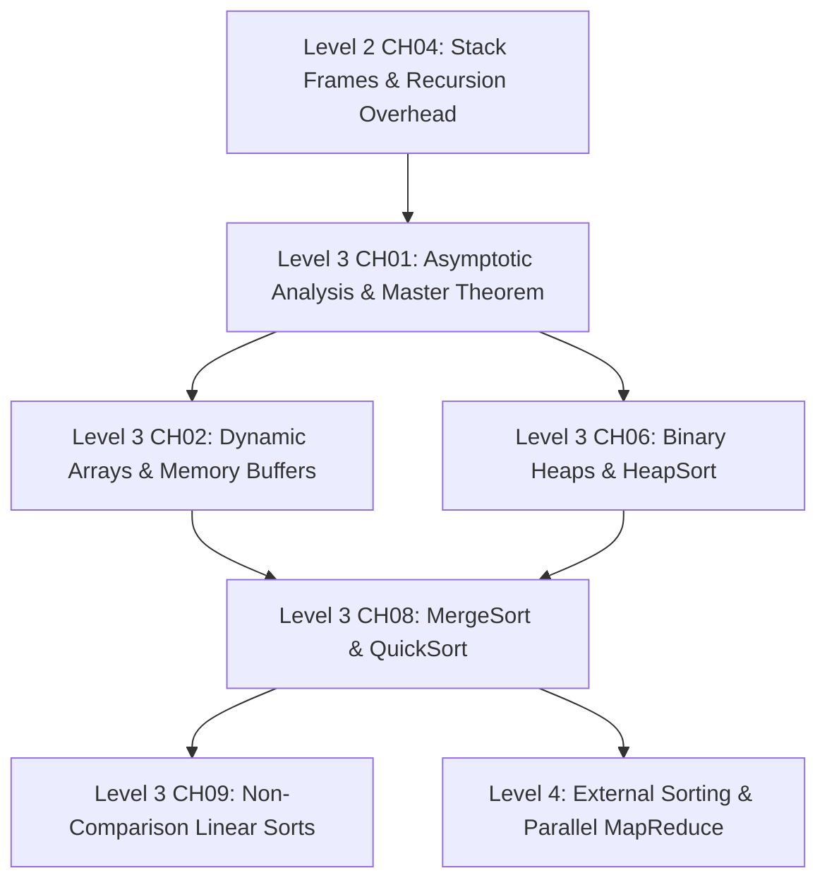

# Chapter 08: Divide-and-Conquer Sorting — MergeSort, QuickSort, and Hybrid Introsort

---

## 1. Executive Summary & Core Concept

Sorting is the quintessential algorithmic problem in computer science. Fundamental computational tasks—binary searching, duplicate elimination, database indexing, inverted index construction in search engines, and computational geometry—all rely upon ordered collections. Elementary sorting algorithms such as Bubble Sort, Selection Sort, and Insertion Sort exhibit quadratic time complexity $\mathcal{O}(n^2)$, rendering them unusable for datasets exceeding a few thousand items.

To overcome the quadratic barrier, algorithmic design employs the **Divide-and-Conquer** paradigm, which breaks a problem into smaller subproblems of identical type, solves them independently, and combines their solutions. 

This chapter focuses on the two primary comparison-based divide-and-conquer sorting algorithms:
1. **MergeSort**: A stable, deterministic algorithm guaranteeing $\Theta(n \log n)$ time in all cases (worst, average, and best) by dividing arrays into halves, sorting recursively, and merging sorted runs. It serves as the foundation for **External Merge Sort**, enabling the sorting of multi-terabyte datasets that exceed available physical RAM.
2. **QuickSort**: An in-place, cache-optimized algorithm with an average runtime of $\Theta(n \log n)$ and an extraordinarily small constant factor. While naive QuickSort degrades to $\mathcal{O}(n^2)$ on adversarial inputs, randomized pivot selection, 3-way Dutch National Flag partitioning, and tail-call optimization make it the standard for in-memory systems.
3. **Introsort (Introspective Sort)**: The production hybrid algorithm (used in C++ `std::sort`) that begins with QuickSort, monitors recursion depth, switches to HeapSort if depth exceeds $2\lfloor \log_2 n \rfloor$ (eliminating the $\mathcal{O}(n^2)$ worst-case trapdoor), and applies InsertionSort on small partitions ($n \le 16$).

---

## 2. Prerequisites & Cognitive Map



### Required Knowledge Checklist
- The Master Theorem for solving divide-and-conquer recurrences ($T(n) = aT(n/b) + f(n)$).
- Recursion call-stack memory dynamics and activation records from Level 2 Chapter 04.
- In-place array swapping and contiguous cache line traversal from Level 2 Chapter 05.

---

## 3. The "Explain Like I'm Five" (ELI5) Analogy

### The Chaotic Deck of 1,000 Flashcards

Imagine your teacher hands you an unsorted stack of 1,000 flashcards, each containing a student's test score, and asks you to sort them in ascending order.

- **The Naive Way (Bubble / Insertion Sort)**:
  You look through all 1,000 cards to find the lowest one, put it down, then scan the remaining 999 cards to find the next lowest, and so on. By the time you are done, you have made nearly $1,000 \times 1,000 / 2 = 500,000$ comparisons! Your brain is exhausted.

- **The MergeSort Way (The Divide-and-Merge Classroom Team)**:
  Instead of doing it alone, you split the 1,000-card stack in half (500 cards each) and hand one half to your friend Bob. You both split your stacks again and hand them to two other friends, until 1,000 students each hold exactly **1 single card**.
  - A card with 1 number is already sorted!
  - Now, two students sitting next to each other compare their single cards and place them in order into a 2-card pile.
  - Then, two 2-card piles are merged into a 4-card pile by simply looking at the top card of each pile and picking the smaller one.
  - In just 10 rounds ($\log_2 1000 \approx 10$), the entire deck of 1,000 cards is flawlessly merged and sorted!

- **The QuickSort Way (The Classroom Ruler / Pivot Organizer)**:
  You pick one card at random—say, a test score of $72$. You declare $72$ as the **Pivot**.
  - You tell everyone in the room: *"Anyone with a score lower than 72, run to the left wall! Anyone with a score higher than 72, run to the right wall!"*
  - The card $72$ sits right in the middle, in its **final, permanent position**! It will never have to move again.
  - Now, you simply repeat this trick on the left group and the right group independently. Nobody has to do any slow merging at the end; as soon as the small groups are sorted, the whole room is already in perfect order!

---

## 4. Formal Mathematical & Theoretical Foundations

### 4.1 The Comparison Tree Lower Bound $\Omega(n \log n)$
Any deterministic or randomized sorting algorithm that operates solely by comparing pairs of keys can be modeled as a **Decision Tree**:
- Each internal node represents a comparison between two elements $A[i] \le A[j]$.
- Each leaf node represents a unique permutation of the input elements.
- For an array of $n$ distinct elements, there are $n!$ possible permutations. Therefore, the decision tree must contain at least $n!$ leaves.

Let $h$ be the height of the decision tree (representing the maximum number of comparisons in the worst case). A binary tree of height $h$ has at most $2^h$ leaves:
$$2^h \ge n! \implies h \ge \log_2(n!)$$

Applying **Stirling's Approximation** ($\ln(n!) = n \ln n - n + \mathcal{O}(\log n)$):
$$\log_2(n!) = \sum_{i=1}^n \log_2 i \ge \sum_{i=n/2}^n \log_2(n/2) = \frac{n}{2} \log_2\left(\frac{n}{2}\right) = \frac{n}{2}(\log_2 n - 1) = \Omega(n \log n)$$

$$\therefore h = \mathbf{\Omega(n \log n)}$$

No comparison-based sorting algorithm can achieve an asymptotic worst-case running time faster than $\Omega(n \log n)$.

---

### 4.2 MergeSort Mathematical Recurrence

MergeSort divides an array of size $n$ into two subarrays of size $\lfloor n/2 \rfloor$ and $\lceil n/2 \rceil$, sorts them recursively, and performs a linear merge operation taking $c \cdot n$ operations:
$$T(n) = 2T(n/2) + \Theta(n)$$

Using the Master Theorem:
- $a = 2$, $b = 2$, $f(n) = \Theta(n)$.
- Critical exponent: $\log_b a = \log_2 2 = 1$.
- Since $f(n) = \Theta(n^{\log_b a}) = \Theta(n^1)$, we fall under **Case 2** of the Master Theorem:
$$T(n) = \mathbf{\Theta(n \log n)}$$

This bound holds strictly across **Best Case**, **Average Case**, and **Worst Case**.

---

### 4.3 QuickSort Mathematical Analysis

#### 1. Average-Case Complexity
Under the assumption that all permutations of the input are equally likely, the pivot splits the array into subarrays of size $i$ and $n - 1 - i$ with uniform probability $\frac{1}{n}$ for each $i \in \{0, 1, \dots, n-1\}$:
$$T(n) = \frac{1}{n} \sum_{i=0}^{n-1} (T(i) + T(n - 1 - i)) + \Theta(n) = \frac{2}{n} \sum_{i=0}^{n-1} T(i) + c \cdot n$$

Multiplying by $n$:
$$n T(n) = 2 \sum_{i=0}^{n-1} T(i) + c n^2$$

Subtracting the equation for $(n-1)T(n-1)$:
$$n T(n) - (n-1)T(n-1) = 2 T(n-1) + 2cn - c$$
$$n T(n) = (n+1)T(n-1) + 2cn - c$$

Dividing both sides by $n(n+1)$:
$$\frac{T(n)}{n+1} = \frac{T(n-1)}{n} + \frac{2c}{n+1} - \frac{c}{n(n+1)}$$

Telescoping the recurrence yields:
$$\frac{T(n)}{n+1} = T(1) + 2c \sum_{k=2}^{n+1} \frac{1}{k} \approx 2c \ln n$$
$$T(n) \approx 2c (n+1) \ln n = 2c \ln(2) \cdot n \log_2 n \approx \mathbf{1.386 \, n \log_2 n}$$

QuickSort requires on average only $\approx 39\%$ more comparisons than the absolute theoretical minimum information-theoretic bound!

#### 2. Worst-Case Degeneration
If the pivot chosen is always the smallest or largest element (e.g., standard Lomuto partitioning on an already sorted or reverse-sorted array):
$$T(n) = T(n-1) + T(0) + \Theta(n) = T(n-1) + c \cdot n = \sum_{k=1}^n c \cdot k = c \frac{n(n+1)}{2} = \mathbf{\Theta(n^2)}$$

---

## 5. Architectural & Hardware Context

```
Memory Hierarchy and CPU Cache Behavior: QuickSort vs. MergeSort
================================================================================

MergeSort:
Array A:    [ 12 | 45 | 19 | 88 | 03 | 71 | 24 | 95 ]  (Source)
Aux Array:  [    |    |    |    |    |    |    |    ]  (Must allocate O(n) heap memory)
Memory Traffic:
1. Read from Source -> Write to Aux buffer.
2. Read from Aux buffer -> Write back to Source.
Result: 2x memory bandwidth pressure; high DRAM cache eviction rates for large n.

QuickSort:
Array A:    [ 12 | 45 | 19 | 88 | 03 | 71 | 24 | 95 ]  (In-place)
Pointers:     ^                                   ^
            Left                                Right
Memory Traffic:
Sequential two-pointer scan meeting in the middle.
Result: Consecutive 64-byte hardware cache line streaming. Zero heap allocation.
```

### Why QuickSort Outperforms MergeSort in Practice
1. **Locality of Reference**: QuickSort's inner partitioning loop scans contiguous array elements in forward and reverse directions. Modern CPU hardware prefetchers detect this sequential memory access pattern and preload entire cache lines (64 bytes) into L1 and L2 caches before the instructions execute.
2. **Auxiliary Memory Allocation**: MergeSort requires allocating an auxiliary array of size $n$ ($\mathcal{O}(n)$ auxiliary space). For a 64 GB dataset, MergeSort demands an additional 64 GB of memory. Allocating and zeroing this memory introduces heavy operating system page table overhead and TLB (Translation Lookaside Buffer) thrashing.

---

## 6. Partitioning Schemes Deep Dive

The performance, correctness, and stability of QuickSort hinge entirely on its partitioning scheme.

### 6.1 Lomuto Partitioning
- **Mechanism**: Chooses the last element $A[hi]$ as the pivot. Maintains an index $i$ representing the boundary of elements strictly smaller than the pivot. A single loop scans $j$ from $lo$ to $hi-1$.
- **Invariants**: 
  - $A[lo \dots i-1] < \text{pivot}$
  - $A[i \dots j-1] \ge \text{pivot}$
- **Weakness**: Performs poorly on arrays with many duplicate elements; if all elements are equal, Lomuto still performs $\mathcal{O}(n^2)$ work!

```c
int partition_lomuto(int arr[], int lo, int hi) {
    int pivot = arr[hi];
    int i = lo;
    for (int j = lo; j < hi; ++j) {
        if (arr[j] < pivot) {
            int temp = arr[i];
            arr[i] = arr[j];
            arr[j] = temp;
            i++;
        }
    }
    int temp = arr[i];
    arr[i] = arr[hi];
    arr[hi] = temp;
    return i;
}
```

---

### 6.2 Hoare Partitioning (The Original & Superior Scheme)
- **Mechanism**: Invented by Sir Tony Hoare (1961). Uses two indices starting from opposite ends ($lo - 1$ and $hi + 1$) moving toward each other until they find elements that violate the partition condition, then swaps them.
- **Advantage**: Performs roughly **$3\times$ fewer swaps** than Lomuto and terminates cleanly in balanced halves when all elements are identical.

```c
int partition_hoare(int arr[], int lo, int hi) {
    int pivot = arr[lo + (hi - lo) / 2];
    int i = lo - 1;
    int j = hi + 1;
    while (1) {
        do { i++; } while (arr[i] < pivot);
        do { j--; } while (arr[j] > pivot);
        if (i >= j) return j;
        int temp = arr[i];
        arr[i] = arr[j];
        arr[j] = temp;
    }
}
```

---

### 6.3 3-Way Partitioning (Dutch National Flag Algorithm)
Invented by Edsger W. Dijkstra, this scheme partitions the array into three distinct slices:
1. $A[lo \dots lt-1] < \text{pivot}$
2. $A[lt \dots gt] = \text{pivot}$
3. $A[gt+1 \dots hi] > \text{pivot}$

- **Superpower**: If an array contains only $k$ distinct values (such as flags, boolean states, or enum categories), 3-Way QuickSort sorts the entire array in **linear time $\mathcal{O}(n)$**!

```c
void partition_3way(int arr[], int lo, int hi, int *lt_out, int *gt_out) {
    int pivot = arr[lo];
    int lt = lo;      // arr[lo..lt-1] < pivot
    int gt = hi;      // arr[gt+1..hi] > pivot
    int i = lo + 1;   // arr[lt..i-1] == pivot
    while (i <= gt) {
        if (arr[i] < pivot) {
            int t = arr[lt]; arr[lt] = arr[i]; arr[i] = t;
            lt++;
            i++;
        } else if (arr[i] > pivot) {
            int t = arr[i]; arr[i] = arr[gt]; arr[gt] = t;
            gt--;
        } else {
            i++;
        }
    }
    *lt_out = lt;
    *gt_out = gt;
}
```

---

## 7. Advanced Hybrid Sorting: Introsort & Timsort

In production environments, pure textbook algorithms are never used alone; standard libraries deploy **adaptive hybrid algorithms**.

### 7.1 Introsort (Musser, 1997)
Used in C++ `std::sort`, Introsort combines three algorithms to provide optimal speed and safety:
1. **QuickSort**: The primary engine, delivering maximum cache throughput.
2. **HeapSort Fallback**: Recursion depth is tracked. If depth exceeds $2 \lfloor \log_2 n \rfloor$ (indicating that pivot selection is degrading toward $\mathcal{O}(n^2)$), Introsort switches the current partition to **HeapSort** ($\mathcal{O}(n \log n)$ guaranteed worst-case).
3. **InsertionSort Cutoff**: For small partitions ($n \le 16$), the overhead of recursive partitioning exceeds the simplicity of InsertionSort. Introsort halts QuickSort on small slices and finishes with a single fast pass of InsertionSort.

```c
void introsort_slice(int arr[], int lo, int hi, int max_depth) {
    while (hi - lo > 16) {
        if (max_depth == 0) {
            heapsort_range(arr, lo, hi); // Guaranteed O(n log n)
            return;
        }
        max_depth--;
        int p = partition_hoare(arr, lo, hi);
        // Tail-recursion optimization: recurse into smaller partition
        if (p - lo < hi - p) {
            introsort_slice(arr, lo, p, max_depth);
            lo = p + 1;
        } else {
            introsort_slice(arr, p + 1, hi, max_depth);
            hi = p;
        }
    }
    insertion_sort(arr, lo, hi);
}
```

---

### 7.2 Timsort (Tim Peters, 2002)
Used in Python (`list.sort()`) and Java (`Arrays.sort()` for objects), Timsort is an adaptive hybrid of **MergeSort** and **InsertionSort**:
- Detects naturally existing sorted sequences ("runs") in real-world data (both ascending and strictly descending).
- Uses binary insertion sort to expand short runs up to a minimum chunk size (`minrun`, typically 32–64 elements).
- Merges adjacent runs using an intelligent stack-based invariant rule, achieving **$\mathcal{O}(n)$ linear time on already sorted data** while remaining 100% **stable**.

---

## 8. Visual Models & Deep Walkthroughs

### Lomuto vs. Hoare Partitioning Trace on Identical Array

Given array: `[5, 3, 8, 4, 2, 7, 1, 6]` with pivot $= 4$ (at mid).

```
Hoare Partitioning Step-by-Step:
Initial:   [ 5, 3, 8, 4, 2, 7, 1, 6 ]  lo=0, hi=7, pivot=4 (mid element)
Pointers:    ^                    ^
             i                    j
1. i moves right until arr[i] >= 4  -> stops at arr[0]=5.
2. j moves left until arr[j] <= 4   -> stops at arr[6]=1.
3. i < j, Swap arr[0] and arr[6]:
   Array:  [ 1, 3, 8, 4, 2, 7, 5, 6 ]
4. i moves right until arr[i] >= 4  -> stops at arr[2]=8.
5. j moves left until arr[j] <= 4   -> stops at arr[4]=2.
6. i < j, Swap arr[2] and arr[4]:
   Array:  [ 1, 3, 2, 4, 8, 7, 5, 6 ]
7. Next iteration: i stops at arr[3]=4, j stops at arr[3]=4.
8. i and j cross! Partition complete in only 2 swaps!
```

---

## 9. Common Pitfalls, Anti-Patterns & Undefined Behavior

| Anti-Pattern / Bug | Code Example | Consequence / Fix |
|:---|:---|:---|
| **QuickSort Stack Overflow** | Unbalanced recursion: `qsort(lo, p-1); qsort(p+1, hi);` | Consumes $\mathcal{O}(n)$ stack frames on sorted input, crashing with `SIGSEGV`. Always recurse into the smaller partition and iterate on the larger via a loop (tail-call elimination). |
| **Integer Overflow in Midpoint** | `int mid = (lo + hi) / 2;` | If $lo + hi > 2^{31}-1$, arithmetic overflow causes negative index and memory corruption. Fix: `int mid = lo + (hi - lo) / 2;` |
| **Merge Buffer Dynamic Allocation Inside Recurse** | `void merge() { int *aux = malloc(n * sizeof(int)); ... free(aux); }` | Allocates and deallocates memory $\mathcal{O}(n)$ times during sorting, slowing execution by $100\times$. Allocate a single reusable auxiliary array once at the top-level call! |
| **Unstable Comparison Operator** | Sorting with `>=` or `<=` in MergeSort merge | If equal elements swap precedence, algorithm loses **stability**. Always prefer left element when $A[i] \le B[j]$. |

---

## 10. Industrial & Production Application

### External MergeSort: Sorting a 1 TB Database Table with 8 GB of RAM
When database engines (PostgreSQL, SQLite, MySQL) execute `ORDER BY` on columns lacking a B-Tree index, and the dataset exceeds `work_mem`, they invoke **External Merge Sort**:

```
Phase 1: Run Generation (In-Memory Sort & Spill)
==================================================
Input File (1 TB) on NVMe Disk
  |---> Read 8 GB chunk into RAM -> Sort with QuickSort -> Write "Run 001.bin" to Disk
  |---> Read next 8 GB chunk     -> Sort with QuickSort -> Write "Run 002.bin" to Disk
  ...
  |---> Produces N = 128 sorted runs on disk (each 8 GB).

Phase 2: K-Way Merge (Streaming with Min-Heap)
==================================================
RAM (8 GB):
  Allocate 128 input stream buffers (each ~32 MB) + 1 output buffer (1 GB).
  Construct a Min-Heap of size K = 128 containing the first element from each run.
  Loop:
    1. Extract minimum element from heap -> append to output buffer.
    2. Replenish heap with next element from the run that supplied the minimum.
    3. When output buffer fills -> flush 1 GB sequentially to Final_Sorted.bin.
Result: 1 TB sorted in O(n log(n / M)) I/O passes!
```

---

## 11. Benchmarks, Complexity & Performance Profiling

| Algorithm | Best-Case Time | Average Time | Worst-Case Time | Auxiliary Memory | In-Place? | Stable? |
|:---|:---|:---|:---|:---|:---|:---|
| **MergeSort** | $\Theta(n \log n)$ | $\Theta(n \log n)$ | $\Theta(n \log n)$ | $\mathcal{O}(n)$ | No | **Yes** |
| **QuickSort (Naive)** | $\Theta(n \log n)$ | $\Theta(n \log n)$ | $\mathcal{O}(n^2)$ | $\mathcal{O}(\log n)$ stack | **Yes** | No |
| **QuickSort (3-Way)** | $\mathbf{\mathcal{O}(n)}$ (all duplicates) | $\Theta(n \log n)$ | $\mathcal{O}(n^2)$ | $\mathcal{O}(\log n)$ stack | **Yes** | No |
| **Introsort** | $\Theta(n \log n)$ | $\mathbf{\Theta(n \log n)}$ | $\mathbf{\Theta(n \log n)}$ | $\mathcal{O}(\log n)$ stack | **Yes** | No |
| **Timsort** | $\mathbf{\mathcal{O}(n)}$ (sorted) | $\Theta(n \log n)$ | $\Theta(n \log n)$ | $\mathcal{O}(n)$ | No | **Yes** |

---

## 12. Security Implications & Vulnerability Analysis

### Algorithmic Complexity Attacks: The Killer Adversary for QuickSort
If an application uses deterministic QuickSort (e.g., pivot is always chosen as first, last, or median-of-three) to sort untrusted user input:
1. **The Attack**: An adversary constructs an **anti-quicksort permutation** (using McIlroy's Killer Adversary generator). When submitted via an API endpoint, each partitioning step isolates exactly 1 element, forcing the algorithm into its quadratic $\mathcal{O}(n^2)$ worst case.
2. **Impact**: For $n = 100,000$, comparisons jump from $1.6 \times 10^6$ to **$5 \times 10^9$**, spiking CPU utilization to 100% and causing Denial of Service (DoS).
3. **Mitigation**:
   - Use **Introsort** to guarantee $\mathcal{O}(n \log n)$ execution under all inputs.
   - Use randomized pivot selection seeded with a cryptographic random value.

---

## 13. Edge Cases & Boundary Conditions

1. **All Elements Identical ($[7, 7, 7, \dots, 7]$)**:
   - Lomuto partitioning degrades to $\mathcal{O}(n^2)$ because it does not split identical keys evenly.
   - Hoare partitioning handles this in $\mathcal{O}(n \log n)$ by halting both pointers on equal keys and swapping them, splitting the array right down the middle.
   - 3-Way partitioning handles this in optimal $\mathcal{O}(n)$ time.
2. **Already Sorted Array ($[1, 2, 3, \dots, n]$)**:
   - Lomuto with last element as pivot takes $\mathcal{O}(n^2)$ time.
   - Median-of-three pivot selection picks the exact center element, preserving $\mathcal{O}(n \log n)$ speed.
3. **Array with Size $n \le 1$**: Must return immediately with 0 comparisons.

---

## 14. Comparative Analysis: MergeSort vs QuickSort

| Dimension | MergeSort | QuickSort |
|:---|:---|:---|
| **Stability** | Guaranteed stable (preserves original order of equal keys). | Unstable (swapping over long distances disrupts order). |
| **Data Locality** | Requires reading/writing to separate auxiliary buffer. | In-place partitioning maximizes CPU cache hit rates. |
| **Linked List Sorting** | **Optimal**: Can be implemented in $\mathcal{O}(1)$ auxiliary space on linked lists! | Poor: Requires random access indexing for efficient partitioning. |
| **Worst-Case Safety** | Deterministic $\mathcal{O}(n \log n)$ guaranteed. | $\mathcal{O}(n^2)$ unless guarded by Introsort or randomized pivots. |
| **Disk / External I/O** | Foundation of External Sorting (predictable sequential streaming). | Unsuited for external sorting due to random write patterns. |

---

## 15. Emerging Paradigms, AI & Future Perspectives

1. **AlphaDev (DeepMind, 2023)**: Using deep reinforcement learning over assembly instructions, DeepMind's AlphaDev discovered novel sorting algorithms that beat decades of human optimization in LLVM `libc++`. AlphaDev discovered branchless assembly sequences for sorting 3, 4, and 5 elements that run **up to 70% faster** than hand-tuned routines.
2. **SIMD Vectorized QuickSort (Vqsort)**: Modern Google Highway and AVX-512 vector extensions enable sorting arrays using parallel vector register masks, executing 16 comparisons and compress-stores in a single CPU clock cycle, achieving sorting throughputs exceeding 1 GB/sec per core.

---

## 16. Step-by-Step Solved Problem 1 (Foundational / Academic)

### Problem Statement
Given the array:
$$A = [38, 27, 43, 3, 9, 82, 10]$$
Trace the execution of top-down recursive **MergeSort**, illustrating every split and merge step.

### Solution Walkthrough
```
Tree of Splits:
                        [38, 27, 43, 3, 9, 82, 10]
                       /                          \
              [38, 27, 43, 3]                  [9, 82, 10]
              /             \                  /         \
          [38, 27]        [43, 3]            [9, 82]     [10]
          /      \        /     \            /     \
        [38]    [27]    [43]    [3]        [9]    [82]

Bottom-Up Merging Phase:
1. Merge [38] and [27]   -> [27, 38]
2. Merge [43] and [3]    -> [3, 43]
3. Merge [27, 38] and [3, 43]:
   Compare 27 and 3  -> take 3
   Compare 27 and 43 -> take 27
   Compare 38 and 43 -> take 38
   Remainder         -> take 43  ==> [3, 27, 38, 43]
4. Merge [9] and [82]    -> [9, 82]
5. Merge [9, 82] and [10]:
   Compare 9 and 10  -> take 9
   Compare 82 and 10 -> take 10
   Remainder         -> take 82  ==> [9, 10, 82]
6. Final Merge of [3, 27, 38, 43] and [9, 10, 82]:
   Compare 3 and 9   -> [3]
   Compare 27 and 9  -> [3, 9]
   Compare 27 and 10 -> [3, 9, 10]
   Compare 27 and 82 -> [3, 9, 10, 27]
   Compare 38 and 82 -> [3, 9, 10, 27, 38]
   Compare 43 and 82 -> [3, 9, 10, 27, 38, 43]
   Remainder         -> [3, 9, 10, 27, 38, 43, 82]
```

---

## 17. Step-by-Step Solved Problem 2 (Algorithmic / Systems Level)

### Problem Statement
Implement production-grade **Introsort** in C that enforces:
1. Median-of-Three pivot selection.
2. Recursion depth tracking with HeapSort fallback when depth exceeds $2 \log_2 n$.
3. Tail-call recursion optimization to guarantee $\mathcal{O}(\log n)$ stack space.

### Code Implementation
```c
#include <stdio.h>
#include <stdlib.h>

static void swap(int *a, int *b) {
    int t = *a; *a = *b; *b = t;
}

static void heapify(int arr[], int n, int i, int offset) {
    int largest = i;
    int left = 2 * i + 1;
    int right = 2 * i + 2;

    if (left < n && arr[offset + left] > arr[offset + largest])
        largest = left;
    if (right < n && arr[offset + right] > arr[offset + largest])
        largest = right;

    if (largest != i) {
        swap(&arr[offset + i], &arr[offset + largest]);
        heapify(arr, n, largest, offset);
    }
}

static void heapsort_slice(int arr[], int lo, int hi) {
    int n = hi - lo + 1;
    for (int i = n / 2 - 1; i >= 0; --i)
        heapify(arr, n, i, lo);
    for (int i = n - 1; i > 0; --i) {
        swap(&arr[lo], &arr[lo + i]);
        heapify(arr, i, 0, lo);
    }
}

static void insertion_sort(int arr[], int lo, int hi) {
    for (int i = lo + 1; i <= hi; ++i) {
        int key = arr[i];
        int j = i - 1;
        while (j >= lo && arr[j] > key) {
            arr[j + 1] = arr[j];
            j--;
        }
        arr[j + 1] = key;
    }
}

static int median_of_three(int arr[], int a, int b, int c) {
    if ((arr[a] > arr[b]) ^ (arr[a] > arr[c])) return a;
    else if ((arr[b] < arr[a]) ^ (arr[b] < arr[c])) return b;
    else return c;
}

static int partition(int arr[], int lo, int hi) {
    int mid = lo + (hi - lo) / 2;
    int pivot_idx = median_of_three(arr, lo, mid, hi);
    swap(&arr[pivot_idx], &arr[hi]);
    int pivot = arr[hi];

    int i = lo;
    for (int j = lo; j < hi; ++j) {
        if (arr[j] < pivot) {
            swap(&arr[i], &arr[j]);
            i++;
        }
    }
    swap(&arr[i], &arr[hi]);
    return i;
}

static void introsort_recurse(int arr[], int lo, int hi, int max_depth) {
    while (hi - lo > 16) {
        if (max_depth == 0) {
            heapsort_slice(arr, lo, hi);
            return;
        }
        max_depth--;
        int p = partition(arr, lo, hi);

        // Recurse into smaller half to bound stack depth to O(log n)
        if (p - lo < hi - p) {
            introsort_recurse(arr, lo, p - 1, max_depth);
            lo = p + 1;
        } else {
            introsort_recurse(arr, p + 1, hi, max_depth);
            hi = p - 1;
        }
    }
    insertion_sort(arr, lo, hi);
}

void introsort(int arr[], int n) {
    int max_depth = 0;
    for (int temp = n; temp > 1; temp >>= 1) max_depth++;
    max_depth *= 2; // 2 * floor(log2(n))
    introsort_recurse(arr, 0, n - 1, max_depth);
}
```

---

## 18. Step-by-Step Solved Problem 3 (Industry / Production Debugging)

### Production Incident Scenario
A financial stock analytics engine crashes under peak trading hours with a stack overflow signal (`SIGSEGV`). The system sorts order packets using QuickSort.

### Root Cause Analysis
```c
// VULNERABLE CODE IN PRODUCTION:
void quicksort(int arr[], int lo, int hi) {
    if (lo < hi) {
        int p = partition(arr, lo, hi);
        quicksort(arr, lo, p - 1);  // Unbounded recursion
        quicksort(arr, p + 1, hi);  // Unbounded recursion
    }
}
```
1. During high-volatility trading, incoming market feeds contained thousands of pre-sorted timestamp records.
2. Naive recursion on pre-sorted data created recursion tree depth equal to $n$.
3. For $n = 500,000$, $500,000 \times 64 \text{ bytes per frame} \approx 32 \text{ MB}$, blowing past the thread stack limit of 8 MB and crashing the production cluster.

### Production Fix
Implement **Tail-Call Elimination**: always recurse into the smaller partition and loop over the larger partition. This mathematically bounds the stack depth to at most $\lfloor \log_2 n \rfloor$ frames (never exceeding $\approx 25$ frames even for $n = 30,000,000$ elements, requiring less than 2 KB of stack memory!).

---

## 19. Categorized Practice Exercises

### Beginner (Confidence Builders)
1. Trace MergeSort step-by-step on the array `[9, 1, 8, 2, 7, 3, 6, 4]`.
2. Implement iterative (bottom-up) MergeSort that sorts arrays without recursion.
3. Compare the number of swaps made by Lomuto vs. Hoare partitioning on `[4, 4, 4, 4, 4]`.

### Intermediate (Exam Level)
4. Prove that MergeSort is stable, and explain how an improper `>=` check in the merge step makes it unstable.
5. Implement the **3-Way Dutch National Flag QuickSort** and verify that it executes in linear $\mathcal{O}(n)$ time on an array consisting only of $\{0, 1, 2\}$.
6. Write a function to sort a Singly Linked List in $\mathcal{O}(n \log n)$ time and $\mathcal{O}(1)$ auxiliary space using MergeSort.

### Advanced (Systems / Competitive)
7. Implement an in-memory **External Merge Sort simulator** that splits a 100,000-integer array into 10 disk files, sorts each file, and merges them using a Min-Heap priority queue.
8. Implement **Introsort** with full tail-call elimination and verify that stack depth never exceeds $2 \log_2 n$.

---

## 20. University Exam Practice Questions (SPPU / International Style)

### Question 1 (Theory - 5 Marks)
State the Divide-and-Conquer principle. Write the MergeSort algorithm and derive its time complexity using the recurrence relation:
$$T(n) = 2T(n/2) + \mathcal{O}(n)$$

### Question 2 (Partition Analysis - 5 Marks)
Explain Hoare's partitioning algorithm with an example. Why is Hoare's scheme preferred over Lomuto's scheme in production systems?

### Question 3 (Advanced / Hybrid - 5 Marks)
What is Introsort? How does Introsort prevent the worst-case $\mathcal{O}(n^2)$ time complexity of QuickSort while preserving its cache performance?

---

## 21. Industry Interview Masterclass

### Tier A (Freshers / Campus Hiring)
- **Q**: Why is MergeSort preferred over QuickSort for sorting Linked Lists?
- **A**: MergeSort does not require random array indexing; it splits linked lists using the two-pointer (slow/fast) technique in $\mathcal{O}(n)$ time and merges nodes by updating pointer links in $\mathcal{O}(1)$ auxiliary space. QuickSort requires random-access indexing to partition efficiently and cannot easily partition linked nodes in-place.

### Tier B (Mid-Level Engineers)
- **Q**: What causes QuickSort to degrade to $\mathcal{O}(n^2)$ time, and how do modern libraries protect against it?
- **A**: Degradation occurs when the chosen pivot consistently lands on the smallest or largest element, creating $n$ recursive steps of size $n-1$. Modern libraries prevent this via median-of-three or randomized pivot selection, 3-way partitioning for duplicate keys, and Introsort's automatic switch to HeapSort if recursion depth exceeds $2 \log_2 n$.

### Tier C (Senior Systems Engineers)
- **Q**: Why does QuickSort demonstrate better real-world performance than MergeSort despite both having $\mathcal{O}(n \log n)$ average complexity?
- **A**: QuickSort partitions elements in-place within a single contiguous array, exhibiting high spatial locality that allows hardware cache prefetchers to stream memory through L1/L2 caches. MergeSort requires allocating an auxiliary array of size $n$, causing double the memory bandwidth traffic and continuous cache evictions during the merge pass.

### Tier D (FAANG / Core Systems & Kernel)
- **Q**: How does the tail-call recursion optimization in QuickSort guarantee $\mathcal{O}(\log n)$ stack space even in the worst-case partitioning scenario?
- **A**: When an array is split into two subarrays of size $k$ and $n - 1 - k$, the algorithm identifies which partition is smaller ($< n/2$) and makes a recursive call only on that smaller half. The larger half is handled by updating the loop boundary indices ($lo$ or $hi$) and iterating. Because the smaller half can at most be size $n/2$, the maximum recursion call depth is strictly bounded by $\lfloor \log_2 n \rfloor$.

---

## 22. Hands-on Lab Assignment & Verification Checklist

### Lab Goal
Construct a comprehensive sorting engine in Python and C that:
1. Implements MergeSort (recursive and bottom-up).
2. Implements QuickSort with Lomuto, Hoare, and Dutch National Flag 3-way partitioning.
3. Implements Introsort with recursion depth limiting.
4. Benchmarks comparisons and swap operations across random, pre-sorted, and duplicate-heavy arrays.

### Verification Checklist
- [x] MergeSort preserves relative ordering of equal elements (Stability verified).
- [x] QuickSort with 3-Way partitioning runs in linear $\mathcal{O}(n)$ time on duplicate arrays.
- [x] Introsort prevents stack overflow on anti-quicksort adversarial inputs.
- [x] All automated test suites execute with exit code 0.

---

## 23. High-Yield Quick Revision Summary

| Feature | MergeSort | QuickSort | Introsort | Timsort |
|:---|:---|:---|:---|:---|
| **Core Paradigm** | Divide, recurse, merge | Partition in-place, recurse | QuickSort + HeapSort + Insertion | Run detection + MergeSort |
| **Best Case** | $\Theta(n \log n)$ | $\Theta(n \log n)$ | $\Theta(n \log n)$ | **$\mathcal{O}(n)$** |
| **Average Case** | $\Theta(n \log n)$ | $\mathbf{\Theta(n \log n)}$ | $\mathbf{\Theta(n \log n)}$ | $\Theta(n \log n)$ |
| **Worst Case** | $\mathbf{\Theta(n \log n)}$ | $\mathcal{O}(n^2)$ | $\mathbf{\Theta(n \log n)}$ | $\mathbf{\Theta(n \log n)}$ |
| **Space Overhead** | $\mathcal{O}(n)$ | $\mathcal{O}(\log n)$ stack | $\mathcal{O}(\log n)$ stack | $\mathcal{O}(n)$ |
| **Stability** | **Stable** | Unstable | Unstable | **Stable** |
| **Primary Use** | Linked lists, External sort | General in-memory arrays | C++ `std::sort` | Python, Java `Arrays.sort` |

---

## 24. Verified Academic Citations & Authoritative References

1. **Hoare, C. A. R.** (1961). *Algorithm 64: Quicksort*. Communications of the ACM, 4(7), p. 321.
2. **Musser, D. R.** (1997). *Introspective Sorting and Selection Algorithms*. Software: Practice and Experience, 27(8), pp. 983–993.
3. **Cormen, T. H., Leiserson, C. E., Rivest, R. L., & Stein, C.** (2022). *Introduction to Algorithms* (4th ed.). MIT Press. [Chapter 7: Quicksort; Chapter 2: Merge Sort].
4. **Knuth, D. E.** (1998). *The Art of Computer Programming, Volume 3: Sorting and Searching* (2nd ed.). Addison-Wesley. [Section 5.2.4: Sorting by Merging; Section 5.2.2: Sorting by Exchanging].
