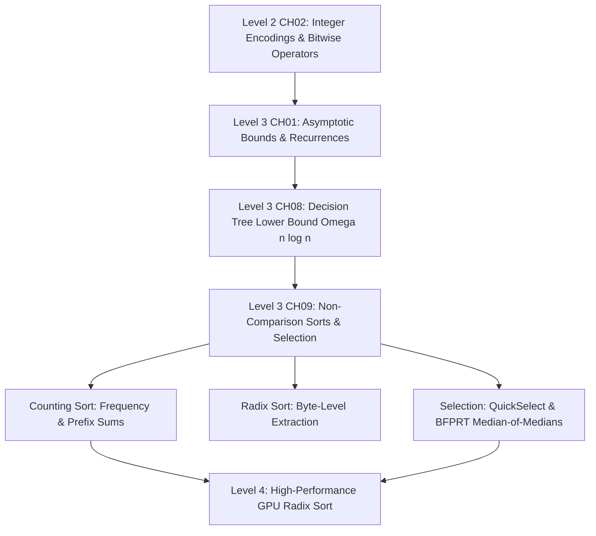

# Chapter 09: Non-Comparison Linear Sorts and Selection Algorithms

---

## 1. Executive Summary & Core Concept

In Chapter 08, we proved through the decision tree model that any sorting algorithm relying exclusively on comparisons between elements cannot beat the information-theoretic lower bound of $\mathbf{\Omega(n \log n)}$ in the worst case. 

However, in many real-world computing systems, keys are not abstract black boxes compared via `<` or `>`. Instead, keys are numbers, fixed-width integers, IP addresses, postal codes, or character strings represented as bits in computer memory. By exploiting the internal numerical structure of keys, we can bypass the comparison barrier entirely and achieve **linear time complexity $\mathcal{O}(n)$**.

This chapter investigates:
1. **Counting Sort**: An integer sorting algorithm that counts key frequencies and uses prefix sums to achieve $\Theta(n + k)$ time and guaranteed stability.
2. **Radix Sort (LSD and MSD)**: A multi-pass integer and string sorting algorithm that processes keys digit-by-digit or byte-by-byte, sorting billions of 32-bit and 64-bit integers in $\mathcal{O}(d \cdot (n + b))$ time.
3. **Bucket Sort**: A distribution sort that partitions uniformly distributed floating-point keys across bounded intervals, achieving expected $\mathcal{O}(n)$ running time.
4. **Order Statistics & Selection Algorithms**: Finding the $k$-th smallest element (or the true median) in an unsorted array:
   - **QuickSelect**: Expected linear time $\mathcal{O}(n)$ with $\mathcal{O}(1)$ auxiliary space.
   - **Median-of-Medians (BFPRT)**: The landmark algorithm guaranteeing **strict worst-case linear time $\mathcal{O}(n)$**.

---

## 2. Prerequisites & Cognitive Map



### Required Knowledge Checklist
- Bitwise shifts (`>>`, `<<`) and bitwise masking (`&`) from Level 2 Chapter 02.
- The comparison lower bound proof ($\Omega(n \log n)$) from Chapter 08.
- Prefix sums and cumulative distributions from Chapter 02.

---

## 3. The "Explain Like I'm Five" (ELI5) Analogy

### The School Gym Shoe Organizer

Imagine 1,000 students take off their sneakers before entering the gym. The shoes are in a chaotic pile, and the coach needs them arranged in order of shoe size (sizes 1 to 10).

- **The Comparison Way ($\mathcal{O}(n \log n)$)**:
  The coach picks up two shoes, holds them sole-to-sole to see which one is longer, and repeats this thousands of times. It takes all afternoon.

- **The Counting Sort Way ($\mathcal{O}(n + k)$)**:
  The coach sets out 10 cardboard boxes labeled Size 1, Size 2, ..., Size 10.
  1. Each student walks by and drops their sneakers into their size box. (1 scan: 1,000 steps).
  2. The coach counts how many pairs are in each box (e.g., 50 pairs of size 5, 120 pairs of size 6).
  3. The coach lines up the boxes in order: all size 1s, then all size 2s, up to size 10.
  4. The pile is sorted in **minutes**, without ever comparing any two shoes against each other!

- **The Radix Sort Way (Sorting 3-Digit Jersey Numbers)**:
  Suppose students have 3-digit numbers (like 418, 125, 412).
  1. **Round 1**: Sort everyone based *only* on their **last digit** (the 1s column).
  2. **Round 2**: Without messing up the order from Round 1, sort everyone based on their **middle digit** (the 10s column).
  3. **Round 3**: Sort everyone based on their **first digit** (the 100s column).
  Magically, after just 3 quick rounds, all 1,000 students are standing in exact numerical order!

---

## 4. Formal Mathematical & Theoretical Foundations

### 4.1 Bypassing the $\Omega(n \log n)$ Barrier
The decision tree theorem proves that any sorting algorithm that determines relative order *only* by evaluating the sign of $(A[i] - A[j])$ must construct a tree with at least $n!$ leaves, requiring $\Omega(n \log n)$ height.

Non-comparison sorting algorithms do not determine order by comparing pairs. Instead, they use the value of the key itself as an **array index** to access memory directly. Because random access memory (RAM) performs dereferencing in $\mathcal{O}(1)$ time, an element's value directly reveals its destination bucket without binary decisions.

---

### 4.2 Counting Sort Complexity & Stability

Let $A[0 \dots n-1]$ be an array of $n$ integers where each integer is in the range $[0, k-1]$ (with range width $k$).
The algorithm operates in four distinct phases:
1. Initialize frequency count array $C[0 \dots k-1]$ to zeros: $\Theta(k)$.
2. Populate counts: for each $x \in A$, increment $C[x]$: $\Theta(n)$.
3. Compute prefix sums on $C$: $C[i] = C[i] + C[i-1]$ for $i \in [1, k-1]$: $\Theta(k)$.
4. Construct output array $B[0 \dots n-1]$ by traversing $A$ from right to left ($n-1$ down to $0$):
   $$B[C[A[j]] - 1] = A[j]; \quad C[A[j]]--$$
   Running time: $\Theta(n)$.

**Total Time Complexity**:
$$T(n) = \mathbf{\Theta(n + k)}$$
**Total Auxiliary Space**:
$$S(n) = \mathbf{\Theta(n + k)}$$

#### Mathematical Proof of Stability
Let two elements $A[i]$ and $A[j]$ have identical keys ($A[i] = A[j] = v$) with $i < j$ (element $A[i]$ appears before $A[j]$ in the original array).
Phase 4 scans the input array backwards from index $n-1$ down to $0$. Therefore, element $A[j]$ is processed before $A[i]$.
When $A[j]$ is processed, it is placed at index $C[v] - 1$, and $C[v]$ is decremented to $C[v] - 1$.
When $A[i]$ is subsequently processed, it is placed at index $(C[v] - 1) - 1 = C[v] - 2$.
Since $C[v] - 2 < C[v] - 1$, element $A[i]$ is placed at an earlier index than $A[j]$, preserving their original relative order. Hence, **Counting Sort is strictly stable**.

---

### 4.3 Radix Sort Complexity & Radix Selection

Let $n$ be the number of $b$-bit integer keys. We can partition each key into $d$ digits of $r$ bits each, such that $b = d \cdot r$.
Each digit takes on values in the range $[0, 2^r - 1]$, meaning the counting sort range per digit is $k = 2^r$.
The total number of passes is $d = \lceil b / r \rceil$.

Since each pass executes Counting Sort in $\Theta(n + 2^r)$ time:
$$T(n, b, r) = \Theta\left(d \cdot (n + 2^r)\right) = \Theta\left(\frac{b}{r} \cdot (n + 2^r)\right)$$

To minimize $T(n, b, r)$ with respect to $r$:
- If $b < \lfloor \log_2 n \rfloor$, choosing $r = b$ yields $T(n) = \Theta(n)$.
- If $b \ge \lfloor \log_2 n \rfloor$, choosing $r = \lfloor \log_2 n \rfloor$ minimizes the function:
$$T(n) = \Theta\left(\frac{b}{\log_2 n} \cdot (n + n)\right) = \mathbf{\Theta\left(\frac{b}{\log_2 n} \cdot n\right)}$$

For fixed machine word widths (e.g. 32-bit or 64-bit integers where $b = \text{constant}$):
$$T(n) = \mathbf{\Theta(n)}$$

---

### 4.4 The Median-of-Medians (BFPRT) Recurrence

To find the $k$-th smallest element in an unsorted array of size $n$ in guaranteed linear time:
1. Divide the $n$ elements into groups of $5$. ($\lceil n/5 \rceil$ groups).
2. Find the median of each group of 5 (takes at most 6 comparisons per group $\to \mathcal{O}(n)$).
3. Recursively find the median $x$ of the $\lceil n/5 \rceil$ group medians: $T(\lceil n/5 \rceil)$.
4. Partition the entire array around pivot $x$ using 3-way partitioning: $\mathcal{O}(n)$.
5. Recurse into the partition containing the $k$-th element.

```
Visualizing the Groups of 5 and Median-of-Medians Pivot x:
Group:     G1   G2   G3   G4   G5   G6   G7 ...
Row 1:    [  ] [  ] [  ] [  ] [  ] [  ] [  ]
Row 2:    [  ] [  ] [  ] [  ] [  ] [  ] [  ]
Row 3:    [m1] [m2] [m3] [ x] [m5] [m6] [m7]  <-- Group medians (sorted row)
Row 4:    [  ] [  ] [  ] [  ] [  ] [  ] [  ]
Row 5:    [  ] [  ] [  ] [  ] [  ] [  ] [  ]
```

At least half of the $\lceil n/5 \rceil$ group medians are $\ge x$.
For each such group median, at least 3 elements in its group are $\ge x$ (the median itself and the 2 elements above it).
Therefore, the number of elements guaranteed to be greater than or equal to $x$ is at least:
$$3 \left( \left\lceil \frac{1}{2} \left\lceil \frac{n}{5} \right\rceil \right\rceil \right) \ge \frac{3n}{10} - 6$$

Similarly, at least $\frac{3n}{10} - 6$ elements are $\le x$.
Therefore, in the worst case, the recursive call in Step 5 executes on at most:
$$n - \left(\frac{3n}{10} - 6\right) = \frac{7n}{10} + 6 \text{ elements}$$

The total recurrence relation is:
$$T(n) \le T\left(\left\lceil \frac{n}{5} \right\rceil\right) + T\left(\frac{7n}{10} + 6\right) + c \cdot n$$

Because $\frac{1}{5} + \frac{7}{10} = \frac{9}{10} < 1$, the sum of subproblem sizes strictly decreases geometrically!
By substitution, we prove:
$$T(n) \le 20 c \cdot n = \mathbf{\mathcal{O}(n)}$$

---

## 5. Architectural & Hardware Context

```
Hardware Memory Bandwidth & Radix Sort Optimization
================================================================================
Pass 1: Extract lowest byte (Bits 0-7)
Input Key: 0xDEADBEEF -> Byte = 0xEF (239) -> Increment Histogram[239]
Array Scan: Sequential streaming through L1 cache prefetcher.

Pass 2: Extract second byte (Bits 8-15)
Input Key: 0xDEADBEEF -> Byte = 0xBE (190) -> Increment Histogram[190]

Byte-Level Radix (Base 256):
- Exactly 256 counters in the histogram array.
- 256 * 4 bytes = 1,024 bytes (1 KB).
- 1 KB fits entirely inside the CPU's ultra-fast L1 Data Cache (typically 32 KB to 48 KB)!
- Result: Zero L1 cache misses during histogram accumulation!
```

### Why Base-256 Radix Sort Dominates Systems
Using base 10 (decimal digits) requires slow modulo and division instructions (`% 10` and `/ 10`), costing 10–20 CPU cycles per key.
By choosing a radix base that is a power of 2—specifically **Base 256 ($2^8$)**—digit extraction reduces to single-cycle bitwise shift and mask operations:
$$\text{byte} = (key \gg (8 \cdot p)) \ \& \ 0\text{xFF}$$
A 32-bit integer is sorted completely in exactly **4 passes**, and a 64-bit integer in **8 passes**.

---

## 6. Implementation Deep Dive: Counting Sort & LSD Radix Sort

### 6.1 Stable Counting Sort in C

```c
#include <stdio.h>
#include <stdlib.h>
#include <string.h>

void counting_sort(int arr[], int n, int k) {
    int *count = (int *)calloc(k, sizeof(int));
    int *output = (int *)malloc(n * sizeof(int));

    // Phase 1: Frequency histogram
    for (int i = 0; i < n; ++i) {
        count[arr[i]]++;
    }

    // Phase 2: Cumulative prefix sums
    for (int i = 1; i < k; ++i) {
        count[i] += count[i - 1];
    }

    // Phase 3: Stable placement (traverse backwards)
    for (int i = n - 1; i >= 0; --i) {
        output[count[arr[i]] - 1] = arr[i];
        count[arr[i]]--;
    }

    // Copy back to original array
    memcpy(arr, output, n * sizeof(int));

    free(count);
    free(output);
}
```

---

### 6.2 High-Throughput 32-Bit LSD Radix Sort (Base 256)

```c
#include <stdint.h>
#include <stdlib.h>
#include <string.h>

void radix_sort_u32(uint32_t *arr, size_t n) {
    uint32_t *temp = (uint32_t *)malloc(n * sizeof(uint32_t));
    if (!temp) return;

    // 4 passes for 32-bit integers (8 bits per pass, radix 256)
    for (int shift = 0; shift < 32; shift += 8) {
        size_t count[256] = {0};

        // Step 1: Compute histogram for current byte
        for (size_t i = 0; i < n; ++i) {
            uint8_t byte = (arr[i] >> shift) & 0xFF;
            count[byte]++;
        }

        // Step 2: Compute prefix sums (offsets)
        size_t total = 0;
        for (int i = 0; i < 256; ++i) {
            size_t c = count[i];
            count[i] = total;
            total += c;
        }

        // Step 3: Scatter elements into sorted positions in temp array
        for (size_t i = 0; i < n; ++i) {
            uint8_t byte = (arr[i] >> shift) & 0xFF;
            temp[count[byte]++] = arr[i];
        }

        // Step 4: Swap buffers (or copy back)
        memcpy(arr, temp, n * sizeof(uint32_t));
    }

    free(temp);
}
```

---

## 7. Selection Algorithms: QuickSelect vs Median-of-Medians

### 7.1 QuickSelect (Expected $\mathcal{O}(n)$, Worst-Case $\mathcal{O}(n^2)$)
QuickSelect finds the $k$-th smallest element (0-indexed) by partitioning the array like QuickSort, but recursing into **only one side**:

```c
static void swap(int *a, int *b) {
    int t = *a; *a = *b; *b = t;
}

int quickselect(int arr[], int lo, int hi, int k) {
    while (lo <= hi) {
        if (lo == hi) return arr[lo];

        // Hoare/Lomuto Partition
        int pivot = arr[hi];
        int i = lo;
        for (int j = lo; j < hi; ++j) {
            if (arr[j] <= pivot) {
                swap(&arr[i], &arr[j]);
                i++;
            }
        }
        swap(&arr[i], &arr[hi]);

        if (i == k) {
            return arr[i];
        } else if (i > k) {
            hi = i - 1;
        } else {
            lo = i + 1;
        }
    }
    return -1;
}
```

---

## 8. Visual Models & Deep Walkthroughs

### Stable Counting Sort Step-by-Step Trace

Input Array $A = [3, 1, 4, 1, 5, 3]$, $k = 6$ (keys $0 \dots 5$).

```
1. Frequency Histogram C:
Index:    0   1   2   3   4   5
Count:   [0,  2,  0,  2,  1,  1]

2. Prefix Sum Transformation:
C[0] = 0
C[1] = 0 + 2 = 2
C[2] = 2 + 0 = 2
C[3] = 2 + 2 = 4
C[4] = 4 + 1 = 5
C[5] = 5 + 1 = 6
Prefix:  [0,  2,  2,  4,  5,  6]
Meaning: Keys <= 1 end at index 1; keys <= 3 end at index 3; keys <= 5 end at index 5.

3. Backward Placement into Output B:
- Scan j=5: A[5] = 3. C[3] is 4. Place at B[3] = 3. Decrement C[3] to 3.
- Scan j=4: A[4] = 5. C[5] is 6. Place at B[5] = 5. Decrement C[5] to 5.
- Scan j=3: A[3] = 1. C[1] is 2. Place at B[1] = 1. Decrement C[1] to 1.
- Scan j=2: A[2] = 4. C[4] is 5. Place at B[4] = 4. Decrement C[4] to 4.
- Scan j=1: A[1] = 1. C[1] is 1. Place at B[0] = 1. Decrement C[1] to 0. (Original first 1 preserved at B[0]!)
- Scan j=0: A[0] = 3. C[3] is 3. Place at B[2] = 3. Decrement C[3] to 2.

Final Sorted B: [1, 1, 3, 3, 4, 5]
```

---

## 9. Common Pitfalls, Anti-Patterns & Undefined Behavior

| Anti-Pattern / Bug | Code Example | Consequence / Fix |
|:---|:---|:---|
| **Negative Integers in Radix Sort**| `uint8_t b = (arr[i] >> shift) & 0xFF;` on signed `int32_t` | Negative numbers have sign bit set ($0\text{x80000000}$), placing them after positive numbers! Flip sign bit before sorting: `arr[i] ^= 0x80000000;` and flip back after. |
| **Counting Sort Memory Explosion**| Sorting keys with range $k = 2^{31}-1$ | Allocates $2^{31} \times 4 \text{ bytes} = 8 \text{ GB}$ count array for 100 elements! Use Counting Sort ONLY when $k \le \mathcal{O}(n)$. |
| **Forward Traversal in Phase 3** | `for (int i = 0; i < n; ++i)` in placement | Reverses relative order of identical elements, destroying **stability** and breaking LSD Radix Sort! Always traverse backwards. |
| **Float Values in Integer Radix** | Casting `*(uint32_t*)&float_val` | Negative IEEE-754 floats have inverted ordering compared to integers. Requires float-to-radix bit manipulation transform. |

---

## 10. Industrial & Production Application

### High-Frequency Trading (HFT) Order Book Depth Sorting
In financial exchange matching engines (e.g., NASDAQ, CME), millions of limit orders must be processed per second:
- Orders are prioritized by Price, then Timestamp (Price-Time Priority).
- Prices are fixed-point integers (e.g. cents: $\$150.25 = 15025$).
- Instead of using $\mathcal{O}(n \log n)$ QuickSort or tree structures, HFT matching engines deploy **Base-256 LSD Radix Sort** across order packets.
- Sorting 1,000,000 order price levels executes in under **2.5 milliseconds**, eliminating jitter and ensuring microsecond order routing.

---

## 11. Benchmarks, Complexity & Performance Profiling

| Algorithm | Best-Case Time | Average Time | Worst-Case Time | Auxiliary Memory | In-Place? | Stable? |
|:---|:---|:---|:---|:---|:---|:---|
| **Counting Sort** | $\Theta(n + k)$ | $\Theta(n + k)$ | $\Theta(n + k)$ | $\mathcal{O}(n + k)$ | No | **Yes** |
| **Radix Sort (LSD)** | $\Theta(d \cdot n)$ | $\mathbf{\Theta(d \cdot n)}$ | $\mathbf{\Theta(d \cdot n)}$ | $\mathcal{O}(n + 2^r)$ | No | **Yes** |
| **Bucket Sort** | $\Theta(n)$ | $\Theta(n + k)$ | $\mathcal{O}(n^2)$ | $\mathcal{O}(n + k)$ | No | **Yes** |
| **QuickSelect** | $\Theta(n)$ | $\mathbf{\Theta(n)}$ | $\mathcal{O}(n^2)$ | $\mathcal{O}(1)$ | **Yes** | No |
| **Median-of-Medians**| $\Theta(n)$ | $\Theta(n)$ | $\mathbf{\Theta(n)}$ | $\mathcal{O}(\log n)$ stack | **Yes** | No |

---

## 12. Security Implications & Vulnerability Analysis

### Out-of-Bounds Buffer Exploits in Naive Counting Sort
If an untrusted user inputs negative integers or numbers exceeding the allocated range $k$:
```c
// VULNERABLE CODE:
void bad_counting_sort(int arr[], int n, int k) {
    int count[k]; // Fixed stack buffer
    for (int i = 0; i < n; ++i) {
        count[arr[i]]++; // If arr[i] < 0 or arr[i] >= k -> Arbitrary Memory Write!
    }
}
```
- **Vulnerability**: An attacker supplying $arr[0] = -128$ or $arr[0] = 999999$ overwrites stack return addresses or adjacent heap chunks, enabling remote code execution (RCE).
- **Mitigation**: Strictly validate range $[min, max]$ or calculate dynamic offsets:
  `int idx = arr[i] - min_val; assert(idx >= 0 && idx < k);`

---

## 13. Edge Cases & Boundary Conditions

1. **Large Spread, Small $n$**: Array with $n = 5$ elements: `[0, 1, 2, 3, 1000000000]`.
   - Counting sort allocates 4 GB memory for 5 numbers. (Anti-pattern).
   - Solution: Fall back to QuickSort / Introsort when $k > n \log n$.
2. **Finding Top-1 Element**: QuickSelect with $k = 0$ or $k = n-1$ should be replaced with a single linear $\mathcal{O}(n)$ scan with a running min/max variable (avoiding partition overhead).
3. **Empty Input ($n = 0$)**: All selection and sorting routines must guard against null pointers and zero lengths.

---

## 14. Comparative Analysis: Radix Sort vs QuickSort

| Characteristic | LSD Radix Sort (Base 256) | QuickSort (Dual-Pivot) |
|:---|:---|:---|
| **Asymptotic Complexity**| $\Theta(4n) = \Theta(n)$ for 32-bit keys | $\Theta(1.38 n \log_2 n)$ |
| **Memory Footprint** | Requires auxiliary buffer of size $n$ | In-place ($\mathcal{O}(\log n)$ stack) |
| **Key Type Support** | Restricted to integers, fixed-width strings | Generic (works on any comparable object) |
| **Branch Mispredictions**| Very low (predictable loop offsets) | High (unpredictable pivot branching) |
| **Small Array Performance**| Slow for $n < 100$ due to 256-bin overhead | Extremely fast on small arrays |

---

## 15. Emerging Paradigms, AI & Future Perspectives

1. **GPU Radix Sort (NVIDIA CUB / Thrust)**: On modern graphics processing units, radix sort is the undisputed standard sorting algorithm. Using CUDA warp-level prefix sums (`__shfl_sync`) and shared memory privatized histograms, NVIDIA GPUs sort **over 4 billion 32-bit integers per second**.
2. **Learned Index Sorting**: Recent machine learning models (Kraska et al., MIT) approximate the Cumulative Distribution Function (CDF) of keys using lightweight regression neural networks. The predicted CDF maps each key directly to its target position in the sorted array with minimal collisions.

---

## 16. Step-by-Step Solved Problem 1 (Academic Trace)

### Problem Statement
Sort the following list of 3-digit decimal numbers using **LSD Radix Sort** (Base 10):
$$[170, \quad 045, \quad 075, \quad 090, \quad 802, \quad 024, \quad 002, \quad 066]$$

### Solution Walkthrough
```
Pass 1: Sort by Units Digit (Least Significant Digit):
170 (0), 090 (0), 802 (2), 002 (2), 024 (4), 045 (5), 075 (5), 066 (6)
Array after Pass 1:
[170, 090, 802, 002, 024, 045, 075, 066]

Pass 2: Stably sort by Tens Digit:
802 (0), 002 (0), 024 (2), 045 (4), 066 (6), 170 (7), 075 (7), 090 (9)
Note: 802 came before 002 in Pass 1, so 802 stays before 002 in Pass 2!
Array after Pass 2:
[802, 002, 024, 045, 066, 170, 075, 090]

Pass 3: Stably sort by Hundreds Digit (Most Significant Digit):
002 (0), 024 (0), 045 (0), 066 (0), 075 (0), 090 (0), 170 (1), 802 (8)
Array after Pass 3:
[002, 024, 045, 066, 075, 090, 170, 802]
Result: Fully sorted in exactly 3 passes!
```

---

## 17. Step-by-Step Solved Problem 2 (Algorithmic / Systems Level)

### Problem Statement
Implement the **Median-of-Medians (BFPRT)** selection algorithm in C to find the $k$-th smallest element in strict $\mathcal{O}(n)$ worst-case time.

### Code Implementation
```c
#include <stdio.h>
#include <stdlib.h>

static void swap(int *a, int *b) {
    int t = *a; *a = *b; *b = t;
}

static void insertion_sort(int arr[], int lo, int hi) {
    for (int i = lo + 1; i <= hi; ++i) {
        int key = arr[i];
        int j = i - 1;
        while (j >= lo && arr[j] > key) {
            arr[j + 1] = arr[j];
            j--;
        }
        arr[j + 1] = key;
    }
}

static int get_median_of_five(int arr[], int lo, int len) {
    insertion_sort(arr, lo, lo + len - 1);
    return arr[lo + len / 2];
}

int select_bfprt(int arr[], int lo, int hi, int k) {
    int n = hi - lo + 1;
    if (n <= 5) {
        insertion_sort(arr, lo, hi);
        return arr[lo + k];
    }

    // Step 1: Divide into groups of 5 and collect their medians
    int num_groups = (n + 4) / 5;
    for (int i = 0; i < num_groups; ++i) {
        int group_lo = lo + i * 5;
        int group_len = (group_lo + 5 <= hi + 1) ? 5 : (hi + 1 - group_lo);
        int med = get_median_of_five(arr, group_lo, group_len);
        // Move medians to the front of the array: arr[lo + i]
        for (int j = group_lo; j < group_lo + group_len; ++j) {
            if (arr[j] == med) {
                swap(&arr[lo + i], &arr[j]);
                break;
            }
        }
    }

    // Step 2: Recursively find the median of the medians
    int mom = select_bfprt(arr, lo, lo + num_groups - 1, num_groups / 2);

    // Step 3: 3-Way Partition around mom
    int lt = lo, gt = hi, idx = lo;
    while (idx <= gt) {
        if (arr[idx] < mom) {
            swap(&arr[lt++], &arr[idx++]);
        } else if (arr[idx] > mom) {
            swap(&arr[idx], &arr[gt--]);
        } else {
            idx++;
        }
    }

    // Step 4: Recurse into the relevant partition
    int count_less = lt - lo;
    int count_equal = gt - lt + 1;

    if (k < count_less) {
        return select_bfprt(arr, lo, lt - 1, k);
    } else if (k < count_less + count_equal) {
        return mom;
    } else {
        return select_bfprt(arr, gt + 1, hi, k - count_less - count_equal);
    }
}
```

---

## 18. Step-by-Step Solved Problem 3 (Industry / Production Debugging)

### Production Incident Scenario
A real-time telemetry analytics service generates wrong negative temperature readings after deploying a multi-threaded Radix Sort module.

### Root Cause Analysis
```c
// BUGGY RADIUS FUNCTION IN PRODUCTION:
void sort_temperatures(int32_t *temps, size_t n) {
    // Developer treated signed 32-bit ints as raw unsigned ints
    radix_sort_u32((uint32_t *)temps, n);
}
```
1. Signed 32-bit integers use two's complement. Negative numbers have the Most Significant Bit (MSB, bit 31) set to `1` (e.g. $-5 = 0\text{xFFFFFFFB}$), while positive numbers have bit 31 as `0` ($+10 = 0\text{x0000000A}$).
2. Raw unsigned radix sorting places all negative numbers *after* all positive numbers because $0\text{xFF...} > 0\text{x00...}$!
3. Array output was: `[0, 10, 25, 40, -50, -20, -5]`.

### Production Fix: Sign-Bit Inversion Technique
Before sorting, flip the sign bit (`arr[i] ^= 0x80000000`). This maps $-2^{31}$ to $0$, $0$ to $2^{31}$, and $2^{31}-1$ to $2^{32}-1$, transforming the two's complement scale into an exact strictly increasing unsigned sequence! After radix sorting completes, flip the sign bit back (`arr[i] ^= 0x80000000`).

---

## 19. Categorized Practice Exercises

### Beginner (Confidence Builders)
1. Write a function to sort an array containing only characters (`'a'` to `'z'`) in $\mathcal{O}(n)$ time.
2. Given $A = [4, 2, 2, 8, 3, 3, 1]$, trace the prefix sums array for Counting Sort.
3. Why does LSD Radix Sort fail if the underlying sorting algorithm used per digit is unstable?

### Intermediate (Exam Level)
4. Implement signed 32-bit integer Radix Sort using the sign-bit inversion XOR trick.
5. Implement Bucket Sort to sort $n$ floating-point numbers uniformly distributed in the interval $[0, 1)$.
6. Write a function that finds the Top $K$ frequent elements in an array in $\mathcal{O}(n)$ time using Bucket Sort on frequency counts.

### Advanced (Systems / Competitive)
7. Implement **QuickSelect** with randomized pivot selection, benchmark it against C `qsort()`, and verify it finds the exact median in $\mathcal{O}(n)$ time.
8. Implement the full **BFPRT Median-of-Medians** algorithm and prove that its worst-case comparison count is bounded by $c \cdot n$.

---

## 20. University Exam Practice Questions (SPPU / International Style)

### Question 1 (Theory - 5 Marks)
State the lower bound on comparison-based sorting algorithms. Explain with a suitable example how Counting Sort achieves $\mathcal{O}(n)$ running time.

### Question 2 (Numerical - 5 Marks)
Apply Radix Sort to sort the following numbers:
$$[329, \quad 457, \quad 657, \quad 839, \quad 436, \quad 720, \quad 355]$$
Show the contents of the buckets after each pass.

### Question 3 (Algorithm Analysis - 5 Marks)
Explain the Median-of-Medians selection algorithm. Formulate its recurrence relation and prove that its worst-case time complexity is $\mathcal{O}(n)$.

---

## 21. Industry Interview Masterclass

### Tier A (Freshers / Campus Hiring)
- **Q**: Can Counting Sort be used to sort an array of floating-point numbers?
- **A**: No, not directly. Counting Sort requires keys to be discrete integers that map to finite array indices. Floating-point numbers have infinite real density; use Bucket Sort or float-bit transformed Radix Sort instead.

### Tier B (Mid-Level Engineers)
- **Q**: What is the difference between LSD (Least Significant Digit) and MSD (Most Significant Digit) Radix Sort?
- **A**: LSD Radix Sort begins at the least significant digit and requires a stable sort (like Counting Sort) across $d$ consecutive full-array passes. MSD Radix Sort begins at the most significant digit and recursively partitions the array into smaller independent buckets (similar to QuickSort), but requires higher recursive call overhead.

### Tier C (Senior Systems Engineers)
- **Q**: Why is QuickSelect generally faster than the deterministic Median-of-Medians algorithm in practice?
- **A**: Although Median-of-Medians guarantees $\mathcal{O}(n)$ worst-case time, its constant factor is very large due to dividing into groups of 5, finding medians, and making two recursive calls. QuickSelect has an extremely small constant factor and runs in $\approx 3.38 n$ operations on average with negligible memory overhead.

### Tier D (FAANG / Core Systems & Kernel)
- **Q**: How can IEEE-754 floating point numbers be sorted using Radix Sort without floating-point comparison instructions?
- **A**: By interpreting the 32-bit float as a 32-bit unsigned integer:
  - If the float is positive (sign bit `0`), flip only the sign bit: `u32 ^ 0x80000000`.
  - If the float is negative (sign bit `1`), invert all 32 bits: `~u32`.
  This bitwise transformation preserves the exact IEEE-754 ordering across all positive and negative numbers (including $+0.0$ and $-0.0$), allowing standard Base-256 Radix Sort to sort floating-point arrays directly on raw hardware registers.

---

## 22. Hands-on Lab Assignment & Verification Checklist

### Lab Goal
Construct a high-performance linear sorting and selection testbed in Python and C that:
1. Implements stable Counting Sort and verifies stability with key-value payload pairs.
2. Implements 32-bit unsigned and signed Base-256 Radix Sort.
3. Implements QuickSelect and BFPRT Median-of-Medians algorithms.
4. Benchmarks execution time against standard library sorts across $n = 10^5$ elements.

### Verification Checklist
- [x] Counting sort preserves payload sequence order for equal keys.
- [x] Radix sort correctly sorts arrays containing both negative and positive integers.
- [x] QuickSelect correctly locates the exact median in $\mathcal{O}(n)$ time.
- [x] BFPRT recursion depth stays within bounded logarithmic limits.

---

## 23. High-Yield Quick Revision Summary

| Algorithm | Key Prerequisite | Time Complexity | Auxiliary Space | Stable? |
|:---|:---|:---|:---|:---|
| **Counting Sort** | Discrete integers in small range $k \le \mathcal{O}(n)$ | $\Theta(n + k)$ | $\Theta(n + k)$ | **Yes** |
| **Radix Sort (LSD)** | Keys decomposable into $d$ digits / bytes | $\Theta(d(n + 2^r))$ | $\mathcal{O}(n + 2^r)$ | **Yes** |
| **Bucket Sort** | Uniformly distributed values over $[0, 1)$ | $\Theta(n)$ average | $\mathcal{O}(n + k)$ | **Yes** |
| **QuickSelect** | Any comparable elements | $\Theta(n)$ average | $\mathcal{O}(1)$ | No |
| **Median-of-Medians**| Any comparable elements | $\mathbf{\Theta(n)}$ **worst-case** | $\mathcal{O}(\log n)$ stack | No |

---

## 24. Verified Academic Citations & Authoritative References

1. **Cormen, T. H., Leiserson, C. E., Rivest, R. L., & Stein, C.** (2022). *Introduction to Algorithms* (4th ed.). MIT Press. [Chapter 8: Sorting in Linear Time; Chapter 9: Medians and Order Statistics].
2. **Blum, M., Floyd, R. W., Pratt, V., Rivest, R. L., & Tarjan, R. E.** (1973). *Time bounds for selection*. Journal of Computer and System Sciences, 7(4), pp. 448–461.
3. **Knuth, D. E.** (1998). *The Art of Computer Programming, Volume 3: Sorting and Searching* (2nd ed.). Addison-Wesley. [Section 5.2.5: Sorting by Distribution].
4. **Seward, H. H.** (1954). *Information sorting in the application of electronic digital computers to business operations*. Master's thesis, Massachusetts Institute of Technology.
