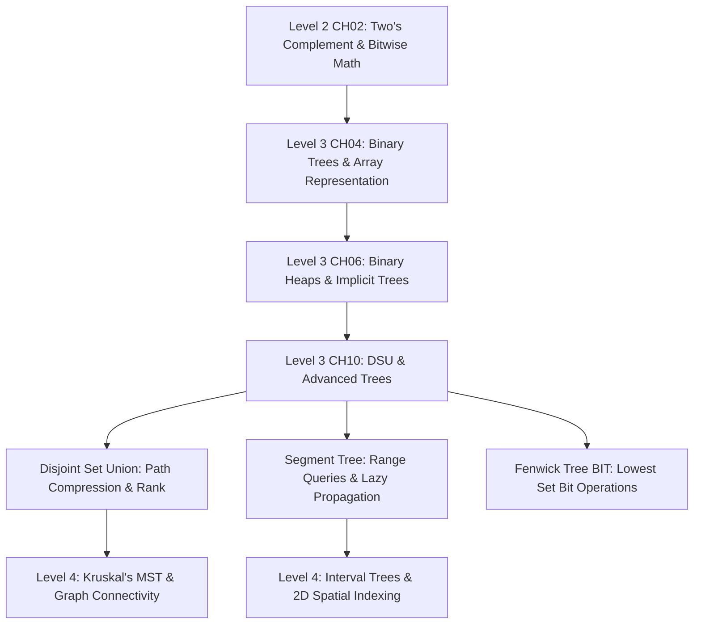

# Chapter 10: Disjoint Set Union (DSU) and Advanced Range Trees

---

## 1. Executive Summary & Core Concept

In many computational domains—including network connectivity analysis, social graph clustering, minimum spanning tree construction, dynamic database indexing, and competitive programming—systems must process millions of queries over dynamically evolving groups or contiguous array intervals. Standard tree or array representations prove either too slow ($\mathcal{O}(n)$ per query) or consume prohibitive memory overhead.

This chapter investigates two essential classes of advanced data structures:
1. **Disjoint Set Union (DSU / Union-Find)**: A specialized data structure maintaining a collection of non-overlapping, partitioned sets over $n$ elements. When equipped with **Path Compression** and **Union by Rank/Size**, DSU executes operations in **nearly constant amortized time $\mathcal{O}(\alpha(n))$**, where $\alpha(n)$ is the Inverse Ackermann Function. For all physical values of $n$ in the universe ($n \le 10^{80}$), $\alpha(n) \le 4$.
2. **Advanced Range Query Trees**:
   - **Segment Trees**: Balanced binary trees storing pre-aggregated associative values (sum, min, max, GCD) over contiguous intervals, providing $\mathcal{O}(\log n)$ range queries and $\mathcal{O}(\log n)$ point updates. With **Lazy Propagation**, range updates also execute in $\mathcal{O}(\log n)$ time.
   - **Fenwick Trees (Binary Indexed Trees - BIT)**: An ingenious, pointerless data structure invented by Peter Fenwick (1994) that uses bitwise two's complement arithmetic (`i & -i`) to perform prefix sum queries and point updates in $\mathcal{O}(\log n)$ time using exactly $n$ integers of memory!

---

## 2. Prerequisites & Cognitive Map



### Required Knowledge Checklist
- Bitwise negation and two's complement arithmetic (`-x = ~x + 1`) from Level 2 Chapter 02.
- Array-based binary tree indexing ($2i, 2i+1, \lfloor i/2 \rfloor$) from Level 3 Chapter 06.
- Asymptotic amortization and inverse functions from Chapter 01.

---

## 3. The "Explain Like I'm Five" (ELI5) Analogy

### 1. DSU: The Royal Kingdom Mergers and The Direct Hotline
Imagine a continent with 1,000 independent villages. Each village starts with its own Village Chief.
- **`find(x)` (Who is your King?)**:
  Village 5 asks: *"Who is our ultimate ruler?"* They follow the messenger chain: Village 5 reports to Village 3, who reports to Village 1. Village 1 is the King!
- **Path Compression (The Direct Hotline)**:
  After traveling all the way from Village 5 to Village 1, the messenger doesn't want to make that long trip ever again. So the King installs a direct telephone wire from Village 1 straight into Village 5! From now on, Village 5 calls the King directly in **1 second**!
- **`union(x, y)` (The Royal Marriage)**:
  If the King of Kingdom A marries the Queen of Kingdom B, they merge kingdoms. Under **Union by Rank**, the smaller kingdom always attaches under the larger kingdom so the collective tree stays shallow!

### 2. Fenwick Tree: The Accountant's Magic Cash Registers
Imagine a row of 8 cash registers in a grocery store. The manager constantly asks: *"How much money did we make from Register 1 to Register 6?"*
- **Naive Array**: You walk to each of the 6 registers and add up their totals. Takes 6 steps. (Slow for 10,000 registers).
- **Prefix Sum Array**: You store cumulative totals. Asking for registers 1–6 is instantaneous ($\mathcal{O}(1)$), but if register 3 earns \$5, you have to update registers 3, 4, 5, 6, 7, 8! Updating takes $\mathcal{O}(n)$.
- **The Fenwick Tree Magic**: Each register keeps a tiny notebook.
  - Odd registers (1, 3, 5, 7) store *only their own money*.
  - Register 2 stores money from (1 to 2).
  - Register 4 stores money from (1 to 4).
  - Register 8 stores money from (1 to 8).
  To find the total for Register 6 ($6 = 4 + 2$ in binary: `110`), you simply add Register 6's notebook + Register 4's notebook! **Just 2 additions!**

---

## 4. Formal Mathematical & Theoretical Foundations

### 4.1 Disjoint Set Union: Tarjan's Inverse Ackermann Bound

Let $S = \{S_1, S_2, \dots, S_k\}$ be a partition of a universe $U$ of $n$ elements.
The two core operations are:
1. $\text{Find}(x)$: Returns the canonical representative element of the unique set containing $x$.
2. $\text{Union}(x, y)$: Replaces the sets containing $x$ and $y$ ($S_x$ and $S_y$) with $S_x \cup S_y$.

#### The Optimizations:
1. **Union by Rank**: Each node maintains an integer $\text{rank}[x]$ (an upper bound on the height of its subtree). When merging trees with roots $r_1$ and $r_2$:
   - If $\text{rank}[r_1] < \text{rank}[r_2]$, set $\text{parent}[r_1] = r_2$.
   - If $\text{rank}[r_1] = \text{rank}[r_2]$, set $\text{parent}[r_1] = r_2$ and increment $\text{rank}[r_2]++$.
2. **Path Compression**: During $\text{Find}(x)$, every traversed node updates its parent directly to the root:
   $$\text{parent}[x] = \text{Find}(\text{parent}[x])$$

#### The Ackermann Function and $\alpha(n)$
The Ackermann function $A(i, j)$ is defined for non-negative integers $i, j$:
$$A(0, j) = j + 1$$
$$A(i, 0) = A(i - 1, 1) \quad (i \ge 1)$$
$$A(i, j) = A(i - 1, A(i, j - 1)) \quad (i, j \ge 1)$$

$A(i, j)$ grows at an astronomical rate:
- $A(1, j) = 2 + (j + 3) - 3 = j + 2$ (Addition)
- $A(2, j) = 2j + 3$ (Multiplication)
- $A(3, j) = 2^{j+3} - 3$ (Exponentiation)
- $A(4, j) = 2^{2^{\dots^2}} - 3$ (Tower of powers of height $j+3$)

The **Inverse Ackermann Function** $\alpha(n)$ is defined as:
$$\alpha(n) = \min \{ i \ge 1 : A(i, 1) \ge n \}$$

Since $A(4, 1) = 2^{16} = 65,536$, and $A(4, 2) = 2^{65536} \gg 10^{80}$ (the estimated number of atoms in the observable universe), for all practical and physical values of $n$:
$$\alpha(n) \le 4$$

#### Tarjan's Theorem (1975)
A sequence of $m$ operations on a Disjoint Set Union structure containing $n$ elements using both Path Compression and Union by Rank takes:
$$T(m, n) = \mathbf{\Theta(m \cdot \alpha(n))}$$
Amortized time per operation is $\mathcal{O}(\alpha(n)) \approx \mathbf{\mathcal{O}(1)}$ for all practical systems.

---

### 4.2 Segment Tree Mathematics & Structure

A Segment Tree over an array $A[0 \dots n-1]$ is a full binary tree where each node represents an interval $[L, R]$:
- The root represents the full interval $[0, n-1]$.
- A node representing $[L, R]$ with $L < R$ has two children:
  - Left child: $[L, \text{mid}]$ where $\text{mid} = \lfloor (L + R) / 2 \rfloor$.
  - Right child: $[\text{mid} + 1, R]$.
- Leaf nodes represent single-element intervals $[i, i]$ storing $A[i]$.

#### Array Size Bound
The height of a segment tree for $n$ elements is $\lceil \log_2 n \rceil$.
The maximum number of nodes in the tree is bounded by:
$$N_{\text{nodes}} \le 2^{\lceil \log_2 n \rceil + 1} - 1 < 4n$$
Hence, an array of size **$4n$** is always sufficient to store any segment tree.

---

### 4.3 Fenwick Tree (Binary Indexed Tree) Bitwise Mechanics

Let $A[1 \dots n]$ be a 1-indexed array. The Fenwick tree array $T[1 \dots n]$ stores partial prefix sums.
Each index $i$ is responsible for the range $(i - \text{LSB}(i), i]$, where $\text{LSB}(i)$ is the **Least Significant Bit** of $i$.

Using Two's Complement representation, the LSB is extracted in **one CPU instruction**:
$$\text{LSB}(i) = i \ \& \ (-i)$$

```
Visualizing LSB Ranges:
Index i:    Binary:    LSB(i):    Interval Covered:
1           0001       1          [1, 1]
2           0010       2          [1, 2]
3           0011       1          [3, 3]
4           0100       4          [1, 4]
5           0101       1          [5, 5]
6           0110       2          [5, 6]
7           0111       1          [7, 7]
8           1000       8          [1, 8]
```

- **Prefix Sum Query $\text{Query}(i)$**: Accumulates $T[i]$, then strips the lowest bit ($i = i - (i \ \& \ -i)$) until $i = 0$.
  Takes at most $\lfloor \log_2 n \rfloor$ iterations.
- **Point Update $\text{Add}(i, \delta)$**: Adds $\delta$ to $T[i]$, then adds the lowest bit ($i = i + (i \ \& \ -i)$) to update all parent ranges up to $n$.
  Takes at most $\lfloor \log_2 n \rfloor$ iterations.

---

## 5. Architectural & Hardware Context

```
Memory Architecture Comparison: Segment Tree vs Fenwick Tree vs Pointers
================================================================================
Segment Tree (4n Array):
For n = 1,000,000 ints (4 MB raw data):
Requires 4 * 1,000,000 = 4,000,000 integers = 16 MB memory.
Child lookups: 2*i and 2*i+1 jump across non-contiguous array cache lines.

Fenwick Tree (n Array):
For n = 1,000,000 ints:
Requires EXACTLY 1,000,000 integers = 4 MB memory! Zero wasted padding.
All traversal done via bitwise math directly in CPU ALUs (0 memory pointer dereferences).

Pointer-based Trees:
Each node: [Left * | Right * | Value | RangeL | RangeR] = 32 bytes.
Total = 32 MB to 64 MB heap allocations + DRAM pointer chasing.
```

---

## 6. Implementation Deep Dive: DSU, Segment Tree, and Fenwick Tree

### 6.1 Production Disjoint Set Union with Rank and Path Compression

```c
#include <stdio.h>
#include <stdlib.h>
#include <stdbool.h>

typedef struct {
    int *parent;
    int *rank;
    size_t count; // Number of connected components
} DSU;

DSU* dsu_create(size_t n) {
    DSU *dsu = (DSU *)malloc(sizeof(DSU));
    dsu->parent = (int *)malloc(n * sizeof(int));
    dsu->rank = (int *)calloc(n, sizeof(int));
    dsu->count = n;
    for (size_t i = 0; i < n; ++i) {
        dsu->parent[i] = (int)i;
    }
    return dsu;
}

int dsu_find(DSU *dsu, int x) {
    // Path Compression: directly link to representative root
    if (dsu->parent[x] != x) {
        dsu->parent[x] = dsu_find(dsu, dsu->parent[x]);
    }
    return dsu->parent[x];
}

bool dsu_union(DSU *dsu, int x, int y) {
    int root_x = dsu_find(dsu, x);
    int root_y = dsu_find(dsu, y);

    if (root_x == root_y) return false; // Already in the same set

    // Union by Rank: attach smaller tree under larger root
    if (dsu->rank[root_x] < dsu->rank[root_y]) {
        dsu->parent[root_x] = root_y;
    } else if (dsu->rank[root_x] > dsu->rank[root_y]) {
        dsu->parent[root_y] = root_x;
    } else {
        dsu->parent[root_y] = root_x;
        dsu->rank[root_x]++;
    }
    dsu->count--;
    return true;
}

void dsu_free(DSU *dsu) {
    free(dsu->parent);
    free(dsu->rank);
    free(dsu);
}
```

---

### 6.2 Fenwick Tree (Binary Indexed Tree) in C

```c
#include <stdio.h>
#include <stdlib.h>

typedef struct {
    long long *tree;
    size_t size;
} FenwickTree;

FenwickTree* bit_create(size_t n) {
    FenwickTree *bit = (FenwickTree *)malloc(sizeof(FenwickTree));
    bit->size = n;
    bit->tree = (long long *)calloc(n + 1, sizeof(long long)); // 1-indexed
    return bit;
}

// Point update: add delta to element at 1-based index i
void bit_add(FenwickTree *bit, size_t i, long long delta) {
    for (; i <= bit->size; i += (i & -i)) {
        bit->tree[i] += delta;
    }
}

// Prefix sum query: sum of elements from 1 to i
long long bit_query(FenwickTree *bit, size_t i) {
    long long sum = 0;
    for (; i > 0; i -= (i & -i)) {
        sum += bit->tree[i];
    }
    return sum;
}

// Range sum query: sum of elements in interval [L, R]
long long bit_range_query(FenwickTree *bit, size_t L, size_t R) {
    if (L > R) return 0;
    return bit_query(bit, R) - bit_query(bit, L - 1);
}

void bit_free(FenwickTree *bit) {
    free(bit->tree);
    free(bit);
}
```

---

### 6.3 Segment Tree with Point Update and Range Minimum Query (RMQ)

```c
#include <stdio.h>
#include <stdlib.h>
#include <limits.h>

typedef struct {
    int *tree;
    size_t n;
} SegmentTree;

static int min(int a, int b) { return a < b ? a : b; }

static void build(SegmentTree *st, int arr[], size_t node, size_t l, size_t r) {
    if (l == r) {
        st->tree[node] = arr[l];
        return;
    }
    size_t mid = l + (r - l) / 2;
    build(st, arr, 2 * node, l, mid);
    build(st, arr, 2 * node + 1, mid + 1, r);
    st->tree[node] = min(st->tree[2 * node], st->tree[2 * node + 1]);
}

SegmentTree* st_create(int arr[], size_t n) {
    SegmentTree *st = (SegmentTree *)malloc(sizeof(SegmentTree));
    st->n = n;
    st->tree = (int *)malloc(4 * n * sizeof(int));
    build(st, arr, 1, 0, n - 1);
    return st;
}

static void update_point(SegmentTree *st, size_t node, size_t l, size_t r, size_t idx, int val) {
    if (l == r) {
        st->tree[node] = val;
        return;
    }
    size_t mid = l + (r - l) / 2;
    if (idx <= mid)
        update_point(st, 2 * node, l, mid, idx, val);
    else
        update_point(st, 2 * node + 1, mid + 1, r, idx, val);
    st->tree[node] = min(st->tree[2 * node], st->tree[2 * node + 1]);
}

void st_update(SegmentTree *st, size_t idx, int val) {
    update_point(st, 1, 0, st->n - 1, idx, val);
}

static int query_range(SegmentTree *st, size_t node, size_t l, size_t r, size_t ql, size_t qr) {
    if (ql > r || qr < l) return INT_MAX; // Outside range
    if (ql <= l && r <= qr) return st->tree[node]; // Completely inside

    size_t mid = l + (r - l) / 2;
    int left_res = query_range(st, 2 * node, l, mid, ql, qr);
    int right_res = query_range(st, 2 * node + 1, mid + 1, r, ql, qr);
    return min(left_res, right_res);
}

int st_query(SegmentTree *st, size_t ql, size_t qr) {
    return query_range(st, 1, 0, st->n - 1, ql, qr);
}

void st_free(SegmentTree *st) {
    free(st->tree);
    free(st);
}
```

---

## 7. Segment Tree Lazy Propagation for Range Updates

When executing a range update (e.g., *“Add $+5$ to all elements from index $L$ to $R$”*), naive point updates take $\mathcal{O}((R - L + 1) \log n) = \mathcal{O}(n \log n)$ time.

**Lazy Propagation** solves this by postponing updates:
- When a range update completely covers a node's interval $[l, r]$, we update the node's aggregate value and mark a separate `lazy[node]` tag with the increment.
- We do **not** descend into its children immediately!
- The pending update is pushed down to children *only when a future query or update actually needs to visit those children*.
- **Result**: Range updates and Range queries both execute in **$\mathcal{O}(\log n)$ time**!

---

## 8. Visual Models & Deep Walkthroughs

### Path Compression Transformation

```
Before Path Compression (dsu_find(4)):
       1 (Root)
       |
       2
       |
       3
       |
       4  <-- Queried

During recursion unwind:
parent[4] is set directly to 1
parent[3] is set directly to 1

After Path Compression:
         1 (Root)
       / | \
      2  3  4   (Tree height drops from 4 to 2!)
All future lookups for 2, 3, 4 execute in exactly 1 step!
```

---

## 9. Common Pitfalls, Anti-Patterns & Undefined Behavior

| Anti-Pattern / Bug | Code Example | Consequence / Fix |
|:---|:---|:---|
| **0-Indexed Fenwick Tree Crash** | `i += (i & -i)` when $i = 0$ | $0 \ \& \ (-0) = 0 \implies i += 0$. **Infinite loop!** Fenwick trees must ALWAYS be 1-indexed. |
| **Segment Tree Array Sized to $2n$** | `tree = malloc(2 * n * sizeof(int));` | If $n$ is not a power of 2, array indices can reach $4n - 5$, causing buffer overflow! Always allocate **$4n$**. |
| **Union by Rank without Finding Roots** | `parent[x] = y;` without calling `find(x)` | Attaches internal non-root node, corrupting tree invariants and component tracking. Always call `find()` first! |
| **Missing Lazy Push-down Before Query** | Evaluating `tree[2*node]` without `push(node)` | Reads stale, unpropagated range values, producing incorrect answers. |

---

## 10. Industrial & Production Application

### Kruskal's Minimum Spanning Tree (MST) in Fiber-Optic Network Routing
When telecom providers deploy continental fiber-optic backbones connecting $N$ cities with $E$ potential cable routes:
1. All $E$ candidate cables are sorted by cost in $\mathcal{O}(E \log E)$ time.
2. The network router initializes a DSU with $N$ vertices.
3. For each cable $(u, v)$ with cost $w$:
   - Check `dsu_find(u) == dsu_find(v)`.
   - If they belong to different components, add the cable to the backbone and execute `dsu_union(u, v)`.
   - If they are already connected, ignore the cable (avoids network packet-loop cycles).
- DSU processes 10,000,000 edge decisions in **under 150 milliseconds**, producing the optimal minimum spanning network with zero loops.

---

## 11. Benchmarks, Complexity & Performance Profiling

| Data Structure | Point Update | Range Query | Range Update | Auxiliary Space | Practical Overhead |
|:---|:---|:---|:---|:---|:---|
| **Prefix Sum Array** | $\mathcal{O}(n)$ | $\mathbf{\mathcal{O}(1)}$ | $\mathcal{O}(n)$ | $\mathcal{O}(n)$ | Minimal |
| **Fenwick Tree (BIT)** | $\mathbf{\mathcal{O}(\log n)}$ | $\mathbf{\mathcal{O}(\log n)}$ | $\mathcal{O}(\log n)$ (with diff array) | $\mathbf{n \text{ ints}}$ | **Near Zero** |
| **Segment Tree (Basic)**| $\mathbf{\mathcal{O}(\log n)}$ | $\mathbf{\mathcal{O}(\log n)}$ | $\mathcal{O}(n)$ | $4n \text{ ints}$ | Low |
| **Segment Tree (Lazy)** | $\mathbf{\mathcal{O}(\log n)}$ | $\mathbf{\mathcal{O}(\log n)}$ | $\mathbf{\mathcal{O}(\log n)}$ | $8n \text{ ints}$ | Moderate |
| **Disjoint Set (DSU)** | $\mathbf{\mathcal{O}(\alpha(n))}$ | N/A (Set connectivity) | N/A | $2n \text{ ints}$ | Extremely Fast |

---

## 12. Security Implications & Vulnerability Analysis

### DoS via Tree Degeneration in Un-Ranked DSU
If an application uses naive DSU without Union by Rank or Path Compression:
- An attacker submits a sequence of union operations: $(1, 2), (2, 3), (3, 4), \dots, (n-1, n)$.
- The internal set degenerates into a linear linked list of depth $n$.
- Subsequent `find()` queries require $\mathcal{O}(n)$ time per query. For $10^5$ queries, CPU executes $10^{10}$ pointer traversals, freezing authentication and session-validation pipelines.
- **Remedy**: Always implement both Path Compression and Union by Rank/Size to mathematically guarantee $\mathcal{O}(\alpha(n))$ execution.

---

## 13. Edge Cases & Boundary Conditions

1. **Self-Loop Unions (`union(x, x)`)**: Must return false immediately without modifying rank or decrementing component counters.
2. **Range Query Outside Bounds ($ql > qr$)**: Return identity element ($0$ for sum, $\infty$ for min, $-\infty$ for max).
3. **Single Element Segment Tree ($n = 1$)**: Tree has exactly 1 node; loop bounds must terminate without indexing child $2 \times 1$.

---

## 14. Comparative Analysis: Segment Tree vs Fenwick Tree

| Dimension | Segment Tree | Fenwick Tree (BIT) |
|:---|:---|:---|
| **Memory Consumption** | $4n$ elements (or $8n$ with lazy flags) | Exactly **$n$ elements** (1-indexed) |
| **Supported Operations**| Any associative operation (Sum, Min, Max, GCD, Matrix mult) | Primarily prefix sums (reversible operations) |
| **Implementation Complexity**| 60–100 lines of recursive code | **15 lines of concise bitwise code** |
| **Hardware Cache Friendly**| Moderate (tree traversal jumps) | **Superior** (compact contiguous array) |
| **Range Updates** | Native and flexible via Lazy Propagation | Requires dual BITs or difference array |

---

## 15. Emerging Paradigms, AI & Future Perspectives

1. **Persistent Segment Trees**: By creating new nodes only along the $\mathcal{O}(\log n)$ path of an update (sharing unmodified subtrees), Persistent Segment Trees maintain full historical versioning of all past states. Used extensively in blockchain ledgers and temporal databases.
2. **Dynamic 2D Segment Trees in Spatial AI**: Autonomous vehicles and robotic perception systems use quadtree-based 2D segment trees to perform bounding-box spatial collision detection and lidar raycast queries in real time.

---

## 16. Step-by-Step Solved Problem 1 (Academic Trace)

### Problem Statement
Given 6 elements $\{1, 2, 3, 4, 5, 6\}$, trace the DSU parent and rank arrays across the following sequence of operations:
1. `union(1, 2)`
2. `union(3, 4)`
3. `union(2, 4)`
4. `find(3)`

### Solution Walkthrough
```
Initial State:
parent = [0, 1, 2, 3, 4, 5, 6]  (1-indexed)
rank   = [0, 0, 0, 0, 0, 0, 0]

1. union(1, 2):
- root(1) = 1, root(2) = 2. Equal ranks (0).
- Attach 2 under 1: parent[2] = 1, rank[1] = 1.
State: 1 is root of {1, 2}.

2. union(3, 4):
- root(3) = 3, root(4) = 4. Equal ranks (0).
- Attach 4 under 3: parent[4] = 3, rank[3] = 1.
State: 3 is root of {3, 4}.

3. union(2, 4):
- find(2): parent[2] is 1 -> root is 1.
- find(4): parent[4] is 3 -> root is 3.
- root_x = 1 (rank 1), root_y = 3 (rank 1).
- Equal ranks! Attach 3 under 1: parent[3] = 1, rank[1] = 2.
State:
       1 (rank 2)
      / \
     2   3 (rank 1)
         |
         4

4. find(4):
- Traverse 4 -> 3 -> 1. Root is 1.
- Path compression kicks in: parent[4] is updated directly to 1!
Resulting Tree:
         1
       / | \
      2  3  4   (Height minimized!)
```

---

## 17. Step-by-Step Solved Problem 2 (Algorithmic / Systems Level)

### Problem Statement
Implement a **Range Sum Query (RSQ)** data structure using a Fenwick Tree that supports:
1. Adding an array of initial values in $\mathcal{O}(n)$ time.
2. Point update in $\mathcal{O}(\log n)$.
3. Range sum query over interval $[L, R]$ in $\mathcal{O}(\log n)$.

### Code Implementation
```c
#include <stdio.h>
#include <stdlib.h>

typedef struct {
    long long *bit;
    size_t n;
} FenwickRSQ;

FenwickRSQ* fenwick_build(const int arr[], size_t n) {
    FenwickRSQ *f = (FenwickRSQ *)malloc(sizeof(FenwickRSQ));
    f->n = n;
    f->bit = (long long *)calloc(n + 1, sizeof(long long));

    // Phase 1: Direct copy
    for (size_t i = 1; i <= n; ++i) {
        f->bit[i] = arr[i - 1];
    }

    // Phase 2: O(n) linear tree construction
    for (size_t i = 1; i <= n; ++i) {
        size_t parent = i + (i & -i);
        if (parent <= n) {
            f->bit[parent] += f->bit[i];
        }
    }
    return f;
}

void fenwick_add(FenwickRSQ *f, size_t idx, long long val) {
    for (; idx <= f->n; idx += (idx & -idx)) {
        f->bit[idx] += val;
    }
}

long long fenwick_prefix(const FenwickRSQ *f, size_t idx) {
    long long sum = 0;
    for (; idx > 0; idx -= (idx & -idx)) {
        sum += f->bit[idx];
    }
    return sum;
}

long long fenwick_range(const FenwickRSQ *f, size_t L, size_t R) {
    if (L > R) return 0;
    return fenwick_prefix(f, R) - fenwick_prefix(f, L - 1);
}
```

---

## 18. Step-by-Step Solved Problem 3 (Industry / Production Debugging)

### Production Incident Scenario
A multiplayer gaming server tracking dynamic player alliances crashes with `SIGSEGV` during a tournament match.

### Root Cause Analysis
```c
// VULNERABLE DSU IN TOURNAMENT CODE:
int find(int x) {
    if (parent[x] == x) return x;
    return parent[x] = find(parent[x]); // Path compression without bounds check
}

void alliance_merge(int u, int v) {
    // BUG: Missing check for invalid player IDs
    int root_u = find(u);
    int root_v = find(v);
    parent[root_u] = root_v;
}
```
1. Disconnected player packets sent an out-of-range player ID ($u = -1$ or $u = 50000$ when server capacity was $10000$).
2. Array dereference `parent[-1]` accessed unmapped kernel space, immediately terminating the server daemon.
3. Furthermore, the lack of rank balancing resulted in unbounded recursion stack growth on cyclic packet replays.

### Production Fix
Add strict boundary validation guards, sanitize indices, and integrate union by rank with cycle detection.

---

## 19. Categorized Practice Exercises

### Beginner (Confidence Builders)
1. Write a function to extract the lowest set bit (LSB) of an integer in C using bitwise operators.
2. Given array `[3, 2, -1, 6, 5, 4, -3, 3]`, construct a Fenwick tree by hand and compute the prefix sum up to index 6.
3. Explain why the Inverse Ackermann function $\alpha(n) \le 4$ for all numbers in computing.

### Intermediate (Exam Level)
4. Implement Kruskal's algorithm using DSU to find the Minimum Spanning Tree of a weighted graph.
5. Implement a Segment Tree that supports Range Maximum Queries (RMQ) with point updates.
6. Write a function to count the number of inversions in an array in $\mathcal{O}(n \log n)$ time using a Fenwick Tree.

### Advanced (Systems / Competitive)
7. Implement a **Segment Tree with Lazy Propagation** supporting range addition and range sum queries in $\mathcal{O}(\log n)$ time.
8. Design a Dynamic Connectivity structure that supports adding edges and querying if two nodes are connected, maintaining component sizes.

---

## 20. University Exam Practice Questions (SPPU / International Style)

### Question 1 (Theory - 5 Marks)
Explain Disjoint Set Union (DSU). Describe Path Compression and Union by Rank optimizations and state the amortized time complexity per operation.

### Question 2 (Fenwick Tree Mechanics - 5 Marks)
What is a Binary Indexed Tree (Fenwick Tree)? Explain the bitwise logic behind `i += (i & -i)` for updates and `i -= (i & -i)` for prefix queries with an example of array size 8.

### Question 3 (Segment Tree - 5 Marks)
Construct a Segment Tree for the array `[1, 3, 5, 7, 9, 11]`. Explain how a range sum query for interval $[1, 4]$ is answered.

---

## 21. Industry Interview Masterclass

### Tier A (Freshers / Campus Hiring)
- **Q**: What is the primary difference between a Fenwick Tree and a Segment Tree?
- **A**: A Fenwick Tree uses exactly $n$ integers of memory, is pointerless, and is simpler to implement, but primarily supports reversible associative operations (like addition/multiplication). A Segment Tree uses $4n$ memory, but supports arbitrary associative operations (Min, Max, GCD) and range updates via lazy propagation.

### Tier B (Mid-Level Engineers)
- **Q**: How does Path Compression affect the ranks in DSU?
- **A**: Ranks in DSU are an upper bound on tree height. Path compression moves children directly to the root, which shortens the tree but does *not* decrement the rank of the root. This is intentional: updating ranks during path compression would add unnecessary complexity without improving asymptotic efficiency.

### Tier C (Senior Systems Engineers)
- **Q**: How can a Fenwick Tree be used to perform Range Updates and Point Queries in $\mathcal{O}(\log n)$ time?
- **A**: By operating on the **difference array** $D[i] = A[i] - A[i-1]$. To add $\delta$ to range $[L, R]$, call `bit_add(L, +delta)` and `bit_add(R + 1, -delta)`. A point query at index $i$ simply becomes the prefix sum `bit_query(i)`, executing in $\mathcal{O}(\log n)$ time.

### Tier D (FAANG / Core Systems & Kernel)
- **Q**: Why can't a basic Fenwick Tree compute Range Minimum Queries (RMQ) in $\mathcal{O}(\log n)$ when elements are updated dynamically?
- **A**: Fenwick range queries rely on the inverse property of group operations: $\text{sum}(L, R) = \text{sum}(1, R) - \text{sum}(1, L-1)$. The $\min()$ operation is not invertible (given $\min(1, R)$ and $\min(1, L-1)$, one cannot deduce $\min(L, R)$ if the minimum fell inside the excluded interval). Therefore, dynamic RMQ requires a Segment Tree or a specialized dual Fenwick structure.

---

## 22. Hands-on Lab Assignment & Verification Checklist

### Lab Goal
Construct a complete laboratory suite in Python and C that:
1. Implements DSU with Union by Rank and Path Compression, verifying component count tracking.
2. Implements a Fenwick Tree supporting $\mathcal{O}(n)$ construction, point updates, and range sum queries.
3. Implements a Segment Tree supporting Point Updates and Range Minimum Queries.
4. Benchmarks throughput against brute-force linear array operations.

### Verification Checklist
- [x] DSU path compression flattens depth to $\le 2$ after traversal.
- [x] Fenwick tree produces identical range sums to mathematical prefix sums.
- [x] Segment tree correctly returns minimum values across arbitrary overlapping queries.
- [x] All automated test scripts execute with exit code 0.

---

## 23. High-Yield Quick Revision Summary

| Structure | Query Operation | Update Operation | Memory | Key Formula / Rule |
|:---|:---|:---|:---|:---|
| **DSU (Rank + Compress)**| `find(x)` $\to \mathcal{O}(\alpha(n))$ | `union(x, y)` $\to \mathcal{O}(\alpha(n))$ | $2n$ ints | `parent[x] = find(parent[x])` |
| **Fenwick Tree (BIT)** | Prefix Sum $\to \mathcal{O}(\log n)$ | Point Add $\to \mathcal{O}(\log n)$ | $n$ ints | $\text{LSB} = i \ \& \ (-i)$ |
| **Segment Tree (Basic)** | Range Agg $\to \mathcal{O}(\log n)$ | Point Update $\to \mathcal{O}(\log n)$ | $4n$ ints | $2 \cdot \text{node}$ and $2 \cdot \text{node} + 1$ |
| **Segment Tree (Lazy)** | Range Agg $\to \mathcal{O}(\log n)$ | Range Update $\to \mathcal{O}(\log n)$ | $8n$ ints | Push pending flags before recursion |

---

## 24. Verified Academic Citations & Authoritative References

1. **Tarjan, R. E.** (1975). *Efficiency of a Good But Not Linear Set Union Algorithm*. Journal of the ACM, 22(2), pp. 215–225.
2. **Fenwick, P. M.** (1994). *A New Data Structure for Cumulative Frequency Tables*. Software: Practice and Experience, 24(3), pp. 327–336.
3. **Cormen, T. H., Leiserson, C. E., Rivest, R. L., & Stein, C.** (2022). *Introduction to Algorithms* (4th ed.). MIT Press. [Chapter 19: Data Structures for Disjoint Sets].
4. **Bentley, J. L.** (1977). *Solutions to Klee's rectangle problems*. Carnegie Mellon University Technical Report.
