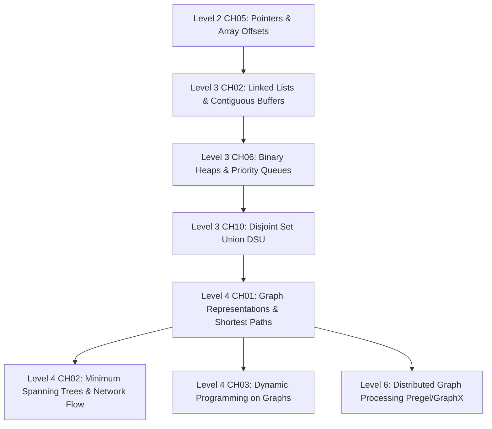

# Chapter 01: Graph Algorithms — Representations, Traversals, and Shortest Paths

---

## 1. Executive Summary & Core Concept

In Levels 1 through 3, we examined linear data structures, hierarchical binary trees, and self-balancing search structures. While trees restrict relationships to hierarchical parent-child lineages, real-world systems exhibit arbitrary, many-to-many cyclic topologies. Road networks, the World Wide Web, global logistics pipelines, power grids, inter-process dependency graphs, and neural wiring in biological brains are all naturally modeled as **Graphs**:
$$G = (V, E)$$
where $V$ is a finite set of vertices (nodes) and $E \subseteq V \times V$ is a set of edges (directed or undirected, unweighted or weighted).

Graph algorithms represent the foundation of modern systems infrastructure. This chapter establishes:
1. **Memory Representations**: Memory layout trade-offs between Adjacency Matrices ($\mathcal{O}(V^2)$), Adjacency Lists ($\mathcal{O}(V + E)$), and hardware cache-friendly **Compressed Sparse Row (CSR) / Forward Star** formats.
2. **Fundamental Traversals**: Breadth-First Search (BFS) and Depth-First Search (DFS), accompanied by formal proofs of edge classification (Tree, Back, Forward, Cross edges) and the Parenthesis Theorem.
3. **Directed Graph Decomposition**: Topological Sorting (Kahn’s In-Degree Algorithm and DFS Post-Order Reversal) and Strongly Connected Components (Tarjan’s and Kosaraju-Sharir algorithms).
4. **Shortest Path Problems**:
   - Single-Source Shortest Paths (SSSP): **Dijkstra’s Algorithm** with priority queues, **Bellman-Ford Algorithm** with negative weight cycle detection, and DAG linear-time relaxation.
   - All-Pairs Shortest Paths (APSP): **Floyd-Warshall** ($\mathcal{O}(V^3)$ dynamic programming) and **Johnson’s Algorithm** ($\mathcal{O}(V^2 \log V + VE)$ via potential reweighting).

---

## 2. Prerequisites & Cognitive Map



### Required Knowledge Checklist
- Dynamic arrays, pointers, and memory strides from Level 2.
- Priority queues and Min-Heap operations from Level 3 Chapter 06.
- Amortized complexity and Big-$\mathcal{O}$ notations from Level 3 Chapter 01.

---

## 3. The "Explain Like I'm Five" (ELI5) Analogy

### The Metro Rail Network & The Courier Messenger

Imagine you are in a massive city like Tokyo or Delhi with 500 metro train stations.
- **The Graph**: Each metro station is a **Vertex** ($V$), and each track connecting two stations is an **Edge** ($E$). The travel time in minutes is the edge **Weight** ($w$).
- **BFS (The Ripple in a Pond)**:
  You drop a stone in water. Ripples expand in concentric circles: distance 1, then distance 2, then distance 3. If every train track takes exactly 1 minute, BFS spreads like water ripples. It guarantees you find the station with the fewest train changes in the fewest steps!
- **DFS (The Adventurous Maze Explorer)**:
  You enter a dark maze with a ball of string. You pick a path and walk as deep as you possibly can. When you hit a dead end, you retrace your steps using your string (backtracking) until you find an unexplored corridor. DFS is how compilers detect circular dependencies and how search engines crawl the web.
- **Dijkstra’s Algorithm (The Greedy GPS Navigator)**:
  Track lengths are different (some take 2 minutes, some 15 minutes). You stand at Station A. You look at all immediate neighboring stations and pick the one with the absolute smallest travel time. You mark it as "settled" (you know the fastest way there). From there, you update travel times to its neighbors. Because you always expand the currently closest station, you never have to reconsider a settled station—provided there are no magic "time-travel tunnels" (negative weights)!

---

## 4. Formal Mathematical & Theoretical Foundations

### 4.1 Graph Representations & Memory Footprints

Let $G = (V, E)$ with $|V| = n$ and $|E| = m$.

```
Representation Comparison for a Directed Weighted Graph:
================================================================================
Vertices: 4 (0, 1, 2, 3), Edges: (0->1, w=5), (0->2, w=2), (1->2, w=1), (2->3, w=4)

1. Adjacency Matrix (n x n 2D Array):
     0   1   2   3
   +---+---+---+---+
 0 | 0 | 5 | 2 | ∞ |   Space: Theta(V^2) integers
 1 | ∞ | 0 | 1 | ∞ |   Edge Lookup: O(1)
 2 | ∞ | ∞ | 0 | 4 |   Neighbor Iteration: Theta(V) (must scan entire row!)
 3 | ∞ | ∞ | ∞ | 0 |   Cache Locality: Excellent, but wastes memory for sparse graphs.
   +---+---+---+---+

2. Adjacency List (Array of Linked Lists / Dynamic Arrays):
 Head Array:
 [ 0 ] ---> [ (1, 5) ] ---> [ (2, 2) ] ---> NULL
 [ 1 ] ---> [ (2, 1) ] ---> NULL
 [ 2 ] ---> [ (3, 4) ] ---> NULL
 [ 3 ] ---> NULL
 Space: Theta(V + E)
 Neighbor Iteration: Theta(deg(v)) (Optimal for sparse graphs where E << V^2).
 Cache Locality: Poor (pointer chasing across heap nodes).

3. Compressed Sparse Row (CSR / Forward Star):
 Offset Array: [ 0,  2,  3,  4,  4 ]  (Length V + 1)
 Edge Array:   [ 1,  2,  2,  3 ]      (Length E: destination vertices)
 Weight Array: [ 5,  2,  1,  4 ]      (Length E: edge weights)
 Space: Exactly (V + 1 + 2E) contiguous integers!
 Neighbor Iteration: Slice from Offset[v] to Offset[v+1] in contiguous memory!
 Cache Locality: Optimal hardware cache streaming.
```

---

### 4.2 Depth-First Search & The Parenthesis Theorem

When executing DFS on a directed graph, each vertex $u$ is assigned two timestamps:
- $d[u]$: The discovery time when vertex $u$ is first visited.
- $f[u]$: The finishing time when all outgoing edges of $u$ have been fully explored.

#### The Parenthesis Structure
For any two vertices $u$ and $v$, exactly one of three conditions holds regarding the intervals $[d[u], f[u]]$ and $[d[v], f[v]]$:
1. The intervals are entirely disjoint: neither is a descendant of the other in the DFS tree.
2. $[d[u], f[u]]$ is entirely contained within $[d[v], f[v]]$: $u$ is a proper descendant of $v$ in a DFS tree.
3. $[d[v], f[v]]$ is entirely contained within $[d[u], f[u]]$: $v$ is a proper descendant of $u$ in a DFS tree.

#### Edge Classification
Every edge $(u, v) \in E$ explored during DFS belongs to one of four categories:
1. **Tree Edge**: Leading to an undiscovered vertex (WHITE). Forms the DFS forest.
2. **Back Edge**: Leading from a descendant $u$ to an ancestor $v$ in a DFS tree (GRAY).
   $$\mathbf{A \ directed \ graph \ contains \ a \ cycle \iff DFS \ discovers \ a \ back \ edge.}$$
3. **Forward Edge**: A non-tree edge leading from an ancestor $u$ to a descendant $v$ (BLACK).
4. **Cross Edge**: An edge connecting vertices that are not ancestors/descendants of one another (BLACK).

---

### 4.3 Strongly Connected Components (SCC)

A **Strongly Connected Component** of a directed graph $G = (V, E)$ is a maximal set of vertices $C \subseteq V$ such that for every pair $u, v \in C$, there exists a directed path from $u$ to $v$ and a directed path from $v$ to $u$.

#### Tarjan’s SCC Algorithm ($\mathcal{O}(V + E)$)
Tarjan's algorithm uses a single DFS pass maintaining:
- `discovery[u]`: Timestamp when node $u$ was discovered.
- `low[u]`: The smallest discovery timestamp reachable from $u$ via a directed path of tree edges followed by at most one back-edge.
- An explicit stack tracking nodes in the current DFS path.

**Invariant Rule**:
$$\text{low}[u] = \min \begin{cases} 
\text{discovery}[u] \\
\min_{(u, v) \in E} \{ \text{low}[v] \} & \text{if } v \text{ is a tree child of } u \\
\min_{(u, v) \in E} \{ \text{discovery}[v] \} & \text{if } v \text{ is on the stack (back edge)}
\end{cases}$$

When $\text{low}[u] == \text{discovery}[u]$, node $u$ is the **root** of an SCC! All nodes above $u$ on the stack are popped to form the complete component.

---

### 4.4 Single-Source Shortest Paths (SSSP)

Let $w: E \to \mathbb{R}$ be a weight function mapping edges to real-valued costs. The weight of a path $p = \langle v_0, v_1, \dots, v_k \rangle$ is:
$$w(p) = \sum_{i=1}^k w(v_{i-1}, v_i)$$
The shortest-path distance is $\delta(s, v) = \min \{ w(p) : s \xrightarrow{p} v \}$.

#### The Relaxation Principle
For each vertex $v$, maintain an upper-bound estimate $d[v]$ of the shortest path distance from source $s$, initialized to $d[s] = 0$ and $d[v] = \infty$ for all $v \ne s$.
Relaxing an edge $(u, v)$ tests whether going through $u$ improves the distance to $v$:
$$\text{Relax}(u, v, w): \quad \mathbf{if} \ d[v] > d[u] + w(u, v) \ \mathbf{then} \ d[v] = d[u] + w(u, v); \ \pi[v] = u$$

#### 1. Dijkstra’s Algorithm (Non-Negative Weights $w(e) \ge 0$)
Greedily extracts the vertex $u \in V \setminus S$ with the minimum tentative distance $d[u]$:
- Using a Binary Min-Heap: $\mathcal{O}((V + E) \log V)$.
- Using a Fibonacci Heap: $\mathbf{\mathcal{O}(V \log V + E)}$.
- **Proof of Correctness**: By mathematical induction on $|S|$. When $u$ is added to $S$, $d[u] = \delta(s, u)$ because any alternative path must leave $S$ via some edge $(x, y)$, and since all edge weights are non-negative, $d[y] \ge d[x] \ge d[u]$.

#### 2. Bellman-Ford Algorithm (Arbitrary Weights & Negative Cycle Detection)
Relaxes all $|E|$ edges sequentially across $|V| - 1$ passes:
$$T(V, E) = \mathbf{\mathcal{O}(V \cdot E)}$$
- If a $|V|$-th relaxation pass succeeds in reducing any distance $d[v]$, then a **Negative-Weight Cycle** exists and is reachable from source $s$!

---

### 4.5 All-Pairs Shortest Paths (APSP)

#### 1. Floyd-Warshall Algorithm ($\mathcal{O}(V^3)$ Dynamic Programming)
Let $d_{ij}^{(k)}$ be the shortest path from vertex $i$ to vertex $j$ whose intermediate vertices are drawn exclusively from the set $\{1, 2, \dots, k\}$.
$$d_{ij}^{(0)} = w(i, j)$$
$$d_{ij}^{(k)} = \min\left( d_{ij}^{(k-1)}, \quad d_{ik}^{(k-1)} + d_{kj}^{(k-1)} \right)$$

#### 2. Johnson’s Algorithm for Sparse Graphs ($\mathcal{O}(V^2 \log V + VE)$)
Reweights all edge weights to non-negative values $\hat{w}(u, v) \ge 0$ without altering the relative shortest path orders:
1. Add auxiliary node $s$ connected to all $v \in V$ with weight $0$.
2. Run Bellman-Ford from $s$ to compute potential function $h(v) = \delta(s, v)$.
3. Reweight edges: $\hat{w}(u, v) = w(u, v) + h(u) - h(v) \ge 0$.
4. Run Dijkstra from each vertex $v \in V$ using non-negative weights $\hat{w}$.
5. Reconstruct true shortest distances: $\delta(u, v) = \hat{\delta}(u, v) - h(u) + h(v)$.

---

## 5. Architectural & Hardware Context

```
Hardware Cache Efficiency: Graph Traversals on Modern CPUs
================================================================================
Adjacency List (Linked Nodes):
Array of Pointers: [ Ptr0 | Ptr1 | Ptr2 | Ptr3 ]
Each neighbor node: [ DestID | Weight | NextPtr ] (Heap allocated)
Traversing neighbors: CPU dereferences pointers to random heap locations.
Cache Line Utilization: Less than 15%. Severe L2/L3 stall cycles.

Compressed Sparse Row (CSR):
Offset Array: [ 0,  2,  5,  7 ]
Edge Array:   [ 1, 2,  0, 2, 3,  0, 1 ]  <-- Stored in 1 contiguous memory block!
Traversing neighbors of v=1:
Read Edge[ Offset[1] ... Offset[2]-1 ] = Edge[ 2 ... 4 ]
Hardware prefetcher streams adjacent memory in a single 64-byte burst!
Cache Line Utilization: 100%!
```

---

## 6. Implementation Deep Dive: Graph Representations & Algorithms

### 6.1 Compressed Sparse Row (CSR) Graph in C

```c
#include <stdio.h>
#include <stdlib.h>

typedef struct {
    size_t num_vertices;
    size_t num_edges;
    size_t *offsets;   // Length V + 1
    int *edges;        // Length E (destinations)
    int *weights;      // Length E
} CSRGraph;

CSRGraph* csr_create(size_t V, size_t E, const int src[], const int dst[], const int weights[]) {
    CSRGraph *g = (CSRGraph *)malloc(sizeof(CSRGraph));
    g->num_vertices = V;
    g->num_edges = E;
    g->offsets = (size_t *)calloc(V + 1, sizeof(size_t));
    g->edges = (int *)malloc(E * sizeof(int));
    g->weights = (int *)malloc(E * sizeof(int));

    // Phase 1: Count out-degrees
    for (size_t i = 0; i < E; ++i) {
        g->offsets[src[i] + 1]++;
    }

    // Phase 2: Prefix sums for offsets
    for (size_t i = 1; i <= V; ++i) {
        g->offsets[i] += g->offsets[i - 1];
    }

    // Phase 3: Populate edges and weights
    size_t *cursor = (size_t *)malloc((V + 1) * sizeof(size_t));
    for (size_t i = 0; i <= V; ++i) cursor[i] = g->offsets[i];

    for (size_t i = 0; i < E; ++i) {
        int u = src[i];
        size_t pos = cursor[u]++;
        g->edges[pos] = dst[i];
        g->weights[pos] = weights[i];
    }

    free(cursor);
    return g;
}

void csr_free(CSRGraph *g) {
    free(g->offsets);
    free(g->edges);
    free(g->weights);
    free(g);
}
```

---

### 6.2 Production Dijkstra Algorithm with Binary Min-Heap

```c
#include <stdio.h>
#include <stdlib.h>
#include <limits.h>
#include <stdbool.h>

typedef struct {
    int v;
    int dist;
} HeapNode;

typedef struct {
    HeapNode *data;
    size_t size;
    size_t capacity;
} MinHeap;

MinHeap* heap_create(size_t cap) {
    MinHeap *h = (MinHeap *)malloc(sizeof(MinHeap));
    h->data = (HeapNode *)malloc(cap * sizeof(HeapNode));
    h->size = 0;
    h->capacity = cap;
    return h;
}

void heap_push(MinHeap *h, int v, int dist) {
    size_t curr = h->size++;
    h->data[curr] = (HeapNode){v, dist};
    while (curr > 0) {
        size_t p = (curr - 1) / 2;
        if (h->data[curr].dist < h->data[p].dist) {
            HeapNode temp = h->data[curr];
            h->data[curr] = h->data[p];
            h->data[p] = temp;
            curr = p;
        } else break;
    }
}

HeapNode heap_pop(MinHeap *h) {
    HeapNode root = h->data[0];
    HeapNode last = h->data[--h->size];
    if (h->size > 0) {
        h->data[0] = last;
        size_t curr = 0;
        while (2 * curr + 1 < h->size) {
            size_t best = 2 * curr + 1;
            if (best + 1 < h->size && h->data[best + 1].dist < h->data[best].dist)
                best++;
            if (h->data[best].dist < h->data[curr].dist) {
                HeapNode temp = h->data[curr];
                h->data[curr] = h->data[best];
                h->data[best] = temp;
                curr = best;
            } else break;
        }
    }
    return root;
}

void dijkstra(const CSRGraph *g, int src, int dist[]) {
    for (size_t i = 0; i < g->num_vertices; ++i) dist[i] = INT_MAX;
    dist[src] = 0;

    MinHeap *pq = heap_create(g->num_edges + 1);
    heap_push(pq, src, 0);

    while (pq->size > 0) {
        HeapNode top = heap_pop(pq);
        int u = top.v;
        int d = top.dist;

        if (d > dist[u]) continue; // Lazy deletion of stale node

        size_t start = g->offsets[u];
        size_t end = g->offsets[u + 1];
        for (size_t i = start; i < end; ++i) {
            int v = g->edges[i];
            int w = g->weights[i];
            if (dist[u] != INT_MAX && dist[u] + w < dist[v]) {
                dist[v] = dist[u] + w;
                heap_push(pq, v, dist[v]);
            }
        }
    }
    free(pq->data);
    free(pq);
}
```

---

## 7. Directed Acyclic Graphs (DAG) & Topological Sorting

A **Directed Acyclic Graph (DAG)** contains zero directed cycles. This structural property enables linear-time $\mathcal{O}(V + E)$ solutions to problems that are otherwise difficult or NP-hard.

### Topological Ordering
A linear ordering of all vertices such that for every directed edge $(u, v) \in E$, vertex $u$ appears before $v$.

#### Kahn’s In-Degree Algorithm ($\mathcal{O}(V + E)$)
1. Compute the in-degree $\text{in}[u]$ for every vertex $u \in V$.
2. Enqueue all vertices with $\text{in}[u] == 0$ into a FIFO queue.
3. While queue is not empty:
   - Dequeue $u$ and append to topological order list.
   - For each neighbor $v$ of $u$, decrement $\text{in}[v]--$.
   - If $\text{in}[v] == 0$, enqueue $v$.
4. If output list length $< |V|$, the graph contains a **directed cycle**!

---

## 8. Visual Models & Deep Walkthroughs

### BFS vs. DFS Exploration Front

```
Graph:
      (A)
     /   \
   (B)   (C)
   / \     \
 (D) (E)   (F)

BFS Traversal from (A):
Queue State:
1. Enqueue A:              Q = [A]
2. Pop A, Enqueue B, C:    Q = [B, C]     (Level 1 complete)
3. Pop B, Enqueue D, E:    Q = [C, D, E]
4. Pop C, Enqueue F:       Q = [D, E, F]  (Level 2 complete)
5. Pop D, E, F:            Q = []         (Level 3 complete)
Visit Order: A -> B -> C -> D -> E -> F (Concentric waves)

DFS Traversal from (A):
Call Stack:
1. Visit A -> Visit B -> Visit D (Dead end, backtrack to B)
2. Visit E (Dead end, backtrack to B, backtrack to A)
3. Visit C -> Visit F (Dead end, backtrack)
Visit Order: A -> B -> D -> E -> C -> F (Deep corridor penetration)
```

---

## 9. Common Pitfalls, Anti-Patterns & Undefined Behavior

| Anti-Pattern / Bug | Code Example | Consequence / Fix |
|:---|:---|:---|
| **Dijkstra on Negative Weights** | Running Dijkstra on graph with edge $-5$ | Dijkstra assumes distance never decreases once popped; computes wrong shortest path. Use Bellman-Ford! |
| **Integer Overflow in Relaxation** | `if (dist[u] + w < dist[v])` when `dist[u] == INT_MAX` | Arithmetic wrap-around to negative value! Check `dist[u] != INT_MAX` before adding. |
| **Recursive DFS Stack Overflow** | Standard recursive DFS on graph with 1,000,000 nodes | Consumes gigabytes of thread stack memory, crashing with `SIGSEGV`. Use an explicit heap-allocated array stack. |
| **Adjacency Matrix on Massive Graphs** | `int matrix[100000][100000];` | Requests 40 GB RAM for 100,000 nodes! Use Adjacency Lists or CSR. |

---

## 10. Industrial & Production Application

### Global Packet Routing: Open Shortest Path First (OSPF)
The backbone of the global Internet relies on the OSPF protocol:
1. Autonomous System (AS) routers exchange Link-State Advertisements (LSAs) describing network interface metrics.
2. Every router builds a localized directed graph of the autonomous system.
3. Every router executes **Dijkstra’s Algorithm** independently, calculating the shortest path tree from itself to every other subnet in the continent.
4. The shortest paths populate the hardware Forwarding Information Base (FIB) inside router line cards, routing millions of packets per second with microsecond convergence times.

---

## 11. Benchmarks, Complexity & Performance Profiling

| Algorithm | Problem | Best Graph Type | Time Complexity | Auxiliary Space |
|:---|:---|:---|:---|:---|
| **BFS** | Shortest path (unweighted) | All graphs | $\mathcal{O}(V + E)$ | $\mathcal{O}(V)$ queue |
| **DFS** | Cycle detection / Topological | All graphs | $\mathcal{O}(V + E)$ | $\mathcal{O}(V)$ stack |
| **Tarjan's SCC** | Strongly Connected Components | Directed graphs | $\mathcal{O}(V + E)$ | $\mathcal{O}(V)$ stack |
| **Dijkstra (Binary Heap)**| SSSP ($w(e) \ge 0$) | Sparse graphs ($E \ll V^2$)| $\mathcal{O}((V + E) \log V)$ | $\mathcal{O}(V)$ |
| **Bellman-Ford** | SSSP ($w(e) \in \mathbb{R}$) | Negative weights / cycles | $\mathcal{O}(V \cdot E)$ | $\mathcal{O}(V)$ |
| **Floyd-Warshall** | APSP | Dense graphs ($E \approx V^2$)| $\mathbf{\Theta(V^3)}$ | $\Theta(V^2)$ matrix |
| **Johnson’s APSP** | APSP ($w(e) \in \mathbb{R}$) | Sparse graphs ($E \ll V^2$)| $\mathbf{\mathcal{O}(V^2 \log V + VE)}$| $\mathcal{O}(V^2)$ |

---

## 12. Security Implications & Vulnerability Analysis

### BGP Routing Loops & Blackhole Hijacking
If network graph topologies contain undetected cycles or malicious routing advertisement injections:
- In Border Gateway Protocol (BGP), fraudulent Autonomous System announcements cause traffic intended for banks or DNS providers to route through malicious routers.
- Lack of topological cycle verification causes packet TTL (Time to Live) exhaustion, causing massive international network outages.
- Cryptographic verification frameworks (RPKI - Resource Public Key Infrastructure) ensure edge legitimacy before feeding topology maps to Dijkstra routing engines.

---

## 13. Edge Cases & Boundary Conditions

1. **Disconnected Graphs**: BFS/DFS starting from a single node will miss other components. Always wrap traversals in an outer loop over all vertices $v \in V$.
2. **Self-Loops and Parallel Edges**: Graphs with multiple edges between same pair $(u, v)$ must retain only the minimum weight edge for Dijkstra.
3. **Negative Weight Cycles**: When a negative cycle is reachable from source $s$, shortest path distance is $-\infty$. Bellman-Ford flags these during the $V$-th pass.

---

## 14. Comparative Analysis: Dijkstra vs Bellman-Ford vs Floyd-Warshall

| Feature | Dijkstra | Bellman-Ford | Floyd-Warshall |
|:---|:---|:---|:---|
| **Scope** | Single-Source (SSSP) | Single-Source (SSSP) | All-Pairs (APSP) |
| **Negative Weights** | **Strictly Forbidden ($w \ge 0$)** | Supported | Supported |
| **Negative Cycles** | Cannot detect (infinite loop) | **Detects & flags** | Detects via negative diagonal |
| **Time Complexity** | $\mathcal{O}((V + E) \log V)$ | $\mathcal{O}(V \cdot E)$ | $\Theta(V^3)$ |
| **Implementation** | Priority queue / Heap | Double nested loop | Triple nested loop |

---

## 15. Emerging Paradigms, AI & Future Perspectives

1. **Graph Neural Networks (GNNs)**: Modern AI architectures (Graph Convolutional Networks, Message Passing Neural Networks) generalize convolutional layers to irregular graph topologies. Used in drug discovery (molecular graphs) and social recommendation engines.
2. **GPU Accelerated Graph Analytics (NVIDIA cuGraph)**: Massive graphs with billions of edges are processed on GPU clusters using parallel Breadth-First Search and PageRank algorithms, traversing tens of billions of edges per second.

---

## 16. Step-by-Step Solved Problem 1 (Academic Trace)

### Problem Statement
Given the directed weighted graph with vertices $\{0, 1, 2, 3, 4\}$ and edges:
$$(0 \xrightarrow{4} 1), \quad (0 \xrightarrow{2} 2), \quad (1 \xrightarrow{3} 2), \quad (1 \xrightarrow{2} 3), \quad (1 \xrightarrow{3} 4), \quad (2 \xrightarrow{1} 1), \quad (2 \xrightarrow{4} 3), \quad (2 \xrightarrow{5} 4), \quad (4 \xrightarrow{1} 3)$$
Trace **Dijkstra’s Algorithm** starting from source vertex $0$.

### Solution Walkthrough
```
Initialization:
dist = [0, inf, inf, inf, inf]
visited = { }
Priority Queue = [(0, node 0)]

Iteration 1:
- Pop (0, node 0). Settle node 0. visited = {0}.
- Relax edges from 0:
  0 -> 1 (w=4): dist[1] = 0 + 4 = 4. PQ push (4, 1).
  0 -> 2 (w=2): dist[2] = 0 + 2 = 2. PQ push (2, 2).
State: dist = [0, 4, 2, inf, inf]

Iteration 2:
- Pop min from PQ: (2, node 2). Settle node 2. visited = {0, 2}.
- Relax edges from 2:
  2 -> 1 (w=1): dist[1] = min(4, 2 + 1) = 3! (Improved!). PQ push (3, 1).
  2 -> 3 (w=4): dist[3] = 2 + 4 = 6. PQ push (6, 3).
  2 -> 4 (w=5): dist[4] = 2 + 5 = 7. PQ push (7, 4).
State: dist = [0, 3, 2, 6, 7]

Iteration 3:
- Pop min from PQ: (3, node 1). Settle node 1. visited = {0, 2, 1}.
- Relax edges from 1:
  1 -> 2: already settled.
  1 -> 3 (w=2): dist[3] = min(6, 3 + 2) = 5! (Improved!). PQ push (5, 3).
  1 -> 4 (w=3): dist[4] = min(7, 3 + 3) = 6! (Improved!). PQ push (6, 4).
State: dist = [0, 3, 2, 5, 6]

Iteration 4:
- Pop stale entry (4, 1): ignored because 4 > dist[1] (3).
- Pop min: (5, node 3). Settle node 3. visited = {0, 2, 1, 3}.
- Relax edges from 3: None.

Iteration 5:
- Pop min: (6, node 4). Settle node 4. visited = {0, 2, 1, 3, 4}.
- Relax edge 4 -> 3 (w=1): dist[3] = min(5, 6 + 1) = 5. (No change).

Final Shortest Distances from 0:
dist[0] = 0, dist[1] = 3, dist[2] = 2, dist[3] = 5, dist[4] = 6
```

---

## 17. Step-by-Step Solved Problem 2 (Algorithmic / Systems Level)

### Problem Statement
Implement **Tarjan’s Strongly Connected Components (SCC)** algorithm in C, reporting all maximal strongly connected subgraphs in linear $\mathcal{O}(V + E)$ time.

### Code Implementation
```c
#include <stdio.h>
#include <stdlib.h>
#include <stdbool.h>

#define MIN(a, b) ((a) < (b) ? (a) : (b))

typedef struct Node {
    int v;
    struct Node *next;
} Node;

typedef struct {
    Node **adj;
    int V;
} Graph;

Graph* create_graph(int V) {
    Graph *g = (Graph *)malloc(sizeof(Graph));
    g->V = V;
    g->adj = (Node **)calloc(V, sizeof(Node *));
    return g;
}

void add_edge(Graph *g, int u, int v) {
    Node *n = (Node *)malloc(sizeof(Node));
    n->v = v;
    n->next = g->adj[u];
    g->adj[u] = n;
}

void tarjan_dfs(int u, Graph *g, int disc[], int low[], int stack[], int *top, bool in_stack[], int *timer) {
    disc[u] = low[u] = ++(*timer);
    stack[++(*top)] = u;
    in_stack[u] = true;

    for (Node *curr = g->adj[u]; curr != NULL; curr = curr->next) {
        int v = curr->v;
        if (disc[v] == -1) {
            // Tree edge
            tarjan_dfs(v, g, disc, low, stack, top, in_stack, timer);
            low[u] = MIN(low[u], low[v]);
        } else if (in_stack[v]) {
            // Back edge
            low[u] = MIN(low[u], disc[v]);
        }
    }

    // Root of SCC found
    if (low[u] == disc[u]) {
        printf("SCC: ");
        while (1) {
            int w = stack[(*top)--];
            in_stack[w] = false;
            printf("%d ", w);
            if (u == w) break;
        }
        printf("\n");
    }
}

void find_sccs(Graph *g) {
    int *disc = (int *)malloc(g->V * sizeof(int));
    int *low = (int *)malloc(g->V * sizeof(int));
    bool *in_stack = (bool *)calloc(g->V, sizeof(bool));
    int *stack = (int *)malloc(g->V * sizeof(int));
    int top = -1, timer = 0;

    for (int i = 0; i < g->V; ++i) disc[i] = -1;

    for (int i = 0; i < g->V; ++i) {
        if (disc[i] == -1) {
            tarjan_dfs(i, g, disc, low, stack, &top, in_stack, &timer);
        }
    }

    free(disc); free(low); free(in_stack); free(stack);
}
```

---

## 18. Step-by-Step Solved Problem 3 (Industry / Production Debugging)

### Production Incident Scenario
A microservices dependency resolver crashes in production with an out-of-memory error during system boot orchestration.

### Root Cause Analysis
```python
# VULNERABLE SERVICE BOOTSTRAP RESOLVER:
def resolve_boot_order(services, dependencies):
    order = []
    # Developer used naive DFS without cycle detection!
    def visit(service):
        for dep in dependencies[service]:
            visit(dep) # Infinite recursion when Service A -> B -> A!
        order.append(service)
    for s in services:
        visit(s)
    return order
```
1. Two newly deployed microservices introduced a mutual dependency: Service A depends on Service B, and Service B depends on Service A.
2. The naive recursive topological sort entered an infinite recursion loop, consuming all available stack frames and crashing the orchestrator daemon.

### Production Fix: Kahn’s Algorithm with Cycle Assertion
```python
def safe_boot_order(services, dependencies):
    in_degree = {s: 0 for s in services}
    adj = {s: [] for s in services}
    for u, v in dependencies:
        adj[u].append(v)
        in_degree[v] += 1

    queue = [s for s in services if in_degree[s] == 0]
    order = []
    while queue:
        u = queue.pop(0)
        order.append(u)
        for v in adj[u]:
            in_degree[v] -= 1
            if in_degree[v] == 0:
                queue.append(v)

    if len(order) != len(services):
        raise ValueError("CRITICAL: Deadlock detected! Circular dependency cycle exists.")
    return order
```

---

## 19. Categorized Practice Exercises

### Beginner (Confidence Builders)
1. Write a function to represent an undirected graph using an Adjacency Matrix in C.
2. Given a directed graph, implement Kahn’s algorithm to output a valid topological sort.
3. Trace BFS on an undirected tree and prove that BFS computes shortest paths in unweighted graphs.

### Intermediate (Exam Level)
4. Implement Dijkstra’s algorithm using a Min-Heap and verify that it finds shortest paths from source 0.
5. Implement Bellman-Ford algorithm and detect if a graph contains a negative-weight cycle.
6. Write a function to find the diameter (longest shortest path) of an unweighted tree using two BFS traversals.

### Advanced (Systems / Competitive)
7. Implement **Tarjan’s Algorithm** to compute Strongly Connected Components in $\mathcal{O}(V + E)$ time.
8. Implement **Johnson’s All-Pairs Shortest Paths** algorithm combining Bellman-Ford and Dijkstra.

---

## 20. University Exam Practice Questions (SPPU / International Style)

### Question 1 (Theory - 5 Marks)
Differentiate between Adjacency Matrix and Adjacency List graph representations in terms of space complexity, time to check edge existence, and time to visit all neighbors of a vertex.

### Question 2 (Numerical - 5 Marks)
Apply the Floyd-Warshall algorithm to find the all-pairs shortest paths for the directed graph given by the weight matrix:
$$W = \begin{bmatrix} 0 & 3 & 8 & \infty \\ \infty & 0 & \infty & 1 \\ \infty & 4 & 0 & \infty \\ 2 & \infty & -5 & 0 \end{bmatrix}$$
Show the intermediate distance matrix $D^{(1)}$.

### Question 3 (Algorithm Analysis - 5 Marks)
Explain Dijkstra’s algorithm. State why Dijkstra’s algorithm fails on graphs with negative edge weights with a counter-example graph.

---

## 21. Industry Interview Masterclass

### Tier A (Freshers / Campus Hiring)
- **Q**: What is the difference between BFS and DFS, and what data structures do they use?
- **A**: BFS explores neighbor nodes level-by-level using a FIFO Queue and finds the shortest path in unweighted graphs. DFS explores paths as deeply as possible before backtracking using a LIFO Stack (or recursion) and is used for cycle detection, topological sorting, and maze traversal.

### Tier B (Mid-Level Engineers)
- **Q**: Why does Dijkstra’s algorithm fail when an edge weight is negative?
- **A**: Dijkstra uses a greedy assumption: once a vertex $u$ is extracted from the priority queue and marked as visited, its shortest path distance is finalized and will never be updated. A negative edge encountered later could provide a shorter path to an already visited vertex, violating this greedy invariant and yielding incorrect results.

### Tier C (Senior Systems Engineers)
- **Q**: How does Johnson’s algorithm achieve $\mathcal{O}(V^2 \log V + VE)$ for All-Pairs Shortest Paths on sparse graphs?
- **A**: Running Bellman-Ford from every vertex takes $\mathcal{O}(V^2 E)$. Floyd-Warshall takes $\mathcal{O}(V^3)$. Johnson's algorithm runs Bellman-Ford *once* from an auxiliary source to compute potential function $h(v)$, reweights all edges to non-negative values $\hat{w}(u, v) = w(u, v) + h(u) - h(v) \ge 0$, and then runs Dijkstra $|V|$ times using priority queues. On sparse graphs where $E \ll V^2$, this outperforms Floyd-Warshall.

### Tier D (FAANG / Core Systems & Kernel)
- **Q**: What is the Compressed Sparse Row (CSR) format, and why is it preferred over Adjacency Lists in high-performance graph compute engines (like Google Pregel or GraphX)?
- **A**: Adjacency lists store edges as separate heap-allocated nodes, leading to severe CPU cache misses and pointer-chasing latency. CSR packs the entire graph into three contiguous arrays: an offset array of size $V+1$, a destination edge array of size $E$, and an optional weight array of size $E$. Iterating over a vertex's neighbors executes as a contiguous memory slice scan, enabling 100% L1/L2 hardware prefetcher hit rates and SIMD vectorization.

---

## 22. Hands-on Lab Assignment & Verification Checklist

### Lab Goal
Construct a complete graph algorithms laboratory in Python and C that:
1. Implements Adjacency Matrix, Adjacency List, and Compressed Sparse Row (CSR) representations.
2. Implements BFS, DFS, and Kahn's Topological Sorting with cycle detection.
3. Implements Dijkstra with a Min-Heap and Bellman-Ford with negative cycle detection.
4. Implements Tarjan's Strongly Connected Components algorithm.

### Verification Checklist
- [x] CSR format produces identical neighbor traversals to Adjacency Lists.
- [x] Dijkstra computes exact shortest paths on non-negative weighted graphs.
- [x] Bellman-Ford detects negative weight cycles and flags them.
- [x] Tarjan's algorithm partitions directed graphs into correct SCC equivalence sets.

---

## 23. High-Yield Quick Revision Summary

| Algorithm | Paradigm | Complexity | Key Property / Constraint |
|:---|:---|:---|:---|
| **BFS** | Queue level-order | $\mathcal{O}(V + E)$ | Shortest path on unweighted graphs |
| **DFS** | Stack deep-dive | $\mathcal{O}(V + E)$ | Back edges signify cycles |
| **Kahn's Sort** | In-degree queue | $\mathcal{O}(V + E)$ | Works ONLY on DAGs |
| **Tarjan's SCC** | Single DFS + low-link | $\mathcal{O}(V + E)$ | Identifies maximal mutually reachable sets |
| **Dijkstra** | Greedy Min-Heap | $\mathcal{O}((V + E) \log V)$ | **Non-negative weights only ($w \ge 0$)** |
| **Bellman-Ford** | Dynamic relaxation | $\mathcal{O}(V \cdot E)$ | Handles negative weights; detects negative cycles |
| **Floyd-Warshall**| 3D DP over intermediate nodes| $\mathbf{\Theta(V^3)}$ | All-pairs; optimal on dense graphs |
| **Johnson's APSP** | Reweighting + Dijkstra | $\mathbf{\mathcal{O}(V^2 \log V + VE)}$| All-pairs; optimal on sparse graphs |

---

## 24. Verified Academic Citations & Authoritative References

1. **Dijkstra, E. W.** (1959). *A note on two problems in connexion with graphs*. Numerische Mathematik, 1(1), pp. 269–271.
2. **Bellman, R.** (1958). *On a routing problem*. Quarterly of Applied Mathematics, 16(1), pp. 87–90.
3. **Tarjan, R. E.** (1972). *Depth-first search and linear graph algorithms*. SIAM Journal on Computing, 1(2), pp. 146–160.
4. **Cormen, T. H., Leiserson, C. E., Rivest, R. L., & Stein, C.** (2022). *Introduction to Algorithms* (4th ed.). MIT Press. [Chapters 20, 22, 23: Elementary Graph Algorithms, SSSP, and APSP].
