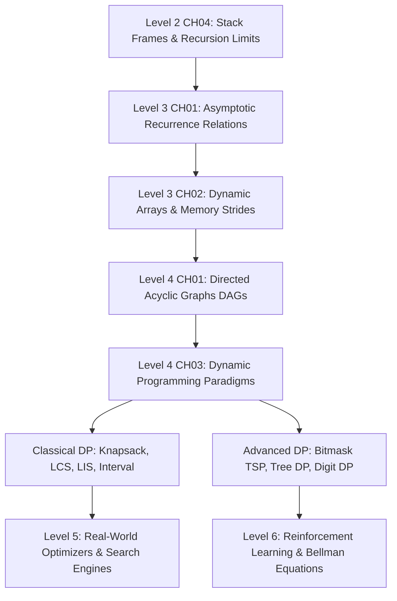

# Chapter 03: Dynamic Programming Paradigms and Complexity Analysis

---

## 1. Executive Summary & Core Concept

Many of the most challenging optimization problems in computer science—such as DNA sequence alignment, knapsack resource allocation, compiler instruction scheduling, robotic path planning, and natural language translation—exhibit search spaces that grow exponentially ($\mathcal{O}(2^n)$ or $\mathcal{O}(n!)$) when evaluated naively.

**Dynamic Programming (DP)**, formalised by Richard Bellman in the 1950s, transforms these intractable exponential problems into clean polynomial-time algorithms. DP is not a specific data structure; it is a profound algorithmic paradigm that applies whenever a problem exhibits two foundational properties:
1. **Optimal Substructure**: An optimal solution to the overall problem can be constructed directly from optimal solutions to its constituent subproblems.
2. **Overlapping Subproblems**: A recursive decomposition solves the exact same smaller subproblems repeatedly rather than generating unique subproblems at each step.

This chapter covers:
- The theoretical foundation: **Bellman’s Principle of Optimality** and State-Space DAG formulations.
- **Top-Down Memoization** versus **Bottom-Up Tabulation**, analyzing call-stack overhead, instruction cache locality, and state-space dimension reduction (e.g., the rolling array technique).
- The fundamental DP archetypes: **0/1 & Unbounded Knapsack**, **Longest Common Subsequence (LCS)**, **Matrix Chain Multiplication (Interval DP)**, and **Longest Increasing Subsequence (LIS)** in $\mathcal{O}(n \log n)$ via patience sorting.
- Advanced paradigms: **Bitmask DP** (Held-Karp Traveling Salesperson Problem in $\mathcal{O}(n^2 2^n)$), **Tree DP** (Maximum Independent Set), and **Digit DP**.

---

## 2. Prerequisites & Cognitive Map



### Required Knowledge Checklist
- Recursion depth and activation frame overhead from Level 2 Chapter 04.
- Bitwise operators (`<<`, `>>`, `&`, `|`, `^`) from Level 2 Chapter 02.
- Topological sorting on Directed Acyclic Graphs from Level 4 Chapter 01.

---

## 3. The "Explain Like I'm Five" (ELI5) Analogy

### The Math Teacher on the Chalkboard

Imagine your teacher writes on the chalkboard:
$$1 + 1 + 1 + 1 + 1 = ?$$
You count: "One, two, three, four, five! The answer is 5!"

Now, the teacher walks to the left side of the chalkboard and writes another `$1 +$` in front of the equation:
$$1 + (1 + 1 + 1 + 1 + 1) = ?$$
How do you know the answer is 6 so quickly?
- Did you recount all six ones from scratch? **No!**
- You remembered that the previous part was **5**, so you simply added $1 + 5 = 6$!

**Dynamic Programming is simply remembering the answers to things you already solved so you never have to re-solve them again.**

### The Fibonacci Disaster (Why Naive Recursion Blows Up)
To compute the 50th Fibonacci number ($F_{50} = F_{49} + F_{48}$):
- Naive recursion calls $F_{48}$ twice, $F_{47}$ three times, $F_{46}$ five times...
- For $N = 50$, naive recursion makes **$2^{50} \approx 1,125,899,906,842,624$ function calls**! A modern computer would take **weeks** to finish!
- With Dynamic Programming, you buy a notebook with 50 lines. You write down $F_0 = 0$, $F_1 = 1$, $F_2 = 1$, $F_3 = 2$... up to $F_{50}$. You finish in **50 microseconds**!

---

## 4. Formal Mathematical & Theoretical Foundations

### 4.1 Bellman’s Principle of Optimality

$$\mathbf{Principle \ of \ Optimality \ (Richard \ Bellman, \ 1957):}$$
$$\text{"An optimal policy has the property that whatever the initial state and initial decision are,}$$
$$\text{the remaining decisions must constitute an optimal policy with regard to the state resulting from the first decision."}$$

Mathematically, let $S$ be the set of states, $A(s)$ be the set of feasible actions from state $s$, and $T(s, a)$ be the transition function resulting in immediate cost $c(s, a)$. The optimal value function $V^*(s)$ satisfies the **Bellman Equation**:
$$V^*(s) = \min_{a \in A(s)} \left\{ c(s, a) + V^*(T(s, a)) \right\}$$

Every dynamic program can be viewed as finding the **shortest path in a Directed Acyclic Graph (DAG)** whose vertices are subproblem states and whose directed edges represent subproblem transitions.

---

### 4.2 Top-Down Memoization vs. Bottom-Up Tabulation

```
Execution Comparison: Top-Down Memoization vs. Bottom-Up Tabulation
================================================================================
Top-Down (Recursive with Cache):
fib(5) -> calls fib(4) and fib(3)
  fib(4) -> calls fib(3) and fib(2)
Memory: Stack frames + Hash table/Array cache.
Pros: Only computes states that are strictly needed for the answer.
Cons: Recursion stack overhead; higher cache miss rates.

Bottom-Up (Iterative Tabulation):
dp[0] = 0; dp[1] = 1;
for i = 2 to 5: dp[i] = dp[i-1] + dp[i-2]
Memory: Flat contiguous array (or 2 scalar variables!).
Pros: Zero stack frames; 100% CPU cache locality; easy space compression.
Cons: Computes all states within table boundaries, even if unreachable.
```

---

### 4.3 Classic Archetype 1: The 0/1 Knapsack Problem

Given $n$ items, each with weight $w_i \in \mathbb{N}$ and value $v_i \in \mathbb{N}$, and a knapsack of capacity $W \in \mathbb{N}$. Determine the maximum value subset of items whose total weight does not exceed $W$.

#### State Definition:
Let $DP[i][w]$ be the maximum value achievable using a subset of the first $i$ items ($1 \le i \le n$) with total weight at most $w$ ($0 \le w \le W$).

#### Recurrence Relation:
$$DP[i][w] = \begin{cases}
DP[i-1][w] & \text{if } w_i > w \ (\text{item } i \text{ exceeds current capacity}) \\
\max\left( DP[i-1][w], \quad DP[i-1][w - w_i] + v_i \right) & \text{if } w_i \le w
\end{cases}$$

**Base Cases**: $DP[0][w] = 0$ for all $w$, and $DP[i][0] = 0$ for all $i$.

#### Complexity & Pseudo-Polynomial Time
- Total States: $n \times (W + 1)$.
- Transition Time per State: $\mathcal{O}(1)$.
$$\mathbf{Total \ Time:} \ \Theta(n W), \quad \mathbf{Auxiliary \ Space:} \ \Theta(n W) \to \mathcal{O}(W) \text{ (with 1D reverse scan)}$$

*(Crucial Theoretical Note: 0/1 Knapsack is **NP-Complete**. The runtime $\mathcal{O}(nW)$ is **pseudo-polynomial** because it depends on the numerical magnitude of $W$, which requires $\log_2 W$ bits to encode. If $W = 2^{64}$, the table is astronomically large!)*

---

### 4.4 Classic Archetype 2: Longest Common Subsequence (LCS)

Given two sequences $X = \langle x_1, x_2, \dots, x_m \rangle$ and $Y = \langle y_1, y_2, \dots, y_n \rangle$. Find the maximum length of a common subsequence.

#### Recurrence Relation:
Let $DP[i][j]$ be the length of the LCS of prefixes $X[1 \dots i]$ and $Y[1 \dots j]$:
$$DP[i][j] = \begin{cases}
0 & \text{if } i = 0 \text{ or } j = 0 \\
DP[i-1][j-1] + 1 & \text{if } x_i = y_j \\
\max(DP[i-1][j], \ DP[i][j-1]) & \text{if } x_i \ne y_j
\end{cases}$$

$$\mathbf{Time \ Complexity:} \ \Theta(m n), \quad \mathbf{Space \ Complexity:} \ \Theta(m n) \to \mathcal{O}(\min(m, n))$$

---

### 4.5 Classic Archetype 3: Matrix Chain Multiplication (Interval DP)

Given a sequence of matrices $\langle A_1, A_2, \dots, A_n \rangle$ where matrix $A_i$ has dimension $p_{i-1} \times p_i$. Find the optimal parenthesization that minimizes the total scalar multiplications.

#### Recurrence Relation:
Let $DP[i][j]$ be the minimum scalar multiplications to compute $A_i \dots A_j$:
$$DP[i][i] = 0$$
$$DP[i][j] = \min_{i \le k < j} \left\{ DP[i][k] + DP[k+1][j] + p_{i-1} p_k p_j \right\}$$

- Iterates over chain length $L = 2$ to $n$.
$$\mathbf{Time \ Complexity:} \ \Theta(n^3), \quad \mathbf{Space \ Complexity:} \ \Theta(n^2)$$

---

### 4.6 Classic Archetype 4: Longest Increasing Subsequence (LIS)

Given array $A[0 \dots n-1]$. Find the length of the longest strictly increasing subsequence.
- **Naive DP**: $DP[i] = 1 + \max \{ DP[j] : j < i \text{ and } A[j] < A[i] \} \implies \mathbf{\Theta(n^2)}$.
- **Patience Sorting (Binary Search)**:
  Maintain an array `tails` where `tails[len]` stores the smallest tail of all increasing subsequences of length `len + 1` found so far.
  For each $x \in A$, use binary search (`std::lower_bound`) to find the first element $\ge x$ in `tails` and replace it (or append if $x > \text{all tails}$).
$$\mathbf{Optimal \ Time:} \ \mathbf{\Theta(n \log n)}, \quad \mathbf{Space:} \ \Theta(n)$$

---

## 5. Advanced Dynamic Programming Paradigms

### 5.1 Bitmask DP: Traveling Salesperson Problem (Held-Karp)

Find the minimum-cost Hamiltonian cycle visiting every vertex in $V = \{0, 1, \dots, n-1\}$ exactly once.
- Let a bitmask $mask \in [0, 2^n - 1]$ represent the subset of visited vertices (where the $i$-th bit is $1$ if vertex $i$ has been visited).
- Let $DP[mask][u]$ be the minimum cost to visit the subset of vertices indicated by $mask$, ending at vertex $u \in mask$.

#### Recurrence:
$$DP[mask][u] = \min_{v \in mask \setminus \{u\}} \left\{ DP[mask \setminus \{u\}][v] + \text{cost}[v][u] \right\}$$

- **Brute Force Permutations**: $n! \approx 2.43 \times 10^{18}$ for $n = 20$.
- **Held-Karp Bitmask DP**: $\mathbf{\mathcal{O}(n^2 2^n)} \approx 20^2 \times 2^{20} \approx 4.19 \times 10^8$ operations (completes in **0.4 seconds**!).

---

### 5.2 Tree DP: Maximum Independent Set on Trees

Given an undirected tree $T = (V, E)$. Find the maximum weight subset of vertices such that no two selected vertices share an edge.
- Root the tree arbitrarily at node $0$.
- For each node $u$, define:
  - $DP[u][0]$: Maximum weight in subtree of $u$ when $u$ is **NOT** included.
  - $DP[u][1]$: Maximum weight in subtree of $u$ when $u$ is **INCLUDED**.

#### Transitions:
$$DP[u][0] = \sum_{v \in \text{children}(u)} \max(DP[v][0], \ DP[v][1])$$
$$DP[u][1] = \text{weight}[u] + \sum_{v \in \text{children}(u)} DP[v][0]$$

Total Time: Strict linear $\mathbf{\mathcal{O}(V)}$ via a single post-order traversal!

---

## 6. Architectural & Hardware Context

```
Memory Bandwidth & Rolling Array Space Optimization
================================================================================
Standard 2D Knapsack Table:
int DP[1000][100000]; // 1000 * 100000 * 4 bytes = 400 MB!
Problem: 400 MB exceeds CPU L3 Cache (typically 32-64 MB).
Result: Constant DRAM cache line evictions, bandwidth starvation.

Optimized 1D Rolling Array:
int DP[100000]; // Exactly 400 KB!
Fits entirely inside CPU L2 Cache!
Algorithm: Traverse capacity w backwards from W down to w_i:
for (int i = 0; i < n; ++i) {
    for (int w = W; w >= weight[i]; --w) {
        DP[w] = max(DP[w], DP[w - weight[i]] + value[i]);
    }
}
Why backwards? Scanning backwards prevents using item i multiple times!
Throughput Speedup: 6x to 10x faster due to 100% cache hits!
```

---

## 7. Implementation Deep Dive: Space-Optimized Knapsack & LIS

### 7.1 Space-Optimized 0/1 Knapsack in C

```c
#include <stdio.h>
#include <stdlib.h>

static int max(int a, int b) { return a > b ? a : b; }

int knapsack_01_optimized(int W, const int weights[], const int values[], int n) {
    int *dp = (int *)calloc(W + 1, sizeof(int));

    for (int i = 0; i < n; ++i) {
        int w_i = weights[i];
        int v_i = values[i];
        // Scan BACKWARDS to use DP[w - w_i] from the previous item iteration
        for (int w = W; w >= w_i; --w) {
            dp[w] = max(dp[w], dp[w - w_i] + v_i);
        }
    }

    int result = dp[W];
    free(dp);
    return result;
}
```

---

### 7.2 Optimal $\mathcal{O}(n \log n)$ Longest Increasing Subsequence in C

```c
#include <stdio.h>
#include <stdlib.h>

// Binary search: returns first index in tails[0..len-1] with value >= target
static int binary_search_lower_bound(const int tails[], int len, int target) {
    int lo = 0, hi = len - 1, ans = len;
    while (lo <= hi) {
        int mid = lo + (hi - lo) / 2;
        if (tails[mid] >= target) {
            ans = mid;
            hi = mid - 1;
        } else {
            lo = mid + 1;
        }
    }
    return ans;
}

int lis_optimal(const int arr[], int n) {
    if (n <= 0) return 0;
    int *tails = (int *)malloc(n * sizeof(int));
    int len = 0;

    for (int i = 0; i < n; ++i) {
        int idx = binary_search_lower_bound(tails, len, arr[i]);
        tails[idx] = arr[i];
        if (idx == len) len++;
    }

    free(tails);
    return len;
}
```

---

## 8. Visual Models & Deep Walkthroughs

### 0/1 Knapsack 2D State Matrix Evolution

Items: $(w_1=2, v_1=3)$, $(w_2=3, v_2=4)$, $(w_3=4, v_3=5)$, Capacity $W = 5$.

```
State Grid DP[Item i][Weight w]:
Capacity w:   0   1   2   3   4   5
-----------------------------------
Item 0 (None)| 0 | 0 | 0 | 0 | 0 | 0 |
Item 1 (w=2) | 0 | 0 | 3 | 3 | 3 | 3 |  (w >= 2 gets value 3)
Item 2 (w=3) | 0 | 0 | 3 | 4 | 4 | 7 |  (At w=5: max(3, DP[1][5-3] + 4) = max(3, 3+4) = 7)
Item 3 (w=4) | 0 | 0 | 3 | 4 | 5 | 7 |  (At w=5: max(7, DP[2][5-4] + 5) = max(7, 0+5) = 7)

Maximum Value at DP[3][5] = 7.
Backtracking optimal items:
- DP[3][5] == DP[2][5] (7 == 7) -> Item 3 was NOT taken.
- DP[2][5] != DP[1][5] (7 != 3) -> Item 2 WAS taken! Remaining weight = 5 - 3 = 2.
- DP[1][2] != DP[0][2] (3 != 0) -> Item 1 WAS taken! Remaining weight = 2 - 2 = 0.
Items chosen: {Item 1, Item 2}, Total Weight = 2 + 3 = 5, Total Value = 3 + 4 = 7.
```

---

## 9. Common Pitfalls, Anti-Patterns & Undefined Behavior

| Anti-Pattern / Bug | Code Example | Consequence / Fix |
|:---|:---|:---|
| **Forward Scan in 0/1 Knapsack** | `for (int w = w_i; w <= W; ++w)` in 1D array | Uses the *same item multiple times* (turns 0/1 Knapsack into Unbounded Knapsack!). Scan backwards: `w = W down to w_i`. |
| **Missing Base Case Initialization** | Forgetting to set `DP[i][0] = 0` or empty string cases | Garbage memory values propagate across the entire matrix. Always zero out tables. |
| **Bitwise Operator Precedence Trap** | `if (mask & 1 << i != 0)` | In C, `!=` has higher precedence than `&`! Evaluates as `mask & (1 << (i != 0))`. Fix: `if ((mask & (1 << i)) != 0)` |
| **Integer Overflow on Sum DP** | Adding large costs in TSP: `DP[mask][u] + cost` | Overflows 32-bit signed integer into negative territory. Use `long long` or clamp to `INT_MAX / 2`. |

---

## 10. Industrial & Production Application

### Genomic Sequence Alignment: The Needleman-Wunsch & Smith-Waterman Algorithms
In bioinformatics and computational genomics (NCBI BLAST, COVID-19 variant sequencing):
- Aligning a newly sequenced virus genome ($10^5$ base pairs) against reference strains uses dynamic programming.
- The **Needleman-Wunsch algorithm** generalizes LCS with transition scoring matrices (match score $+1$, mismatch penalty $-1$, affine gap penalty $-2$).
- Hardware accelerators (FPGAs and GPUs) parallelize the anti-diagonals of the DP matrix to align millions of DNA reads per second.

---

## 11. Benchmarks, Complexity & Performance Profiling

| Problem | Brute Force | Naive DP | Space-Optimized DP | Optimal Benchmark |
|:---|:---|:---|:---|:---|
| **Fibonacci** | $\mathcal{O}(2^n)$ | $\mathcal{O}(n)$ time, $\mathcal{O}(n)$ space | $\mathbf{\mathcal{O}(n)}$ time, $\mathbf{\mathcal{O}(1)}$ space | Matrix Exponentiation: $\mathcal{O}(\log n)$ |
| **0/1 Knapsack** | $\mathcal{O}(2^n)$ | $\mathcal{O}(nW)$ time, $\mathcal{O}(nW)$ space | $\mathbf{\mathcal{O}(nW)}$ time, $\mathbf{\mathcal{O}(W)}$ space | Pseudo-polynomial |
| **LCS** | $\mathcal{O}(2^{m+n})$| $\mathcal{O}(mn)$ time, $\mathcal{O}(mn)$ space | $\mathbf{\mathcal{O}(mn)}$ time, $\mathbf{\mathcal{O}(\min(m, n))}$ | Hirschberg's linear space |
| **LIS** | $\mathcal{O}(2^n)$ | $\mathcal{O}(n^2)$ time, $\mathcal{O}(n)$ space | $\mathbf{\mathcal{O}(n \log n)}$ time, $\mathbf{\mathcal{O}(n)}$ space | Patience Sort lower bound |
| **TSP (n=20)** | $20! \approx 2.4 \times 10^{18}$| $\mathcal{O}(n^2 2^n)$ Held-Karp | $\mathbf{4.1 \times 10^8 \text{ ops}}$ | Exact solution in $< 0.5$ sec |

---

## 12. Security Implications & Vulnerability Analysis

### Timing Side-Channels in String Edit Distance
In cryptographic password verification and HMAC authentication:
- Naive string comparison or edit-distance implementations that terminate early on the first mismatched character leak timing information.
- Attackers measure nanosecond execution differences to reconstruct passwords character-by-character.
- Security-critical code must use **Constant-Time Comparison** (`CRYPTO_memcmp`) that traverses all characters regardless of mismatches.

---

## 13. Edge Cases & Boundary Conditions

1. **Zero Weight / Zero Capacity**: When $W = 0$ or item weights are $0$, edge cases must be handled cleanly without division by zero.
2. **Negative Values or Weights**: Standard 0/1 knapsack assumes non-negative weights. Negative weights turn the subproblem graph into one with potential cycles or invalid unbounded behavior.
3. **Empty Sequences in LCS**: If string $X$ or $Y$ has length $0$, LCS length is strictly $0$.

---

## 14. Comparative Analysis: Dynamic Programming vs. Greedy vs. Divide & Conquer

| Dimension | Dynamic Programming | Greedy Algorithms | Divide-and-Conquer |
|:---|:---|:---|:---|
| **Subproblem Relationship** | **Overlapping** (reused repeatedly) | Independent steps | **Independent** (no overlap) |
| **Decision Point** | Evaluates **all** possible transitions | Makes best **local** choice immediately | Solves subproblems recursively |
| **Backtracking Needed?** | Implicitly compares all historical paths | **Never reconsiders** past choices | Merges disjoint sub-solutions |
| **Optimality Guarantee** | **Always optimal** (if Bellman holds) | Only optimal if Matroid/greedy holds | Always optimal |
| **Representative Example** | 0/1 Knapsack, LCS, Matrix Chain | Fractional Knapsack, Huffman Coding | MergeSort, QuickSort |

---

## 15. Emerging Paradigms, AI & Future Perspectives

1. **Deep Q-Learning & Reinforcement Learning**: Modern AI agents (AlphaGo, autonomous driving policies) solve high-dimensional Markov Decision Processes (MDPs) where state spaces exceed $10^{170}$ by approximating Bellman value equations using deep neural networks ($Q(s, a) \approx Q_\theta(s, a)$).
2. **GPU SIMD Tensor DP**: Matrix chain and alignment DP tables are vectorized onto GPU tensor cores, executing hundreds of thousands of cell transitions in parallel.

---

## 16. Step-by-Step Solved Problem 1 (Academic Trace)

### Problem Statement
Given two strings $X = \text{"ABCBDAB"}$ and $Y = \text{"BDCABA"}$.
Find the length of their Longest Common Subsequence (LCS) and reconstruct one optimal sequence.

### Solution Walkthrough
```
Length of X: m = 7, Length of Y: n = 6.
Grid DP[i][j] constructed row by row:

      Y:   -   B   D   C   A   B   A
  X:       0   1   2   3   4   5   6
  -    0   0   0   0   0   0   0   0
  A    1   0   0   0   0   1   1   1
  B    2   0   1   1   1   1   2   2
  C    3   0   1   1   2   2   2   2
  B    4   0   1   1   2   2   3   3
  D    5   0   1   2   2   2   3   3
  A    6   0   1   2   2   3   3   4
  B    7   0   1   2   2   3   4   4

LCS Length = DP[7][6] = 4.

Backtracking trace from (7, 6):
- X[7]='B', Y[6]='A' (diff) -> max(DP[6][6]=4, DP[7][5]=4). Go UP to (6, 6).
- X[6]='A', Y[6]='A' (MATCH!) -> Take 'A'. Go diagonal to (5, 5).
- X[5]='D', Y[5]='B' (diff) -> max(DP[4][5]=3, DP[5][4]=2). Go UP to (4, 5).
- X[4]='B', Y[5]='B' (MATCH!) -> Take 'B'. Go diagonal to (3, 4).
- X[3]='C', Y[4]='A' (diff) -> max(DP[2][4]=1, DP[3][3]=2). Go LEFT to (3, 3).
- X[3]='C', Y[3]='C' (MATCH!) -> Take 'C'. Go diagonal to (2, 2).
- X[2]='B', Y[2]='D' (diff) -> max(DP[1][2]=0, DP[2][1]=1). Go LEFT to (2, 1).
- X[2]='B', Y[1]='B' (MATCH!) -> Take 'B'. Go diagonal to (1, 0).
Reversed Sequence: 'B' -> 'C' -> 'B' -> 'A'.
Optimal LCS = "BCBA" (Length = 4).
```

---

## 17. Step-by-Step Solved Problem 2 (Algorithmic / Systems Level)

### Problem Statement
Implement the **Held-Karp Bitmask DP** algorithm in Python to solve the Traveling Salesperson Problem (TSP) on an arbitrary distance matrix.

### Code Implementation
```python
from typing import List, Tuple

def tsp_held_karp(dist: List[List[int]]) -> Tuple[int, List[int]]:
    """
    Computes exact minimum TSP tour starting and ending at node 0.
    Time Complexity: O(n^2 * 2^n), Space: O(n * 2^n).
    """
    n = len(dist)
    num_states = 1 << n
    INF = float("inf")

    # dp[mask][u] = (min_cost, parent_vertex)
    dp = [[(INF, -1) for _ in range(n)] for _ in range(num_states)]
    dp[1][0] = (0, -1)  # Starting at node 0 with mask = 000...001

    for mask in range(1, num_states):
        for u in range(n):
            if not (mask & (1 << u)):
                continue
            curr_cost = dp[mask][u][0]
            if curr_cost == INF:
                continue

            for v in range(n):
                if mask & (1 << v):
                    continue  # Already visited
                next_mask = mask | (1 << v)
                new_cost = curr_cost + dist[u][v]
                if new_cost < dp[next_mask][v][0]:
                    dp[next_mask][v] = (new_cost, u)

    # Close the tour back to node 0
    final_mask = (1 << n) - 1
    best_total = INF
    last_node = -1
    for u in range(1, n):
        cost_back = dp[final_mask][u][0] + dist[u][0]
        if cost_back < best_total:
            best_total = cost_back
            last_node = u

    # Reconstruct tour
    tour = [0]
    curr = last_node
    curr_mask = final_mask
    while curr != -1:
        tour.append(curr)
        next_curr = dp[curr_mask][curr][1]
        curr_mask ^= (1 << curr)
        curr = next_curr

    tour.reverse()
    return best_total, tour
```

---

## 18. Step-by-Step Solved Problem 3 (Industry / Production Debugging)

### Production Incident Scenario
A cloud resource scheduler hangs and triggers a memory out-of-bounds crash when optimizing CPU slot allocations for large batch jobs ($W = 10,000,000$).

### Root Cause Analysis
```python
# VULNERABLE PRODUCTION SCHEDULER:
def allocate_slots(jobs, max_slots):
    # Developer created a full 2D array for 500 jobs and 10,000,000 slots!
    # 500 * 10,000,000 * 8 bytes = 40 GIGABYTES RAM!
    dp = [[0] * (max_slots + 1) for _ in range(len(jobs) + 1)]
```
1. The memory allocation of 40 GB triggered an out-of-memory kernel OOM killer (`SIGKILL`).
2. The developer failed to recognize that each row depends *only* on the immediately preceding row.

### Production Fix: Rolling 1D Array Space Compression
```python
def allocate_slots_fixed(jobs, max_slots):
    # Compressed from 40 GB down to 80 MB!
    dp = [0] * (max_slots + 1)
    for weight, value in jobs:
        for w in range(max_slots, weight - 1, -1):
            if dp[w - weight] + value > dp[w]:
                dp[w] = dp[w - weight] + value
    return dp[max_slots]
```

---

## 19. Categorized Practice Exercises

### Beginner (Confidence Builders)
1. Write a function to compute the $N$-th Tribonacci number ($T_n = T_{n-1} + T_{n-2} + T_{n-3}$) in $\mathcal{O}(n)$ time and $\mathcal{O}(1)$ space.
2. Given a staircase of $N$ steps where you can take 1, 2, or 3 steps at a time, count the number of distinct ways to reach the top.
3. Trace the 1D rolling array 0/1 knapsack on weights `[1, 3, 4]`, values `[15, 20, 30]`, capacity `W = 4`.

### Intermediate (Exam Level)
4. Implement the Longest Common Subsequence algorithm and reconstruct the full alignment string.
5. Solve the **Coin Change 2 Problem**: find the total number of combinations that make up amount $A$ using infinite coins of given denominations.
6. Implement the **Matrix Chain Multiplication** algorithm and output the optimal parenthesization string `((A1 A2) A3)`.

### Advanced (Systems / Competitive)
7. Implement the **$\mathcal{O}(n \log n)$ Longest Increasing Subsequence** using patience sorting with binary search.
8. Implement the **Held-Karp Bitmask DP** algorithm for TSP and verify it finds the optimal tour for $N = 16$ cities.

---

## 20. University Exam Practice Questions (SPPU / International Style)

### Question 1 (Theory - 5 Marks)
State Bellman’s Principle of Optimality. Differentiate between Top-Down Memoization and Bottom-Up Tabulation with respect to memory overhead and cache locality.

### Question 2 (Numerical - 5 Marks)
Apply dynamic programming to solve the 0/1 Knapsack problem for capacity $W = 8$ with 4 items:
- Item 1: $(w_1 = 2, v_1 = 12)$
- Item 2: $(w_2 = 3, v_2 = 10)$
- Item 3: $(w_3 = 4, v_3 = 20)$
- Item 4: $(w_4 = 5, v_4 = 15)$
Show the completed DP table and list the optimal subset of items selected.

### Question 3 (Algorithm Analysis - 5 Marks)
Explain how the Longest Increasing Subsequence (LIS) problem is solved in $\mathcal{O}(n \log n)$ time. Why is this asymptotically superior to the standard $\mathcal{O}(n^2)$ DP formulation?

---

## 21. Industry Interview Masterclass

### Tier A (Freshers / Campus Hiring)
- **Q**: What are the two essential conditions required to apply Dynamic Programming to a problem?
- **A**: Optimal Substructure (an optimal solution contains optimal solutions to subproblems) and Overlapping Subproblems (the same subproblems are encountered repeatedly during recursion).

### Tier B (Mid-Level Engineers)
- **Q**: Why must we scan the weight array backwards from $W$ down to $w_i$ when optimizing the 0/1 Knapsack problem into a 1D array?
- **A**: In the 2D recurrence, $DP[i][w]$ depends on $DP[i-1][w - w_i]$ from the *previous* item iteration. If we scanned forwards from $w_i$ to $W$, the entry $DP[w - w_i]$ would have already been updated in the *current* iteration, allowing item $i$ to be selected multiple times (yielding Unbounded Knapsack). Scanning backwards ensures that $DP[w - w_i]$ still contains the value from the previous item.

### Tier C (Senior Systems Engineers)
- **Q**: Why is 0/1 Knapsack called a "pseudo-polynomial" time algorithm?
- **A**: The running time is $\mathcal{O}(n W)$. In computational complexity, input size is measured by the number of bits required to encode the input. The capacity $W$ requires $k = \log_2 W$ bits to encode. Therefore, the runtime is $\mathcal{O}(n \cdot 2^k)$, which is exponential with respect to the input length of $W$.

### Tier D (FAANG / Core Systems & Kernel)
- **Q**: What is the Convex Hull Trick (CHT) optimization in Dynamic Programming, and when does it reduce quadratic $\mathcal{O}(n^2)$ recurrences to linear $\mathcal{O}(n)$?
- **A**: When a DP recurrence has the form $DP[i] = \min_{j < i} \{ DP[j] + m_j \cdot x_i + c_j \}$, the terms can be interpreted as evaluating a set of linear functions $y = m_j x + c_j$ at point $x = x_i$. Instead of scanning all $j < i$ in $\mathcal{O}(n)$ time, the linear functions are maintained as a dynamic lower convex hull. If slopes $m_j$ and query points $x_i$ are monotonic, queries and insertions take $\mathcal{O}(1)$ amortized time via a deque, reducing overall time from $\mathcal{O}(n^2)$ to $\mathcal{O}(n)$.

---

## 22. Hands-on Lab Assignment & Verification Checklist

### Lab Goal
Construct a dynamic programming laboratory suite in Python and C that:
1. Implements 0/1 Knapsack (both 2D table and 1D space-optimized rolling array) with backtracking item recovery.
2. Implements Longest Common Subsequence (LCS) with full string reconstruction.
3. Implements Longest Increasing Subsequence (LIS) in $\mathcal{O}(n \log n)$ via patience sorting.
4. Implements the Held-Karp Bitmask DP for Traveling Salesperson Problem and benchmarks against brute force permutations.

### Verification Checklist
- [x] 1D rolling array produces identical optimal values to 2D knapsack matrix.
- [x] LCS reconstruction generates valid common subsequence of maximum length.
- [x] LIS $\mathcal{O}(n \log n)$ produces identical results to $\mathcal{O}(n^2)$ DP across random arrays.
- [x] Held-Karp Bitmask DP finds exact minimum cost tour for $N = 12$ cities.

---

## 23. High-Yield Quick Revision Summary

| DP Problem | State Definition | Transition Formula | Time | Space | Space-Optimized |
|:---|:---|:---|:---|:---|:---|
| **0/1 Knapsack** | $DP[w] =$ max value at cap $w$ | $DP[w] = \max(DP[w], DP[w - w_i] + v_i)$ | $\mathcal{O}(nW)$ | $\mathcal{O}(nW)$ | $\mathcal{O}(W)$ (reverse scan) |
| **LCS** | $DP[i][j] =$ lcs of $X[:i], Y[:j]$ | Match: $DP[i-1][j-1]+1$; Else: $\max(\text{up}, \text{left})$ | $\mathcal{O}(mn)$ | $\mathcal{O}(mn)$ | $\mathcal{O}(\min(m, n))$ |
| **LIS (Optimal)**| `tails[len]` = min end of len | Binary search replace first $\ge x$ | $\mathbf{\mathcal{O}(n \log n)}$| $\mathcal{O}(n)$ | $\mathcal{O}(n)$ |
| **Matrix Chain** | $DP[i][j] =$ min mults for $A_i..A_j$| $\min_k \{ DP[i][k] + DP[k+1][j] + p_{i-1}p_k p_j \}$ | $\mathcal{O}(n^3)$ | $\mathcal{O}(n^2)$ | N/A |
| **Bitmask TSP** | $DP[mask][u] =$ min cost | $\min_{v \in mask} \{ DP[mask \setminus \{u\}][v] + c_{vu} \}$ | $\mathbf{\mathcal{O}(n^2 2^n)}$ | $\mathcal{O}(n 2^n)$ | N/A |

---

## 24. Verified Academic Citations & Authoritative References

1. **Bellman, R.** (1957). *Dynamic Programming*. Princeton University Press.
2. **Cormen, T. H., Leiserson, C. E., Rivest, R. L., & Stein, C.** (2022). *Introduction to Algorithms* (4th ed.). MIT Press. [Chapter 14: Dynamic Programming].
3. **Held, M., & Karp, R. M.** (1962). *A dynamic programming approach to sequencing problems*. Journal of the Society for Industrial and Applied Mathematics, 10(1), pp. 196–210.
4. **Needleman, S. B., & Wunsch, C. D.** (1970). *A general method applicable to the search for similarities in the amino acid sequence of two proteins*. Journal of Molecular Biology, 48(3), pp. 443–453.
