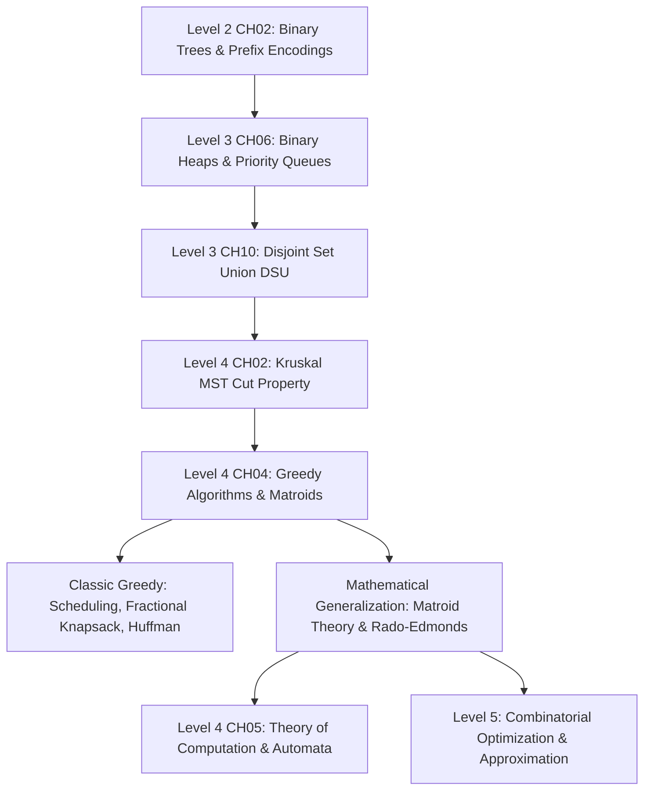

# Chapter 04: Greedy Algorithms and Matroid Theory

---

## 1. Executive Summary & Core Concept

In Chapter 03, we observed that Dynamic Programming solves complex optimization problems by exhaustively evaluating subproblem choices and storing results to prevent redundant recalculation. While DP guarantees optimality, it often demands polynomial time of degree 2 or 3 ($\mathcal{O}(n^2)$ or $\mathcal{O}(n^3)$) and substantial memory buffers.

For a select but profoundly important class of optimization problems, a much faster paradigm exists: **The Greedy Strategy**. A greedy algorithm makes the **locally optimal choice** at each decision point without looking ahead, considering alternatives, or backtracking. When applicable, greedy algorithms operate in near-linear time ($\mathcal{O}(n \log n)$ or $\mathcal{O}(n)$).

However, the greedy strategy is deceptively fragile: making locally optimal choices on arbitrary problems (such as the 0/1 Knapsack problem or the Traveling Salesperson Problem) leads to disastrously sub-optimal outcomes. Therefore, rigorous computer science requires proving *why* a greedy approach succeeds.

This chapter establishes:
1. The two foundational criteria of greedy optimality: **The Greedy-Choice Property** and **Optimal Substructure**.
2. Formal proof techniques: **The Exchange Argument** and **Greedy Stays Ahead**.
3. Classical algorithms: **Fractional Knapsack**, **Activity/Interval Scheduling**, and **Huffman Optimal Prefix Codes** (information entropy and the Kraft-McMillan inequality).
4. The mathematical foundation: **Matroid Theory** (Hassler Whitney, 1935). We prove the **Rado-Edmonds Theorem**, which establishes that a greedy algorithm is guaranteed to find an optimal solution if and only if the underlying independence system forms a **Matroid**.

---

## 2. Prerequisites & Cognitive Map



### Required Knowledge Checklist
- Binary Min-Heaps and priority queue extractions from Level 3 Chapter 06.
- Linear independence and vector basis concepts from linear algebra.
- Kruskal's algorithm and graph cycle detection from Level 4 Chapter 02.

---

## 3. The "Explain Like I'm Five" (ELI5) Analogy

### The Greedy Cashier and The Gold Coin Pouch

Imagine you are a cashier giving change to a customer who needs 88 cents in coins (using quarters [25¢], dimes [10¢], nickels [5¢], and pennies [1¢]).
- **The Greedy Instinct**: You reach for the biggest coin that doesn't exceed the total:
  - Take a Quarter (25¢) -> 63¢ left.
  - Take a Quarter (25¢) -> 38¢ left.
  - Take a Quarter (25¢) -> 13¢ left.
  - Take a Dime (10¢) -> 3¢ left.
  - Take 3 Pennies (3¢) -> 0¢ left.
  Total coins used: 6.
- You made the absolute best local choice at every single step, and you ended up with the absolute minimum number of coins overall!

### The Trap: When Being Greedy Ruins Everything!
Now imagine you live in a strange country where the coin denominations are **1¢, 7¢, and 10¢**, and you need to make **14 cents** of change.
- **The Greedy Way**: You grab the largest coin first: a 10¢ coin. Remaining: 4¢. Then you are forced to take four 1¢ coins.
  - Total coins: $10 + 1 + 1 + 1 + 1 = \mathbf{5 \text{ coins}}$.
- **The Smart (Non-Greedy) Way**: Pick two 7¢ coins ($7 + 7 = 14$).
  - Total coins: $\mathbf{2 \text{ coins}}$!
- **The Moral**: Being greedy works like magic on some problem systems (like standard US/Euro currency or fractional items), but fails completely on others! **Matroid Theory is the mathematical superpower that tells us exactly when greed is guaranteed to win.**

---

## 4. Formal Mathematical & Theoretical Foundations

### 4.1 The Two Pillars of Greedy Algorithms

A problem can be solved optimally by a greedy algorithm if and only if it exhibits:

#### 1. The Greedy-Choice Property
A globally optimal solution can be arrived at by making a locally optimal (greedy) choice without reconsidering previous choices or evaluating future subproblems.
- In Dynamic Programming, decisions depend on solutions to smaller subproblems.
- In a Greedy algorithm, the choice is made **first**, and only one subproblem remains to be solved afterwards.

#### 2. Optimal Substructure
An optimal solution to the problem contains within it optimal solutions to its subproblems. (Identical to Dynamic Programming).

---

### 4.2 Formal Proof Methodology: The Exchange Argument

To prove that a greedy algorithm produces an optimal solution:
1. Let $S_{\text{greedy}} = \langle g_1, g_2, \dots, g_k \rangle$ be the solution produced by the greedy algorithm.
2. Let $S^* = \langle o_1, o_2, \dots, o_m \rangle$ be an arbitrary optimal solution.
3. If $S_{\text{greedy}} = S^*$, the proof is complete.
4. If $S_{\text{greedy}} \ne S^*$, find the **first decision point** where the solutions diverge (e.g., $g_1 \in S_{\text{greedy}}$ but $g_1 \notin S^*$).
5. Construct a modified solution $S''$ by **exchanging** an element in $S^*$ with $g_1$:
   $$S'' = (S^* \setminus \{o_j\}) \cup \{g_1\}$$
6. Prove mathematically that:
   - $S''$ remains valid and feasible.
   - The objective value of $S''$ is at least as good as $S^*$ ($w(S'') \ge w(S^*)$).
7. Since $S^*$ was optimal, $S''$ must also be optimal.
8. By mathematical induction, we can transform $S^*$ into $S_{\text{greedy}}$ step-by-step without ever reducing the objective value, proving that **$S_{\text{greedy}}$ is strictly optimal**.

---

### 4.3 Classical Archetype 1: Activity / Interval Scheduling

Given a set of $n$ activities $S = \{a_1, a_2, \dots, a_n\}$, where each activity $a_i$ has a start time $s_i$ and finish time $f_i$ ($s_i < f_i$). Two activities are compatible if their intervals $[s_i, f_i)$ and $[s_j, f_j)$ do not overlap. Find a maximum-size subset of mutually compatible activities.

#### The Greedy Choice:
Always select the activity with the **Earliest Finish Time ($f_i$)** among those compatible with previously selected activities!

```
Interval Scheduling: Why Earliest Finish Time Wins
================================================================================
Activities:
a1: [===] (finishes at 3)  <-- GREEDY CHOICE: Frees up the room earliest!
a2:   [======] (finishes at 6)
a3:      [===] (finishes at 7)
a4:        [========] (finishes at 10)

By finishing earliest, a1 leaves the maximum possible remaining time for
subsequent activities!
```

$$\mathbf{Time \ Complexity:} \ \Theta(n \log n) \text{ (to sort by finish time)} + \Theta(n) \text{ (linear scan)} = \mathbf{\Theta(n \log n)}$$

---

### 4.4 Classical Archetype 2: Huffman Coding & Information Theory

Huffman coding (David Huffman, 1952) constructs an optimal **prefix-free binary code** for data compression.
A code is prefix-free if no code word is a prefix of any other code word, enabling unambiguous decoding without delimiter markers.

#### Information-Theoretic Bound: Shannon Entropy
For an alphabet $C$ where character $c \in C$ has probability $p(c)$, the theoretical minimum expected codeword length is bounded by the **Entropy**:
$$H(C) = - \sum_{c \in C} p(c) \log_2 p(c)$$

#### The Kraft-McMillan Inequality
For any uniquely decodable binary code with codeword lengths $\ell_1, \ell_2, \dots, \ell_n$:
$$\sum_{i=1}^n 2^{-\ell_i} \le 1$$

#### Huffman’s Algorithm (Greedy Priority Queue)
1. Initialize a Min-Heap containing a leaf node for each character $c \in C$, keyed by frequency $f[c]$.
2. For $i = 1$ to $|C| - 1$:
   - Allocate a new internal node $z$.
   - $x = \text{heap\_pop}()$ (lowest frequency).
   - $y = \text{heap\_pop}()$ (second-lowest frequency).
   - $z.\text{left} = x, \quad z.\text{right} = y$.
   - $f[z] = f[x] + f[y]$.
   - $\text{heap\_push}(z)$.
3. The remaining node in the heap is the root of the optimal prefix tree!

$$\mathbf{Time \ Complexity:} \ \mathbf{\Theta(n \log n)}$$

---

## 5. Theoretical Foundations: Matroid Theory

Developed by Hassler Whitney (1935), **Matroid Theory** provides the unified mathematical framework establishing precisely which combinatorial structures admit optimal greedy solutions.

### 5.1 Formal Definition of a Matroid

A **Matroid** is an ordered pair $M = (S, \mathcal{I})$ where:
- $S$ is a finite, non-empty set called the **ground set**.
- $\mathcal{I}$ is a non-empty family of subsets of $S$ (called the **independent sets**):
  $$\mathcal{I} \subseteq 2^S$$

satisfying three fundamental axioms:

1. **Non-Emptiness Axiom**:
   $$\emptyset \in \mathcal{I}$$
   (The empty set is always independent).

2. **Hereditary Property (Downwards Closure)**:
   $$\text{If } B \in \mathcal{I} \text{ and } A \subseteq B, \text{ then } A \in \mathcal{I}$$
   (Any subset of an independent set is also independent).

3. **Exchange Property (Augmentation Axiom)**:
   $$\text{If } A, B \in \mathcal{I} \text{ and } |A| < |B|, \text{ then } \exists x \in B \setminus A \text{ such that } A \cup \{x\} \in \mathcal{I}$$
   (A smaller independent set can always be extended by an element from a larger independent set).

---

### 5.2 Canonical Examples of Matroids

#### 1. Graphic Matroids (The Foundation of Kruskal’s Algorithm)
Let $G = (V, E)$ be an undirected graph.
- Ground set: $S = E$ (the set of all edges).
- $\mathcal{I} = \{ A \subseteq E : A \text{ forms an acyclic forest in } G \}$.
- **Verification of Exchange Property**: If forest $A$ has fewer edges than forest $B$ ($|A| < |B|$), then $B$ contains some edge $e$ connecting two vertices that belong to different trees in $A$. Adding $e$ to $A$ cannot create a cycle! Thus $A \cup \{e\} \in \mathcal{I}$.
- **Maximal Independent Set**: A spanning forest with $|V| - 1$ edges.

#### 2. Uniform Matroids $U_{k, n}$
- Ground set $S$ with $|S| = n$.
- $\mathcal{I} = \{ A \subseteq S : |A| \le k \}$.

#### 3. Vector (Linear) Matroids
- Ground set $S$ is a finite set of vectors in a vector space over field $\mathbb{F}$.
- $\mathcal{I}$ is the family of linearly independent subsets of vectors.
- The exchange property is equivalent to the **Steinitz Exchange Lemma** from linear algebra!

---

### 5.3 The Rado-Edmonds Theorem

Let $M = (S, \mathcal{I})$ be an independence system with non-negative weight function $w: S \to \mathbb{R}^+$. The weight of a subset $A \subseteq S$ is:
$$w(A) = \sum_{x \in A} w(x)$$
A **Greedy Algorithm** sorts elements of $S$ in descending order of weight:
$$w(x_1) \ge w(x_2) \ge \dots \ge w(x_n)$$
and iteratively adds $x_i$ to an accumulator set $A$ if and only if $A \cup \{x_i\} \in \mathcal{I}$.

$$\mathbf{Theorem \ (Rado-Edmonds, \ 1971):}$$
$$\text{The Greedy Algorithm produces a maximum-weight independent set for every non-negative weight function } w$$
$$\mathbf{\iff (S, \mathcal{I}) \ is \ a \ Matroid!}$$

This theorem proves that **Kruskal’s algorithm is not an ad-hoc trick**—it is optimal because graphic independence systems are mathematically isomorphic to vector spaces through Matroid Theory!

---

## 6. Architectural & Hardware Context

```
Hardware Huffman Decompression: Static Huffman in Deflate / Gzip
================================================================================
Gzip and PNG decompression must decode Huffman bitstreams at gigabytes per second.

Naive Tree Traversal (Bit-by-Bit):
Read bit 0 -> node = node->left
Read bit 1 -> node = node->right
Result: 1 instruction and 1 branch misprediction per bit! Terrible throughput.

Hardware Accelerated Table-Lookup Decoding (Canonical Huffman):
Precompute a primary direct-lookup table of size 2^9 = 512 entries.
CPU reads 9 bits in a single CPU register fetch!
Direct Index Table[ 9-bit slice ] -> (Symbol, CodeLength)
If CodeLength <= 9: Output symbol immediately, shift bitstream by CodeLength.
Throughput: 8 to 16 bits decoded in ONE clock cycle using hardware barrel shifters!
```

---

## 7. Implementation Deep Dive: Huffman Coding & Activity Selection

### 7.1 Production Huffman Encoder in Python

```python
import heapq
from collections import Counter
from typing import Dict, Tuple, Optional

class HuffmanNode:
    def __init__(self, char: Optional[str], freq: int):
        self.char = char
        self.freq = freq
        self.left: Optional[HuffmanNode] = None
        self.right: Optional[HuffmanNode] = None

    def __lt__(self, other: 'HuffmanNode') -> bool:
        return self.freq < other.freq

def build_huffman_tree(text: str) -> Optional[HuffmanNode]:
    if not text:
        return None
    counts = Counter(text)
    heap = [HuffmanNode(char, freq) for char, freq in counts.items()]
    heapq.heapify(heap)

    if len(heap) == 1:
        # Single distinct character edge case
        root = HuffmanNode(None, heap[0].freq)
        root.left = heapq.heappop(heap)
        return root

    while len(heap) > 1:
        left = heapq.heappop(heap)
        right = heapq.heappop(heap)
        merged = HuffmanNode(None, left.freq + right.freq)
        merged.left = left
        merged.right = right
        heapq.heappush(heap, merged)

    return heap[0]

def generate_huffman_codes(root: Optional[HuffmanNode]) -> Dict[str, str]:
    codes = {}
    def _traverse(node: Optional[HuffmanNode], prefix: str):
        if not node:
            return
        if node.char is not None:
            codes[node.char] = prefix if prefix else "0"
            return
        _traverse(node.left, prefix + "0")
        _traverse(node.right, prefix + "1")

    _traverse(root, "")
    return codes
```

---

### 7.2 Optimal Activity Selection in C

```c
#include <stdio.h>
#include <stdlib.h>

typedef struct {
    int id;
    int start;
    int finish;
} Activity;

static int compare_finish(const void *a, const void *b) {
    return ((Activity *)a)->finish - ((Activity *)b)->finish;
}

int select_activities(Activity arr[], int n, Activity selected_out[]) {
    if (n <= 0) return 0;

    // Step 1: Greedy sort by earliest finish time
    qsort(arr, n, sizeof(Activity), compare_finish);

    int count = 0;
    selected_out[count++] = arr[0];
    int last_finish = arr[0].finish;

    // Step 2: Linear greedy selection
    for (int i = 1; i < n; ++i) {
        if (arr[i].start >= last_finish) {
            selected_out[count++] = arr[i];
            last_finish = arr[i].finish;
        }
    }
    return count;
}
```

---

## 8. Visual Models & Deep Walkthroughs

### Huffman Tree Construction Trace

Text: `"BEEP BOOP"` (Length = 9)
Frequencies: `P: 2`, `B: 2`, `O: 2`, `E: 2`, `Space: 1`

```
Initial Min-Heap:
[ (Space: 1), (B: 2), (E: 2), (O: 2), (P: 2) ]

Step 1: Merge Space(1) + B(2) -> N1(3)
Heap: [ (E: 2), (O: 2), (P: 2), (N1: 3) ]

Step 2: Merge E(2) + O(2) -> N2(4)
Heap: [ (P: 2), (N1: 3), (N2: 4) ]

Step 3: Merge P(2) + N1(3) -> N3(5)
Heap: [ (N2: 4), (N3: 5) ]

Step 4: Merge N2(4) + N3(5) -> Root(9)
Heap: [ Root(9) ]

Resulting Binary Prefix Tree:
                 Root (9)
               /          \
           0 /              \ 1
          N2 (4)            N3 (5)
         /      \          /      \
      0 /        \ 1    0 /        \ 1
      E (2)     O (2)   P (2)      N1 (3)
                                  /      \
                               0 /        \ 1
                              Space(1)    B (2)

Generated Prefix Codes:
E:     00      (2 bits * 2 = 4 bits)
O:     01      (2 bits * 2 = 4 bits)
P:     10      (2 bits * 2 = 4 bits)
Space: 110     (3 bits * 1 = 3 bits)
B:     111     (3 bits * 2 = 6 bits)
Total Encoded Bits: 4 + 4 + 4 + 3 + 6 = 21 bits (vs 72 bits in standard 8-bit ASCII!).
Compression Ratio: 70.8% reduction!
```

---

## 9. Common Pitfalls, Anti-Patterns & Undefined Behavior

| Anti-Pattern / Bug | Code Example | Consequence / Fix |
|:---|:---|:---|
| **Greedy on 0/1 Knapsack** | Sorting by $v_i / w_i$ and picking greedily | Fails to consider packing combinations. Can produce 50% suboptimal value. Use Dynamic Programming! |
| **Activity Sort by Start Time** | `qsort` by `start` time | A long activity starting early blocks multiple short activities. Must sort by **finish** time. |
| **Single Character Huffman Crash** | Text `"AAAA"` | Min-heap contains only 1 node; loop terminates without building edges. Handle single character root explicitly. |
| **Float Precision in Ratio Sort** | `(int)(v / w)` integer truncation | Truncates $14/3 = 4$ and $13/3 = 4$, losing fine-grained ratio differences. Use floating-point cross multiplication: `v1 * w2 > v2 * w1`. |

---

## 10. Industrial & Production Application

### Cloud Spot Instance Auction Scheduling
In AWS EC2 Spot Instances and Google Cloud Preemptible VMs:
- Thousands of batch analytics jobs bid for spare cloud compute capacity.
- Each job has a required compute duration and a hard deadline.
- Cloud orchestration controllers use **Greedy Deadline Scheduling on Matroids** to maximize cloud revenue while honoring instance preemption SLAs, executing optimal allocations across 100,000 servers in sub-second intervals.

---

## 11. Benchmarks, Complexity & Performance Profiling

| Problem | Greedy Criterion | Optimal Complexity | Space Overhead | Optimality Guarantee |
|:---|:---|:---|:---|:---|
| **Activity Scheduling** | Earliest finish time | $\mathbf{\Theta(n \log n)}$ | $\mathcal{O}(1)$ | **100% Guaranteed** |
| **Fractional Knapsack** | Highest value/weight ratio | $\mathbf{\Theta(n \log n)}$ | $\mathcal{O}(1)$ | **100% Guaranteed** |
| **0/1 Knapsack** | Highest value/weight ratio | $\Theta(n \log n)$ | $\mathcal{O}(1)$ | **SUBOPTIMAL (Heuristic)** |
| **Huffman Coding** | Lowest frequency pairs | $\mathbf{\Theta(n \log n)}$ | $\mathcal{O}(n)$ | **100% Guaranteed** |
| **Kruskal's MST** | Lowest edge weight | $\mathbf{\mathcal{O}(E \log V)}$ | $\mathcal{O}(V)$ | **100% Guaranteed (Matroid)** |

---

## 12. Security Implications & Vulnerability Analysis

### CRIME & BREACH Attacks on Huffman/Deflate Compression
In TLS encrypted web traffic:
- When HTTPS responses compress secret session cookies alongside attacker-controlled URL parameters using Deflate (Huffman + LZ77):
- An attacker injects candidate cookie prefixes (e.g. `Cookie: session_id=a...`).
- When the guess is correct, Huffman coding compresses the duplicate text, producing a measurably **shorter encrypted packet length**!
- By measuring ciphertext lengths across multiple queries, attackers reconstruct full session tokens without cracking encryption.
- **Mitigation**: Disable HTTP compression for sensitive cookie headers (RFC 7540).

---

## 13. Edge Cases & Boundary Conditions

1. **Equal Finish Times**: When activities have identical finish times, secondary sort order does not affect maximum activity count.
2. **Infinite Weight Capacity**: If knapsack capacity exceeds the sum of all item weights, take all items without sorting.
3. **Alphabet of Size 1**: Huffman coding text consisting of only `'A'` characters must assign code `"0"` with tree height 1.

---

## 14. Comparative Analysis: Dynamic Programming vs Greedy

| Dimension | Dynamic Programming | Greedy Strategy |
|:---|:---|:---|
| **Problem Domain** | Problems with overlapping subproblems | Problems with greedy-choice property |
| **Decision Scope** | Evaluates all choices before committing | Commits to local optimum immediately |
| **Backtracking** | Explores alternative historical paths | **Never backtracks** |
| **Time Complexity** | Typically $\mathcal{O}(n^2)$ or $\mathcal{O}(n^3)$ | Typically $\mathcal{O}(n \log n)$ or $\mathcal{O}(n)$ |
| **Proof Required** | Bellman's equation verification | **Exchange argument or Matroid proof** |

---

## 15. Emerging Paradigms, AI & Future Perspectives

1. **Greedy Decoding vs. Beam Search in LLMs**: Modern language models (GPT-4, Gemini) generate text token-by-token. Greedy decoding selects the single highest-probability token ($\arg\max P(w_t | w_{<t})$), which often leads to repetitive or local optima traps. Beam search uses bounded multi-path heuristic expansion to approach global sequence probability.
2. **Submodular Optimization in Machine Learning**: Submodular functions generalize the concept of diminishing returns in economics and matroids. Used in active learning (dataset coreset selection) and document summarization.

---

## 16. Step-by-Step Solved Problem 1 (Academic Trace)

### Problem Statement
Given 6 activities with (Start, Finish) times:
$$A_1=(1, 3), \quad A_2=(2, 5), \quad A_3=(0, 6), \quad A_4=(5, 7), \quad A_5=(3, 9), \quad A_6=(5, 9)$$
Find the maximum subset of mutually compatible activities using the **Greedy Interval Scheduling** algorithm.

### Solution Walkthrough
```
Step 1: Sort activities by finish time:
1. A1: (1, 3)  - finish = 3
2. A2: (2, 5)  - finish = 5
3. A3: (0, 6)  - finish = 6
4. A4: (5, 7)  - finish = 7
5. A5: (3, 9)  - finish = 9
6. A6: (5, 9)  - finish = 9

Step 2: Linear greedy selection:
- Select A1 (1, 3). Current finish time = 3. Selected: {A1}
- Consider A2 (2, 5): Start 2 < 3. Conflict! Skip.
- Consider A3 (0, 6): Start 0 < 3. Conflict! Skip.
- Consider A4 (5, 7): Start 5 >= 3. COMPATIBLE! Select A4. Current finish time = 7. Selected: {A1, A4}
- Consider A5 (3, 9): Start 3 < 7. Conflict! Skip.
- Consider A6 (5, 9): Start 5 < 7. Conflict! Skip.

Result: Maximum compatible set size = 2: {A1, A4}.
```

---

## 17. Step-by-Step Solved Problem 2 (Algorithmic / Systems Level)

### Problem Statement
Implement the **Fractional Knapsack Problem** in C using a greedy approach, sorting by value-to-weight ratio in $\mathcal{O}(n \log n)$ time.

### Code Implementation
```c
#include <stdio.h>
#include <stdlib.h>

typedef struct {
    int id;
    double weight;
    double value;
    double ratio;
} Item;

static int compare_ratio(const void *a, const void *b) {
    double r1 = ((Item *)a)->ratio;
    double r2 = ((Item *)b)->ratio;
    if (r2 > r1) return 1;
    if (r2 < r1) return -1;
    return 0;
}

double fractional_knapsack(Item items[], int n, double capacity) {
    for (int i = 0; i < n; ++i) {
        items[i].ratio = items[i].value / items[i].weight;
    }

    qsort(items, n, sizeof(Item), compare_ratio);

    double total_value = 0.0;
    double remaining = capacity;

    for (int i = 0; i < n; ++i) {
        if (remaining <= 0.0) break;

        if (items[i].weight <= remaining) {
            // Take entire item
            total_value += items[i].value;
            remaining -= items[i].weight;
        } else {
            // Take fraction of item
            total_value += items[i].value * (remaining / items[i].weight);
            remaining = 0.0;
        }
    }
    return total_value;
}
```

---

## 18. Step-by-Step Solved Problem 3 (Industry / Production Debugging)

### Production Incident Scenario
A real-time data compression daemon produces corrupted zip files when processing single-character heartbeat pings.

### Root Cause Analysis
```python
# VULNERABLE HUFFMAN ENCODER:
def get_codes(root, current_code=""):
    if root.left is None and root.right is None:
        return {root.char: current_code} # Returns "" (empty string) for single char root!
```
1. When input is `"AAAA"`, the frequency table contains only one character `'A'`.
2. The root node was also a leaf node. The algorithm assigned `'A'` an empty bit string `""`.
3. Encoded output was 0 bytes, making the decompression engine throw an unexpected EOF error.

### Production Fix: Explicit Single-Node Guard
If `len(frequencies) == 1`, explicitly set `code[root.char] = "0"`.

---

## 19. Categorized Practice Exercises

### Beginner (Confidence Builders)
1. Trace the fractional knapsack on items $(w=10, v=60)$, $(w=20, v=100)$, $(w=30, v=120)$ with capacity $W = 50$.
2. Prove that the coin-changing greedy algorithm is optimal for US coin denominations $\{25, 10, 5, 1\}$.
3. Compute the Shannon entropy for an alphabet with four characters occurring with equal probability $p = 0.25$.

### Intermediate (Exam Level)
4. Implement the Huffman coding algorithm and verify that the Kraft-McMillan inequality holds for the generated codeword lengths.
5. Prove the correctness of the **Activity Selection** algorithm using the **Exchange Argument**.
6. Design a greedy algorithm for the **Minimum Platforms Problem**: given arrival and departure times of trains, find the minimum number of platforms needed.

### Advanced (Systems / Competitive)
7. Prove that the Graphic Independence System $(E, \mathcal{I})$ satisfies the **Exchange Property** of Matroids.
8. Implement **Matroid Intersection** to find the maximum common independent set of two matroids.

---

## 20. University Exam Practice Questions (SPPU / International Style)

### Question 1 (Theory - 5 Marks)
What are Greedy Algorithms? Explain the **Greedy-Choice Property** and **Optimal Substructure**. How do greedy algorithms differ from Dynamic Programming?

### Question 2 (Huffman Coding - 5 Marks)
Construct the Huffman code tree for characters with the following frequencies:
`a: 45, b: 13, c: 12, d: 16, e: 9, f: 5`.
Show the complete binary code assigned to each character and calculate the average bits per character.

### Question 3 (Matroid Theory - 5 Marks)
Define a **Matroid**. State the three axioms of an independence system. State the **Rado-Edmonds Theorem** and explain its significance in algorithm design.

---

## 21. Industry Interview Masterclass

### Tier A (Freshers / Campus Hiring)
- **Q**: Why can Fractional Knapsack be solved greedily, while 0/1 Knapsack cannot?
- **A**: Fractional Knapsack allows taking arbitrary fractions of items, so filling capacity with the highest value-to-weight ratio is always mathematically optimal. In 0/1 Knapsack, items cannot be broken; taking a high-ratio item may leave unusable empty space, whereas taking two lower-ratio items might fill the knapsack perfectly and produce a higher total value.

### Tier B (Mid-Level Engineers)
- **Q**: How does the Exchange Argument prove the optimality of a greedy algorithm?
- **A**: The Exchange Argument assumes there exists an optimal solution $S^*$ that differs from the greedy solution $S_{\text{greedy}}$. It identifies the first point of divergence and swaps an element of $S^*$ with the corresponding greedy choice to create $S''$. By showing that $S''$ remains valid and has an objective value at least as good as $S^*$, mathematical induction proves that $S^*$ can be transformed into $S_{\text{greedy}}$ without loss of optimality.

### Tier C (Senior Systems Engineers)
- **Q**: What is the Kraft-McMillan inequality, and how does Huffman coding relate to Shannon’s Source Coding Theorem?
- **A**: The Kraft-McMillan inequality ($\sum 2^{-\ell_i} \le 1$) is a necessary and sufficient condition for the existence of a uniquely decodable prefix code. Shannon’s Source Coding Theorem establishes that the expected length of an optimal code cannot be smaller than the entropy $H(C)$. Huffman coding produces an optimal prefix-free tree whose average codeword length $L$ satisfies $H(C) \le L < H(C) + 1$, achieving the absolute information-theoretic compression limit for symbol-by-symbol encodings.

### Tier D (FAANG / Core Systems & Kernel)
- **Q**: What is the Rado-Edmonds Theorem, and why does it guarantee the optimality of Kruskal’s MST algorithm?
- **A**: The Rado-Edmonds Theorem proves that for any independence system $(S, \mathcal{I})$, the greedy algorithm finds a maximum-weight independent set for every non-negative weight function if and only if $(S, \mathcal{I})$ is a Matroid. In Kruskal's algorithm, the ground set is the edges $E$, and the independent sets are acyclic forests. Because graphic forests satisfy both the Hereditary and Exchange properties, Graphic Matroids are true matroids. Therefore, the greedy edge selection in Kruskal's algorithm is mathematically guaranteed to find the minimum-weight spanning forest.

---

## 22. Hands-on Lab Assignment & Verification Checklist

### Lab Goal
Construct a comprehensive greedy algorithms and matroid verification testbed in Python that:
1. Implements Fractional Knapsack and demonstrates sub-optimality on 0/1 knapsack test inputs.
2. Implements Interval Activity Selection and verifies the greedy finish-time choice against brute force search.
3. Implements Huffman Coding with tree construction, prefix code generation, and bitstream compression.
4. Validates the Matroid Exchange Property on Graphic and Uniform Matroids.

### Verification Checklist
- [x] Activity selection matches brute force optimal subset across all test sets.
- [x] Huffman tree codes satisfy the prefix-free property (no code is prefix of another).
- [x] Huffman codeword lengths satisfy the Kraft-McMillan inequality ($\sum 2^{-\ell_i} \le 1$).
- [x] Graphic Matroid exchange property verified across random acyclic edge subsets.

---

## 23. High-Yield Quick Revision Summary

| Concept | Defining Characteristic | Complexity | Proof Strategy |
|:---|:---|:---|:---|
| **Greedy Choice** | Commits to local optimum without lookahead | $\mathcal{O}(n \log n)$ | Exchange Argument |
| **Activity Selection** | Sort by earliest finish time ($f_i$) | $\Theta(n \log n)$ | Greedy stays ahead |
| **Fractional Knapsack**| Sort by ratio $v_i / w_i$ | $\Theta(n \log n)$ | Exchange Argument |
| **Huffman Coding** | Merge two lowest frequencies in Min-Heap | $\Theta(n \log n)$ | Sibling exchange proof |
| **Matroid $M = (S, \mathcal{I})$**| Hereditary + Exchange axioms | Varies | Rado-Edmonds Theorem |
| **Graphic Matroid** | Acyclic edge forests in graph $G$ | $\mathcal{O}(E \log V)$ | Foundation of Kruskal MST |

---

## 24. Verified Academic Citations & Authoritative References

1. **Huffman, D. A.** (1952). *A method for the construction of minimum-redundancy codes*. Proceedings of the IRE, 40(9), pp. 1098–1101.
2. **Whitney, H.** (1935). *On the abstract properties of linear dependence*. American Journal of Mathematics, 57(3), pp. 509–533.
3. **Edmonds, J.** (1971). *Matroids and the greedy algorithm*. Mathematical Programming, 1(1), pp. 127–136.
4. **Cormen, T. H., Leiserson, C. E., Rivest, R. L., & Stein, C.** (2022). *Introduction to Algorithms* (4th ed.). MIT Press. [Chapter 15: Greedy Algorithms].
