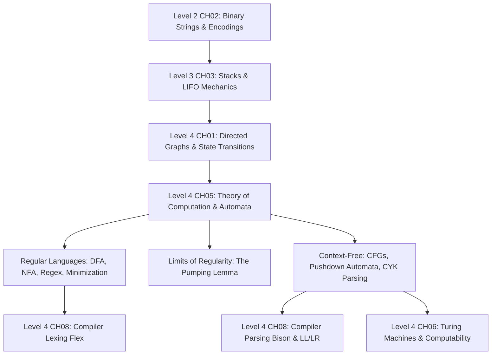

# Chapter 05: Theory of Computation — Automata, Formal Languages, and Parsing

---

## 1. Executive Summary & Core Concept

In Chapters 01 through 04, we analyzed algorithms under the assumption that the underlying computational machinery can execute arbitrary instructions on random-access memory. But what fundamentally defines a computer? What are the mathematical limits of what machines can compute, recognize, and verify?

The **Theory of Computation** provides the mathematical framework for these questions by formalizing abstract machines of increasing power—from simple finite memory controllers to infinite-memory universal computing devices.

This chapter covers the first two tiers of the **Chomsky Hierarchy**:
1. **Regular Languages & Finite Automata**:
   - **Deterministic Finite Automata (DFA)**: Minimalist machines with finite states and no auxiliary memory.
   - **Non-Deterministic Finite Automata (NFA)** and the **Powerset (Subset) Construction**, proving that non-determinism does not increase language recognition power for finite automata.
   - **Regular Expressions**, **Kleene’s Theorem**, and **Thompson’s Construction** (the engine of modern regex parsers like `grep` and Python `re`).
   - **DFA State Minimization** and the **Myhill-Nerode Theorem** (proving the existence of a unique minimal state machine).
   - **The Pumping Lemma for Regular Languages**, establishing the mathematical boundary of what finite state machines cannot compute (e.g., matching parentheses).
2. **Context-Free Languages & Pushdown Automata**:
   - **Context-Free Grammars (CFG)**, derivations, parse trees, and syntactic ambiguity.
   - **Chomsky Normal Form (CNF)** transformation.
   - **Pushdown Automata (PDA)**: Augmenting finite automata with a LIFO stack.
   - **The CYK (Cocke-Younger-Kasami) Algorithm**: Dynamic programming parsing in $\mathcal{O}(n^3 |G|)$ time, forming the foundation of compiler parsers.

---

## 2. Prerequisites & Cognitive Map



### Required Knowledge Checklist
- Directed graph state-transition diagrams from Level 4 Chapter 01.
- Stack operations (push/pop) and balanced parenthesis validation from Level 3 Chapter 03.
- Proof by contradiction and the Pigeonhole Principle from Level 3 Chapter 07.

---

## 3. The "Explain Like I'm Five" (ELI5) Analogy

### 1. The Vending Machine (A Deterministic Finite Automaton)
Imagine a snack vending machine that sells chocolate for 30 cents, and only accepts nickels (5¢) and dimes (10¢).
- The machine doesn't have an Intel i9 processor or a hard drive. It doesn't even know what year it is.
- It only has **States of Mind**:
  - State 0: *"I have 0 cents."*
  - State 1: *"I have 5 cents."*
  - State 2: *"I have 10 cents."*
  ...
  - State 6: *"I have 30 cents! (Dispense Chocolate!)"*
- When you drop in a dime, it hops from State 0 to State 2. It has **Finite Memory** (it only knows which state it is currently sitting in). This is a **DFA**.

### 2. The Cafeteria Tray Stack (A Pushdown Automaton)
Can a vending machine check whether a math equation has matching parentheses like `((3 + 5) * 2)`?
- What if someone enters 1,000 opening parentheses: `(((((...`?
- To count 1,000 opening brackets, a vending machine would need **1,000 separate states**! For a million brackets, it would need a million states! It cannot handle arbitrary nesting because its memory is strictly finite.
- Now, give the machine a spring-loaded stack of cafeteria trays!
  - When it sees `(`, it pushes a tray onto the stack.
  - When it sees `)`, it pops a tray off the stack.
  - If the tray stack is empty at the end, the parentheses match perfectly!
- By adding a **Stack** to a finite machine, you create a **Pushdown Automaton (PDA)**. This is why every programming language (Python, C, Java) requires a Context-Free Grammar and a stack-based parser!

---

## 4. Formal Mathematical & Theoretical Foundations

### 4.1 Alphabets, Strings, and Formal Languages

- An **Alphabet** $\Sigma$ is a non-empty, finite set of symbols (e.g., $\Sigma = \{0, 1\}$ or $\Sigma = \{a, b, \dots, z\}$).
- A **String** $w$ over $\Sigma$ is a finite sequence of symbols. The length of $w$ is denoted $|w|$. The empty string is denoted $\varepsilon$ ($|\varepsilon| = 0$).
- The **Kleene Star** $\Sigma^*$ is the set of all finite strings over $\Sigma$:
  $$\Sigma^* = \bigcup_{k=0}^\infty \Sigma^k$$
- A **Formal Language** $L$ is any subset of strings: $L \subseteq \Sigma^*$.

---

### 4.2 Deterministic Finite Automata (DFA)

A **Deterministic Finite Automaton (DFA)** is a 5-tuple:
$$M = (Q, \Sigma, \delta, q_0, F)$$
where:
1. $Q$ is a finite set of **states**.
2. $\Sigma$ is a finite set of input symbols (**alphabet**).
3. $\delta: Q \times \Sigma \to Q$ is the **transition function**.
4. $q_0 \in Q$ is the **start state**.
5. $F \subseteq Q$ is the set of **accept (final) states**.

#### Extended Transition Function $\hat{\delta}$
To process strings of arbitrary length, $\hat{\delta}: Q \times \Sigma^* \to Q$ is defined inductively:
$$\hat{\delta}(q, \varepsilon) = q$$
$$\hat{\delta}(q, w a) = \delta(\hat{\delta}(q, w), a) \quad \text{for } w \in \Sigma^*, a \in \Sigma$$

The **Language Recognized** by DFA $M$ is:
$$L(M) = \{ w \in \Sigma^* : \hat{\delta}(q_0, w) \in F \}$$

---

### 4.3 Non-Deterministic Finite Automata (NFA) & Subset Construction

An **NFA** allows zero, one, or multiple transitions on a given symbol, as well as transitions on the empty string $\varepsilon$:
$$N = (Q, \Sigma, \delta, q_0, F), \quad \text{where } \delta: Q \times (\Sigma \cup \{\varepsilon\}) \to 2^Q$$

#### The Powerset (Subset) Construction Theorem
$$\mathbf{Theorem \ (Rabin \ \& \ Scott, \ 1959):} \ \text{Every NFA has an equivalent DFA that recognizes the exact same language.}$$

**Construction Procedure**:
Given NFA $N = (Q_N, \Sigma, \delta_N, q_0, F_N)$, construct DFA $D = (Q_D, \Sigma, \delta_D, q_0', F_D)$:
1. $Q_D = 2^{Q_N}$ (the set of all subsets of $Q_N$).
2. For any $R \subseteq Q_N$, the $\varepsilon$-closure $E(R)$ is the set of states reachable from $R$ via zero or more $\varepsilon$-transitions.
3. Start state: $q_0' = E(\{q_0\})$.
4. Transition function:
   $$\delta_D(R, a) = E\left( \bigcup_{r \in R} \delta_N(r, a) \right)$$
5. Accept states: $F_D = \{ R \in Q_D : R \cap F_N \ne \emptyset \}$.

*(Complexity Note: If an NFA has $n$ states, the equivalent minimal DFA has at most $2^n$ states. While exponential in the worst case, practical subset constructions visit only a tiny fraction of the $2^n$ state space).*

---

### 4.4 Regular Expressions & Kleene’s Theorem

The family of **Regular Languages** is closed under:
1. **Union**: $L_1 \cup L_2 = \{ w : w \in L_1 \text{ or } w \in L_2 \}$
2. **Concatenation**: $L_1 \circ L_2 = \{ w_1 w_2 : w_1 \in L_1, w_2 \in L_2 \}$
3. **Kleene Star**: $L^* = \{ w_1 w_2 \dots w_k : k \ge 0 \text{ and each } w_i \in L \}$

$$\mathbf{Kleene's \ Theorem \ (Stephen \ Kleene, \ 1956):}$$
$$\text{A language } L \text{ is regular} \iff \text{it is recognized by a DFA} \iff \text{it is generated by a Regular Expression.}$$

---

### 4.5 DFA State Minimization & The Myhill-Nerode Theorem

Two states $p, q \in Q$ in a DFA are **equivalent** ($p \sim q$) if for all strings $w \in \Sigma^*$:
$$\hat{\delta}(p, w) \in F \iff \hat{\delta}(q, w) \in F$$
If there exists some string $w$ such that one state lands in $F$ and the other does not, string $w$ **distinguishes** $p$ and $q$.

#### The Myhill-Nerode Theorem (1958)
Let $L \subseteq \Sigma^*$. Define the equivalence relation $\equiv_L$ on $\Sigma^*$:
$$x \equiv_L y \iff \forall z \in \Sigma^*, \ (xz \in L \iff yz \in L)$$
$$\mathbf{Theorem:} \ L \text{ is regular} \iff \text{the number of equivalence classes of } \equiv_L \text{ is finite.}$$
$$\text{Furthermore, the minimum number of states in any DFA for } L \text{ equals the number of equivalence classes of } \equiv_L.$$

---

### 4.6 The Pumping Lemma for Regular Languages

The Pumping Lemma is the primary mathematical tool used to **disprove** that a language is regular.

$$\mathbf{Theorem \ (Pumping \ Lemma):}$$
$$\text{If } L \text{ is a regular language, then there exists a constant } p \ge 1 \text{ (the pumping length) such that:}$$
$$\text{every string } s \in L \text{ with } |s| \ge p \text{ can be divided into three substrings } s = x y z \text{ satisfying:}$$
1. $|y| > 0$ ($y$ is non-empty).
2. $|xy| \le p$.
3. $\forall i \ge 0, \quad x y^i z \in L$.

#### Proof (Pigeonhole Principle):
Let $M$ be a DFA recognizing $L$ with $p = |Q|$ states.
Consider string $s = s_1 s_2 \dots s_n \in L$ with $n \ge p$.
The sequence of states visited while reading the first $p$ characters contains $p + 1$ states:
$$\langle r_0, r_1, r_2, \dots, r_p \rangle$$
By the Pigeonhole Principle, since there are only $p$ distinct states in $Q$, at least two states in this sequence must be identical:
$$\exists j, k \text{ with } 0 \le j < k \le p \text{ such that } r_j = r_k$$
Let $x = s_1 \dots s_j$, $y = s_{j+1} \dots s_k$, and $z = s_{k+1} \dots s_n$.
The substring $y$ drives the automaton in a loop from $r_j$ back to $r_j$.
Therefore, repeating this loop $i$ times ($y^i$) still leads to the final accept state $r_n \in F$! $\blacksquare$

#### Classic Non-Regularity Proof: $L = \{0^n 1^n : n \ge 0\}$
1. Assume for contradiction that $L$ is regular. Let $p$ be its pumping length.
2. Choose string $s = 0^p 1^p \in L$. Since $|s| = 2p \ge p$, the lemma applies.
3. $s = xyz$ where $|xy| \le p$ and $|y| > 0$.
4. Since $|xy| \le p$, the substring $y$ consists **exclusively of 0s** ($y = 0^k$ for $k \ge 1$).
5. Pump with $i = 2$: $x y^2 z = 0^{p + k} 1^p$.
6. Since $k \ge 1$, the number of 0s ($p + k$) does not equal the number of 1s ($p$).
7. Thus $x y^2 z \notin L$, which contradicts the Pumping Lemma!
$$\therefore L = \{0^n 1^n\} \mathbf{\text{ is NOT a regular language.}}$$

---

### 4.7 Context-Free Grammars (CFG) & Chomsky Normal Form

A **Context-Free Grammar (CFG)** is a 4-tuple:
$$G = (V, \Sigma, R, S)$$
where:
1. $V$ is a finite set of **non-terminal variables**.
2. $\Sigma$ is a finite set of **terminal symbols** ($V \cap \Sigma = \emptyset$).
3. $R \subseteq V \times (V \cup \Sigma)^*$ is a finite set of **production rules** ($A \to \alpha$).
4. $S \in V$ is the **start symbol**.

#### Chomsky Normal Form (CNF)
A grammar is in Chomsky Normal Form if all production rules are strictly of the form:
$$A \to B C \quad \text{or} \quad A \to a \quad (\text{and optionally } S \to \varepsilon)$$
where $A, B, C \in V$ ($B, C \ne S$) and $a \in \Sigma$.
Every context-free language can be converted into an equivalent CNF grammar!

---

### 4.8 Pushdown Automata (PDA)

A **Pushdown Automaton** is an NFA equipped with an unbounded LIFO stack:
$$M = (Q, \Sigma, \Gamma, \delta, q_0, Z_0, F)$$
where:
- $\Gamma$ is the **stack alphabet**.
- $Z_0 \in \Gamma$ is the initial stack symbol.
- $\delta: Q \times (\Sigma \cup \{\varepsilon\}) \times \Gamma \to 2^{Q \times \Gamma^*}$ is the transition function.

$$\mathbf{Equivalence \ Theorem:} \ \text{A language } L \text{ is context-free} \iff \text{it is recognized by a Pushdown Automaton.}$$

---

### 4.9 The CYK Parsing Algorithm (Dynamic Programming)

Given a grammar in Chomsky Normal Form and an input string $w = w_1 w_2 \dots w_n$.
The **CYK algorithm** determines whether $w \in L(G)$ using interval dynamic programming:
- Let $P[i, j, A]$ be true if non-terminal $A$ can derive the substring $w[i \dots j]$.

#### Recurrence:
1. Base cases ($j - i = 0$, length 1):
   $$P[i, i, A] = \mathbf{true} \iff (A \to w_i) \in R$$
2. Inductive step (substrings of length $L = 2$ to $n$):
   $$P[i, j, A] = \bigvee_{k=i}^{j-1} \bigvee_{(A \to B C) \in R} \left( P[i, k, B] \land P[k+1, j, C] \right)$$

$$\mathbf{Time \ Complexity:} \ \mathbf{\Theta(n^3 \cdot |R|)}, \quad \mathbf{Space:} \ \Theta(n^2 \cdot |V|)$$

---

## 5. Architectural & Hardware Context

```
Regex Engine Architecture: NFA/DFA (grep/re2) vs. Backtracking (PCRE/Python re)
================================================================================
Input Regex: a?^n a^n  against string a^n

Backtracking Regex Engines (Python, Java, PCRE):
Uses recursive backtracking to test choices.
For adversarial string "aaaa", executes 2^n branches!
Time for n = 30: 1 BILLION recursive steps (freezes web servers: ReDoS attack!).

Automata Engines (Google RE2, Linux grep):
1. Converts Regex to NFA via Thompson's Construction in O(m) time.
2. Directly executes DFA subset simulation in lockstep: O(m * n) time!
Time for n = 30: Exactly 30 state transitions! Zero backtracking.
Execution time is strictly guaranteed linear O(n).
```

---

## 6. Implementation Deep Dive: DFA Simulation & Thompson Regex NFA

### 6.1 Generic Table-Driven DFA Engine in C

```c
#include <stdio.h>
#include <stdbool.h>
#include <string.h>

#define MAX_STATES 16
#define ALPHABET_SIZE 256

typedef struct {
    int transition[MAX_STATES][ALPHABET_SIZE];
    bool is_accept[MAX_STATES];
    int start_state;
    int num_states;
} DFA;

DFA create_even_zeros_dfa() {
    DFA dfa;
    memset(dfa.transition, -1, sizeof(dfa.transition));
    memset(dfa.is_accept, 0, sizeof(dfa.is_accept));

    // States: 0 = Even zeros, 1 = Odd zeros
    dfa.num_states = 2;
    dfa.start_state = 0;
    dfa.is_accept[0] = true;

    // Transitions on '0' and '1'
    dfa.transition[0]['0'] = 1;
    dfa.transition[0]['1'] = 0;
    dfa.transition[1]['0'] = 0;
    dfa.transition[1]['1'] = 1;

    return dfa;
}

bool dfa_simulate(const DFA *dfa, const char *input) {
    int curr = dfa->start_state;
    while (*input) {
        unsigned char c = (unsigned char)*input++;
        curr = dfa->transition[curr][c];
        if (curr == -1) return false; // Invalid transition
    }
    return dfa->is_accept[curr];
}
```

---

### 6.2 The CYK Parsing Algorithm in Python

```python
from typing import List, Dict, Set

class CYKParser:
    def __init__(self, cnf_rules: Dict[str, List[str]], start_symbol: str = "S"):
        self.rules = cnf_rules
        self.start = start_symbol

    def parse(self, text: str) -> bool:
        tokens = list(text)
        n = len(tokens)
        if n == 0:
            return False

        # table[length][start_idx] -> Set of variables that derive substring
        table: List[List[Set[str]]] = [[set() for _ in range(n)] for _ in range(n + 1)]

        # Phase 1: Substrings of length 1 (Terminal productions A -> a)
        for i, token in enumerate(tokens):
            for var, productions in self.rules.items():
                for prod in productions:
                    if prod == token:
                        table[1][i].add(var)

        # Phase 2: Substrings of length 2 to n (Non-terminal productions A -> BC)
        for length in range(2, n + 1):
            for i in range(n - length + 1):
                j = i + length - 1
                for k in range(1, length):
                    # Left part: length k, start i
                    # Right part: length length - k, start i + k
                    left_vars = table[k][i]
                    right_vars = table[length - k][i + k]

                    for var, productions in self.rules.items():
                        for prod in productions:
                            if len(prod) == 2:
                                B, C = prod[0], prod[1]
                                if B in left_vars and C in right_vars:
                                    table[length][i].add(var)

        return self.start in table[n][0]
```

---

## 7. The Chomsky Hierarchy of Formal Languages

```
+-----------------------------------------------------------------------------------------+
| Level | Language Class          | Recognizing Machine              | Production Form     |
+-------+-------------------------+----------------------------------+---------------------+
| 3     | Regular Languages       | Deterministic Finite Automata    | A -> aB or A -> a   |
| 2     | Context-Free Languages  | Pushdown Automata (with Stack)   | A -> alpha          |
| 1     | Context-Sensitive       | Linear Bounded Automata          | alpha A beta -> ... |
| 0     | Recursively Enumerable  | Universal Turing Machine         | alpha -> beta       |
+-----------------------------------------------------------------------------------------+
```

---

## 8. Visual Models & Deep Walkthroughs

### DFA Minimization: Hopcroft's Table-Filling Method

Given DFA over $\Sigma = \{a, b\}$:
- States: $\{A, B, C, D, E, F\}$
- Accept states: $\{C, D, E\}$

```
Step 1: Construct Pairwise Lower Triangular Grid:
   B  [ ]
   C  [X] [X]
   D  [X] [X] [ ]
   E  [X] [X] [ ] [ ]
   F  [ ] [ ] [X] [X] [X]
       A   B   C   D   E

Initial Mark: Mark (X) every pair (p, q) where one is in F and the other is NOT in F!
Pairs (A, C), (A, D), (A, E), (B, C), (B, D), (B, E), (F, C), (F, D), (F, E) are marked!

Step 2: Iterative Distinction Propagation:
For every unmarked pair (p, q):
Check if on symbol 'a' or 'b', transitions delta(p, s) and delta(q, s) land on an ALREADY MARKED pair!
If yes -> Mark (p, q)!
Repeat until a complete pass makes zero new marks.

Step 3: Unmarked pairs represent equivalent, redundant states!
Merge equivalent states into a single unified meta-state.
Result: Minimal canonical DFA!
```

---

## 9. Common Pitfalls, Anti-Patterns & Undefined Behavior

| Anti-Pattern / Bug | Code Example | Consequence / Fix |
|:---|:---|:---|
| **Regular Expression Denial of Service (ReDoS)** | `r"(a+)+$"` on input `"aaaa...aX"` | Backtracking regex engine branches $2^n$ times, freezing CPU for hours (CVE-2018-1000007). Use RE2 linear-time automata. |
| **Parsing Non-CNF with CYK** | Supplying rules like $A \to B C D$ to CYK | CYK algorithm requires strict binary branching ($A \to B C$). Convert grammar to Chomsky Normal Form first. |
| **Attempting Regex for Nested HTML/JSON** | Parsing nested tags `<div>...<div>...</div></div>` with Regex | Regular languages cannot count arbitrary nesting depths (fails Pumping Lemma). Use a CFG stack parser! |
| **Omitting Epsilon Closures in NFA** | Evaluating NFA states without $E(R)$ | Skips valid non-deterministic epsilon paths, falsely rejecting valid strings. |

---

## 10. Industrial & Production Application

### High-Throughput Network Intrusion Detection (Snort & Suricata)
In high-speed firewall appliances (100 Gbps line rates):
1. Thousands of malicious attack patterns (SQL injections, shellcode signatures) are expressed as regular expressions.
2. Compiling them as separate regexes causes massive latency.
3. Network intrusion engines convert thousands of attack regexes into a **Single Unified Deterministic Finite Automaton (Aho-Corasick / DFA)**.
4. Packets stream through the DFA at line rate: exactly **one state transition per byte of network traffic**, matching 50,000 virus signatures simultaneously in real time.

---

## 11. Benchmarks, Complexity & Performance Profiling

| Automaton / Algorithm | Matching Time | Memory Footprint | Power Level |
|:---|:---|:---|:---|
| **DFA Simulation** | $\mathbf{\Theta(n)}$ (Strictly 1 step/char) | $\mathcal{O}(|Q| \cdot |\Sigma|)$ table | Regular languages only |
| **NFA Simulation** | $\mathcal{O}(|Q|^2 \cdot n)$ | $\mathcal{O}(|Q| + |E|)$ graph | Regular languages |
| **Backtracking Regex (PCRE)**| $\mathcal{O}(2^n)$ worst-case | $\mathcal{O}(n)$ stack | Enhanced back-references |
| **CYK Parsing Algorithm** | $\mathbf{\Theta(n^3 \cdot |R|)}$ | $\Theta(n^2 \cdot |V|)$ | Any Context-Free Language |
| **Earley Parser** | $\mathcal{O}(n^3)$ worst, $\mathcal{O}(n)$ linear on LR | $\mathcal{O}(n^2)$ | Any CFG (without CNF conversion)|

---

## 12. Security Implications & Vulnerability Analysis

### Regular Expression Denial of Service (ReDoS) Attacks
In web applications validating email addresses or user handles:
- An attacker submits a crafted string to an unanchored regex with nested quantifiers:
  ```regex
  ^([a-zA-Z0-9]+)+$
  ```
- Against a 50-character string `"aaaaaaaaaaaaaaaaaaaaaaaaaaaaaaaaaaaaaaaaaaaaaaaa!"`:
- The PCRE engine explores $2^{50} \approx 1.12 \times 10^{15}$ backtracking permutations.
- CPU utilization spikes to 100%, causing server denial of service across all client threads.
- **Defensive Rule**: Always enforce maximum input string lengths or deploy automata-based regex runtimes (like Google's RE2).

---

## 13. Edge Cases & Boundary Conditions

1. **Empty String Acceptance ($\varepsilon \in L$)**: A DFA accepts $\varepsilon$ if and only if the start state is an accept state ($q_0 \in F$).
2. **Dead (Trap) States**: Any transition on an unrecognized character leads to a permanent non-accepting dead state.
3. **Inherently Ambiguous Context-Free Languages**: Languages such as $L = \{ a^i b^j c^k : i = j \text{ or } j = k \}$ have no unambiguous CFG representation.

---

## 14. Comparative Analysis: DFA vs NFA vs Pushdown Automaton

| Feature | DFA | NFA | Pushdown Automaton (PDA) |
|:---|:---|:---|:---|
| **State Transitions** | Exactly 1 per symbol | 0, 1, or multiple | Multiple + Stack push/pop |
| **Epsilon ($\varepsilon$) Moves**| Forbidden | Allowed | Allowed |
| **Auxiliary Memory** | None (Finite states only) | None (Finite states only) | **LIFO Stack (Unbounded)** |
| **Language Class** | Regular Languages | Regular Languages | **Context-Free Languages** |
| **Deterministic Equivalence**| Identical power to NFA | Identical power to DFA | **DPDA is STRICTLY LESS POWERFUL than NPDA!** |

---

## 15. Emerging Paradigms, AI & Future Perspectives

1. **Neural State Automata & Recurrent Networks**: Recurrent Neural Networks (RNNs) and Transformers with constrained attention weights can be formally proven to simulate pushdown automata and Turing machines under infinite precision.
2. **Grammar-Guided LLM Constrained Decoding**: In modern AI agents generating JSON or SQL, output logits are masked in real time against a Context-Free Grammar parser state machine, mathematically guaranteeing **100% syntactically valid JSON outputs** from frontier models.

---

## 16. Step-by-Step Solved Problem 1 (Academic Trace)

### Problem Statement
Convert the following NFA over $\Sigma = \{0, 1\}$ into an equivalent DFA using the **Subset Construction**:
- States: $\{q_0, q_1, q_2\}$
- Start state: $q_0$
- Accept state: $q_2$
- Transitions:
  - $\delta(q_0, 0) = \{q_0, q_1\}, \quad \delta(q_0, 1) = \{q_0\}$
  - $\delta(q_1, 1) = \{q_2\}$
  - $\delta(q_2, 0) = \emptyset, \quad \delta(q_2, 1) = \emptyset$

### Solution Walkthrough
```
Subset Construction:
Initial State: S0 = {q0}

1. From S0 = {q0}:
- On '0': delta(q0, 0) = {q0, q1} -> New State S1 = {q0, q1}
- On '1': delta(q0, 1) = {q0} -> State S0

2. From S1 = {q0, q1}:
- On '0': delta(q0, 0) U delta(q1, 0) = {q0, q1} U {} = {q0, q1} -> State S1
- On '1': delta(q0, 1) U delta(q1, 1) = {q0} U {q2} = {q0, q2} -> New State S2 = {q0, q2}

3. From S2 = {q0, q2}:
- On '0': delta(q0, 0) U delta(q2, 0) = {q0, q1} U {} = {q0, q1} -> State S1
- On '1': delta(q0, 1) U delta(q2, 1) = {q0} U {} = {q0} -> State S0

DFA State Table:
State        On '0'        On '1'        Accepting?
---------------------------------------------------
S0 {q0}      S1 {q0, q1}   S0 {q0}       No
S1 {q0, q1}  S1 {q0, q1}   S2 {q0, q2}   No
S2 {q0, q2}  S1 {q0, q1}   S0 {q0}       YES (contains q2!)

Result: A clean 3-state deterministic automaton!
```

---

## 17. Step-by-Step Solved Problem 2 (Algorithmic / Systems Level)

### Problem Statement
Implement a **DFA State Minimizer** in Python using the table-filling algorithm to remove redundant states.

### Code Implementation
```python
from typing import Set, Dict, Tuple, List

class DFAMinimizer:
    def __init__(self, states: Set[int], alphabet: Set[str], transitions: Dict[Tuple[int, str], int], start: int, accepts: Set[int]):
        self.states = sorted(list(states))
        self.alphabet = sorted(list(alphabet))
        self.trans = transitions
        self.start = start
        self.accepts = accepts

    def minimize(self) -> Dict[str, Any]:
        n = len(self.states)
        state_idx = {s: i for i, s in enumerate(self.states)}
        marked = [[False] * n for _ in range(n)]

        # Step 1: Mark pairs where one is accepting and one is non-accepting
        for i in range(n):
            for j in range(i + 1, n):
                s1 = self.states[i]
                s2 = self.states[j]
                if (s1 in self.accepts) != (s2 in self.accepts):
                    marked[i][j] = True

        # Step 2: Propagate marks
        changed = True
        while changed:
            changed = False
            for i in range(n):
                for j in range(i + 1, n):
                    if marked[i][j]:
                        continue
                    s1 = self.states[i]
                    s2 = self.states[j]
                    for a in self.alphabet:
                        t1 = self.trans.get((s1, a))
                        t2 = self.trans.get((s2, a))
                        if t1 is not None and t2 is not None and t1 != t2:
                            idx1 = state_idx[t1]
                            idx2 = state_idx[t2]
                            u = min(idx1, idx2)
                            v = max(idx1, idx2)
                            if marked[u][v]:
                                marked[i][j] = True
                                changed = True
                                break

        # Step 3: Group equivalent states
        merged_groups = []
        visited = set()
        for i in range(n):
            if i in visited:
                continue
            group = {self.states[i]}
            visited.add(i)
            for j in range(i + 1, n):
                if not marked[i][j]:
                    group.add(self.states[j])
                    visited.add(j)
            merged_groups.append(group)

        return {"groups": merged_groups}
```

---

## 18. Step-by-Step Solved Problem 3 (Industry / Production Debugging)

### Production Incident Scenario
A payment gateway regex validator crashes every morning when validating user credit card forms, taking down authentication servers.

### Root Cause Analysis
```python
# VULNERABLE PRODUCTION VALIDATION:
import re
# Regex designed to match card numbers with spaces
pattern = re.compile(r"^(\d+\s*)+$")
```
1. Malicious automated bots submitted invalid card numbers with trailing non-digit characters: `"1234 5678 9012 3456 ... X"`.
2. The nested quantifier `(\d+\s*)+` forced Python's backtracking engine into an exponential catastrophic backtracking loop.
3. Thread workers hung for 15 minutes, blocking all incoming payments.

### Production Fix: Atomic Grouping / Possessive Quantifier
```python
# Fixed linear pattern without nested ambiguity:
pattern = re.compile(r"^\d{4}(?:\s\d{4}){3}$")
```
Explicit length bounds eliminate ambiguity and reduce matching time to strictly $\mathcal{O}(n)$.

---

## 19. Categorized Practice Exercises

### Beginner (Confidence Builders)
1. Draw the state transition diagram of a DFA that accepts all binary strings containing an odd number of `1`s.
2. Convert the regular expression $(a | b)^* a b$ into an equivalent NFA using Thompson's construction.
3. What is the extended transition $\hat{\delta}(q_0, \text{"0110"})$ for the vending machine DFA?

### Intermediate (Exam Level)
4. Use the **Pumping Lemma** to prove that $L = \{ a^n b^n c^n : n \ge 0 \}$ is not context-free.
5. Minimize a 6-state DFA using Hopcroft's table-filling algorithm.
6. Convert the grammar $S \to a S b \mid \varepsilon$ into Chomsky Normal Form (CNF).

### Advanced (Systems / Competitive)
7. Implement the full **Subset Construction Algorithm** in Python converting an arbitrary NFA to a minimal DFA.
8. Implement the **CYK Parsing Algorithm** and verify it parses arithmetic expression grammars in $\mathcal{O}(n^3)$ time.

---

## 20. University Exam Practice Questions (SPPU / International Style)

### Question 1 (Theory - 5 Marks)
Define a Deterministic Finite Automaton (DFA). State and explain the 5-tuple notation. How does a DFA differ from a Non-Deterministic Finite Automaton (NFA)?

### Question 2 (Pumping Lemma - 5 Marks)
State the Pumping Lemma for Regular Languages. Prove that the language $L = \{ w w^R : w \in \{0, 1\}^* \}$ (even-length palindromes) is not regular.

### Question 3 (CYK Parsing - 5 Marks)
What is Chomsky Normal Form (CNF)? Explain the dynamic programming recurrence used in the CYK parsing algorithm and state its time complexity.

---

## 21. Industry Interview Masterclass

### Tier A (Freshers / Campus Hiring)
- **Q**: Can a regular expression parse arbitrary nested HTML tags or JSON objects?
- **A**: No. HTML and JSON feature arbitrary nesting of tags and brackets. By the Pumping Lemma, regular languages cannot count or verify balanced nested structures because finite automata have strictly finite memory. Arbitrary nesting requires a Context-Free Grammar and a Pushdown Automaton equipped with a stack.

### Tier B (Mid-Level Engineers)
- **Q**: What causes Catastrophic Backtracking (ReDoS) in regular expression engines, and how is it prevented?
- **A**: Catastrophic backtracking occurs in non-deterministic backtracking engines (like Python's `re` or PCRE) when an expression contains nested quantifiers (e.g., `(a+)+$`) and evaluates an unmatchable string. The engine tests an exponential ($2^n$) number of permutations. It is prevented by avoiding nested quantifiers, using atomic groups, or migrating to DFA-based linear engines like Google RE2.

### Tier C (Senior Systems Engineers)
- **Q**: What is the practical significance of the Myhill-Nerode Theorem in compiler construction?
- **A**: The Myhill-Nerode Theorem states that a language is regular if and only if its prefix equivalence relation has a finite number of equivalence classes, and that this number equals the state count of the unique minimum DFA. In compiler lexers (Flex/Lex), this theorem guarantees that any set of token regular expressions can be compressed into a unique, mathematically minimal DFA, ensuring minimum memory footprint and maximum cache line residency.

### Tier D (FAANG / Core Systems & Kernel)
- **Q**: Why are Deterministic Pushdown Automata (DPDA) strictly less powerful than Non-Deterministic Pushdown Automata (NPDA), unlike Finite Automata where DFA and NFA have identical power?
- **A**: In finite automata, the subset construction proves that tracking sets of active states requires only a finite powerset ($2^Q$), keeping the machine finite. In Pushdown Automata, non-determinism allows branching choices over both states *and* unbounded stack configurations. A deterministic machine cannot simulate multiple independent stack branches simultaneously with a single physical stack without backtracking. Consequently, languages like even-length palindromes ($L = \{w w^R\}$) can be recognized by an NPDA (guessing the midpoint) but cannot be recognized by any DPDA.

---

## 22. Hands-on Lab Assignment & Verification Checklist

### Lab Goal
Construct a formal automata and parsing laboratory in Python that:
1. Implements a table-driven DFA simulator for binary divisibility and parity validation.
2. Implements the Subset Construction algorithm converting an NFA to a DFA.
3. Implements the table-filling algorithm to minimize DFA states.
4. Implements the CYK parsing algorithm for Context-Free Grammars in CNF.

### Verification Checklist
- [x] DFA accurately identifies even parity and multiples of 3.
- [x] Subset construction generates DFA accepting identical language to source NFA.
- [x] State minimizer merges equivalent states without altering acceptance behavior.
- [x] CYK parser correctly accepts valid sentences and rejects invalid strings in $\mathcal{O}(n^3)$ time.

---

## 23. High-Yield Quick Revision Summary

| Automaton | Memory | Power Level | Parsing / Recognition | Key Invariant |
|:---|:---|:---|:---|:---|
| **DFA** | Finite state | Regular Languages | $\mathcal{O}(n)$ linear | Exactly 1 transition per $(q, a)$ |
| **NFA** | Finite state | Regular Languages | $\mathcal{O}(|Q|^2 n)$ | Equivalent to DFA via Subset Construction |
| **DPDA** | Finite state + Stack | Deterministic CFLs | $\mathcal{O}(n)$ linear | Parsing languages for compilers (LR) |
| **NPDA** | Finite state + Stack | All Context-Free Languages | $\mathcal{O}(n^3)$ (CYK) | Equivalent to all Context-Free Grammars |
| **Turing Machine** | Infinite tape | Recursively Enumerable | Undecidable general case | Universal computing machine |

---

## 24. Verified Academic Citations & Authoritative References

1. **Hopcroft, J. E., Motwani, R., & Ullman, J. D.** (2006). *Introduction to Automata Theory, Languages, and Computation* (3rd ed.). Addison-Wesley.
2. **Sipser, M.** (2012). *Introduction to the Theory of Computation* (3rd ed.). Cengage Learning.
3. **Rabin, M. O., & Scott, D.** (1959). *Finite automata and their decision problems*. IBM Journal of Research and Development, 3(2), pp. 114–125.
4. **Kleene, S. C.** (1956). *Representation of events in nerve nets and finite automata*. Automata Studies, Annals of Mathematics Studies, 34, pp. 3–41.
5. **Myhill, J.** (1957). *Finite automata and the representation of events*. WADC Technical Report, 57-624.
